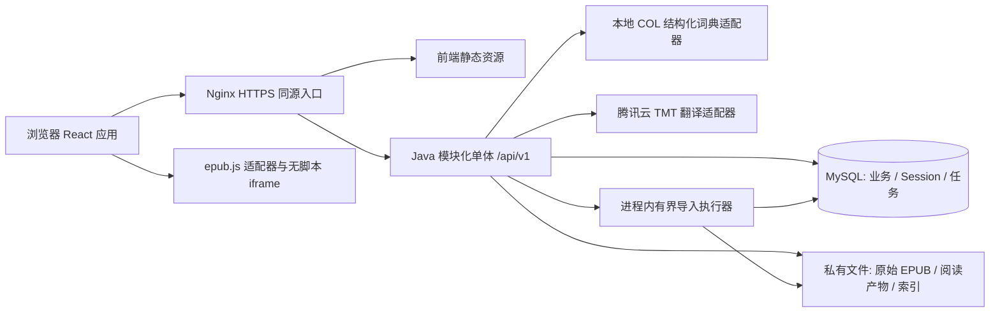
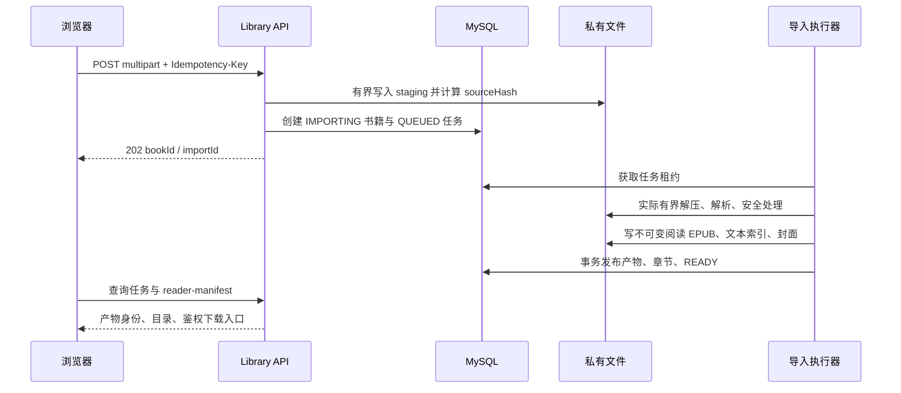
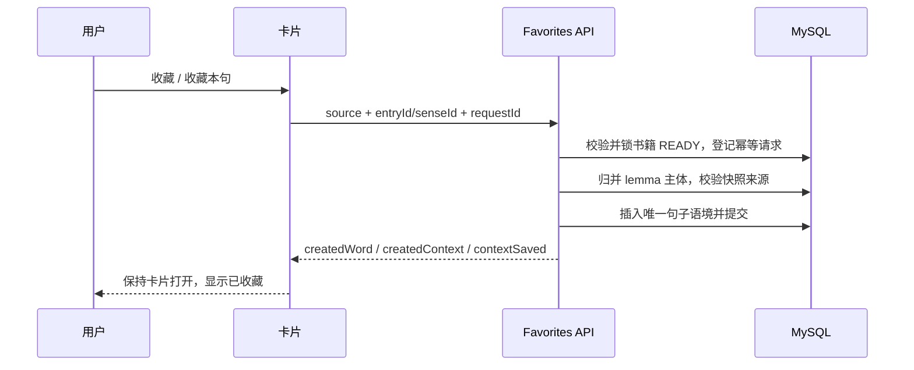
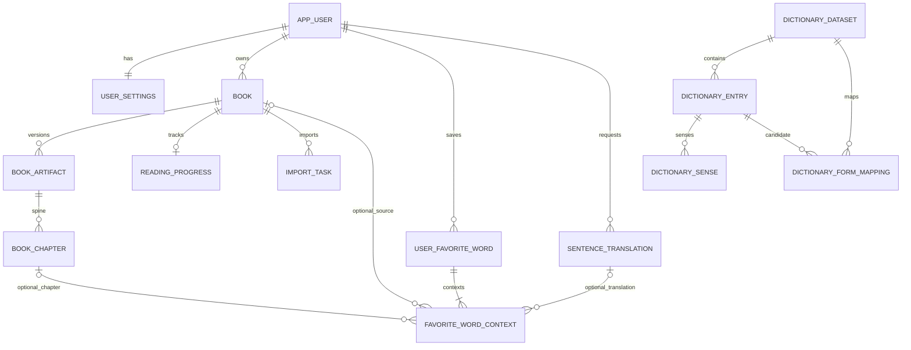

# Readict V1.1 系统技术设计文档

文档版本：0.2（2026-11-19 修订，正式开发设计草案）  
编写日期：2026-11-18  
唯一功能需求基线：[PRD V1.1](../../requirements/prd/PRD-v1.1.md)  
适用仓库：本设计保存在 readict-design；后续正式实现位于独立的 readict-app。  
状态：已完成工程设计修订，尚未实现、未通过生产验收；第 17 章的阻断项未关闭。技术方向采纳记录见 ADR-0001，不代表验证已通过；尚未发布开发交付基线。

### 2026-11-19 修订说明

依据用户实施指令、[CR-0002](../../requirements/changes/CR-0002-密码规则与本地词典及音频阶段安排.md) 与 [ADR-0001](../decisions/ADR-0001-本机环境与本地词典及翻译技术选型.md)：开发和验收统一本机 MySQL；密码调整为数字＋英文字母；本地 COL 为首版词典、腾讯云 TMT 为翻译目标；音频等待后续文件。新增完整[模块化开发计划](../implementation/Readict-V1.1-模块化开发计划.md)。第 2 章 EPUB 历史结果保留原适用边界，修订不代表新实现通过测试。

## 阅读导航

1. [设计目标、范围与术语](#1-设计目标范围与术语)
2. [代码、测试、报告与环境事实](#2-代码测试报告与环境事实)
3. [系统总体架构](#3-系统总体架构)
4. [技术栈及取舍](#4-技术栈及取舍)
5. [前端模块与组件](#5-前端模块与组件)
6. [后端模块与事务边界](#6-后端模块与事务边界)
7. [EPUB 阅读器详细设计](#7-epub-阅读器详细设计)
8. [单词定位与浮动卡片](#8-单词定位与浮动卡片)
9. [词形、词性与词典](#9-词形词性与词典)
10. [主动异步翻译](#10-主动异步翻译)
11. [收藏与原文语境](#11-收藏与原文语境)
12. [用户认证与个人设置](#12-用户认证与个人设置)
13. [数据库与文件模型](#13-数据库与文件模型)
14. [核心 API 契约](#14-核心-api-契约)
15. [安全、性能、兼容性与运维](#15-安全性能兼容性与运维)
16. [异常、并发与数据一致性](#16-异常并发与数据一致性)
17. [测试、验收与未决事项](#17-测试验收与未决事项)
18. [正式开发实施顺序](#18-正式开发实施顺序)

## 1. 设计目标、范围与术语

### 1.1 目标与边界

**【工程设计决策】** 第一版实现“注册／登录 → 导入英文 EPUB → 单页阅读 → 点击查词 → 主动翻译原句 → 收藏单词与原文 → 回看收藏／返回原文”。将原型的交互和实验的技术结果整合成可持久化、具备用户隔离、能够维护的正式系统，优先保证内容定位和数据正确性。

范围包括：常见可重排 EPUB 2／EPUB 3、书架和章节目录、阅读偏好、阅读进度、词形还原和词性优先释义、词典发音、收藏多语境、账号和密码管理。暂不支持 DRM、固定版式、PDF、短语、AI 语义消歧、全文语言分析、离线应用、跨设备实时协作、复习页面／计划／算法／数据表。

UI 视觉继续采用已选定的 Editorial 方向：暖白纸面、克制的深绿强调、Georgia 正文、桌面单页和独立工具栏。设计参考见 [UX 设计规范](../../ux/design-spec.md)，旧 UX 文件中的复习描述不得扩大当前范围。

### 1.2 证据等级与需求差异

| 标记 | 含义 | 使用规则 |
|---|---|---|
| 【已验证事实】 | 仓库代码、测试或报告直接支持的事实 | 附证据；历史测试仅证明对应样本及环境，不代表当前生产实现 |
| 【工程设计决策】 | 本文为正式开发选定的方案 | 尚未实现；需按验收任务证明，不包装为实验结果 |
| 【待验证候选方案】 | 尚缺真实数据、授权、兼容或安全证据的选项 | 不默认上线；列出采用条件和替代路径 |

除第 2 章及明确注明的证据引用外，第 3～18 章的接口、数据库、状态机、预算和运维方案均属于**工程设计决策**。候选实现和供应商另行标记；代码片段是契约说明，不是仓库已有实现。

| PRD 与现状 | 正式设计处理 |
|---|---|
| PRD 默认一个主要释义，其余折叠；用户已确认的原型默认再显示两条 | 保留主要释义 + 两条其他释义的已确认呈现，超过三条折叠；这是一项已登记 UX 差异，依据 [需求索引](../../requirements/README.md)，不回写 PRD 或伪造 CR |
| 底部上一章／下一章的早期视觉稿 | 使用上一页／下一页；跨章节是翻页到边界时的内核行为 |
| “例句”一词可能指词典附加例句 | 卡片只展示真实原文语境，不额外展示供应商示例句；“翻译例句”仅翻译当前原文 |
| 原型只有本地数据，账号未制作 | 正式版按 PRD 增加数据库、认证及用户隔离，不视为原型已经实现 |
| 原型 50 MB 导入提示，实验 25 MiB | 正式版先采用 25 MiB 上传预算，属于可配置工程限制；明确更新正式 UI 提示，不能沿用模拟导入说明 |

### 1.3 关键术语

| 术语 | 定义 |
|---|---|
| sourceHash | 用户原始 EPUB 字节的 SHA-256；不能单独代表处理后 DOM |
| artifactHash | 服务端生成的不可变阅读 EPUB 字节 SHA-256 |
| pipelineVersion | 安全处理、序列化和文本索引规则版本，例如 `epub-safe-v1` |
| artifactId | 阅读产物 UUID；与用户书籍关联，不公开原始存储路径 |
| CFI | EPUB 内容定位表达式；依赖具体内容树，不是稳定页号，也不是安全可信输入 |
| spineHref | 经规范化的 EPUB 包内章节资源路径；区别于章节显示标题和导航节点 ID |
| blockId | 安全产物内确定性文本块标识；只在该产物版本内稳定 |
| lemmaKey | 服务端按确定规则生成的收藏词条键；同一用户不按词性／词义拆分 |
| contextKey | 某书籍来源的某章节某句位置的摘要；不是句子文本摘要或单词 CFI 摘要 |
| 查询会话 | 一次选词及其词典／翻译／收藏界面状态，带单调递增身份 |

## 2. 代码、测试、报告与环境事实

### 2.1 证据地图

以下相对链接指向实际文件。历史证据保留原样；本文不重跑或修改这些实验。

| 编号 | 证据与直接结论 | 边界 |
|---|---|---|
| E01 | [原型 Reader.tsx](../../../prototypes/reader-ui/src/components/Reader.tsx)：CSS 多列分页、逐词 span、章节字符偏移、面板互斥、键盘操作、上一页／下一页 | 是内置文本原型，不是 EPUB 内核，不具有 EPUB CFI |
| E02 | [DictionaryPopover.tsx](../../../prototypes/reader-ui/src/components/DictionaryPopover.tsx)：Floating UI、前三条释义、独立原句、主动翻译、取消请求、三态收藏 | 词典和翻译为 Mock；语音是 speechSynthesis |
| E03 | [services.ts](../../../prototypes/reader-ui/src/lib/services.ts)、[services.test.ts](../../../prototypes/reader-ui/src/lib/services.test.ts)、[store.tsx](../../../prototypes/reader-ui/src/lib/store.tsx)：确定性失败、按 lemma 合并、语境去重、本地存储回退 | Mock 文件导入复用样书；无数据库并发证明 |
| E04 | [Favorites.tsx](../../../prototypes/reader-ui/src/components/Favorites.tsx)、[Bookshelf.tsx](../../../prototypes/reader-ui/src/components/Bookshelf.tsx)、[ReaderPanels.tsx](../../../prototypes/reader-ui/src/components/ReaderPanels.tsx)：收藏双视图、过滤、快照展示、删除书籍保留收藏、偏好 | 原书跳转基于章节字符偏移；不是跨版本恢复 |
| E05 | [UI 验收报告](../../../validation/ui/2026-11-18/report.md)：三个桌面尺寸及 390px、键盘和布局检查 | UI 样书和 Mock 能力不能证明真实 EPUB 或在线服务 |
| E06 | [实验 main.tsx](../../../validation/technical/reader-core/src/main.tsx)：真实 epub.js 分页、目录、relocated、CFI 保存、iframe 事件、销毁路径 | 演示组件耦合较多；没有正式后端和完整无障碍策略 |
| E07 | [实验 core.ts](../../../validation/technical/reader-core/src/core.ts)：坐标取词、TreeWalker、跨 inline Range、句内偏移、CFI、词性启发式 | 有限英文 token 规则；分句局限于最近语义块 |
| E08 | [importBook.ts](../../../validation/technical/reader-core/src/importBook.ts)：JSZip、DOMPurify、安全策略和有限预算 | 不是服务端解析；声明解压大小检查不能阻断全部 ZIP bomb |
| E09 | [core.test.ts](../../../validation/technical/reader-core/tests/core.test.ts)、[reader.spec.ts](../../../validation/technical/reader-core/tests/reader.spec.ts)、[extended.spec.ts](../../../validation/technical/reader-core/tests/extended.spec.ts)、[invariants.spec.ts](../../../validation/technical/reader-core/tests/invariants.spec.ts)：CFI 往返、真实点击、跨 inline、并发、主动翻译和 DOM 变更敏感性 | 用例包含 Mock 网络与真实网络两类，不能混用结论 |
| E10 | [实验报告](../../../validation/technical/reader-core/REPORT.md)、[样书说明](../../../validation/technical/reader-core/SAMPLES.md)、[最终 Chromium 结果](../../../validation/technical/reader-core/evidence/chromium-final-results.json) | 保留失败和外部用户样书边界，不复制下载目录里的 EPUB |
| E11 | [词法诊断](../../../validation/technical/reader-core/evidence/text-analysis.json)、[在线记录](../../../validation/technical/reader-core/evidence/online-ui.json)、[初始在线探测](../../../validation/technical/reader-core/evidence/online-probes.json) | 小语料、特定时点请求；不代表准确率或 SLA |
| E12 | [性能](../../../validation/technical/reader-core/evidence/performance.json)、[跨浏览器](../../../validation/technical/reader-core/evidence/cross-browser.json)、[WebKit 结果](../../../validation/technical/reader-core/evidence/webkit-final-results.json)、[生产依赖审计](../../../validation/technical/reader-core/evidence/production-dependency-audit.json) | 历史本机结果，未解决的风险继续保留 |

### 2.2 可以复用的结论与不能外推的结论

**【已验证事实】** 实验使用 epub.js 0.3.93，`manager: default / flow: paginated / spread: none`。有限 EPUB 2／3 样书中，目录、图片、强调、跨章翻页和 Chromium 刷新恢复可工作。Range CFI 在同一处理内容中经过字号、视口变化仍可解析到测试词。给正文文本节点增加 span 会使旧 CFI 指向发生变化，撤回包装后恢复（E06、E09）。因此复用定位思路，不能直接复用原型的正文包词方式。

**【已验证事实】** 词形词性诊断 12 例中 9 例同时满足预期，失败包括 `leaves/fell`、`better → good`、`doesn’t`；没有可靠置信度。分句称谓修复后的当前诊断为 5/5，只是小样本。原始文本偏移与实际出现位置可以避免 `I saw a saw.` 两次出现被混淆（E07、E11）。

**【已验证事实】** 在线 Free Dictionary API 返回英文释义，不能满足标准中文释义。MyMemory 的历史一次真实请求约 6950ms，另有初始连接失败；主动请求、缓存和 503 隔离主要有 Mock 断言。没有英汉商业供应商凭据、授权、质量和生产 SLA 的验证（E10、E11）。

**【已验证事实】** 本地三次样书导入记录约 136～494ms，翻页观测约 21.2～34.5ms，单次最长主线程任务最高 235ms；不含网络、文件选择和 IDB 写入。最终开发模式一次取词 52.3ms，不是 P95。Chromium 核心流程通过；Windows WebKit 点击失败、恢复超时，Firefox 因进程启动失败未完成。默认 iframe 数量保持 1 不等于无内存泄漏（E10、E12）。

**【已验证事实】** 有限恶意样本的脚本、事件、远程 tracker 被拦截；实验仍存在 ZIP 真实解压预算、资源清单、复杂 CSS/XML/SVG 等未覆盖面。历史生产审计列出 epubjs 及其传递依赖 `@xmldom/xmldom` 的风险，不能把包数当作独立漏洞数，更不能断言可达性已排除（E08、E12）。

### 2.3 当前环境与版本语义

2026-11-18 本机只读核查：Windows 11 amd64；Oracle JDK／javac 21.0.10；Maven 3.9.14；Node 24.14.0；npm 11.9.0；MySQL 客户端 8.0.44，`MySQL80` 服务运行中；Docker 命令存在，但未验证引擎可用、未拉取镜像。未连接业务数据库，未读取凭据，未运行正式后端。

2026-11-19 补充只读核查：JDK、Maven、Node、MySQL 客户端版本与上述一致，MySQL80 运行；Docker Linux 引擎连接失败。仍未验证应用账号鉴权连接、Flyway、Session 和正式业务事务。本机开发库／测试库仅为规划，本次未创建。

前端和实验已有依赖以各自 package-lock 为事实，不因为本文采用目标栈就统一升级。原型组件库、React、TypeScript、Vite、Floating UI 的具体版本见 [原型 package.json](../../../prototypes/reader-ui/package.json) 和 [实验 package.json](../../../validation/technical/reader-core/package.json)。正式工程另行锁定依赖，必须先治理已知风险。

## 3. 系统总体架构

### 3.1 逻辑与部署关系

**【工程设计决策】** 首版为一个 Java 部署单元和一个前端静态站点；数据库与私有文件目录分别承担结构化状态和大文件。Nginx 提供 HTTPS、同源反向代理、请求大小限制。浏览器不持有供应商密钥，也不直连数据库或第三方翻译。



浏览器通过鉴权 API 下载处理后的 EPUB ArrayBuffer，epub.js 创建 blob 资源及同源 sandbox iframe，父页可以读取正文 DOM。原始 EPUB 不作为网页直接打开，文件目录不挂到公共静态路由；书籍资源只能经所有权验证后获取。

### 3.2 安全边界与扩展边界

首版选择同源 DOM 读取，是对已验证取词机制的延续；安全依赖“入库前安全处理 + 渲染前内容校验 + iframe 禁脚本 + CSP + 资源白名单”。`allow-same-origin` 只为 DOM Range 操作保留，绝不增加 `allow-scripts`。同源不是隔离强保证，残余风险及上线门槛见第 15、17 章。

**【待验证候选方案】** 独立阅读域承载可信阅读桥，再在该域内渲染禁脚本的 EPUB iframe，主应用通过严格 `postMessage` 契约接收词语和矩形。其取词、坐标、认证资源传递、焦点和生命周期尚未实现；不能直接将现有 iframe 改成跨域后继续读取 DOM。若同源方案不能通过安全检查，须先完成该验证或暂停上线，不能以“后续增强”为由放行。

首版单实例；可部署在一台机器，但 MySQL 端口和文件目录不暴露公网。无分布式事务。数据库是业务事实来源，本地缓存仅用于短期读取和待同步进度。后续扩展对象存储、多实例或消息队列，必须由实际容量、可用性需求触发，不预先搭建。

## 4. 技术栈及取舍

| 领域 | 本次设计选型 | 理由 | 替代与风险 |
|---|---|---|---|
| 前端 | React + TypeScript + Vite，沿用原型组件体系、Tailwind、shadcn/ui、Lucide | 原型已验证交互与视觉；避免重做 | 原型不直接变成正式工程；升级由锁文件和安全检查决定 |
| 路由／状态 | React Router；组件内状态 + 按业务 Context；轻量 API 客户端 | 现阶段无需引入大型全局状态库 | 服务端缓存需可失效，不将整本书存进 React 状态 |
| 阅读内核 | epub.js，经 ReaderEngine 接口封装 | 实验有真实 CFI、点击和分页证据 | 兼容和依赖风险是上线门槛；Readium 等只在失败门槛触发时比较 |
| 定位 | DOM Range、TreeWalker、CFI、Floating UI 虚拟元素 | 不改正文节点，复用实验 | 不依赖 epub.js 私有 iframe 字段；坐标和 CFI 需包装并测试 |
| 词法 | compromise 启发式 + 明确词形修正规则 + 词典词形数据 | 足够轻量，失败可回退 | 非语义消歧；改用服务端 NLP 要先证明收益和延迟 |
| Java | Java 21 LTS、Maven、Spring Boot 4.1 稳定系列 | 本机已有 JDK 21；官方系统要求支持 | 开工时锁定当时安全补丁版；未运行正式兼容构建 |
| Web／安全 | Spring MVC、Validation、Spring Security、Spring Session JDBC | 传统请求、事务和 Cookie 会话简单可控 | 供应商超时需单独预算，不能占满 Web 线程 |
| 持久化 | Spring JDBC（JdbcClient）、显式 SQL、Flyway | 收藏去重、并发更新和索引行为透明 | 比 ORM 多写映射；MyBatis/JPA 均可行，本版不增加框架 |
| 数据库 | 本机 MySQL80／MySQL 8.0.44、InnoDB、utf8mb4 | 开发、集成测试及阶段验收使用同一本机实例，独立 readict_dev／readict_test | 服务运行不等于账号连接、驱动、迁移、Session、事务已通过；不要求升级或独立实例 |
| 文件 | 私有本地目录，StoragePort 接口 | 单实例运维简单 | 磁盘、备份与 DB 不原子；需清理任务和恢复演练 |
| 后台任务 | MySQL 任务表 + 进程内有界线程池 + 定时恢复 | 无需消息中间件，任务可恢复 | 任务需租约／重试，不能仅依赖内存 Future |
| 测试 | Java 单测、本机 readict_test 集成测试、前端单测、Playwright | 覆盖事务、真实 DOM 与关键流程 | Docker／Testcontainers 不作前置条件；测试禁止连接 readict_dev 或其他项目数据库 |

外部依据核查于 2026-11-18：[Spring Boot 系统要求](https://docs.spring.io/spring-boot/system-requirements.html)支持本机 Java／Maven；[Spring Session JDBC](https://docs.spring.io/spring-session/reference/configuration/jdbc.html)支持用 JDBC 保存会话；[Spring Security CSRF](https://docs.spring.io/spring-security/reference/servlet/exploits/csrf.html)说明状态变更请求的默认防护。2026-11-19 按用户决定改为本机 MySQL80 开发与验收，未来生产环境另行确定。这些官方能力说明不等于项目集成已通过。

## 5. 前端模块与组件

### 5.1 页面与职责

| 模块 | 正式组件边界 | 数据与职责 |
|---|---|---|
| 用户 | AuthPage、AccountSettings | 注册、登录、密码修改、退出；获取当前用户和 CSRF token |
| 书架 | BookshelfPage、BookCard、ImportDialog | 查询书架、导入进度、失败说明、删除确认；不在客户端模拟成功 |
| 阅读 | ReaderLayout、ReadingCanvas、PageNavigation | 加载 ReaderEngine；展示章节页数与真实位置；正文留在 iframe |
| 工具 | ReaderToolbar、ContentsPanel、ReadingSettingsPanel | 目录／设置互斥覆盖，不改变正文宽度；进入收藏前提交待同步位置 |
| 词典 | DictionaryPopover、DictionaryEntry、ContextSentence | 词典与原文独立，三条默认释义、更多折叠，无额外词典例句 |
| 操作 | TranslationSection、FavoriteAction | 独立请求与重试；保存确认后更新收藏状态 |
| 收藏 | FavoritesPage、FavoriteDetail | 单词／句子投影、搜索、来源筛选、时间排序、详情及原书定位 |

正式页面路由：`/login`、`/register`、`/books`、`/reader/:bookId`、`/favorites`、`/settings`；采用浏览器 History 路由，由 Nginx 对前端路由回退 index.html，`/api` 永不回退。原型 HashRouter 属于已实现参考，不约束正式部署。

### 5.2 状态归属与接口

```ts
type ReaderPhase = 'idle'|'loading'|'restoring'|'ready'|'reflowing'|'error'|'disposed';
type AsyncState<T> = {status:'idle'|'loading'|'success'|'empty'|'error'; data?:T; error?:ApiError};
interface ReaderPreferences {
  font: 'Georgia'|'Palatino Linotype'|'Arial'; fontSize:18|20|22|24;
  lineHeight:1.6|1.8|2; width:660|720; theme:'warm'|'white'|'dark';
  pronunciation:'en-GB'|'en-US';
}
interface ReaderEngine {
  open(source:ArrayBuffer, manifest:ReaderManifest):Promise<void>;
  display(anchor:ReadingAnchor):Promise<void>;
  next():Promise<void>; previous():Promise<void>;
  applyPreferences(value:ReaderPreferences):Promise<void>;
  subscribe(listener:(event:ReaderEvent)=>void):()=>void;
  destroy():Promise<void>;
}
```

`ReaderManifest` 来自第 14 章；`ReadingAnchor` 来自第 7 章；`ReaderEvent` 为 `ready / relocated / selection / resized / error` 的带类型联合。引擎引用、DOM Range、iframe、AbortController、观察器放在生命周期对象或 ref，不进持久状态、JSON 或后端 DTO。

服务端状态按用户隔离；退出时清空缓存和打开的书籍。查询会话用递增 `selectionId`；词典与翻译各有状态机、控制器。目录和设置共用单一面板枚举。收藏显示从服务端收藏状态推导，不能从“刚点击过”推导。

本地仅缓存设置副本和待提交进度，键包含用户 ID、schemaVersion、bookId、artifactId；不继承原型的匿名全量 localStorage。浏览器存储不可用时保持当前阅读并提示“记录尚未同步”；数据库失败时不宣称已永久保存。初版不承诺离线阅读或离线收藏。

## 6. 后端模块与事务边界

### 6.1 模块职责

按业务包组织一个 Maven 应用，各模块内分 `api / application / domain / infrastructure`，不为每层建立独立服务。Controller 仅校验传输数据；Application 编排鉴权和事务；Repository 使用参数化 SQL；外部 Provider 和 Storage 经接口调用。

| 模块 | 核心职责 | 事务与外部调用 |
|---|---|---|
| identity | 用户凭证、密码、登录会话、authVersion、偏好 | 密码更新事务；会话注销可重试，版本检查保证立即失效 |
| library | 上传、书架、章节、产物、导入任务、删除 | 发布书籍与章节在短事务；解压、清洗、哈希在事务外 |
| reading | 进度锚点、恢复与乐观并发控制 | 按 bookId 和 expectedVersion 原子更新 |
| lexical | 词形规则、词典 Provider、结构化释义与音频元数据 | 不在 DB 事务中等待词典；授权允许时落缓存 |
| translation | 当前句校验、Provider、配额、翻译缓存 | 外呼在事务外；写缓存和关联已收藏语境是短事务 |
| favorites | lemma 主体、多语境、快照、列表投影 | 保存／取消为事务；通过约束处理重复提交 |
| operations | 导入租约、文件清理、过期缓存、指标 | 定时小批处理；失败保留状态并退避 |

跨模块通过应用服务，不允许 Controller 直接读别的模块内部表。共享类型仅包含用户标识、错误模型、分页和事务基础设施。所有者 ID 从认证主体取得，不接受请求体中的 `userId`。

### 6.2 请求与后台资源预算

首版默认单实例导入并发 1、待处理任务上限 10、用户同时有效导入任务上限 2；超限返回 429，不能无限堆积内存。Web 请求、导入执行器、供应商外呼分别设限。词典总超时 3 秒、翻译 15 秒为初始工程预算，不是供应商 SLA；连接超时 2 秒，不自动重试计费请求。所有预算可配置，经实测调整。

导入任务由数据库状态驱动，执行器定时领取任务并持有 leaseToken、leaseUntil，续约后才能发布。重复领取不会产生第二份可见书籍。进程崩溃后可根据原始文件重新处理；耗尽三次基础设施重试进入失败，格式／安全错误不重试。文件清理任务不与阅读请求竞争无限线程。

## 7. EPUB 阅读器详细设计

### 7.1 导入与不可变产物



输入只接收 `.epub`，扩展名不是格式证明；验证 ZIP 结构、mimetype、container.xml、OPF、spine 和本地资源映射。默认文件 ≤25 MiB、ZIP 条目 ≤2500、实际累计解压 ≤80 MiB、单条目 ≤16 MiB、路径 UTF-8 ≤512 字节、嵌套目录 ≤16 层、导入总时间 ≤60 秒。这些是第一版工程预算；与实验共有的数值不代表 Java 流式实现已经验证。

先以 ZIP 中央目录作快速检查，再以读取流累计真实输出字节，达到预算立即中断；禁止绝对路径、盘符、反斜杠混淆、`..` 越界、重复规范化路径、符号链接、嵌套归档处理；每次解析 URI 后重新校验，不能依赖字符串拼接。XML 禁 DTD、外部实体、外部 schema 和网络访问。拒绝固定版式与 encryption.xml；包含字体混淆的书也暂拒绝，并给出准确原因，不泛称“DRM”。

**【工程设计决策】** 服务端定义 `EpubSanitizer`，在 Java 安全 XML 解析后使用 XHTML/SVG 元素和属性白名单，移除脚本、事件、表单、嵌套框架及远程资源；仅保留指向已验证包内资源的 URI。CSS 必须经过语法解析和属性／值白名单，移除 import、远程 URL、动画和覆盖式定位，不用正则替代完整安全策略。Java XML 安全参数、CSS 解析库和 allowlist 的具体实现是第 17 章安全验证任务，尚不能复用浏览器 DOMPurify 结论为其背书。

正文保留段落、强调、对话、列表、标题、内部链接和受支持图片；HTML 结构修正、隐藏内容处理、文本索引和序列化是同一个版本化流水线。只在最终 DOM 生成时给文本块增加 `data-readict-block` 属性，不再为每词增加节点。产物生成后不可变；阅读端不得重复清洗并改变结构。渲染前若发现产物缺少安全版本、摘要不符或不支持的策略，拒绝打开，不能边读边修补 DOM。

产物包括：阅读 EPUB、spine／目录清单、按章节的块文本索引、经过安全处理的封面。文本索引记录 `blockId, text, utf16Length`，按实际文本节点顺序连接；不先 trim 或压缩空白。`br` 的换行由流水线形成明确文本分隔，浏览器不得另行发明空格。服务端索引与浏览器 DOM 映射一致性是发布门槛。产物不包含可执行脚本；索引是受鉴权私有文件，不是公共全文接口。

发布使用“临时目录完整写入 → 校验摘要 → 同卷原子重命名 → 数据库事务设置 READY”的顺序。DB 提交失败会留下不可见孤儿文件，由清理任务回收；绝不让 READY 指向未完成文件。原始文件在成功后保留供重新处理，删除书籍时一起删除；失败 staging 默认 24 小时内清理。

### 7.2 引擎加载与分页

加载过程：取 manifest／设置／进度 → 验证下载产物 SHA-256 → `ePub(ArrayBuffer, {replacements:'blobUrl'})` → 等待 ready／navigation → `renderTo` 单页配置 → 注册内容钩子 → 应用偏好 → 恢复位置 → 等待稳定 relocated → 进入 ready。EPUB 目录可能不是每个 spine 一项；目录树与 spine 线性顺序分开建模，不能按目录条数计算进度。

按实际容器、字体、字号、行高和出版内容由引擎分页，不保存全书固定页号，不把 PRD 的行长要求实现为硬切字符。默认正文 20px／1.8／660px，宽松 720px；正文左对齐，图片约束到可视区域。弹出词典、目录或设置不调整容器宽度。字号、字体、行距、宽度变更时先捕获内容锚点，关闭查词，进入 reflowing，排版稳定后恢复并重新取位置。

翻页操作串行；一个翻页 Promise 未完成时合并连续按键为有限待执行方向，禁止并发 next/display 改写位置。ready 之外禁用翻页；首尾按钮由 relocated 的边界状态判断。输入框、弹层和段落取词导航获得键盘焦点时，后台左右键不能翻页。iframe 内和父页分别注册受控键盘监听，避免同一事件重复执行。

### 7.3 位置与进度

```ts
interface ReadingAnchor {
  artifactId:string; artifactHash:string; pipelineVersion:string;
  spineHref:string; cfi:string;
  blockId?:string; blockOffset?:number; // UTF-16，collapsed reading anchor
  quote?:{exact:string; prefix:string; suffix:string};
}
interface ReadingProgress {
  bookId:string; anchor:ReadingAnchor; progressRatio:number;
  version:number; updatedAt:string; // 服务端 UTC，不用客户端时钟排先后
}
```

阅读起点使用 collapsed CFI；收藏另存 wordRangeCfi 和 sentenceRangeCfi，不能混用。持久化产物身份 + spineHref + CFI + 短文本引文，页号只作当次排版 UI。进度比例由产物文本索引计算“之前 spine 文本量 + 当前块内偏移”占总文本量的比例，0～1；不是章节等权平均，也不是读过时长。图片页等没有文本位置的章节以 spine 边界估算并标注近似，不把引擎当前页数当全书绝对进度。

以 `relocated` 事件为最新位置来源。实验版本 `currentLocation()` 在过渡阶段可能为空且异步分支有缺陷，适配器不能无条件读取 `.start`（E10）。初次 display、恢复和重排期间禁止把过渡首页写回；只有当前 generation 的稳定事件才生成可保存进度。字体／图片加载可触发多次重排，等待连续两个动画帧几何不变及 150ms 无新 relocated，最长等待 2 秒后以可验证锚点结束；这些是待实测的调度预算。

恢复次序：

1. 产物身份一致时解析 CFI，并验证目标邻近文本或 quote；内容匹配才认为成功。
2. CFI 失败时在同一 spine 的索引内按 exact + prefix/suffix 寻找唯一位置，再构造 Range／CFI。存在多个候选就提示位置无法唯一恢复，不取第一个。
3. 若无唯一匹配，回到对应章节起点并显示提示；该跳转不能自动覆盖旧进度，用户继续翻页后才成为新进度。
4. 产物／流水线版本变化不直接信任旧 CFI。对旧版本保留引用或显式迁移；不得后台覆盖已保存产物。安全版本撤销时可禁读并要求重处理，再按文本验证迁移。

第 2～4 步是本次工程设计，实验保存了 quote，但没有实现并验证完整 fallback。

保存采用尾随 1 秒防抖、阅读中最多每 5 秒提交一次，pagehide 尝试 flush，进入收藏／切书时主动 flush；浏览器退出送达不保证，靠本地待同步记录恢复。请求携带 `expectedVersion` 和稳定 requestId；返回新版本后才标记同步成功。409 时取服务器位置并提示“另一窗口已更新”，停止当前窗口自动覆盖；用户选择继续此处后以新版本显式提交。本标签页请求严格串行，旧响应不能覆盖新本地位置。服务端不使用客户端时间做 last-write-wins。

### 7.4 生命周期与资源释放

每次 open／切书分配 generation；旧加载、词典、翻译和定位异步结果都检查 generation。关闭或切书先禁用操作并取消请求，再注销内容钩子监听、父页监听、ResizeObserver、字体监听及定时器，清空选区和浮层，销毁 rendition／book，并回收由本适配器创建的 Blob URL。只回收自身所有的 URL，不能重复回收仍在用的资源。超时或初始化失败也走同一清理路径。

不能将 iframe 个数作为泄漏验收。第 17 章要求连续打开／关闭书籍的 heap 和 Blob 计数验证；未完成前仅称“有清理设计”。

## 8. 单词定位与浮动卡片

### 8.1 取词和原句的数据契约

```ts
interface SourceContext {
  artifactId:string; spineHref:string; blockId:string;
  sentenceStart:number; sentenceEnd:number; // 块内 UTF-16，[start,end)
  sentence:string; surface:string;
  wordStart:number; wordEnd:number; // 句内 UTF-16，[start,end)
  wordRangeCfi:string; sentenceRangeCfi:string;
  quote:{exact:string; prefix:string; suffix:string};
}
interface WordSelection {
  selectionId:number; generation:number; source:SourceContext;
  range:Range; iframe:HTMLIFrameElement; // 仅浏览器运行时
}
```

在 content hook 中监听点击：先排除链接、表单、脚注导航等交互元素，再使用 `caretPositionFromPoint`，不支持时回退 `caretRangeFromPoint`。必须命中文本节点，并验证鼠标落在 token 的实际 Range 矩形内，空白点击关闭卡片。以最近规范文本块建立 TreeWalker 映射；跨 `strong/em/span` 的词复用多个文本节点组成的 Range，不依赖 textContent 的全局字符串替换。

token 初版使用英文字母，允许词内直／弯撇号和连字符；边界规则按实验保留。`well-known` 作为整体查词，词典无结果时允许原词形回退，不自动发起每段拆分查询；所有格和缩写在词形层处理。中文、数字和纯标点不进入英文词典。句内同词重复出现按实际起止偏移高亮。

以 `Intl.Segmenter('en', {granularity:'sentence'})` 加称谓修正得到候选原句，逐字符保留原文，不 trim 后再复用旧偏移。范围横跨 inline 节点可用；跨独立段落的任意完整句尚未证明。初版将最近规范块作为提取边界，对疑似未完成句显示“原文片段”，保存精确片段和 `contextKind=fragment`，不能声称总能取得完整自然句。扩大语料和必要跨块映射是第 17 章任务。

选词生成 `SourceContext`，前端先显示原句，再查询词典。服务端据 artifact／spine／block 和 start/end 从私有索引重建原句，验证 `sentence.slice(wordStart,wordEnd) === surface`；Java String 和 JS String 均按 UTF-16 偏移，额外禁止切开代理项。正文包含表情、非 BMP 字符的用例必须纳入一致性测试。服务端不信任客户端传来的书名、章节名、lemma 或翻译文本。

### 8.2 定位、显示与交互

父页 Portal 渲染词典卡片，使用 Floating UI virtual element，`getBoundingClientRect()` 每次从当前 Range 的可见 rect 和 iframe rect 重新计算；iframe 缩放比例包含在转换内。多 rect 的词优先选择点击命中的可见 rect；碰撞检查覆盖整个可见目标，不能只检查点击点。初版不对阅读画布施加 CSS transform 缩放，浏览器原生缩放单独验证。

默认宽 390px，最大 `viewportWidth - 32px`，最大高 75vh；优先右侧，其次左侧，最后上／下，保留箭头、16px 视口边距。内容与翻译改变、字体加载、窗口 resize 后执行 update；不能通过压缩正文容器给卡片腾位置。长内容在卡片内部滚动，底部操作保持可达。采用非模态焦点管理，不出现全屏遮罩。

目录／设置打开、翻页、切章、切书、重排时关闭卡片；普通窗口变化可重新定位，Range 失效时关闭。点击另一词直接替换 selectionId，不保留上一词的释义、翻译按钮触发状态或错误。点击正文空白、父页空白、关闭按钮或 Escape 均关闭，iframe 内事件和父页事件分别处理；取消收藏确认框打开时，Escape 优先关闭确认框。

高亮采用浏览器选区或不插入节点的高亮层；选区可能在焦点变化后消失，必须验证并提供父页矩形覆盖层回退。覆盖层 `pointer-events:none`，不改变正文树。键盘以段落为 Tab 入口，进入后左右移动逻辑词索引，Enter 查询；使用 Range 和现有块元素焦点，不给每词加 span／Tab。关闭后恢复到原块或阅读容器，已销毁的 Range 不再聚焦。

### 8.3 独立状态机

| 子状态 | 转移 | 失败与关闭处理 |
|---|---|---|
| 原文 | available／fragment／unavailable | 不依赖词典成功；缺原文时仍允许查词，但不能保存虚构语境 |
| 词典 | idle → loading → success／empty／error | error 可显式重试；empty 不当网络错误；切词和关闭取消 |
| 翻译 | idle → loading → success／error | 只有按钮触发；词典失败不影响翻译；切词清除触发状态 |
| 收藏 | unsaved／wordOnly／contextSaved + saving／error | 确认服务端结果后改变持久状态；错误仍可阅读和翻译 |
| 面板 | none／contents／settings | 互斥；不占正文宽度 |

每个回调检查 `generation + selectionId + signal.aborted`。Abort 只能阻止前端消费，不保证服务器停止外呼或回滚已提交收藏。变更请求成功但响应丢失时按幂等规则查询结果，不通过重复生成请求来推断失败。

## 9. 词形、词性与词典

### 9.1 词形识别与收藏身份

取词后先按句中偏移匹配 compromise 的对应 term，得到 `lemmaCandidate / pos / method`。不按相同单词文本匹配第一项；不生成伪概率。前端结果只是提示，服务器词典适配器和版本化词形规则决定最终 `lemmaKey`。

初版不在 Java 中调用临时 Node 进程执行每次 NLP；前端 compromise 做快速 POS 提示，后端采用版本化不规则词形表、规则词尾处理和供应商词形关联进行验证。词典 lookup 接收原词形和候选原型，先查可信词形映射／Provider 的 headword，再查候选；没有可信归并证据则保留归一化原词。前端 POS 只影响释义排序，服务端不把它当权限或事实依据。

`lemmaKey` 规范化顺序固定为 Unicode NFKC、Locale.ROOT 小写、弯撇号转直撇号、去除词两端非词字符；不删除词内连字符，不做任意截尾。后端基于映射确认 running/runs → run、children → child 等后再生成键。规则版本写入 lookup 结果和收藏快照；无法还原时 `lemmaMethod=surfaceFallback`。复合词、否定缩写和比较级无法证明时宁可保留，不冒称准确。

首次以 fallback 建立的收藏不会因后台规则升级被静默迁移。服务器优先查用户已有、与当前原词形相同的 fallback 项；后续取得可靠映射时，仍向该项追加语境并显示“按原词形保存，原型映射待校正”，不同时为该次请求建立新主体。若既有规范项和 fallback 项同时存在，返回 `LEMMA_MAPPING_CONFLICT`，暂停追加并保留两项原数据，交由明确的数据修复任务处理。第一版不提供批量迁移或用户合并接口，不假装回退项已经完成原型归并；正式规则升级前须识别这类冲突，迁移另行评审并保留最早快照。

### 9.2 词典标准输出

```ts
interface NormalizedDictionaryEntry {
  entryId:string; datasetId:string; datasetVersion:string; provider:string; providerVersion:string;
  lemma:string; lemmaKey:string; lemmaMethod:string;
  originalSurface:string; detectedPos:string; posMethod:string;
  phonetics:{accent:'en-GB'|'en-US'|'unknown'; ipa?:string; audioId?:string|null}[];
  senses:{senseId:string; pos:string; zh:string; providerOrder:number}[];
  attribution:string; cachePolicy:'none'|'memory'|'persistent';
  snapshotAllowed:boolean;
}
```

Provider 原始响应在适配器内部解析并校验，不透传到 UI。POS 映射为 noun／verb／adjective／adverb／pronoun／preposition／conjunction／determiner／interjection／unknown；不同词性标签保留 rawPos 供诊断。按 detectedPos 相同的组稳定前移，组内及其他组仍保持 providerOrder；不推断某条义项一定是当前句义。未知 POS 完全沿用供应商顺序。主要释义和前两条其他释义可选，默认主释义作为首次收藏快照。

标准英汉词典数据必须来自有授权的词典产品。禁止将英文 definition 翻译后标作词典中文释义，禁止用大模型生成基础释义冒充标准来源。无中文词典配置时正式环境返回 `DICTIONARY_NOT_CONFIGURED`，开发演示可独立启用明确标注的 Mock，不能让 Mock 进入正式验收。

**【工程设计决策】** 首版采用本地 COL 数据集，在线词典不作为首版实现任务。COL 技术可读不等于授权已核实；正式持久化、分发和收藏快照使用须核实数据权利。Oxford 等在线服务只保留未来替代候选，不影响当前本地适配开发。数据集导入规则见第 9.4 节。

### 9.3 缓存、发音与降级

首版本地词典由版本化数据库数据集提供，内存缓存只加速读取。缓存键包括 datasetId、datasetVersion、lemmaKey；POS 排序在读出后做，不为每句复制词条。内存最多 5000 项、TTL 最多 24h，切换活动数据集即失效；未命中最多负缓存 5 分钟。数据集本身是持久数据，不是受 TTL 淘汰的在线缓存；导入和快照使用仍受数据授权约束。

音频需求保留，当前状态为“等待用户后续提供文件分析”。已读 COL MDD 只有 result-min.css 和 yd_col.js，没有发现音频；MDX 抽查有 Unicode 音标，不能由此推断口音或录音可用。audioId 可空，当前显示“音频待补充”，本轮不验收真实录音，不阻塞其他模块。来源、编码、文件组织、词条／口音映射、鉴权、播放和缓存方案待文件分析后决定；如将来使用远程资源仍须白名单和防 SSRF。设备朗读不自动代替录音；若后续采用需独立标注，音频失败不清空词条。

### 9.4 COL 离线转换与版本化数据

**【已验证事实】** 2026-11-19 快速检查的 COL MDX 有 121872 个索引项，251 条分散抽查可读取、有中文，代表词包括 book/run/runs/running/children/saw。running 有独立义项，children 的词形说明存在缺字，索引项不等于独立 lemma 数。临时 js-mdict 7.0.0 读取的 MDD 仅含 result-min.css 与 yd_col.js；未发现音频。该结果是快速抽查，未做全量语义或授权核验，临时工具未作为正式工程依赖。

**【工程设计决策】** Node 离线工具读取 dict/col 的 MDX／MDD，转换为版本化 JSONL 和数据集 manifest，再批量导入本机 MySQL。正式查询由 Java LocalDictionaryProvider 完成，无常驻 Node 词典服务、不把整本 MDX 发到浏览器、不在点击时转换。解析工具优先验证 js-mdict 6.0.6（MIT）；此前 7.0.0 的成功不证明该版本已兼容，锁版本与依赖风险需在 M02 检查。

提取 .title、.phonetic、.collinsMajorTrans、.collinsOrder 与词性标签；去除 .exampleLists、脚本、样式和原始交互。中英解释同一段时建立专用提取规则，不能无条件按第一个汉字截断。无法可靠提取的记录写问题清单，不编造中文或词性。源 key、实际 headword、多区域和顺序分别保存；runs 可映射 run，running 不能无条件归为 run。词形提示需证据确认，未知回退规则不变。

产物 manifest 包括 sourceHash、datasetVersion、converterVersion、parserVersion、总数／成功／失败／跳过数与内容摘要。新数据集先完整导入并校验，再事务切换活动指针；重复导入幂等，失败保留旧活动版本。查询缓存按数据集隔离，历史收藏保存其数据集和义项身份及首次释义，不随切换更新。完整任务见模块计划 M02。

## 10. 主动异步翻译

### 10.1 调用语义

“异步”指浏览器发起独立 HTTP 请求并展示加载状态，Java 在限定超时内调用 Provider 后返回；首版不建立翻译任务队列、WebSocket 或轮询作业。默认查词不触发翻译，只允许明确点击“翻译原句／翻译例句”。

请求包括书籍来源定位、源语言 en、目标 zh-CN 和 requestId；服务端重新提取完整当前原句，默认不发送邻句、不发送全文、书名或用户资料。UI 在首次调用处说明当前句子会发给第三方。供应商凭据仅服务端可读，日志不记录句子全文。长度按所选供应商字节／字符上限验证；不能静默截断或拆句改变含义，超限给出 `TRANSLATION_TEXT_TOO_LONG`。

### 10.2 缓存与收藏关联

首版翻译缓存按用户隔离，键为 SHA-256（规范长度前缀编码的 provider、version、en、zh-CN、精确原句 UTF-8）；不 trim 或压缩空白，不跨用户暴露句子命中。TTL 初值 30 天且受条款约束。无持久存储许可时只做会话展示，并禁用翻译快照写入；若 PRD 的持久化需求不能满足，供应商不放行。

同一用户同一缓存键的并发调用由进程内 single-flight 合并，调用者取消不会让其他等待者失败；等待者有独立超时。服务器已开始外呼时前端取消不保证停止计费，说明此限制。成功结果返回 `translationId / text / provider / translatedAt`；收藏只接受服务器已有且归属当前用户、原句一致的 translationId，不接受任意译文字符串。

先收藏后翻译：翻译成功事务中，将相同 artifact／spine／block／句子范围下的已收藏语境追加 translationId 和译文快照，不改变原句和首次释义。先翻译后收藏：收藏事务校验 translationId 后一次性写快照。若卡片已关闭，前端不重新打开；服务器成功结果仍可缓存，并可追加到请求时已经存在的关联语境。取消收藏后不能被翻译结果重新创建。

### 10.3 错误与预算

初始个人配额 60 次实际 Provider 调用／小时、每日文本 20000 个 Unicode code point，可配置并不高于供应商额度；缓存命中不消耗外部调用额度。数据库按用户＋时间桶预留额度，超时也保守计入，避免并发绕过；供应商失败不反复自动重试。UI 显示重试按钮和 Retry-After，翻译失败不阻止词典和收藏原句。

**【工程设计决策】** 正式目标为腾讯云 TMT，采用官方 Java SDK，经 TranslationProvider 调用；业务 en → zh-CN 在适配器映射为供应商语言代码，按当前接口限制校验。凭据、区域、项目、额度和真实调用尚未配置／验证，本次不购买或开通服务。MyMemory 仅保留历史证据，不作自动回退。第 17 章继续验证长句、质量、隐私、配额、可用性及保存译文条款。

## 11. 收藏与原文语境

### 11.1 主体、语境与去重

主体唯一键为 `(user_id, lemma_key)`，不包含 POS、senseId 或书籍。主体保存第一次收藏的原词形、lemma、IPA、选中中文释义、词性、来源和规则版本；再次保存不覆盖这些字段。主词条公共缓存变化不改变用户历史释义。

语境唯一键为 `(favorite_word_id, context_key)`。`contextKey` 由服务端按长度前缀编码后 SHA-256：`book.originKey + pipelineVersion + artifactHash + spineHref + blockId + sentenceStart + sentenceEnd`。originKey 是该用户首次导入该原始文件时建立的稳定 UUID；同一 sourceHash 重复导入命中原书，同文件删除后重新导入时从仍保留的收藏来源恢复 originKey，否则新建。不同源文件、章节和位置不合并，不能用文本相同判断“同一处”。

同一个主体在同句点击不同位置时 contextKey 不变，不新增语境；保留首次目标词范围和原词形快照。不同 lemma 可分别关联同一句，句子视图展示“单词—语境”记录，不另建独立句子收藏业务。不同 pipeline 的产物不是同一可证明的位置，跨版本不自动去重；需要显式迁移后才映射。

保存时服务器由已校验的 source 取得书名／章节和句子；dictionary entryId、senseId 必须属于合法词典结果。数据库事务先锁当前 READY 书籍、再按 lemma 获取／插入并锁定主体、最后插入语境；以唯一约束处理并发重复，不采用“先查询没有，再无保护插入”。返回 `createdWord / createdContext / favoriteId / contextId / state`，重复保存也是成功且 created=false。

### 11.2 三态与取消

| 状态 | 显示 | 行为 |
|---|---|---|
| 无主体 | 收藏 | 新建主体和当前语境 |
| 有主体但无当前语境 | 收藏本句 | 在主体下追加语境 |
| 有主体且当前语境存在 | 已收藏 | 打开明确的取消收藏确认，不直接删除 |

确认文案说明删除该单词及全部 N 条语境。删除主体事务级联删除它的语境，不删除公共词典／用户书籍／其他主体。`DELETE` 已删除项仍返回 204。保存和删除对主体行串行化，前端 mutation 串行；明确的重新收藏是新操作。旧请求重放由 requestId 识别，不因网络重试复活已取消记录，详见第 16 章。

词典失败或原文缺失时不能伪造完整收藏：词典失败暂不允许首次保存标准词条，显示原因；若已有主体，且当前原文可验证，则允许直接“收藏本句”。原文缺失时允许看词典，但本版本不新增无语境收藏。

### 11.3 删除书籍与来源快照

书籍删除事务先将状态设为 DELETING，禁止新读、收藏和进度写入，删进度，将语境的 book_id／chapter_id 置空，保留 originKey、sourceHash、artifactHash、pipelineVersion、书名、章节、句子、目标范围、CFI、释义和译文快照；登记文件清理任务。列表立即隐藏该书，语境返回 `sourceAvailable=false`，原书跳转禁用。

文件清理成功后删除章节／产物／书籍行并结束任务；清理失败保留 DELETING 墓碑和任务，退避重试，不把书籍重新显示。隐私要求下原始文件和产物均需清理，不能只删数据库记录。保留的收藏句子属于用户主动保存内容，产品删除提示需说明。

收藏来源筛选用 originKey + 书名快照，不能只靠 nullable book_id；因此原书删除后仍可筛选历史来源。同一来源重新导入时，只有 sourceHash、artifactHash、pipelineVersion 和定位验证均一致，才能将孤立语境重新关联到新书；否则继续显示原书不可跳转，不猜测其他版本的位置。



## 12. 用户认证与个人设置

### 12.1 注册、登录和密码

手机号或邮箱 + 密码注册／登录，支持仅填其中一种。email 采用 trim、域名 IDNA 规范化和小写登录键策略；界面说明邮箱登录不区分大小写。手机号使用明确国家区号并转换 E.164，不默认所有号码为中国大陆；邮箱 ≤254 字符、电话 ≤16 字符。各自唯一索引；不用两个 nullable 字段的组合唯一索引代替单字段唯一性。

密码不少于 8 个 Unicode code point，必须含至少一个 ASCII 数字 `0-9` 和一个英文字母 `A-Z` 或 `a-z`；不要求大小写同时出现，允许额外符号但不强制要求。注册、修改和重置密码使用相同规则；登录只验证已有密码哈希，不用新规则拒绝历史有效密码。工程上限 128 个 code point／512 UTF-8 字节，禁止前后 trim 或 Unicode 归一化密码。前后端校验一致但以后端为准。采用 Spring PasswordEncoder 的 PBKDF2-HMAC-SHA256，随机盐至少 16 字节、256-bit 输出、初始 600000 次迭代，带算法／参数版本前缀。该参数是起始设计，不是本机测量结果；需校准至目标机器可承受的登录预算并限制并发。登录成功可按新参数重哈希。

选择 PBKDF2 是为了使用 Java 原生密码学能力并避免 bcrypt 输入截断问题；Argon2id 是可行替代，但需要评估实现库和内存预算。不得存储可逆密码、明文或无盐摘要。找不到账号和密码不匹配返回相同 `INVALID_CREDENTIALS`，做等价哈希开销和限流；注册重复标识给统一“账号不可用”信息，日志不得记录密码。

更正原 0.1 稿的引用错误：PRD 第 11.1 节明确要求忘记密码及密码重置，并要求技术设计确定手机号／邮箱验证方式。因此账号模块须包含恢复流程；短信／邮件验证方式、服务供应商、凭据和成本尚待决定，不因未决定而将需求移出范围。email_verified／phone_verified 初始 false；未取得账号所有权证明不得重置密码，不能只凭登录标识或现有未验证邮箱操作。恢复接口契约见第 14 章，M01 可以先交付登录等子任务，但恢复未验收时不得标记完整账号需求完成。

### 12.2 Session 与失效

采用 Spring Session JDBC，使用框架与目标 MySQL 对应的 Session 表迁移，应用只保存用户 ID、authVersion、必要认证信息，不序列化整份用户实体／正文。登录后轮换 sessionId。生产 Cookie `__Host-readict-session` 设置 Secure、HttpOnly、SameSite=Lax、Path=/、无 Domain；开发 HTTP 使用不同 Cookie 名。空闲超时 30 分钟、绝对有效期 7 天；无“永久登录”承诺。

每次 API 读取当前用户 status 和 authVersion（首版直接查询，后续再评估短缓存），与 Session 中版本比较。修改密码先验证旧密码，事务更新哈希并递增 authVersion；立即拒绝所有旧会话，后台删除用户 Session。修改成功后当前端也退出，要求新密码登录。退出删除当前 Session、清 Cookie、清前端私有缓存；接口返回 204。

`GET /auth/csrf` 提供 token；注册、登录、退出和所有状态变更都附 `X-CSRF-TOKEN`。登录／退出轮换 token 后重新获取。默认不开放跨域凭据请求；不能为方便前后端调试把 CSRF 永久关闭。

限流初值：同 IP 登录失败 20 次／10 分钟、同账号 5 次／10 分钟后短暂退避，不永久锁死账号；按规范化账号的 HMAC 键统计，响应 429 和 Retry-After。数据库时间桶可跨进程重启保留，应用入口另做有界内存防护；代理来源仅信任配置的 Nginx，不接受任意 X-Forwarded-For。

### 12.3 偏好

user_settings 与用户一对一，默认值沿用原型：Georgia、20px、1.8、660px、warm，口音默认 en-GB。只接受第 5 章枚举，不接受任意 CSS 字符串。设置立即本地生效，防抖 500ms 提交全量设置和 expectedVersion；失败提示未同步并允许重试，登录后服务器版本为基线。跨标签页用 BroadcastChannel 提醒更新，服务端版本决定冲突，不用客户端时间覆盖。

字体实际缺失时使用 serif／sans-serif 回退并显示实际字体可能不同；加载完成重新验证位置。白／暖／深色主题使用独立语义色，正文、选词、按钮焦点须检查对比度；减少动态效果随系统设置，不把动画作为状态变化的唯一反馈。

### 12.4 密码恢复的待实现契约

恢复分为“申请挑战 → 验证所有权 → 生成短时一次性恢复凭证 → 重置”。匿名申请返回统一消息以减少账号枚举；账号／IP 限流，验证码或链接凭证仅保存摘要，绑定用途与账号、过期和尝试次数。凭证在重置事务内锁定并一次消费，更新密码及 authVersion，所有旧会话失效。不得把密码发给用户，也不得将未验证的联系方式当作所有权证明。

验证服务和验证码／邮件链接形式尚待确定；对应挑战存储、限额和真实发送验证作为 M01-05 任务，不假装已接入。未配置时返回明确不可用，不实现通用绕过验证码入口。密码校验规则统一，注册／改密／重置均覆盖 abc12345、ABC12345、Abc12345、abc1234! 通过；abcdefgh、12345678、Abcdefgh、abc1234 不通过。现有 PBKDF2 参数与长度上限保留。

## 13. 数据库与文件模型

### 13.1 通用约定与实体关系

下列为逻辑／字段级设计，正式开发通过 Flyway 在本机独立 readict_dev／readict_test 中生成可执行 DDL，不在本次创建数据库或改表。业务主键使用应用生成 UUID，MySQL 存 BINARY(16)，API 使用标准 UUID 字符串；BIGINT version 为非负递增整数。UTC DATETIME(3) 保存服务端时间，输出 ISO-8601 UTC；数据库连接时区固定 UTC。文本默认 utf8mb4；lemma_key 等身份字段显式采用二进制比较，不能依赖默认不区分重音的排序规则。

SHA-256 存 BINARY(32)，API 输出小写十六进制。各表显式外键；普通 JSON 只存非检索附加信息，主要业务键、偏移、状态不藏在 JSON 中。业务状态使用 VARCHAR + CHECK，由应用枚举映射；CHECK 包含范围和互斥关系，复杂跨表规则由事务维护。



图中主体至少一个语境是应用事务不变量，不能只靠外键保证；首次保存必须同事务插入，不能先建立空主体。公共词典缓存与收藏只作来源引用／快照，不做必须存在的强外键。

### 13.2 用户与设置

| 表 | 字段（省略统一 created_at、updated_at 的表另注明） | 约束与索引 |
|---|---|---|
| app_user | id；email VARCHAR(254) NULL；email_key VARCHAR(254) NULL；phone_e164 VARCHAR(16) NULL；password_hash VARCHAR(512)；email_verified、phone_verified BOOLEAN；status VARCHAR(16)；auth_version BIGINT；created_at、updated_at | PK(id)；UNIQUE(email_key)；UNIQUE(phone_e164)；CHECK 至少一种登录标识；status=ACTIVE／DISABLED |
| user_settings | user_id；font VARCHAR(32)；font_size SMALLINT；line_height DECIMAL(2,1)；content_width SMALLINT；theme VARCHAR(8)；pronunciation VARCHAR(5)；version BIGINT；last_request_id；last_request_hash；updated_at | PK/FK(user_id)；枚举白名单与数值 CHECK；用户注册事务创建默认行 |
| SPRING_SESSION / SPRING_SESSION_ATTRIBUTES | 框架会话字段、过期时间、principal 索引及属性 | 使用所选 Spring Session 版本的 MySQL 官方 schema，经 Flyway 管理，禁运行期自动改表 |

email_key 由应用规范化后存入，不能只用 SQL LOWER 代替 IDNA 处理。手机号／邮箱注册并发靠唯一约束。改密码和停用用户递增 auth_version；普通偏好变更不使会话失效。

### 13.3 书籍、产物、章节与进度

| 表 | 关键字段 | 约束与索引 |
|---|---|---|
| book | id；user_id；origin_key；source_hash；source_size BIGINT；title VARCHAR(512)；author VARCHAR(512)；original_filename VARCHAR(255)；status；active_artifact_id NULL；last_read_at NULL；created_at、updated_at | FK user；UNIQUE(user_id,source_hash)；INDEX(user_id,status,last_read_at,id)；INDEX(user_id,origin_key)；DELETING 期间重复导入返回冲突 |
| book_artifact | id；book_id；artifact_hash；pipeline_version VARCHAR(64)；epub_storage_key VARCHAR(512)；index_storage_key VARCHAR(512)；cover_storage_key NULL；total_utf16 BIGINT；status；created_at | FK book；UNIQUE(book_id,pipeline_version,artifact_hash)；文件 key 不可由用户指定；READY 后不可变 |
| book_chapter | id；artifact_id；spine_index INT；spine_href VARCHAR(512)；href_hash；title VARCHAR(512)；text_length BIGINT；cumulative_text_length BIGINT；created_at | FK artifact；UNIQUE(artifact_id,spine_index)；UNIQUE(artifact_id,href_hash)，摘要冲突时比对完整 href；长度非负 |
| reading_progress | book_id；user_id；artifact_id；spine_href VARCHAR(512)；cfi TEXT；block_id VARCHAR(128) NULL；block_offset INT NULL；quote_exact VARCHAR(256) NULL；quote_prefix／suffix VARCHAR(128) NULL；progress_ratio DECIMAL(8,7)；version；last_request_id；last_request_hash；updated_at | PK/FK book；FK user/artifact；INDEX(user_id,updated_at,book_id)；CHECK ratio 0～1、offset≥0；应用校验 artifact 属于 book 且 user 匹配 |
| import_task | id；user_id；book_id；state；stage；attempt INT；lease_token NULL；lease_until NULL；request_id；request_hash；error_code NULL；safe_error_message NULL；created_at、updated_at | FK user/book；UNIQUE(user_id,request_id)；INDEX(state,lease_until,created_at)；stage 枚举检查 |

book.status 为 IMPORTING／READY／FAILED／BROKEN／DELETING；artifact.status 为 READY／REVOKED；import_task.state 为 QUEUED／RUNNING／SUCCEEDED／FAILED，stage 为 VALIDATING／PARSING／SANITIZING／PUBLISHING。有效任务的 book_id 必填，完成任务在书籍最终删除时置空（字段允许 NULL，FK ON DELETE SET NULL），任务保留 30 天后清理。相同 sourceHash 的 FAILED／BROKEN 书籍重新上传时复用书籍行，校验原始文件并创建新 import_task；READY 返回 reused；IMPORTING 返回当前任务；DELETING 返回 409 BOOK_DELETING。重处理不得覆盖仍被进度／收藏引用的旧产物。

book.active_artifact_id 引用自身产物，是可空 FK；先插 book，再插 artifact，再设置 active id 解决创建顺序。删除最终书籍前先清 active id 和 progress，再删章节／产物，避免环状级联。user_id 冗余列用于权限与索引，写服务验证所属关系，不能由客户端传入。

目录树不是章节表的严格一对一关系，嵌套 toc、多个 fragment、无目录的 spine 统一存 manifest JSON 文件，导航目标需映射已知 spine + 合法 fragment。书架进度来自 reading_progress；last_read_at 在成功写进度事务中更新。

### 13.4 词典和翻译

| 表 | 关键字段 | 约束与生命周期 |
|---|---|---|
| dictionary_entry（首版本地数据，使用须有授权） | id；dataset_id；entry_key VARCHAR(128)；section_order INT；provider VARCHAR(64)；provider_version VARCHAR(64)；source_lang VARCHAR(16)；target_lang VARCHAR(16)；lemma_key VARCHAR(128)；headword VARCHAR(128)；phonetics_json JSON；attribution TEXT；license_policy_version VARCHAR(64)；created_at | FK dataset；UNIQUE(dataset_id,entry_key,section_order)；INDEX(dataset_id,lemma_key)；同 headword 可有多个区域，不以 lemma 唯一约束丢掉同形记录；使用须有授权 |
| dictionary_sense | id；entry_id；provider_sense_key VARCHAR(128)；pos VARCHAR(24)；meaning_zh TEXT；provider_order INT | FK entry ON DELETE CASCADE；UNIQUE(entry_id,provider_order)；ID 不能由客户端臆造 |
| sentence_translation | id；user_id；cache_key；provider；provider_version；source_lang；target_lang；source_text TEXT；translated_text TEXT；translated_at；expires_at | FK user；UNIQUE(user_id,cache_key)；INDEX(expires_at)；同摘要命中仍比较全文；失败不写成功行 |

新增 dictionary_dataset：id、source_hash、dataset_version、converter_version、parser_version、status（IMPORTING／READY／FAILED）、counts_json、content_hash、created_at；UNIQUE(source_hash,dataset_version,converter_version)。dictionary_active 只有单个受控 slot，FK 指向 READY 数据集，在导入校验后事务切换。新增 dictionary_form_mapping：dataset_id、surface_key、entry_id、relation、evidence、priority，UNIQUE(dataset_id,surface_key,entry_id,relation)，支持一词多候选，不能用一对一映射损失 running/saw 多词性。

本地 entryId／senseId 为数据集内稳定身份；请求仍使用绑定用户和 source 的 lookupId（10 分钟）选择义项，过期 410 LOOKUP_EXPIRED。收藏事务校验 datasetId、entryId、senseId 和 lemma，禁止客户端臆造。主体快照增加 dictionary_dataset_id（可空历史引用）及 dataset_version、entry_key；不使用级联删除数据集来删除收藏。历史数据集保留引用期，切换不改写首次快照。未命中不是合法首次收藏词条；无授权不得绕过许可导入或公开分发。

翻译缓存过期删除时，语境 translation_id 置空，语境中已有授权译文快照保留；不因缓存过期抹掉用户已保存译文。供应商条款变化时需单独处理保留／删除要求，不能假定许可永远有效。

### 13.5 收藏及来源快照

| 表 | 字段 | 约束与索引 |
|---|---|---|
| user_favorite_word | id；user_id；lemma_key VARCHAR(128)；lemma VARCHAR(128)；first_surface VARCHAR(128)；ipa_snapshot VARCHAR(256) NULL；pos_snapshot VARCHAR(24)；meaning_snapshot TEXT；dictionary_provider VARCHAR(64)；dictionary_version VARCHAR(64)；sense_key VARCHAR(128) NULL；lemma_method VARCHAR(64)；normalization_version VARCHAR(64)；created_at | FK user；UNIQUE(user_id,lemma_key) 二进制语义；INDEX(user_id,created_at,id)；快照首次写入后不因再次收藏覆盖 |
| favorite_word_context | id；favorite_word_id；book_id NULL；chapter_id NULL；origin_key；source_hash；artifact_hash；pipeline_version；context_key；spine_href VARCHAR(512)；block_id VARCHAR(128)；sentence_start／end INT；context_kind VARCHAR(16)；sentence_snapshot TEXT；surface_snapshot VARCHAR(128)；word_start／end INT；word_range_cfi TEXT；sentence_range_cfi TEXT；quote_prefix／suffix VARCHAR(128)；book_title_snapshot VARCHAR(512)；chapter_title_snapshot VARCHAR(512)；translation_id NULL；translation_snapshot TEXT NULL；translation_provider NULL；translated_at NULL；created_at | FK favorite ON DELETE CASCADE；FK book/chapter/translation ON DELETE SET NULL；UNIQUE(favorite_word_id,context_key)；INDEX(origin_key,favorite_word_id)；INDEX(book_id)；INDEX(favorite_word_id,created_at,id)；CHECK 句子／单词范围为非空半开区间 |

`wordEnd <= sentence_snapshot 的 UTF-16 长度`、chapter 属于 book、源用户一致等由应用校验；MySQL CHAR_LENGTH 按字符计数，不能用它冒充 Java/JS UTF-16 长度约束。CFI 长度限制 4096 字节，不作为索引键。原句最多 10000 UTF-16 单元，超长不静默截断，保留阅读并提示当前语境超过保存限制；后续可独立设计长片段支持。

原文、目标范围、来源和首次词义是不可变快照；可追加的译文由服务端来源校验后仅在原译文为空时写入，已有译文不因缓存刷新或重复请求被覆盖，第一版不提供重新翻译覆盖快照功能。删除书籍通过 SET NULL／显式解绑保留快照，删除收藏主体才删除这些句子。来源过滤按 origin_key，由 JOIN favorite 主体验证用户归属，不能直接开放 context_id 查询。

搜索初版采用用户范围内的参数化 LIKE：lemma 匹配及语境 EXISTS，转义 `%`、`_` 和反斜杠；按 `(created_at,id)` 稳定排序，每页 20，最多 100。LIKE 前导通配不会命中普通 B-tree 索引，当前规模接受；使用用户范围、分页、超时和 explain 观察，不能声称已具备全文索引能力。句子视图按 context 时间排序，单词视图按主体首次收藏时间排序。

### 13.6 运维辅助状态与物理文件

| 表 | 用途和唯一性 |
|---|---|
| mutation_receipt | `user_id, operation, request_id` 唯一；保存 request_hash、状态、资源 ID、最小结果、expires_at；与变更同事务，24h 内重放。正文不保存原文全文 |
| file_cleanup_task | 目标为服务器生成的存储 key 列表／目录 ID；state、attempt、next_attempt_at、lease；删除重试与孤儿回收，不执行用户提供路径 |
| rate_bucket | `scope, key_hmac, window_start` 唯一，count、reserved_chars、expires_at；登录和翻译额度的原子计数与清理 |

私有文件结构由 StoragePort 管理，例如 `staging/{importId}`、`users/{userId}/books/{bookId}/source.epub`、`artifacts/{artifactId}/{reader.epub,index.json,cover.*}`；全部在配置根目录下解析。用户原始文件名仅作展示，不能成为磁盘路径。首版不跨用户共享去重存储，避免所有权、删除和存在性侧信道复杂度。

StoragePort 最小方法：`writeStaging(stream,limits)`、`publish(stagingKey,artifactId)`、`openRead(key)`、`deleteOwnedKeys(keys)`、`existsAndDigest(key)`。文件服务返回流而不是一次装入 Java 堆；读取原始文件仅允许内部重新处理或专门授权下载，UI 正常读取只用安全产物。

安全流水线输出必须可复现：固定 ZIP 条目顺序和时间戳、序列化规则、压缩配置、索引版本；相同输入和版本应生成相同 artifactHash。若实现不能保证字节级确定，视作新产物且显式保存版本，不能假定相同 sourceHash 就可以复用旧 CFI。

## 14. 核心 API 契约

### 14.1 通用规则

路径前缀 `/api/v1`，JSON camelCase，UTF-8。除 csrf、注册、登录和密码恢复挑战／验证／重置外均需当前 Session；密码恢复匿名接口仍须 CSRF、限流和一次所有权凭证，不能因匿名开放而跳过验证；读私有资源也需认证。跨用户 ID 返回 404，未登录返回 401，CSRF 错误返回 403。状态变更附 CSRF；上传／收藏／翻译使用 `Idempotency-Key: UUID`，进度和偏好使用 body requestId + expectedVersion。服务端生成 requestId 追踪日志但不返回内部异常堆栈。

成功响应直接是资源或列表 `{items,nextCursor}`，无二次 success 布尔包裹；错误使用 `application/problem+json`，字段兼容 Problem Details：

```json
{
  "type": "urn:readict:error:progress-conflict",
  "title": "阅读进度已被另一窗口更新",
  "status": 409,
  "code": "PROGRESS_CONFLICT",
  "detail": "请获取最新进度后选择继续位置。",
  "requestId": "49c91cdb-9175-45af-8cc5-cd77a581ac7b",
  "retryable": false,
  "currentVersion": 8
}
```

422 表示业务内容或枚举无效，400 表示语法／参数格式错误，413 超出上传限制，415 不支持媒体类型，410 引用已过期，429 限流，502 上游错误，503 服务未配置／暂不可用，504 上游超时。客户端按 code 提供可操作文案，不按第三方原始字符串识别错误。

### 14.2 端点总表

| 方法与路径 | 请求要点 | 成功契约／权限及错误 |
|---|---|---|
| GET `/auth/csrf` | 无 | 200 `{token,headerName}`，匿名可用，no-store |
| POST `/auth/register` | `{identifierType:email\|phone,identifier,password}` | 201 当前用户基础信息，不自动登录；409 IDENTIFIER_UNAVAILABLE；422 PASSWORD_POLICY |
| POST `/auth/password-reset/challenges` | `{identifierType,identifier}`，CSRF 和限流 | 202 统一申请提示；验证服务未配置 503，不能发送假成功验证码 |
| POST `/auth/password-reset/verify` | `{challengeId,proof}`，proof 形式待验证服务决定 | 200 `{resetToken,expiresAt}`；错误／过期／超次数统一校验，凭证不记日志 |
| POST `/auth/password-reset/complete` | `{resetToken,newPassword}`，CSRF | 204，凭证一次消费，失效全部会话；422 PASSWORD_POLICY，失效凭证 410 |
| POST `/auth/login` | `{identifierType,identifier,password}` | 200 `{user}`，设置 Session；401 INVALID_CREDENTIALS；429 |
| GET `/auth/me` | 无 | 200 `{id,email?,phone?,emailVerified,phoneVerified}`；不返回密码／hash |
| POST `/auth/logout` | CSRF | 204，重复退出可成功；清当前会话 |
| PUT `/auth/password` | `{currentPassword,newPassword}` | 204，失效所有会话；旧密码不符 422 |
| GET `/me/settings` | 无 | 200 `{preferences,version}` |
| PUT `/me/settings` | `{preferences,expectedVersion,requestId}` | 200 最新设置／version；409 SETTINGS_CONFLICT |
| GET `/books` | `q?,cursor?,limit?` | 200 items：id/title/author/coverUrl/status/progressRatio/lastReadAt；仅当前用户 |
| POST `/books/imports` | multipart `file`，Idempotency-Key | 202 `{bookId,importId,statusUrl}`；同一 READY 源文件返回 200 `{bookId,reused:true}`；失败文件明确错误 |
| GET `/books/imports/{importId}` | 无 | 200 `{state,stage,bookId,error?}`；导入期每 1 秒轮询，退避到 3 秒；终态停止 |
| GET `/books/{id}` | 无 | 200 书籍元数据和状态；删除后 404 |
| DELETE `/books/{id}` | Idempotency-Key | 202 `{state:DELETING}`；逻辑删除立即生效，最终清理后台执行；重放仍成功 |
| GET `/books/{id}/cover` | 无 | 200 安全图片流；无封面 404，由 UI 用本地占位 |
| GET `/books/{id}/reader-manifest` | 无 | 200 第 14.3 节；非 READY 409 BOOK_NOT_READY |
| GET `/books/{id}/artifacts/{artifactId}/epub` | 无 | 200 application/epub+zip，Content-Length，private/no-store，禁止内容嗅探；artifact 必须属于该书 |
| GET `/books/{id}/progress` | 无 | 200 `{progress:null}` 或 `{progress:ReadingProgress}` |
| PUT `/books/{id}/progress` | 第 14.4 节 | 200 新 version；409 PROGRESS_CONFLICT；422 ANCHOR_INVALID |
| POST `/dictionary/lookups` | `{bookId,source,posHint,lemmaCandidate}` | 200 `{lookupId,entry,source,favoriteState}`；词条无结果 200 `{entry:null,source,...}`；502/504 不抹原文 |
| GET `/dictionary/audio/{audioId}`（预留） | audioId 可空；实际来源与播放契约待文件分析 | 本轮不实现真实播放；未配置 503 AUDIO_NOT_READY，不返回虚构音频 URL；不得标为已验收 |
| POST `/translations` | `{bookId,source,sourceLang:en,targetLang:zh-CN}` + Idempotency-Key | 200 第 14.5 节，cacheHit 标识；429／504／422 长度限制 |
| POST `/favorites` | 第 14.6 节 + Idempotency-Key | 201 新主体／语境，200 已存在；410 LOOKUP_EXPIRED；409 SOURCE_CHANGED |
| GET `/favorites/state` | `lemmaKey,bookId,artifactId,spineHref,blockId,sentenceStart,sentenceEnd` | 200 `{favoriteId?,contextId?,state}`；键必须服务端规范化和源位置验证 |
| GET `/favorites` | `view=words\|sentences,q?,sourceKey?,sort=newest\|oldest,cursor?,limit?` | 200 统一投影，words 时间为主体创建，sentences 为语境创建 |
| GET `/favorites/sources` | 无 | 200 `{items:[{sourceKey,title,sourceAvailable,bookId?}]}`，包含已删除书籍来源 |
| GET `/favorites/{id}` | 无 | 200 主体快照及游标分页语境，不返回别的用户记录 |
| DELETE `/favorites/{id}` | Idempotency-Key | 204 删除整个主体和全部语境；重复为 204 |

接口参数 `source` 为第 8 章 SourceContext 的可序列化字段；range CFI 视为辅助锚点，服务端以索引位置校验原文。词典查找失败响应仍应带已校验 source；若网络整体失败，前端保留本地原句，收藏本句可通过已知 favoriteId 和服务端词形校验完成。书籍删除后查词／翻译来源不能再用原 bookId；收藏详情已有快照仍能显示，本版不额外实现对已删除书籍快照的再次翻译入口。

### 14.3 阅读清单

```json
{
  "bookId": "b0000000-0000-4000-8000-000000000001",
  "artifactId": "a0000000-0000-4000-8000-000000000001",
  "artifactHash": "<64位小写SHA-256>",
  "pipelineVersion": "epub-safe-v1",
  "epubUrl": "/api/v1/books/b0000000-0000-4000-8000-000000000001/artifacts/a0000000-0000-4000-8000-000000000001/epub",
  "spine": [{"chapterId":"c0000000-0000-4000-8000-000000000001","href":"Text/ch1.xhtml","index":0,"title":"Chapter 1","textLength":4200}],
  "toc": [{"id":"toc-1","label":"Chapter 1","href":"Text/ch1.xhtml","children":[]}],
  "settings": {"font":"Georgia","fontSize":20,"lineHeight":1.8,"width":660,"theme":"warm","pronunciation":"en-GB"},
  "settingsVersion": 1
}
```

hash、UUID 和 CFI 示例是契约占位，非实际书籍证据。下载 URL 相对同源且需鉴权，不是公开永久链接。浏览器从同一阅读产物取得块标识；按 manifest 的章节长度和引擎定位计算进度，服务端使用索引复核。

### 14.4 进度更新

```json
{
  "expectedVersion": 7,
  "requestId": "49c91cdb-9175-45af-8cc5-cd77a581ac7b",
  "anchor": {
    "artifactId":"a0000000-0000-4000-8000-000000000001",
    "artifactHash":"<64位小写SHA-256>",
    "pipelineVersion":"epub-safe-v1",
    "spineHref":"Text/ch1.xhtml",
    "cfi":"<epub.js生成的collapsed CFI>",
    "blockId":"b-17",
    "blockOffset":35,
    "quote":{"exact":"The children are running","prefix":"","suffix":" toward the old house."}
  }
}
```

新进度无记录时 expectedVersion=0；保存后 version=1。后端验证产物／章节／块及偏移，并计算 progressRatio，不能相信客户端任意比例。并发 UPDATE 使用 `WHERE book_id=? AND version=?`；同 requestId／同摘要重放返回原结果，不增加版本。不同内容复用 requestId 返回 409 IDEMPOTENCY_KEY_REUSED。CFI 完整解析属于浏览器引擎，服务器仅做长度、表达式形状和来源校验，不声称 Java 已解析并证明 CFI 对应内容。

### 14.5 主动翻译

```json
{
  "translationId":"d0000000-0000-4000-8000-000000000001",
  "sourceText":"The children are running toward the old house.",
  "translatedText":"<已配置供应商返回的真实译文>",
  "provider":"<实际供应商>",
  "providerVersion":"<产品版本>",
  "translatedAt":"2026-11-18T10:00:00.000Z",
  "cacheHit":false
}
```

调用前服务端 source 验证成功才消耗额度。翻译响应绑定请求 source 身份；前端只将结果应用到当前 selectionId，不能仅按相同单词匹配。供应商鉴权、限额、超时和语义错误映射为统一 code，不输出 API key、原始调试 URL 或含全文的堆栈。

### 14.6 收藏请求与列表

```json
{
  "bookId":"b0000000-0000-4000-8000-000000000001",
  "lookupId":"e0000000-0000-4000-8000-000000000001",
  "senseId":"provider-sense-1",
  "source": {
    "artifactId":"a0000000-0000-4000-8000-000000000001",
    "spineHref":"Text/ch1.xhtml","blockId":"b-17",
    "sentenceStart":0,"sentenceEnd":46,
    "sentence":"The children are running toward the old house.",
    "surface":"running","wordStart":17,"wordEnd":24,
    "wordRangeCfi":"<word range CFI>","sentenceRangeCfi":"<sentence range CFI>",
    "quote":{"exact":"running","prefix":"The children are ","suffix":" toward the old house."}
  },
  "translationId":null
}
```

完整 source 在字段级先校验，服务器从索引重新获取正文并重新生成 contextKey。`lookupId + senseId` 选中首次释义；若只追加已有主体且词典不可用，可改传 `favoriteId`，两种模式互斥，服务端必须用词形规则确认 surface 可归于该主体，否则 409 LEMMA_UNCONFIRMED，不能让客户端把任意句子附到任意词条。

成功返回 `{favoriteId,contextId,lemmaKey,state:"contextSaved",createdWord,createdContext}`。GET `/favorites` 的 words 投影为 `{id,lemma,ipa,pos,meaning,contextCount,createdAt}`；sentences 投影为 `{contextId,favoriteId,lemma,sentence,wordStart,wordEnd,translation?,sourceKey,bookTitle,chapterTitle,sourceAvailable,bookId?,anchor?,createdAt}`。来源不可用时不返回可点击 anchor；服务端和前端都检查原书仍可访问。

### 14.7 稳定句子边界补充契约

不能让不同浏览器的 Intl.Segmenter 版本改变持久去重键。正式产物索引除块文本外，还存储流水线版本固定的 sentence ranges；服务端使用 Java BreakIterator 英文规则加版本化称谓修正生成，具体与浏览器行为的差异属于补充验证，不能称已经验证一致。浏览器 Segmenter 仅作立即预览，加载章节后按服务器句子范围取得持久 SourceContext。

为此增加鉴权端点 `GET /books/{id}/artifacts/{artifactId}/text-index?spineHref=...`，返回该章节 `{blocks:[{blockId,textLength,textHash,sentences:[{start,end,kind}]}]}`，不重复传全文。textHash 为未归一化块文本 UTF-8 的 SHA-256，浏览器用块 DOM 映射同时验证长度和摘要；不一致返回错误并禁止该章保存快照，阅读可继续。词典 lookup 返回服务端 canonical source，修正预览边界；翻译和收藏只接受 canonical ranges，不接受任意截取子串作为“句子”。源词在句内的偏移随 canonical 边界重新计算。原句内容以该不可变产物的文本索引为事实，不能把浏览器生成的任意范围写入数据库。

## 15. 安全、性能、兼容性与运维

### 15.1 纵深安全与已知限制

| 威胁 | 正式防护 | 仍需证明的边界 |
|---|---|---|
| 跨用户访问／IDOR | 所有书籍、产物、进度、收藏、翻译和音频引用从当前用户校验；跨用户 ID 返回 404 | 列表、JOIN、下载及批量查询都要负向测试，UUID 不能替代鉴权 |
| XSS／恶意 EPUB | 发布前白名单清洗，禁脚本 iframe，发布前 CSP，纯文本展示词典／译文／书名，不使用任意 innerHTML | Java 流水线与历史 DOMPurify 不等价，必须重建恶意样本门槛 |
| CSS／SVG 资源攻击 | 只允许包内受支持资源和生成的 Blob；CSS 语法白名单；SVG 禁 script、foreignObject、事件、外链及动画 | SVG、XML、字体和复杂图片解码仍可能存在浏览器漏洞；不能只看 tracker 未请求 |
| ZIP bomb／路径穿越 | 实际流式解压累计、单项／总额／条目／深度／时间预算，规范化路径，禁 symlink、重复别名 | 压缩比和声明大小只能辅助；嵌套资源不能绕预算；解析 OOM／CPU 超限要可中止 |
| SSRF | 导入完全不访问外部 URI；Provider 固定基地址，音频白名单并验证 DNS/IP／重定向，拒绝私网和回环 | 不能开放“传 URL 下载词典音频／EPUB”的通用接口 |
| CSRF／会话盗用 | CSRF token、SameSite、Secure、HttpOnly、会话轮换和版本失效 | 同源 XSS 仍可代用户发请求，因此 EPUB 安全是认证安全的一部分 |
| SQL 注入／存储路径注入 | 全参数 SQL，排序字段枚举，文件 key 服务端生成且验证根目录 | LIKE 通配转义、日志和错误输出也不能拼入敏感输入 |
| 供应链与凭据 | 锁定版本、审核传递依赖、最小运行权限；密钥由环境或受控配置注入，不提交 Git | 历史 epub.js 风险未排除；不能仅以开发依赖可忽略结案 |

阅读产物在进入 iframe 之前就必须包含 CSP；建议基线为 `default-src 'none'; script-src 'none'; connect-src 'none'; frame-src 'none'; object-src 'none'; form-action 'none'; base-uri 'none'; img-src blob: data:; font-src blob: data:; style-src 'unsafe-inline' blob:`。仅当资源经过 MIME／内容验证才允许 data/blob 对应类型，不能认为 Blob 天生安全。出版物 CSS、引擎注入主题和资源重写的兼容性需验证；CSP 不能替代清洗。

主应用 CSP 与 EPUB iframe CSP 分开配置：主应用仅允许构建脚本／必要样式，frame-src 限 blob，禁止任意外部 frame；外部音频域按实际配置白名单。应用源无上传 HTML 公共路由；API 内容 `X-Content-Type-Options:nosniff`，文件下载设正确 MIME 和 Content-Disposition。反向代理不缓存私有 API／EPUB；日志隐藏 Cookie、密码、Authorization、Provider key、原文和译文。

运行 Java 进程使用无管理权限账号、专用文件目录；预算可以限制正常大文件，但进程内线程无法安全硬终止所有恶意解析。若安全测试发现 CPU／内存耗尽不能被预算控制，必须把导入移入受 OS 限制的子进程／容器，由同一单体应用调度并关闭公网访问；这是必要隔离备选，不是微服务拆分。该方案未在本机验证，失败门槛触发后完成验证才上线。

### 15.2 性能目标与容量假设

首版容量规划假设：≤100 注册用户、≤20 同时阅读会话，每用户≤100 本书、≤10000 个收藏主体、≤50000 条语境；这是工程容量预算而非已观察业务量。超过预算先提示／限额并做容量评估。上传 25 MiB 上限属于安全预算，不保证所有接近上限 EPUB 可在相同时间渲染。

| 指标 | 目标／方法 | 当前证据 |
|---|---|---|
| 常规查词 | PRD 目标 P95≤1s，分缓存／非缓存，标明网络与供应商条件，至少 200 次固定词表请求 | 无生产英汉服务测量；3 秒超时不等于满足 1 秒目标 |
| 翻页 | 目标基准机 P95≤150ms，从操作到稳定 relocated；跨章单独统计 | 仅历史本机小样本，不能外推低端设备 |
| 卡片即时原文 | 目标点击到原句显示 P95≤100ms，不等待网络 | 历史单次约 52.3ms，不是 P95 |
| 打开阅读 | 目标 2 MiB 样书缓存命中后首屏≤2s，分别记录网络、解压、display | 尚无正式链路测量 |
| 后端常规 DB API | 排除上传／外部服务，20 并发下 P95≤300ms，错误率<1% | 新系统验收目标，未实现 |
| 资源释放 | 连续 50 次开关书和 500 次翻页后无持续无界增长，记录 heap／Blob／监听器 | 未做正式泄漏检查 |

EPUB、NLP 和收藏页面按路由懒加载，词法模块第一次按需加载；只对当前章节／块建立映射并用 WeakMap 缓存，重排或文档销毁时失效。不预建全书每词记录，不把所有页渲染进 DOM。ZIP 下载／解压尽量离开交互路径；服务端流处理避免 Java 堆同时持有多份解压内容。Web Worker 仅用于可以转移的 ZIP／纯文本计算，DOM／Range 必须在主线程，Worker 改造是有性能证据再做的候选优化。

数据库连接池初始最大 10，外呼并发与连接池解耦，避免把 Provider 等待放在事务里。MySQL 开启慢查询观察，分页接口使用稳定游标；不为所有列建索引。缓存有容量、TTL 和淘汰，不保留无界 Map。

### 15.3 兼容性验收范围

首版桌面优先：1440×900、1920×1080、1366×768；390px 只承诺基本布局、卡片与操作可达，不等于完整移动阅读优化。正式首发支持目标为当前稳定 Chrome 和 Edge（记录实际版本）；Firefox／Safari 列为待支持，不能显示“所有现代浏览器支持”。Windows WebKit 自动化失败不直接等同真实 Safari 失败，也绝不能据此宣称 Safari 通过。若发布要求改为 Firefox／Safari 同时支持，相关任务自动升级为上线阻断。

键盘、屏幕阅读器可达性、200% 缩放、深色对比度、减少动画和触屏取词均需有独立记录。缩放、屏幕缩放和字体 fallback 影响 Range 几何及分页，不能只检查 CSS viewport。无英语音频时提供明确不可用状态。

### 15.4 部署、备份与观测

开发 Windows + 本机 JDK／Maven／Node；开发、集成测试和阶段验收均使用本机 MySQL80／MySQL 8.0.44，在同一实例分 readict_dev／readict_test 和对应最小权限账号；测试清理只可作用于 readict_test。未来生产操作系统、数据库版本和部署实例另行决定，不作为当前环境已验证事实，无强制 Docker 要求。本次不安装或升级环境。配置外部化：数据库地址、storageRoot、最大预算、Provider 凭据／白名单、Cookie／代理信任、任务并发；生产启动校验必需配置，不能自动启用 Mock。

健康探针区分进程存活与就绪；就绪检查 DB 和存储可写，不每次探测都请求计费 Provider。指标包括 API 时延、Provider 超时与缓存命中、导入阶段耗时／队列、磁盘余量、清理重试、数据库冲突、progress 冲突、词形 fallback 比例。日志包含 requestId、任务 ID、错误码和耗时，不包含全文内容。内部管理接口仅本机／受控网络访问。

备份每日数据库和私有文件，保留 7 日滚动；初始 RPO≤24h、RTO≤4h 为待演练目标。采用维护窗口暂停导入／删除／收藏写入，先落稳定产物再做 DB 一致性备份并关联文件快照清单；恢复时验证 READY 文件摘要、章节索引和收藏外键，恢复失败的书籍标记不可读并提示，不以空文件代替。数据库 schema 升级先备份、优先向后兼容；不可逆变更通过恢复备份回退，不在生产自动执行 Flyway clean。

## 16. 异常、并发与数据一致性

### 16.1 状态和失败矩阵

| 场景 | 服务端处理 | 前端及恢复 |
|---|---|---|
| 上传断开／超限 | 有界写入中断、关闭流、清理 staging；无 READY 行 | 显示可重选；不能显示导入完成 |
| EPUB 不支持／不安全 | import_task FAILED，记录安全错误码；停止重试 | 书架显示失败及重新选择；不把格式错误混为网络超时 |
| 导入进程崩溃 | 租约到期重新领取；不可变发布＋状态校验；READY 不重复发布 | 轮询可恢复；错误尝试次数可观察 |
| 词典无结果 | 200 entry=null，短负缓存 | 原文保留，可翻译；首次收藏暂禁 |
| 词典故障／未配置 | 502／504／503，提供 retryable | 原文和已有收藏追加不受阻；不自动改用生成释义 |
| 翻译故障／额度满 | 502／504／429，不写成功缓存 | 保留原句／词义；只显式重试，不触发自动循环 |
| 保存响应丢失 | 同请求号查 mutation_receipt 并返回已提交结果 | 显示“确认中”，重放相同请求；不能直接断言失败 |
| 进度冲突 | 409，带 currentVersion，原进度不变 | 暂停自动覆盖并给位置选择，不按客户端时间抢写 |
| 书籍删除竞争 | 书籍行锁序列化；DELETING 后拒绝新 source 操作 | 卡片关闭，进入书架；已保存快照仍可查看 |
| CFI 无效／产物更新 | 依第 7 章验证恢复和降级；不覆盖旧锚点 | 告知回到章节起点或需重处理，不能跳到任意同文句 |
| 本地存储满／损坏 | 不影响数据库事实；服务端错误独立 | 会话继续、提示本地缓存不可用，避免清空服务端收藏 |
| DB 不可用 | 写操作失败不更新成功状态，任务暂停 | 可继续已加载正文；不能承诺新收藏或进度已保存 |
| 清理文件失败 | 书籍维持 DELETING，任务退避和告警 | 书架不再显示；错误不会重建原书 |

### 16.2 幂等、顺序与事务约束

变更请求的 Idempotency-Key／requestId 在“用户＋操作”范围唯一，规范请求摘要包括影响业务的全部字段。相同键不同内容为 409；同内容在 24h 内返回原结果，仍须重新鉴权。收藏幂等回执与业务写入在同一事务提交，不能先记录成功再保存主体。

收藏回执遇到主体随后已被取消时，重放旧保存请求返回原资源 ID 并标注 `resourceState=deleted`，不得重新插入；前端重新获取当前收藏状态后显示未收藏。过了回执有效期，自动重试必须停止并向用户确认当前状态，再由用户发起新操作。翻译回执先登记 IN_PROGRESS 并占用额度，外呼后写 SUCCEEDED／FAILED；重复进行中请求返回 409 REQUEST_IN_PROGRESS + Retry-After，不触发第二次外呼。进程崩溃后的不确定外呼标记 UNKNOWN，前端显示重试可能再次计费，不宣称恰好一次。

进度与设置将最后请求号和摘要随版本写入，当前最后一次同号重放返回原结果；更旧请求若版本不匹配则 409，不能倒退版本。收藏保存的多行唯一约束、首次快照和语境应在一个事务；唯一冲突后查询已有行，不能吞掉其他 SQL 错误。单词主体没有语境的中间状态不能提交。

锁顺序固定：需要来源的操作先 book，再 favorite 主体，再 context，再 receipt 完成；取消收藏只锁 favorite，文件最终清理依次解绑 context、清 active artifact 引用再删子项。死锁／瞬时数据库冲突在确认事务完整回滚后最多重试两次（短随机退避），不得重新发外部翻译调用。事务隔离使用 MySQL READ COMMITTED，唯一约束承担去重，显式锁承担状态竞争。

翻译调用不持有 book 行锁：调用前验证 READY，写结果前再次检查来源。若书籍已删，不重建来源关系；可对删除前已存在且 origin／artifact／句子完全匹配的快照追加译文。若无对应快照，结果只保留于用户缓存或按条款清理；前端收到来源失效后不再展示为可收藏新语境。

### 16.3 不变量与修复

1. READY 书籍必须有可读、摘要正确的 active artifact、合法 spine 和索引；不满足就置为 BROKEN 并告警。
2. 每用户 lemmaKey 最多一个主体，每主体 contextKey 最多一条语境；同词不同 POS 不产生新主体。
3. 快照中的 `sentence[wordStart:wordEnd]` 必须等于原词形；原文不可因翻译或词典刷新被改写。
4. 删除书籍不删除收藏；删除收藏不修改书籍、公共词典或其他用户数据。
5. 位置和 context 的 artifact 身份必须与生成它的内容一致，不能对另一个版本的 DOM 应用旧偏移。
6. 服务端未提交的变更不显示持久成功；前端取消不能被等同服务端回滚。

定时一致性巡检每日执行：READY 文件存在及摘要抽查、过期 staging、孤儿产物、卡住的租约／清理任务；主体空语境属于异常，记录后修复，不能静默创建假句子。巡检不重写历史证据，也不自动把候选词形建议合并为新收藏。

## 17. 测试、验收与未决事项

### 17.1 复用边界与新增验证原则

**【已验证事实】** E01～E12 可作为选型和用例来源，本次没有重跑原型构建、浏览器套件、在线请求或性能实验。历史截图和失败文件不修改。正式工程改变了持久化、导入、安全流水线和调用路径，开发时需要对新实现做针对性测试；这不是重做产品分析，也不能用“复用实验”免除上线验证。

每个新验证保存日期、提交、依赖锁、环境、输入、真实／Mock 区别、预期和实际。技术验证新输出独立按日期归档，不覆盖 reader-core 的历史 evidence。未获取供应商凭据时只验适配器契约，不把 Mock 标为真实服务可用。

### 17.2 分层测试与通过条件

| 层级 | 必须场景 | 通过标准 |
|---|---|---|
| 纯函数／前端单测 | token 边界、inline 跨节点映射、同词多位置、代理项、句内范围、三态、generation 与 abort | 精确字符断言；旧请求不更新当前状态；原句不被翻译覆盖 |
| Java 单测 | lemma 规范化、固定词形表、Provider 映射、请求摘要、源范围校验、枚举与密码策略 | 固定输入可复现，不以实现原样镜像的断言凑数量 |
| 本机 MySQL80／readict_test 集成 | 20 并发同词同句保存、不同句追加、取消与重放、删除来源、版本冲突、唯一键／死锁 | 同词一主体、同句一语境，快照首次值不变，无跨用户读取；版本只增 |
| 文件／导入集成 | 断流、越界、重复路径、XML 实体、SVG/CSS 外链、真实超预算、崩溃与重启 | 不执行代码、不对外请求、不超配置预算，READY 与真实文件一致 |
| 阅读器端到端 | 三桌面＋390px、左右底部取词、长释义／原句、字体变化／窗口变化／刷新 | 卡片不越界、不遮目标、不改正文宽度，锚点解析原文且可见 |
| 调用竞态端到端 | 连点／关闭／翻页期间迟到词典和翻译，收藏响应丢失 | 不串词、不重新打开、不自动翻译、不虚假保存 |
| 词典数据与翻译验收 | COL 固定词表、中文义项、IPA、词形；TMT 超限／额度／错误 | 数据转换与真实外呼分别留证；音频等待文件分析，不计入本轮通过项；不得用 Mock 代替真实验证 |
| 用户／安全 | 两用户互访所有资源、CSRF、密码变更、会话过期、日志脱敏 | 所有私有入口隔离、旧会话失效、日志无凭据／全文 |

分页完整性验证比较章节在不同版式的可读文本覆盖和位置序列，检查首尾和跨章，不要求不同字号页数相同；保存锚点需要往返解析到同一内容。收藏回原文必须核对目标词／句，不只检查路由变化。

### 17.3 可执行的未决技术任务

“阻断上线”不阻断接口隔离后的基础开发，但对应能力不能验收或对外发布。任务状态初始均为未完成；以下没有伪造负责人、批准或完成日期。

| 编号／级别 | 问题与输入 | 执行方法及通过门槛 | 失败后的决定 |
|---|---|---|---|
| V01 阻断相关能力公开发布 | 本地 COL 质量与许可：run/running、children、saw 多 POS、冷僻词至少 50 项 | 核对中文、headword、POS、IPA、词形、归因、持久化／分发／快照权利，导入计数可对账；录音另见 V15 | 修正转换或换合法数据源；不以英英机器翻译或 Mock 补齐 |
| V02 阻断上线 | epub.js／XML 传递依赖风险 | 对正式锁文件审计；逐项确认运行路径可达性，测试安全版本／有记录补丁和回归样书；形成风险处置记录 | 不能消除／隔离则暂停发布并比较替代引擎，不接受“历史构建通过” |
| V03 阻断上线 | Java 安全处理＋真实资源预算 | 在旧恶意样书外增加压缩炸弹、嵌套路径、OPF 远程引用、CSS/SVG/XML 畸形输入；在受限测试环境观察网络、CPU、内存和磁盘 | 加强 allowlist／资源限制；无法有界终止时采用隔离导入进程并复验 |
| V04 阻断上线 | 规范化产物、文本索引与 CFI | EPUB2/3、跨 inline、br、非 BMP、重复句、隐藏内容、不同样式的固定语料；两次产物摘要一致，DOM 块文本与索引逐字相等，CFI 往返且不改变节点 | 修正流水线版本，拒收不支持结构；不能悄悄压缩正文后复用旧 CFI |
| V05 阻断上线 | Chrome／Edge 正式版本核心兼容 | 实际浏览器真实点击、CFI 刷新／字体迟到／200% 缩放／视口变化，三种桌面；记录浏览器和系统缩放 | 修复适配器；首发目标浏览器失败不得放行 |
| V06 阻断翻译正式发布 | 腾讯云 TMT 目标适配器 | 不少于 20 条句子含对话／长句；验证字节限制、真实延迟、超时／配额／计费／隐私／译文保存许可 | 换供应商或调整经确认的限制，不能把 MyMemory 历史成功作 SLA |
| V07 阻断上线 | 事务、权限、删除、幂等 | 目标 MySQL 并发与故障注入；在发布文件后／DB 提交前、收藏提交后／响应前、删除期间中断；两个用户互访全端点 | 修正事务／补偿和权限范围，零错误数据才验收 |
| V08 开发阶段必须完成 | 词形与词性失败集 | 至少 100 项分层语料，包含 leaves/fell、better、doesn’t、重复词；报告 lemma、POS 分别命中情况与 fallback | 精确修正规则／供应商词形映射；不为覆盖率编造置信度，AI 消歧仍不进入 V1.1 |
| V09 开发阶段必须完成 | 服务器分句与原句完整性 | 称谓、缩写、小数、对话、脚注、诗歌、跨块句；验证 canonical ranges 稳定且包含目标 | 返回 fragment 标识或拒绝不支持范围，扩展明确规则并升 pipelineVersion |
| V10 开发阶段必须完成 | DOM 释放、性能、键盘 | 50 次切书、500 次翻页、heap／Blob／监听器统计；段落键盘查词与读屏抽查；第 15 章指标 | 优化热点和清理；确认是否需要 Worker，不先引入 |
| V11 开发阶段必须完成 | 本机环境与备份 | Boot/JDK/驱动/Flyway／Session 组合构建与真实连接；本机 readict_test 的迁移、事务、并发和数据库＋文件恢复演练 | 补配置、库隔离与恢复脚本；不要求 MySQL 8.4、独立实例或 Docker |
| V12 后续增强，条件可升级 | Firefox／Safari／移动触屏 | 真实 Firefox、macOS Safari/iOS、390px 触屏；排查历史 WebKit 坐标失败，不能只运行 Chromium 模拟 UA | 保持明确支持矩阵；若要求同时首发则升级为上线阻断 |
| V13 后续增强，安全失败则阻断 | 独立阅读域桥 | 搭建最小隔离页面验证消息来源、结构化 source／矩形、焦点、下载授权及 CSP；不传 Session 给非可信正文 | 保留当前有限支持或暂停上线，不绕过 same-origin 限制 |
| V14 账号完整验收前必须完成 | 手机号／邮箱验证与密码恢复 | 选择验证服务，验证所有权证明、挑战过期／次数、一次消费、限流和重置后会话失效；注册／改密／重置统一数字＋字母密码规则 | 账号模块保持部分完成；不得仅凭标识重置或标为全量验收通过 |
| V15 待用户补充材料 | 音频文件分析 | 文件到位后检查格式、编码、索引、词条映射、口音、可读性、播放、授权和存储；未到位保持未开始 | 不阻塞其他模块；不得将设备朗读或 CSS/JS 当词典录音 |

### 17.4 需求覆盖矩阵

| PRD 功能 | 设计章节 | 新实现验收重点 |
|---|---|---|
| 手机／邮箱注册登录、改密／重置／退出、用户隔离 | 6、12、13、14、15 | 数字＋字母密码规则、所有权验证、CSRF、authVersion、跨用户负向测试 |
| 导入 EPUB、书架、元数据、资源保存、删除 | 7、11、13、14、16 | 真实有界解析、READY 原子发布、文件最终删除 |
| 单页、目录、翻页、偏好、进度恢复 | 5、7、12、14 | 实际排版、CFI 内容验证、重排／多窗口冲突 |
| 单词原型、词性优先、释义、音标；发音保留 | 8、9、14 | 本地 COL 结构数据与许可、原词形回退；音频待文件分析，不标记本轮已完成 |
| 非模态查词卡片与真实原文 | 5、8、14 | 不改 DOM／分页、坐标边界、原文独立、键盘与焦点 |
| 主动异步翻译 | 10、14、16 | 默认零请求、结果绑定、限流、原句与译文分别保存 |
| lemma 主体、多语境收藏及回看 | 11、13、14、16 | 唯一约束、首次快照、重复句位置、取消与重放 |
| 书籍删除保留原文快照 | 11、13、16 | 外键置空、源筛选继续可用、无错误跳转 |
| 持久化、安全、性能与兼容 | 13、15、16、17 | 目标 MySQL、备份恢复、生产 Provider、支持矩阵 |
| 不开发复习及其他后续功能 | 1、13、18 | 无复习业务表／API／页面，不用旧 UX 扩范围 |

## 18. 正式开发实施顺序

### 18.1 分阶段交付

| 模块 | 实施内容 | 退出条件 |
|---|---|---|
| M00 | 正式工程、配置、Flyway、本机 readict_dev／readict_test、日志与 API 基础 | 本机真实连接、迁移与事务检查；无独立实例或 Docker 前置 |
| M01 | 注册登录、设置、改密退出、Session、验证与密码恢复 | 数字＋字母规则一致，用户隔离；恢复服务未完成则仅部分完成 |
| M02 | COL 离线转换、数据集／义项／词形、Java 查询 | 固定词表、计数、幂等与切换；音频不作文字退出门槛 |
| M03 | 安全 EPUB、产物索引、任务、书架和文件生命周期 | V03／V04 新实现通过，READY 对应真实文件 |
| M04 | ReaderEngine、分页、目录、设置、位置恢复、版本保存 | 内容锚点往返、重排／切书／键盘正确；V05 |
| M05 | 原句／词形 POS、本地查询、非模态定位卡片与竞态 | V01／V08／V09，文字和音标正确，无布局位移 |
| M06 | 收藏去重、快照、列表／回原文、取消与源书删除 | 本机事务并发与权限通过，取消重放不复活 |
| M07 | TMT 适配、主动请求、缓存／配额、译文与收藏 | V06 真实调用，默认零请求，译文不串词 |
| M08 | 导入／清理恢复、幂等、一致性与故障补偿 | V07 故障和竞争通过，无假成功／丢快照 |
| M09 | 本机阶段验收、兼容／性能／安全／恢复和运行交付 | 数据库全在本机测试库；V02／V10／V11／V14；音频 V15 明确未验收 |

基础工程和数据契约可在供应商验证并行时开发，但不能在 Provider 未通过时把对应功能标为完成。若 EPUB 安全方案不能通过，不继续堆叠依赖其上的正式功能，先关闭内核风险。补充实验只针对明确未决项建立最小验证，不重做已有完整实验。

### 18.2 模块实施基线

细化顺序为 M00 工程 → M01 用户与设置 → M02 COL 数据底座 → M03 EPUB／书架 → M04 阅读／进度 → M05 定位／词典卡片 → M06 收藏 → M07 TMT → M08 一致性 → M09 本机阶段验收。任务及状态集中在[模块化开发计划](../implementation/Readict-V1.1-模块化开发计划.md)。模块可先交付已完成子任务，但账号恢复和音频等未完成事项不得被整体“完成”状态掩盖。

### 18.3 设计交付约束

本文是一份供实现和评审使用的系统设计，不包含正式源码或可执行数据库迁移。已确认方向见 ADR-0001，后续重要采纳决定继续遵循仓库 ADR 流程；发布开发基线时引用本设计的 Git 提交、PRD、已确认 ADR 和新验证结果，不能将“设计已写完”等同“系统可上线”。本次按用户指令修订 PRD、本文、模块计划、CR／ADR 和相关索引；不修改原型、实验、历史证据或 readict-app，不创建数据库。
