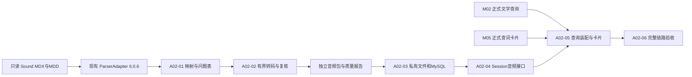
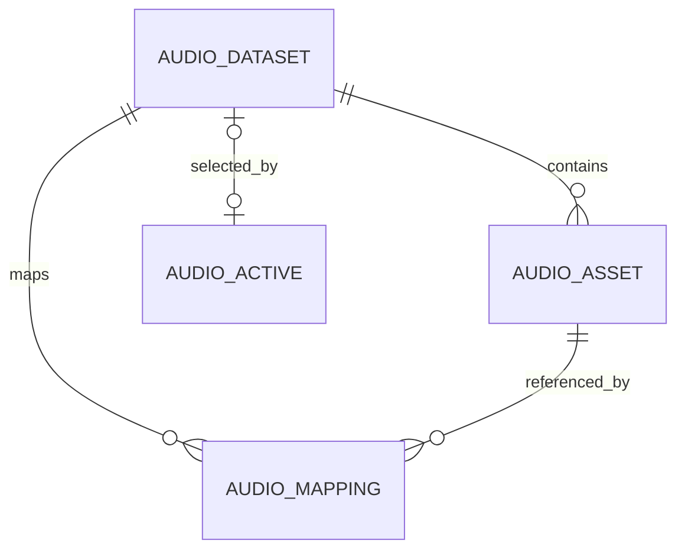
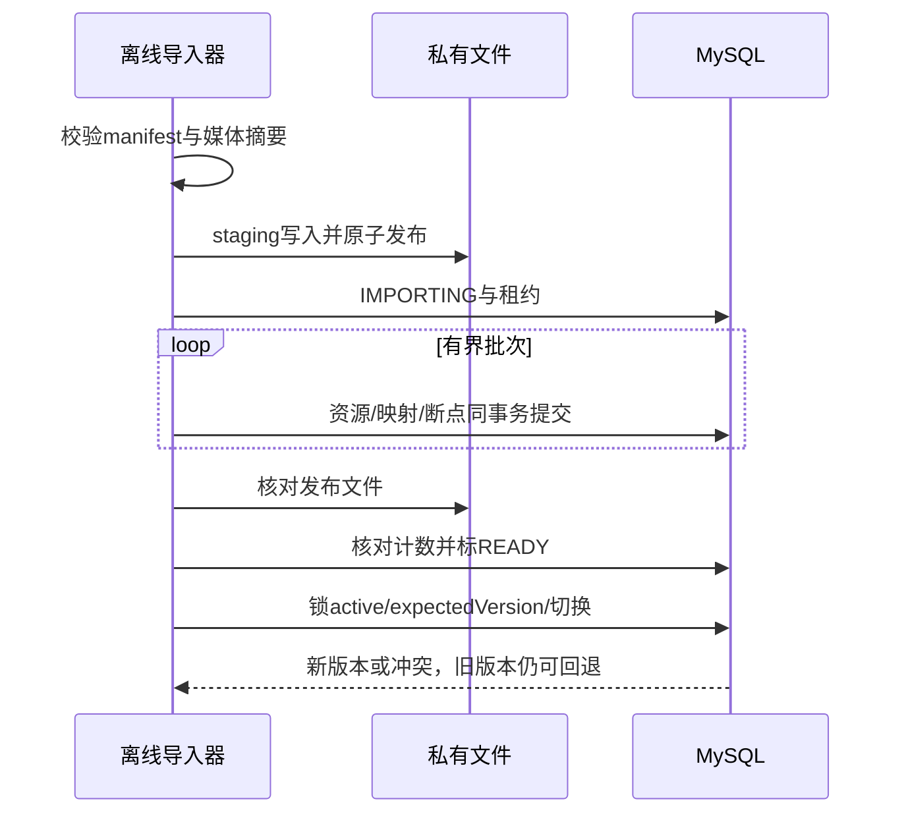

# A02 本地发音库处理与播放接入执行文档

版本：0.4；日期：2026-11-25（补 M05 卡片开发衔接，不新增验收结论）。状态：**A02 本机音频 MVP 核心可用；完整复验后置，正式卡片待 M05**。人工试听未确认，数据权利未核实。

当前实施补记（2026-11-22）：M02本机LOCAL_MVP已完成，V5与内部Provider已交付并启用开发库（应用f9be2e1，设计395a224）。本轮开展A02-01～04和底座验收，正式卡片接入仍待M05；下文旧基线叙述保留为历史，不代表当前阻断。普通文件校验不启动Spring；数据库命令复用dictionary-tool音频子命令，单一dev或test配置，不使用dev,audio-import双profile。
依据：[PRD V1.1](../../requirements/prd/PRD-v1.1.md)、[系统技术设计](../architecture/Readict-V1.1-系统技术设计.md)、[模块化开发计划](Readict-V1.1-模块化开发计划.md)、[ADR-0005](../decisions/ADR-0005-独立发音库与离线MP3播放.md)。已有证据：[2026-11-21 音频技术验证](../../../validation/technical/audio/2026-11-21/README.md)。

本文是新增范围的独立执行基线。**不向 M02-01～M02-06 增加任务，不改变 M02 的文字质量门槛、完成条件或历史结论。** 本文状态核对基于设计提交3633cad／应用提交46e2e40：M02部分实施、质量阻断，正式文字包、V5和Java查询尚未交付，详见 [M02 真实状态](../../../validation/implementation/m02/README.md)。其他并行M02修订及后续实际结果以独立提交和验收为准，不由本文追认完成。本文不把这些工作算作 A02 已完成，也不要求为音频重验已完成的文字任务。

## 1. 目标、边界与证据

目标链路：只读发音源 → 离线抽取／转码 → 独立版本化音频包 → 私有文件与数据库 → Java 鉴权流接口 → 查词卡片按词头、口音播放。音频缺失、解码失败或网络失败均不能阻断文字释义、翻译和收藏。

| 分类 | 当前事实或决定 | 适用边界 |
|---|---|---|
| 已验证事实 | 正式 js-mdict 6.0.6 ParserAdapter 能读取所测音频；94 条实际解码、MP3 转换和再次解码成功 | 47 个直接命中词，不是全量库验收 |
| 已验证事实 | Chrome 157.0.8103.80、Edge 157.0.4341.60 各 94 次点击播放成功，共 188 次；另有重复／切换／暂停检查 | headless 媒体事件与时间推进；未证明扬声器输出及人耳听感 |
| 已验证事实 | 源为 Ogg/Speex 单声道，样本 46 条 11025Hz、48 条 16000Hz；原格式在上述浏览器返回媒体错误 4 | 不能只改扩展名／MIME 作为可播放 MP3 |
| 工程设计 | 离线 MP3，单声道、22050Hz、48kbps；Java 文件服务；浏览器原生 Audio | 沿用样本支持的路线，正式接口、Range、鉴权、卡片尚未验证 |
| 待验证 | 全部录音解码完整性、词头／口音映射、人工试听、资源预算与数据权利 | 样本成功不能替代这些门槛 |

源文件身份使用历史报告中的完整 SHA-256，正式执行仍须只读重算确认：

| 文件 | 字节数 | SHA-256 |
|---|---:|---|
| Sound.mdx | 2757739 | `404c9ef72a049fd8fa90dbf9b1681796ae261614cae2a07dd7ff6b67eea6beaa` |
| Sound_us_uk.mdd | 747895389 | `22759501b28d688c7264dbf4416e3780ba19eeb7b30eca4b79f663da27c6eac9` |
| sound.mdd | 4989 | `a680de2ea88f47936dd79b2ecb0b973d6d7ee10b540f14c2ad518b1764c0fc00` |

历史索引：Sound.mdx 154737 项，大 MDD 248363 项，其中此前检查为 248359 条 SPX 和 4 张 PNG，小 MDD 只有两张口音图标。索引数不等于可发布资源数或独立单词数；实际重新核验后与这组输入摘要对账。COL 自身 MDD 的 CSS／JS 和当前独立发音库是不同来源，不能混称 COL 原配录音。

0.1 版仅形成文档；0.2 版已进入正式实施。以下历史方案与本次实现有差异时，以本节和“本次实现契约”补记为准，保留原始验证记录。

## 2. 分阶段安排与前置条件

| 阶段／任务 | 前置条件 | 交付与退出条件 |
|---|---|---|
| A02-01 输入与映射 | 现有源文件和 6.0.6 适配器 | 摘要、实际链接、口音证据、缺失和歧义清单；不按文件名猜口音 |
| A02-02 离线处理 | A02-01 | 可断点转换、质量核对、版本化产物；所有资源有明确结果 |
| A02-03 数据与存储 | A02-02、M00／M01；协调 M02 V5 编号 | 独立数据表、导入、私有文件发布、版本切换／回退 |
| A02-04 音频服务 | A02-03、现有 Session 认证 | 鉴权 GET／HEAD、MP3、Range、条件请求及错误测试通过 |
| A02-05 查询与播放 | A02-04、M02 正式查询、M05 卡片 | 展示词头准确关联、实际口音标签、播放状态和停止生命周期 |
| A02-06 独立验收 | 分阶段检查以上工作 | 分别登记底座和完整链路；未完成项不得被整体“完成”掩盖 |

A02-01／02 可先于 M02 文字质量解阻开展。A02-03 的数据库实施按文字 V5 后追加迁移；若 V5 尚未落地，可先准备和测试离线产物，不抢占 V5，不在正式库制造迁移缺口。A02-05 不能用临时 Mock 卡片代替正式 M05 验收。M03～M09 原顺序不变。



## 3. 工程组织与输入安全

正式源码归 readict-app；文档和验收摘要归 readict-design。以下按本轮实际后端组织列出；frontend 为等待 M05 的后续目标，尚未实现：

```text
readict-app/
  tools/dictionary-import/
    src/audio/                  # 索引、映射、转码、清单、校验、断点
    src/parser-adapter.mjs       # 复用；不另写一套MDX解析器
    test/audio/                 # 最小自造夹具，真实受限资源留本地
  backend/src/main/java/com/readict/lexical/
    api/DictionaryAudioController.java
    audio/AudioCatalog.java
    audio/AudioPlaybackService.java
    audio/AudioStorage.java    # 私有文件发布与读取
    audio/AudioImporter.java   # 租约、批次与切换
    tool/AudioTool.java        # 独立离线命令
    infrastructure/persistence/mapper/
  backend/src/main/resources/mapper/lexical/
  backend/src/main/resources/db/migration/
  frontend/src/features/dictionary/audio/
    pronunciation-player.ts
    PronunciationButtons.tsx
```

输入路径、私有存储根目录、输出包目录、FFmpeg／ffprobe 路径显式配置，不写死设计仓库绝对地址。开发配置、资源和转换产物置于受忽略目录，不提交词典全文、MP3、WAV、工具二进制或凭据。真实机器路径只进入脱敏本地配置；工程 README 保留启动和命令入口，不在应用新建 docs/。

所有输入只读。映射解析只读 DOM 属性，不运行 HTML、MDD 脚本或动态代码。`sound://` 链接须按受支持语法解析：保存原始键与解码后的键，禁止 NUL、控制字符、盘符、UNC、绝对文件路径及 `..` 越界。资源键只用于容器查找，不能直接拼接到输出路径。URI 解码只执行规定的一次，大小写／斜杠差异只有源索引证明等价时才关联；碰撞登记歧义，不盲目 lowercase 文件名。

FFmpeg 使用固定可执行文件和参数数组启动，禁止 shell 拼接源词头。初始转码并发 2、单资源超时 30 秒，单资源压缩输入上限 2MiB、解码时长上限 60 秒；这些是工程初值，超限入隔离清单，评估后显式调整配置并生成新版本，不能截断后算成功。进程超时终止并等待退出；批次停止后释放 ParserAdapter 和临时文件。全库耗时、磁盘峰值、内存及实际录音时长分布需 A02-02 测量。

## 4. 独立音频包与稳定身份

### 4.1 产物布局

音频包 schema 固定为 `readict-audio-bundle-1`，不改 M02 的 `readict-col-bundle-2`、entry-v2、componentOrder 或义项身份。

```text
audio-bundle/
  manifest.json
  assets.jsonl
  mappings.jsonl
  issues.jsonl
  dispositions.jsonl
  quality.json
  media/ab/<完整MP3摘要>.mp3
```

manifest 包含 schema、数据集 ID、version（固定为`audio-v1/<数据集UUID>`）、源文件名／字节数／SHA-256、转换器版本（提交在运行记录中登记）、ParserAdapter 与 js-mdict 版本、FFmpeg 构建标识和可执行摘要、实际编码参数、词头规范化版本、各文件字节数和摘要、记录数及质量结论。`createdAt` 是运行信息，不能参与确定性内容摘要。绝对路径、临时耗时、日志先后次序也不参与内容身份。

身份元组先按 UTF-8 JSON 数组序列化、SHA-256，再取前 16 字节并设置 UUIDv8／RFC variant 位；与 M02 通用 UUID 实现一致但使用独立域，增加固定向量测试。数据集元组为 `["audio-dataset-v1", sourceIdentitySha256, converterVersion, parserVersion, ffmpegBinarySha256, encodingConfigSha256, normalizeVersion]`。其中 sourceIdentity 是按固定文件角色排序的 `[role,bytes,sha256]` 数组。资源元组为 `["audio-asset-v1",audioDatasetId,sourceResourceKey,sourceSha256,outputSha256]`。JSON 重复字段禁止；Unicode 不隐式改写，数字使用整数，行尾 LF，字段顺序按 schema 固定，资源按 sourceOrdinal 排序，映射按 sourceOrdinal、linkOrder 排序。输出 MP3 禁止写入当前时间等变化元数据；同环境重跑必须得到相同媒体摘要，否则不能发布“可复现”。

### 4.2 字段和示例

| 记录 | 必需字段 | 约束 |
|---|---|---|
| asset | audioId、sourceOrdinal、sourceResourceKey、sourceSha256、outputSha256、storageKey、bytes、mime、sampleRate、channels、durationMs | 只有已成功转码并复核的资源进入 assets；mime=`audio/mpeg`，22050Hz、1声道；所有长度为整数 |
| mapping | sourceOrdinal、linkOrder、indexKey、displayHeadword、wordKey、normalizeVersion、accent、audioId、evidence | accent 仅 en-GB／en-US；未知标签进问题表，不猜测；evidence 保存实际链接和口音标记 |
| issue | stage、sourceOrdinal／resourceKey、code、severity、reason、retryable | 原始原因可定位；不能写伪造 audioId 或空媒体作为成功 |
| quality | counts、decodeStats、durationStats、warnings、humanReview、rightsReview、releaseEligible | 区分自动信号检查、人工试听和权利状态；未执行为 NOT_PERFORMED／UNVERIFIED |

以下示例中的尖括号内容是生成时填入的值，不能原样导入：

```json
{
  "audioId": "<按audio-asset-v1生成的UUID>",
  "sourceOrdinal": 0,
  "sourceResourceKey": "<实际MDD键>",
  "sourceSha256": "<源录音SHA-256>",
  "outputSha256": "<MP3 SHA-256>",
  "storageKey": "media/ab/<MP3完整摘要>.mp3",
  "bytes": 5000,
  "mime": "audio/mpeg",
  "sampleRate": 22050,
  "channels": 1,
  "durationMs": 1000
}
```

词头规范化调用 M02 已有 col-normalize-v1 的共享规则／固定向量，不新增“去 s／ing”音频猜测规则。音频包保留独立词头，不引用尚未生成的 COL entryId。索引中的短语可作为来源记录保留，不扩展 V1.1 的单词查询范围。

### 4.3 对账和质量门槛

必须分别核算以下集合，不能将链接数与独立资源数混加：

- MDD 总资源数 = 音频候选数 + 非音频数 + 未识别数。
- 音频候选数 = 转码复核成功数 + 失败／隔离数。每个候选仅有一个最终结果；重试次数另计。
- MDX 索引数 = 完成映射分析数 + 无录音／范围外数 + 解析失败数；分类互斥，统计判定顺序固定。
- 发现的 sound 链接数 = 可解析且命中数 + 缺失目标数 + 非法／未知标签数。有效链接再分为可发布映射和隔离映射；多个词头引用同一资源不复制转码。
- 可发布映射涉及的每个 audioId 必须在 assets 中，且对应文件摘要、字节数、解码复核均通过。不可用资源绝不能进入可播放列表。

单条自动门槛复用历史验证：源和目标 PCM 非空、时长 >0，RMS >1e-5，源峰值 >0.001；两次解码时长差 ≤max(80ms,源时长5%)；目标采样率／声道正确。全量不满足的资源明确隔离；静音、极短、超长及严重警告进入人工问题清单。不能把这些阈值称作音质、语速或口音准确率。

完整全量资源验收要求全部候选有结果、无未解释差异；“全部录音解码可用”还要求失败数为零。若确有损坏资源，保留失败并经明确批准缩减发布范围，只能称该范围可用，不能静默排除后宣称全库通过。未批准的问题不得使 quality.releaseEligible=true。数据使用／发布授权未核实则阻断相应分发，不影响记录本地技术结果。

## 5. 独立数据库、文件与版本生命周期

### 5.1 表结构契约

复用本机 MySQL80／8.0.44、MyBatis-Plus＋XML、UUID BINARY(16) 和 UTC DATETIME(6)。以下四表为新增设计，不修改 M02 文字五表。本轮 Flyway 固定使用 **V6__dictionary_audio.sql**，在已交付 M02 V5 后追加。V1～V5 原字节不变，禁止覆盖、回写或跳过既有迁移。

| 表 | 字段 | 约束／索引／语义 |
|---|---|---|
| dictionary_audio_dataset | id BINARY(16) PK；version VARCHAR(100)；identity_sha BINARY(32)；status VARCHAR(16)；manifest_sha BINARY(32)；manifest_json JSON；expected_assets BIGINT；expected_mappings BIGINT；imported_assets BIGINT；imported_mappings BIGINT；last_asset_ordinal BIGINT；last_mapping_ordinal BIGINT；lease_owner BINARY(16) NULL；lease_until DATETIME(6) NULL；error_code VARCHAR(100) NULL；created_at／updated_at DATETIME(6) | UNIQUE(identity_sha)；UNIQUE(version)；INDEX(status,updated_at)。status=IMPORTING／READY／FAILED，计数非负；断点和租约随批次事务更新 |
| dictionary_audio_asset | id BINARY(16) PK；dataset_id BINARY(16)；source_ordinal BIGINT；source_key VARCHAR(512)；source_sha／output_sha BINARY(32)；storage_key VARCHAR(160)；bytes BIGINT；duration_ms INT；sample_rate INT；channels TINYINT；mime VARCHAR(32) | FK dataset_id→dataset；UNIQUE(dataset_id,id) 支持复合外键；UNIQUE(dataset_id,source_ordinal)；INDEX(dataset_id,output_sha)。source_key 是溯源快照，实际键超限拒绝该包，不截断；仅有复核成功的资源行 |
| dictionary_audio_mapping | dataset_id BINARY(16)；source_ordinal BIGINT；link_order INT；index_key VARCHAR(255)；display_headword VARCHAR(255)；word_key VARCHAR(255)；accent VARCHAR(8)；audio_id BINARY(16)；evidence_json JSON | PK(dataset_id,source_ordinal,link_order)；复合FK(dataset_id,audio_id)→asset(dataset_id,id)；INDEX(dataset_id,word_key,accent)。word_key 用 utf8mb4_0900_bin；不将词头＋口音设唯一而丢掉一对多证据 |
| dictionary_audio_active | slot TINYINT PK；dataset_id BINARY(16) NULL；version BIGINT；updated_at DATETIME(6) | CHECK(slot=1)；FK dataset_id→dataset；唯一一行，初始NULL表示未配置。切换用显式version条件与行锁，不依赖MP插件 |

字段 NOT NULL，除已注明 NULL 外；所有 FK 使用 RESTRICT，无级联删除。长度、枚举、摘要和计数由导入器严格校验，DDL 补对应 CHECK；标识字段二进制比较。映射保留多条相同音频引用的来源证据；查询时同词头同口音同 audioId 去重。不同 audioId 若输出摘要相同可合并展示为一个候选；摘要不同则标 AMBIGUOUS，不以第一条覆盖。需要未来支持多发音选择时另行设计，首版不随机播放。

迁移 DDL 必须包含上述联合键及完整索引，先在 readict_test 验证后才进入开发库。Controller 经 AudioPlaybackService 解析录音，不直连 Mapper。音频沿用 M02 lexical 的显式 XML 持久化方式，复用既有 UUID 字节转换工具及 UTC 数据库连接和 DDL；不新增只为包装相同 SQL 的 BaseMapper 实体层。参数绑定、排序白名单，不启用二级缓存或全局逻辑删除。



### 5.2 文件发布、导入与切换

私有根目录不在前端 public、静态资源或 Nginx 公共目录。存储键由服务生成，以输出摘要寻址，路径解析后再次验证位于根目录内；禁止符号链接／junction 逃逸。数据库不存用户可控绝对路径。文件可跨数据集复用，但删除前须确认无任何保留数据集引用。

1. 离线导入命令只允许运维／开发进程入口，不开放 HTTP 管理接口。校验包 schema、身份、文件摘要、计数及权限；重复 identity 已 READY 时校验一致后返回 READY 及既有计数，不重置活动版本。
2. 将包媒体写到私有 staging，逐文件核验并原子改名至最终摘要路径。源包／存储卷不支持跨卷原子移动时采用同目标卷临时文件、校验、关闭及原子改名；本轮 MVP 不逐文件强制同步刷盘，断电恢复验收后置；先文件后引用，崩溃最多留下孤儿，不留下 READY 的空引用。
3. 数据集创建 IMPORTING，以短事务批量写入 asset／mapping 和各自断点；每批最多 500 行或 2MiB 参数数据，租约 120 秒，每 30 秒心跳。last_asset_ordinal／last_mapping_ordinal 表示已提交的对应文件行数（不是 MDD 物理序号），与 imported_* 同事务更新。唯一约束冲突必须对比内容，不能 ignore 造成错账。运行租约防同数据集双导入，失效接管检查 manifest 和进度，禁止两个活跃进程覆盖断点。
4. 逐项核对记录数、外键、文件存在及问题审批；摘要在私有发布时逐文件核验，READY 复用发布结果并核对数据库计数；完整性错误置 FAILED 并保留断点；可重试的导入中断保留 IMPORTING 并释放 owner，显式 --resume 后继续；旧活动版本不变。恢复只允许完全相同 manifest／配置；换输入重新生成数据集。
5. 完整校验后置 READY；随后独立短事务锁定 active 单行，验证目标 READY、expectedVersion，再更新 dataset_id 和 version。冲突返回 AUDIO_VERSION_CONFLICT，重新读取后由操作者明确重试，不自动覆盖别人的切换。
6. 缓存按 audioDatasetId、wordKey、accent 隔离。一次查询先读取 active 并固定数据集，后续不再读取新 active；切换不得混合新映射与旧资源。回退切换到保留的 READY 数据集，复用导入时的校验结果；完整介质巡检后置，播放按需检查实际摘要。



初版不自动删除旧 READY 数据集或音频，避免已打开卡片引用失效；metadata 小缓存最多 5000 键、TTL 5分钟，音频 ID 指向不可变文件。后续确需清理时单独执行：确认非活动、无进行中的导入、超过查询引用最长有效期及安全余量，先撤销映射／资源引用，再回收无引用文件。清理任务失败可重试，不删被其他数据集使用的摘要文件；不改写收藏释义／原文快照，不把音频 blob 存到收藏表。

## 6. 查询装配与流接口

### 6.1 按展示词头关联

`AudioCatalog.find(displayHeadword, normalizeVersion)` 返回独立结果，不能修改 M02 DictionaryProvider 的文字提取或身份。查词应用服务在 M02 返回展示组件后再装配音频；子词条使用该组件词头，不继承主词头录音。不使用原句 POS 选录音，不冒称与 COL IPA 对齐。

```ts
type Pronunciations = {
  status: 'available' | 'missing' | 'ambiguous' | 'notConfigured';
  word: string;                  // 实际录音对应的展示词头
  source: 'local-sound';         // UI明确与COL文字来源区分
  audioDatasetId: string | null;
  audioDatasetVersion: string | null;
  items: {audioId:string; accent:'en-GB'|'en-US';
          mime:'audio/mpeg'; durationMs:number}[];
};
```

正式 lookup 响应在 A02-05 增加独立 `pronunciations` 字段；原 phonetics 保持 COL 音标语义，旧 `audioId` 可空，不凭相同单词就把任意 IPA 与录音绑为一对一。音频数据集版本单独返回，不能复用文字 datasetVersion。具体例子：展示 run 才查询 run 发音；展示 ran 就查 ran；由可信映射将原词 ran 解释为展示 run 时，按钮明确显示“run · 英音／美音”，保留原文词形 ran；不能标签仍写 ran 却播放 run。未知形态不自动截尾猜测。

口音偏好复用个人设置 en-GB／en-US，优先排列而非隐藏另一可用口音。偏好缺失时展示该口音不可用、另一个实际可用按钮；不静默换口音。部分口音歧义时只禁用该口音，另一无歧义项可用；整体 status=ambiguous 并给出明确提示。缺失／未配置不返回虚构 URL，items=[]。音频失败不能让文字查询整体失败。

### 6.2 GET／HEAD 契约

路径：`/api/v1/dictionary/audio/{audioId}`，audioId 为合法 UUID。**受当前 Session 和 authVersion 保护的全局词典内容**；无用户私密语境，不虚构 user_id 所属关系；认证先于文件、ETag 和 Range 处理。仅在 SecurityFilterChain 显式允许该路径的已认证 GET／HEAD；不公开整棵 lexical 路径或存储目录。GET／HEAD 无状态，不要求 CSRF header；Cookie 与现有同源请求一致，不把 token 放 URL。

| 情况 | 状态／响应 |
|---|---|
| 完整读取 | 200；Content-Type: audio/mpeg；Content-Length 为实际字节数；Content-Disposition: inline，固定安全文件名 |
| 单段 `Range: bytes=start-end`、开放尾部或后缀 | 206；正确 Content-Range／Length；包含边界截断处理 |
| 不可满足范围或本版不支持的多段范围 | 416；`Content-Range: bytes */<总字节数>`；不尝试无界拼接 |
| 条件 GET 命中 | 304，无正文；先通过认证再比较 ETag |
| If-Range 不匹配 | 忽略 Range，200 完整内容；匹配时206 |
| HEAD | 200／304，无媒体正文；忽略 Range，仅返回完整表示头；不得整文件读入内存 |
| 未登录／会话失效 | 401 Problem Details，不重定向 HTML 登录页 |
| UUID 非法 | 400 INVALID_AUDIO_ID |
| ID 不存在、未发布、已撤销／文件缺失 | 404 AUDIO_NOT_FOUND；文件缺失另外记录 requestId 告警，不泄露路径 |
| 尚无活动音频配置 | 503 AUDIO_NOT_READY |
| 读取暂时失败 | 尚未提交响应时503 AUDIO_READ_FAILED；流已开始则关闭流并记错，不能追加 JSON 污染 MP3 |

共同响应头：`Accept-Ranges: bytes`、`X-Content-Type-Options: nosniff`、`Cache-Control: private, no-cache`、ETag 为 MP3 SHA-256 的带引号强标识、现有 requestId。`no-cache` 允许浏览器私有存储但每次复用须鉴权验证；反向代理不得共享缓存，Service Worker 不缓存此路径。用户退出时停止并清空播放器；不能承诺撤销客户端已经收到的字节。

使用框架 Resource／ResourceRegion 或显式有界流实现 Range 均可，但必须以真实 HTTP IT 证明本表行为；不能同时手写不一致的长度头和让框架重复处理 Range。每请求关闭文件句柄，客户端中断不当服务器故障打印敏感堆栈。文件通路只接受数据库 storage_key，经 StoragePort 检查，禁止路径参数映射任意文件。跨域不开放 `*`，主应用 CSP 首版 `media-src 'self'`。

## 7. 六项任务的详细执行指导

### A02-01 输入核验与映射分析

前置：读取历史音频报告、当前 ParserAdapter 与锁文件；确认源只读且工具版本为实际 6.0.6，不把临时 7.0.0 结果当新实现。目标文件为 `src/audio/inspect.mjs`、`mapping.mjs`、对应夹具与本地源配置示例。

步骤：先核对三个源摘要；枚举物理索引并保留 sourceOrdinal；解析 Sound.mdx 实际链接和 snd_uk／snd_us 标记；查找 MDD 实际资源；保存每个链接位置、原文、目标和口音证据；分开统计缺失、重复、非法路径、标签未知与词头歧义。books／reads／runs 的直接索引缺失保留原结果，不替换成其他词冒充命中。检查同一词头多个来源和多个录音，按第5章去重／歧义规则处理。

完成条件：原输入摘要前后相同，全部索引有分类，固定50词维持原清单，映射可追踪到真实源记录；任何猜测匹配不能进入可发布映射。解析失败给出 sourceOrdinal／resourceKey 和错误码，不执行来源脚本。

### A02-02 离线抽取、转码和复核

前置：A02-01 可用，FFmpeg／ffprobe 路径和摘要已配置。目标文件 `convert.mjs`、`probe.mjs`、`checkpoint.mjs`、`emit.mjs`、`validate.mjs`。复用已验证构建参数，工具不成为应用运行依赖，不改系统 PATH。

执行顺序：按资源去重抽取至随机临时文件 → ffprobe 记录源容器／采样率 → 实际解码 PCM → 质量统计 → MP3 → 再解码 PCM → 时长／信号比较 → 原子发布 → 写断点及结果。转换目标参数：

```text
ffmpeg -nostdin -hide_banner -y -i <源临时文件>
  -map_metadata -1 -vn -ac 1 -ar 22050 -c:a libmp3lame -b:a 48k <目标临时MP3>
```

上述多行是参数说明，实际使用 spawn 参数数组。源 11025Hz 的头信息不手改，不能伪装16000Hz让解码器通过。源样本曾有 `Guessed Channel Layout: mono` 警告，应保留并分类；严重错误、时长异常、全静音不能只看 exitCode=0。失败只写 issues，不输出可用 asset。进程中断的临时文件不能被当成完成文件。

断点键包含数据集身份、源键、源摘要和编码配置；恢复时核验已发布文件及结果，不盲跳过。相同输入配置全新目录复跑比较规范化内容及媒体摘要；不要求重复历史整轮94样本实验，开发回归可复用其固定向量、按新实现变化选择必要样本，最终全库需要实际处理。

退出：满足第4章对账；每条公开资源已实际解码复核；重启／重跑可复现；记录实际时间、磁盘峰值及产物大小。样本 MP3 比原压缩约2.39倍，不能宣称压缩节省或直接推算全库大小。需要调整码率等参数时生成新配置身份并补质量对照，不悄悄改变已发布产物。

### A02-03 私有存储与版本化导入

前置：A02-02 的有效包，M00／M01 基础和本机测试库保护，确认 M02 V5 已安排及最新迁移号。目标文件：新增迁移、实体／Mapper／XML、StoragePort 实现、独立导入 runner 和真实 MySQL IT；不建立临时产品页面。

按第5章创建四表和 NULL 活动指针；实现文件发布、租约、批次写入、断点和 READY 校验；导入账号与在线只读查询权限分开，离线入口不得通过配置绕过 test/dev 环境保护。UUID BaseMapper／XML 实际写读，UTC、计数及复合外键必须在本机 readict_test 验证。导入失败不得使旧 active 改变；事务切换冲突不自动覆盖。第一次未配置时清晰返回 NOT_READY。

退出：重复导入无重复数据、断点恢复结果一致、错误 manifest／缺文件被拒、并发导入和并发切换符合约束、回退可读、文件孤儿可追踪。测试按本次 datasetId 精确清理，不清空用户、Session、M02 数据或整个数据库。不得停止共享 MySQL 来制造故障。

### A02-04 鉴权音频服务

前置：A02-03 和现有 M01 Session／authVersion。目标文件为 DictionaryAudioController、AudioPlaybackService、AudioStorage 私有文件读取、SecurityFilterChain 精确规则及 HTTP IT。

步骤：先定义第6章返回和错误 → 校验认证及ID → 固定可访问的 READY 数据集／资源 → 解析文件和条件头 → 发送有界流。用不同用户已登录会话都可读取同一全局录音的正向测试，匿名不能读取；书籍、原句和收藏仍按各自用户隔离。过期／退出／改密失效会话不能通过缓存协商绕过验证。

退出：200／206／304／416／HEAD、Content-Length、ETag、MIME、404／401／503及中断关闭均有真实 HTTP 结果；不泄露存储路径、源文件或全部索引。压测只测已发布文件读取，不把 FFmpeg 放在线请求路径。

### A02-05 查询装配与卡片播放

2026-11-25 衔接：底座已可用，正式卡片开发采用 [M05 MVP 执行文档](M05-单词定位、词典查询与卡片技术设计与执行文档.md)。M05 与 A02-05 可在同一开发任务内完成装配和播放，不要求先单独交付无音频卡片；本次只补开发入口，A02-05 仍待实施，人工试听及权利检查不随技术接入追认通过。

前置：M02 正式 Provider 及 M05 正式卡片已可用，A02-04 已通过。未满足时登记 BLOCKED_BY_M02／M05，不以原型完成当退出证据。目标文件为查询装配层、前端 PronunciationButtons 和共享 PronunciationPlayer；不改 M02 转换器身份。

查询按第6章 DTO 装配，音频失败局部降级。前端维护一个 Audio 实例，`preload='none'`；默认不下载／播放录音，仅用户点击后设置同源 src 并调用 play。状态为 idle／loading／playing／ended／error／unavailable；显示实际词头和口音、加载及重试，使用有文本名称的按钮与 aria-live 提示，不用持续朗读进度。

每次播放增加 generation，事件回调与 play Promise 检查 generation 和当前查询身份；切换口音先停止旧音频。重复点击正在加载／播放的按钮执行停止，再次点击从头播放；ended 后可重播。停止操作统一 pause、清空 src、load、解除旧监听器并失效旧 generation。

以下事件均调用统一 stop：换词、关闭卡片、翻页、切章、路由离开、退出／会话失效、组件卸载。播放器独立于词典、翻译、收藏请求，音频失败不取消这些请求。play 被自动播放策略拒绝时提示再次点击；媒体 error 无法读 Problem Details 时，最多进行一次现有 `/auth/me` 会话确认，401交认证流程，否则提示重试，不无限请求或自动重播。旧 play Promise 迟到不得播放或改变新卡片状态。

退出：真实卡片按展示词头准确播放，缺失／歧义明确，不出现旧词或旧口音继续播放；偏好与实际口音一致；键盘点击与触屏入口可用，布局不挤压阅读正文。前端基础单测可使用受控 Audio 替身，但最终以真实浏览器及人工试听证明链路。

### A02-06 独立验收与交付

前置：按所验阶段完成相应任务；底座与完整链路分开验收。目标为正式测试及设计仓库未来 `validation/implementation/a02/<日期或批次>/`，包含摘要、计数、失败、脱敏命令、版本、截图及人工确认记录，不提交 MP3／源包。

底座验收覆盖 A02-01～04 的全量对账、复核、导入与接口。完整链路追加 A02-05 的查词装配、播放器生命周期及真实人工试听；使用固定50词，保留未直接命中词、run／ran／running、child／children、book、同头多口音、缺失和歧义。至少人工试听20个命中词的所有提供口音，必须含 book、run、children；记录听者、日期、设备、对应 audioId、内容／速度／截断／杂音及口音标记，不从自动事件推断结论。此抽样仍不保证全库发音内容准确，问题词继续登记。

若权利未核实，不作正式分发验收；人工试听未做，不标完整发音链路完成。无需重跑与此次实现无关的整套 EPUB 或产品实验，只运行相关回归和 M00／M01 既有必要检查。

## 8. 实际命令、预期输出与排障

Node 命令在 readict-app/tools/dictionary-import 中执行，使用本机忽略配置，路径占位须替换为实际值；Java 命令在 backend 中执行。完整转换必须指定 inspection 和全新 out，只有中断同一任务才增加 --resume，不能照抄旧版缺参示例。

| 入口／条件 | 命令示例 | 预期结果 |
|---|---|---|
| Node；已配置三个源及工具路径 | `npm run audio:inspect -- --config <配置JSON> --out <新检查目录>` | 全源摘要、索引和映射分类；不修改输入 |
| Node；已完成全源检查 | `npm run audio:convert -- --config <配置JSON> --inspection <检查目录> --out <新包目录> --allow-local-subset` | 可续跑；逐条质量结果；完成校验后原子发布 |
| Node；完整音频包 | `npm run audio:validate -- --bundle <包目录> --allow-local-subset` | 独立重算 schema、摘要、身份、覆盖和计数；不可跳过安全检查 |
| Node；自建夹具 | `npm test` | 统一执行文字和音频正式测试；不依赖源或数据库 |
| Java；已双 JAR 打包 | `java -jar target/readict-backend-0.0.1-SNAPSHOT-dictionary-tool.jar audio-validate --bundle <包目录> --allow-local-subset` | 不启动 Spring 或连接数据库；默认完整范围，不允许子集时退出3 |
| Java；单一 test 环境与私有根已加载 | `java -jar target/readict-backend-0.0.1-SNAPSHOT-dictionary-tool.jar audio-import --bundle <包目录> --allow-local-subset --spring.profiles.active=test` | 文件先发布，数据与断点同事务，READY 不激活；中断同包显式 --resume |
| Java；已导入数据集 | `java -jar target/readict-backend-0.0.1-SNAPSHOT-dictionary-tool.jar audio-inspect --dataset <UUID> --spring.profiles.active=test` | 状态、计数及实际活动版本，不输出录音内容 |
| Java；读取了当前活动版本 | `java -jar target/readict-backend-0.0.1-SNAPSHOT-dictionary-tool.jar audio-activate --dataset <UUID> --expected-active-version <实际版本> --allow-local-subset --spring.profiles.active=test` | READY、数据库计数和采用策略检查后条件切换；回退同样比较实际版本 |
| Java；专用测试环境 | `mvn -Pmysql-it verify` | 只允许 readict_test；十八表及所有相关回归 |
| Java；普通单测及双 JAR 构建 | `mvn test`、`mvn package` | 不以普通测试声称真实 MySQL 通过；保留 Web 与 dictionary-tool |
| 前端；未来 A02-05 已实施 | `npm run build`、`npm run lint`、`npm test` | 本轮不修改正式页面，不以临时验收环境代替卡片 |

测试库全部通过后，开发启用同包时改为唯一 dev 环境及 readict_dev 私有根。不得使用 dev,audio-import 双 profile。单独工具只加载数据库、迁移、事务及 lexical，不加载 Web、Session 或用户任务，不需要认证 HMAC；Web 正常启动不会执行导入。逐条确认退出码0再继续；0成功、2输入、3质量／策略、4数据库／租约／版本冲突、5内部错误。详见应用 README。

| 现象 | 处理 |
|---|---|
| Speex读取失败／字节截断 | 对比源摘要、实际资源键、ParserAdapter输出长度；记录源读取错误，不先改音频头 |
| 找不到解码／MP3编码器 | 检查实际FFmpeg构建和摘要；Playwright裁剪版不能代替已验证完整工具 |
| 11025Hz速度疑似异常 | 保留原源／WAV／MP3对照，人工试听与probe结果一起检查；禁止猜测更改头 |
| 多词共用音频／同词多条不同音频 | 依来源证据和输出摘要区分合理别名及歧义，不取第一项掩盖 |
| 重跑内容摘要不同 | 检查二进制、编码参数、动态元数据、排序和浮点序列化；身份不同应新包，不覆盖旧包 |
| 已READY但文件丢失 | 当前资源不可用并告警，停止新版本发布／回退完好版本；补偿核查不伪造空文件 |
| 音频401、返回HTML或Range错误 | 检查Session、精确安全规则、代理路由和二进制响应；不要关闭全局认证解决 |
| 换词后仍播放旧音频 | 检查统一stop和generation保护，不能仅隐藏按钮或卸载文字 |

## 9. 验收矩阵与完成定义

| 编号 | 输入／方法 | 通过标准／阻断范围 |
|---|---|---|
| AT01 | 实际源与6.0.6适配器；全索引对账 | 源前后摘要一致；资源／链接分类互斥完整；阻断底座发布 |
| AT02 | 全部候选逐条真实解码／转码／再解码 | 每条有结果，所有公开资源通过门槛；损坏不虚报；全库未零失败不能称全库可用 |
| AT03 | 同输入同工具双输出、故障中断恢复 | 媒体及规范化内容摘要一致，无半成品进入清单；阻断可复现交付 |
| AT04 | 本机测试库重复／并发导入及切换、校验失败 | 唯一约束、UUID／UTC、租约、版本冲突与原子指针正确，旧版本不受损 |
| AT05 | 缺文件、断流、孤儿、旧数据集回退 | 不发布悬空引用，句柄释放，重试／回退可追踪 |
| AT06 | 匿名、过期、改密后的会话及条件GET | 均不能取得媒体或绕过认证304；普通登录用户可访问全局媒体 |
| AT07 | GET／HEAD／Range／If-Range／ETag | 第6章状态、长度和字节精确匹配；无公开路径／代理共享缓存 |
| AT08 | run、ran、running、children、子词条、缺失／歧义 | 关联展示词头正确，实际口音明确，音频缺失不损害文字与收藏 |
| AT09 | Chrome／Edge正式卡片实际点击、时间推进、结束、重播 | 用户触发播放有效；换词／关闭／翻页／退出立即停止；旧回调无作用 |
| AT10 | 人工试听、WAV对照及物理设备 | 按第7章记录真实确认，不以headless记录代替；未做阻断完整链路验收 |
| AT11 | 生命周期、键盘、窄屏、错误重试、M00／M01必要回归 | 无多播放器泄漏，无无条件自动重试，无用户／数据库隔离回归 |
| AT12 | 权利和资源预算记录 | 来源、使用／转换／分发范围明确；实际全库预算可承受，否则限制相应发布 |

允许登记的状态：未开始／进行中／部分完成／前置阻断／待验收／已完成。**底座验收通过**只表示 A02-01～04 相关门槛达到；**完整发音链路验收通过**还需要 A02-05／06、真实人工试听及适用权利检查。两者必须分别列出证据和未完成项。M02 的通过／失败继续由其文字门槛判断，音频不成为重验其已完成子任务的理由。

## 10. 尚待验证的问题与开发建议

| 问题 | 可执行验证 | 门槛与影响 |
|---|---|---|
| 全库解码／转换及预算 | 有界处理248359候选并记录逐条结果、磁盘峰值／耗时 | 阻断相应全量发布；不能按94条线性外推承诺 |
| 词头／口音映射正确性 | 全链接对账、冲突报告、固定词人工核对 | 未确认映射不提供播放按钮；保留实际词头标签 |
| 人耳听感与物理输出 | 当前book／run／children先试听，再执行AT10代表集 | 当前状态未确认；样本事件通过不替代内容确认 |
| 数据使用权利与工具分发 | 核对录音来源、授权条款、离线工具许可／构建义务 | 未确认不分发录音或捆绑工具；技术结论独立保留 |
| 认证流／Range／缓存 | 用正式服务真实HTTP请求及浏览器测试 | 阻断A02-04及后续，不能借历史临时试听页放行 |
| 正式卡片尚未交付 | M02 文字底座已完成，卡片跟随 M05，不扩张 M02 任务 | A02 底座可独立验收，正式卡片仍待 M05 |

建议先完成 A02-01／02，获得可追踪且可复用的独立产物；数据库和接口在迁移顺序核实后开展；正式卡片接入按 A02-05 等待前置模块。新范围使用本独立文档、独立编号与独立验收，不倒改已完成任务。当前文档交付不创建任何通过记录。

## 本次实现契约（0.2）

采用 [ADR-0007](../decisions/ADR-0007-音频本机可用子集采用.md) 的 LOCAL_MVP 策略。用户允许一定缺陷录音，源质量缺陷逐条隔离、其余可用部分继续验收；不更换音源、不补录、不放宽每条质量门槛。完整源音频全部成功与声明范围内技术完整分开登记，releaseEligible=false、人工试听未执行、权利 UNVERIFIED 不变。已知低信号问题不能记为解码损坏。

本次数据库迁移固定 V6，追加四张表，总表数18；V1～V5保持原字节。lease_owner 使用 BINARY(16) UUID，租约120秒／每30秒心跳，批次最多500行或2MiB参数，checkpoint与数据同事务。活动版本按实际读取值条件切换，旧 READY 录音继续可以按已有 ID 访问。

音频包 readict-audio-bundle-1 包含 manifest 和五个数据文件 assets.jsonl、mappings.jsonl、issues.jsonl、quality.json、dispositions.jsonl，另含摘要寻址媒体。manifest 记录全部源摘要、resourceCounts、非音频资源序号、全源计数、采用策略及隔离数量；校验器独立重算身份／摘要／源覆盖，不信任 eligible 声明。dispositions 覆盖每条 MDX，成功、隔离、非音频覆盖每个 MDD 物理位置。采样、诊断、partial、未知文件、越界或符号链接、重复 JSON 键、坏 UTF-8 和无引用媒体不能因子集参数被放行。

长期 Node 入口及 Java 子命令已实现，命令参数以应用 README 为准。文件校验不启动 Spring，不连库；数据库命令仅使用单一 dev 或 test，不加载 MVC、Security、Session 或账号后台任务，不要求认证 HMAC。私有文件环境变量 READICT_AUDIO_STORAGE_ROOT 的根目录名必须匹配 readict_dev／readict_test，未配置在线服务明确返回503。

映射核验规则 sound-map-v3；转换器 readict-audio-converter-4，采用策略后缀绑定身份。MDX 154737项，MDD合计248365资源（248359音频候选、6非音频）；140260条源词头属于本次单词范围，14477条源索引为范围外。220907个范围内链接均有可追溯资源目标；另23988个链接属于范围外源词头。此处是映射扫描结果，不能代替全量转码、导入和实际播放通过结论。

新增 GET／HEAD /api/v1/dictionary/audio/{audioId}，Session鉴权先于 ETag 和 Range；私有流式传输，HEAD忽略Range，支持单段、开放尾部和后缀Range及If-Range，不支持多段。普通匿名或失效会话401，非法UUID400，不可访问资源404，未配置或读取故障503。AudioCatalog 独立返回 available／missing／ambiguous／notConfigured，固定活动数据集，缓存5000键／5分钟，不缓存活动指针或数据库故障。正式文字查询的 pronunciations 和卡片留待 M05。

本次进度与验收见 [A02 记录](../../../validation/implementation/a02/README.md)。全部源数据、录音、包、原始日志和一次性脚本只留本机忽略目录，仓库只保留必要脱敏摘要。正式测试使用自建内容，实际源验收单列。

## 11. 2026-11-23 MVP 执行范围调整

用户明确要求“这一次暂时不用做到完整的验证，基本可用即可……目标是尽快实现 MVP 软件……去掉大部分不重要的验证测试部分”。本次执行以该最新指示为准，不再以全矩阵通过作为本机 MVP 启用的前置。

- 复用已经完成的第一轮全量包和已有基础回归结果，停止第二轮全量转换及独立重复扫描。
- 不重复向测试库导入整库；测试库已有真实 MySQL 最小包导入、事务、切换和 Session HTTP 结果，直接向开发库导入同一现成包，再做少量真实录音的核心链路检查。
- 不执行本轮大规模浏览器播放、性能压测、全面资源峰值复验或新的故障穷举；已有正式测试保留，不为本次交付继续扩充。
- 导入命令本身的包摘要、身份、字段、引用、计数、路径边界和纳入媒体完整性检查保留。私有文件的检查／发布采用 4 个工作线程、最多 16 个在途任务；冻结清单并验证其摘要，媒体直接从源包按清单复制到私有临时文件，逐文件校验后原子发布，省去整库中间副本。所有任务结束后才清理暂存。数据库批次、租约和条件激活仍按既有实现。
- 只登记本轮实际通过的 MVP 核心项。AT03 两次全量一致性、完整 AT09／AT11 卡片交互、AT10 人工试听和 AT12 权利确认仍待完成，不表述为完整验收通过。

验收结果与缺口归档至 [本次 MVP 记录](../../../validation/implementation/a02/2026-11-23-local-subset/README.md)。旧执行目标保留为后续完整复验清单，不反向改写历史结果。

MVP 运行路径进一步收敛：导入仍保留结构、身份、计数、引用、路径和逐媒体摘要检查，但摘要在私有发布时核验，不重复扫描源媒体；READY 复用发布结果并核对数据库计数。激活使用 READY 状态、数据库计数和活动版本条件，不再重新读取整库；播放按需校验实际摘要。正常文件关闭和原子改名保留，逐文件强制同步刷盘与断电恢复验收后置。`audio-validate` 独立命令仍提供完整媒体摘要校验，供后续需要时执行。本次未据此声称完整耐久性或磁盘巡检通过。

最终 MVP 收敛：所有媒体在注册数据集之前已按冻结清单完成摘要核验与原子发布，READY 阶段只检查数据库计数、断点和 owner 租约，不重复逐个读取全库文件；同一 manifest 且两段断点均完整的显式续跑复用既有发布结果。外部删除／损坏由鉴权播放按需检查并明确返回不可用，完整存储故障复验后置；对应的“发布后人工删除并阻断 READY”故障注入不作为本轮 MVP 测试，环境隔离检查继续保留。实际首次导入的旧存在／大小扫描在中断期间自行完成，本次不把该额外已完成结果扩大为完整 A02 验收。
