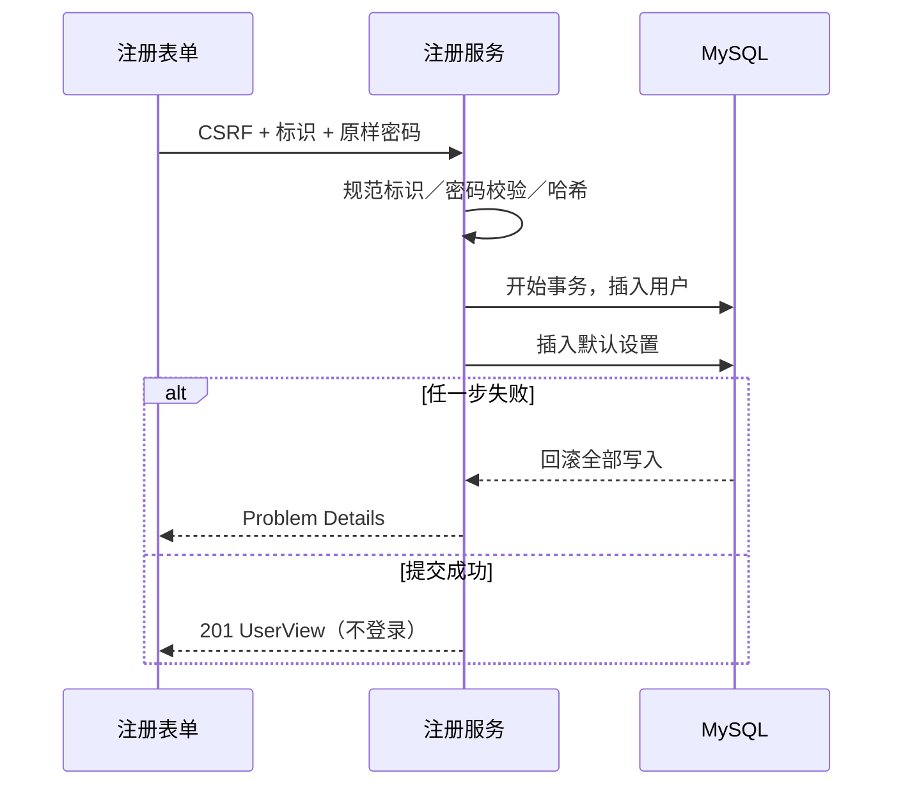
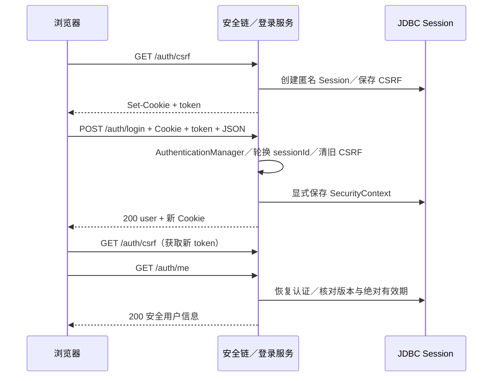
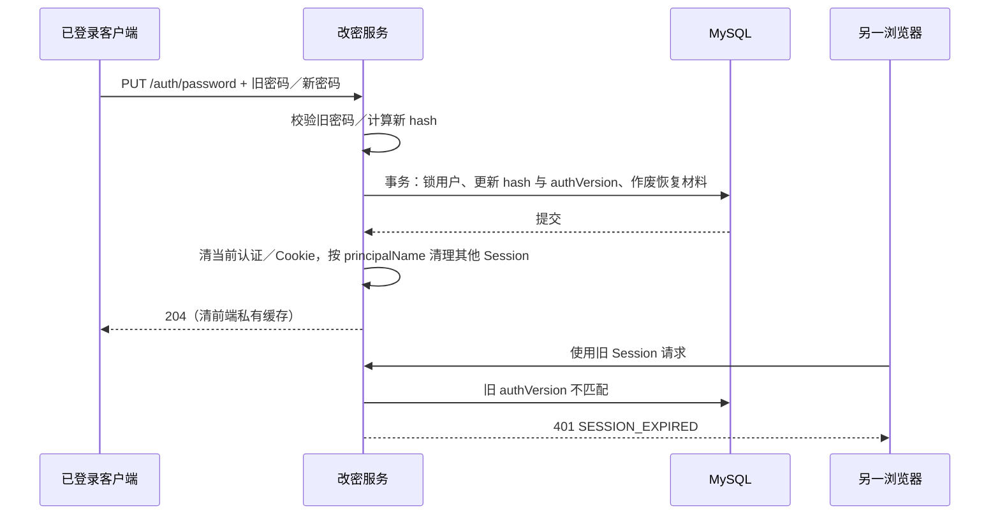
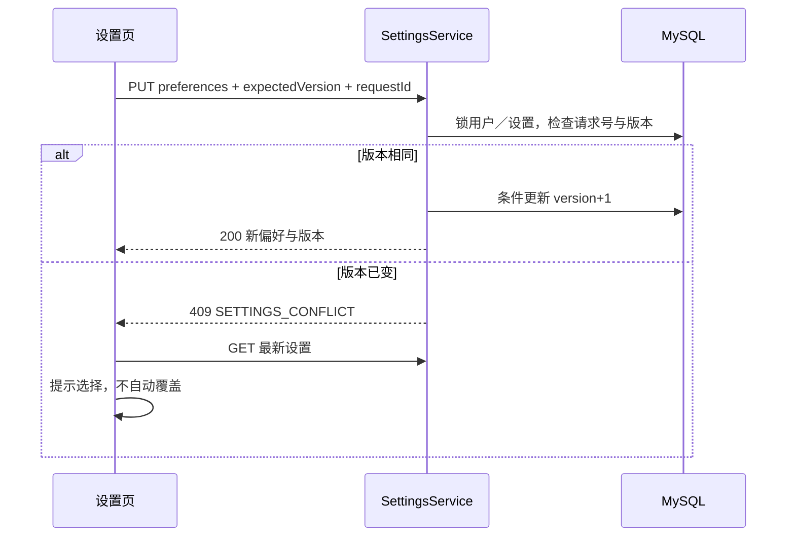
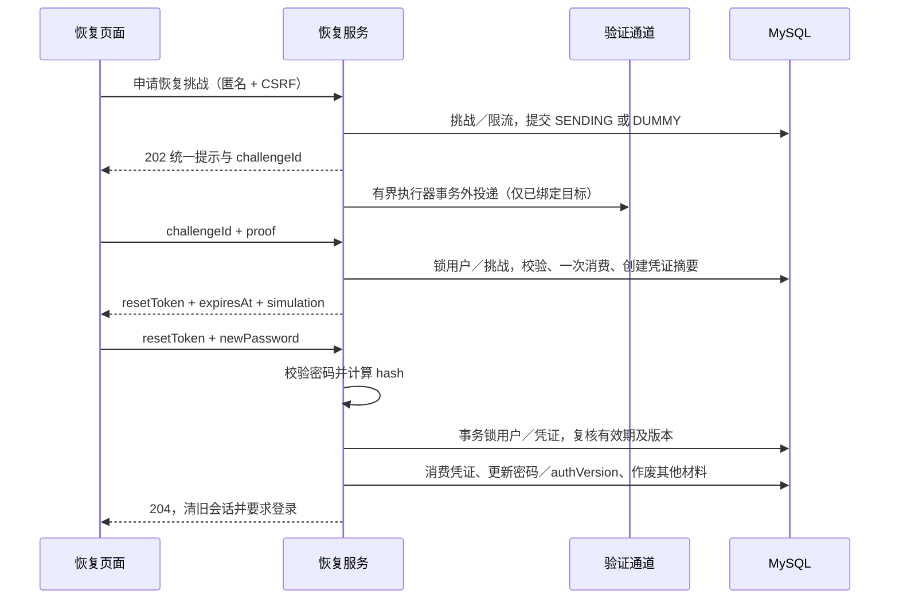

# M01 用户、认证与个人设置执行文档

版本：0.1；日期：2026-11-19。状态：**执行指导已编写，M01 尚未实施／验收**。

需求基线：[PRD V1.1](../../requirements/prd/PRD-v1.1.md)。总体设计：[系统技术设计](../architecture/Readict-V1.1-系统技术设计.md)。任务来源：[模块化开发计划](Readict-V1.1-模块化开发计划.md)。决定：[ADR-0003](../decisions/ADR-0003-M01会话认证与分阶段验证.md)。前置事实：[M00 实施与验收](../../../validation/implementation/m00/README.md)。

执行导航：[环境与分层](#2-目标目录依赖和通用约定) → [迁移](#3-数据迁移字段及约束) → [注册](#4-m01-01用户模型与注册) → [登录与会话](#5-m01-02登录sessioncsrf-与当前用户) → [改密退出](#6-m01-03修改密码与退出) → [页面与设置](#7-m01-04账号与偏好页面) → [验证与恢复](#8-m01-05验证与密码恢复) → [API](#9-核心-api-完整契约) → [验收](#10-m01-06模块验收与操作命令)。


配套流程图：[M01 用户认证与个人设置流程图解](M01-用户认证与个人设置流程图解.md)（职责与数据、注册／登录、鉴权、改密、设置、验证挑战与密码恢复；**图示为待实现设计，不是已验收结果**）。

## 1. 使用方式与完成边界

本文供开发人员在平级 **readict-app** 仓库实施 M01-01～M01-06。示例是待实现方案，不是现有接口、已执行 SQL 或通过报告。本次编写只修改设计仓库文档；不创建应用代码、数据库对象，不安装依赖，不发送短信或邮件。

M01 分为三个阶段，状态必须分别登记：

| 阶段 | 交付 | 完成含义 |
|---|---|---|
| 核心账号 | 注册、登录、JDBC Session、CSRF、改密、退出、设置 | 可以为后续模块提供已验收的身份隔离；联系方式仍未验证 |
| 本地验证 | 挑战、验证码、模拟所有权证明、恢复凭证、重置、异常和并发测试 | 证明本机代码流程；开发通道不证明手机号／邮箱真实归属 |
| 真实通道 | 选定供应商、配置发送、真实接收和所有权验证、恢复验收 | 达成完整账号需求的必要条件；供应商、凭据、费用、模板及合规安排待定 |

允许登记“本机核心和模拟流程验收通过，支持后续模块开发”。只有真实通道及全部退出条件通过，才登记“M01 全范围完成”。不把发音、阅读、查词、翻译或收藏提前纳入本模块，也不增加管理后台、用户列表、任意用户设置查询或联系方式换绑。

### 1.1 已有事实和待实现方案

以下事实来自 2026-11-19 只读源代码核对，应用 M00 实现提交为 `ced5f6e`，文档／单次脚本整理提交为 `1ae7944`；精确执行结果以 M00 归档为准：

| 真实起点 | 复用方式／边界 |
|---|---|
| `backend/pom.xml`：Java 21、Boot 4.1.2、MP Boot 4 Starter 3.5.18、Flyway、Security、JDBC | 在原 POM 增量添加 Session JDBC Starter，版本由 Boot BOM 管理；未证明 Session 已接入 |
| `shared/config/PersistenceConfiguration` 扫描 `com.readict.*.infrastructure.persistence.mapper` | identity/settings 采用该层级，不把 Mapper 任意放到更深包后假设能扫描 |
| `UuidBinaryTypeHandler`、`UtcInstantTypeHandler`、Mapper XML | 复用 UUID／UTC；M00 元信息主键为字符串，UUID 探针不等于业务表 BaseMapper 完整插入读回通过 |
| `DatabaseEnvironmentGuard`、测试 `TestDatabaseInitializer` | 连接／迁移前保护 dev/test；IT 清理前还需核对实际库名 |
| `Problems`、`ApiExceptionHandler`、`RequestIdFilter` | 沿用 Problem Details 和 requestId；JSON 使用当前 `tools.jackson`，不照搬旧 Jackson 包名 |
| `SecurityConfiguration` 默认拒绝，仅匿名开放状态／健康 GET；默认用户自动配置排除 | M01 显式增加身份规则和认证提供器；不恢复默认生成密码、不一律 permitAll |
| 前端 `src/lib/api.ts` 专门解析 SystemStatus；已有取消和过期响应保护 | 抽取通用 JSON／Problem／204 客户端，保留状态接口类型校验；不能把所有响应解析成 SystemStatus |
| `FoundationIT` 假设当前只有元信息和 Flyway 两张表 | M01 增表后调整这一阶段性断言，保留迁移校验、回滚和测试库保护，不能直接删除整套测试 |

官方依据：[Boot Session 配置](https://docs.spring.io/spring-boot/reference/web/spring-session.html)、[Security 自定义登录持久化](https://docs.spring.io/spring-security/reference/servlet/authentication/session-management.html)、[CSRF](https://docs.spring.io/spring-security/reference/servlet/exploits/csrf.html)、[Session JDBC](https://docs.spring.io/spring-session/reference/configuration/jdbc.html)。官方说明支持本设计所需能力；具体项目组合仍由未来 M01 构建和真实 HTTP／数据库验证确认。

### 1.2 执行准备与工作目录

默认工作区 `D:\Java-learning\Readict`，设计仓库和应用仓库平级。开始前在应用根目录执行：

```powershell
Set-Location D:\Java-learning\Readict\readict-app
git status --short
git log -3 --oneline
java -version
mvn -version
node --version
Get-Service MySQL80
```

预期：理解未提交改动，确认 M00 起点和工具可用；不重建工程、不覆盖本地凭据。端口沿用前端 5173／后端 8080，MySQL `127.0.0.1:3306`。开发库 `readict_dev`、测试库 `readict_test`，账号和环境加载按应用 README；不将 `.local/database.json` 打印、提交或复制进本文。Spring Boot 不自动读取 `.env`。

普通单测不需数据库；真实 IT 使用单独测试终端加载 test 账号，不能沿用开发终端凭据。开发和验收不依赖 Docker、MySQL 8.4 或另一实例。M00 的 V1 已执行，**不得修改或重命名 V1，不做 Flyway repair／clean 来隐藏校验失败**。

## 2. 目标目录、依赖和通用约定

### 2.1 目录清单

按需新增文件，不预建空模块。下面列出职责和建议文件名，均相对应用根目录：

```text
backend/src/main/java/com/readict/
  identity/
    api/                       AuthController、VerificationController、PasswordResetController、dto/
    application/               RegistrationService、LoginService、PasswordService、VerificationService
    domain/                    LoginIdentifier、PasswordPolicy、ReadictPrincipal、VerificationPurpose
    infrastructure/
      security/                AuthenticationProvider、AuthVersionFilter、认证／Session配置
      verification/            VerificationSender、LocalOutboxSender、UnavailableSender
      persistence/
        entity/                UserEntity、ChallengeEntity、ResetCredentialEntity、RateBucketEntity
        mapper/                UserMapper、ChallengeMapper、ResetCredentialMapper、RateBucketMapper
        UserRepository.java    其余 Repository 按实际需要添加
  settings/
    api/                       SettingsController、dto/
    application/               SettingsService
    infrastructure/persistence/entity/、mapper/、SettingsRepository.java
  shared/config/               增补现有 SecurityConfiguration；不另建竞争的兜底安全链
backend/src/main/resources/
  db/migration/                V2、V3、V4（见下文）
  mapper/identity/             UserMapper.xml、ChallengeMapper.xml、ResetCredentialMapper.xml、RateBucketMapper.xml
  mapper/settings/             SettingsMapper.xml
backend/src/test/java/com/readict/
  identity/                    密码／标识／状态机单测；进程内捕获 Sender
  settings/                    校验和冲突单测
  IdentityIT.java              真实 MySQL 和真实 HTTP；或按功能拆分 *IT
frontend/src/
  lib/api.ts、api.test.ts       通用客户端与已有状态客户端
  features/auth/               api、types、AuthProvider、登录／注册／改密／恢复表单
  features/settings/           API、偏好状态、SettingsPage
  App.tsx                     路由和认证边界
```

应用不新建 docs/。应用 README 保留配置、运行／测试入口并链接设计仓库；详细实施记录未来归档 `readict-design/validation/implementation/m01/`。单次验收脚本放本地忽略目录，常规自动测试属于应用源码。本文不提前创建验收报告或截图占位。

### 2.2 依赖与配置

M01-02 在 `backend/pom.xml` 原依赖中增加，**不手写 Session 版本**：

```xml
<dependency>
  <groupId>org.springframework.boot</groupId>
  <artifactId>spring-boot-starter-session-jdbc</artifactId>
</dependency>
```

保留 Security、JDBC、MP、Flyway 和 MySQL 模块，不重复引入 Boot 3 Starter、不使用 `@EnableJdbcHttpSession` 再覆盖 Boot 自动配置。未来在 backend/ 检查：

```powershell
mvn dependency:tree '-Dincludes=org.springframework.session:*,org.springframework.security:*,org.mybatis:*,com.baomidou:*'
```

预期：一个 BOM 管理的 Session JDBC 版本，无混入 Boot 3／普通 MyBatis Starter；记录实际解析版本。网络或依赖失败先排查仓库配置，不以本机存在旧缓存判定通过。

增补公共 `application.yml`，保留原 DataSource、Flyway、MyBatis、日志配置：

```yaml
spring:
  session:
    timeout: 30m
    jdbc:
      initialize-schema: never
      table-name: SPRING_SESSION
server:
  servlet:
    session:
      cookie:
        name: readict-dev-session
        http-only: true
        secure: false
        same-site: lax
        path: /
readict:
  auth:
    absolute-timeout: 7d
    rate-hmac-key: ${AUTH_RATE_HMAC_KEY}
  verification:
    sender: unavailable
    local-enabled: false
```

该 Cookie 示例仅用于当前回环 HTTP 的 dev/test 配置；正式部署另配置 `__Host-readict-session`、Secure=true、HttpOnly=true、SameSite=Lax、Path=/、无 Domain，不在当前机器假装生产配置已验收。可以选择 `DefaultCookieSerializer` 明确控制同一套属性，不能让它和 Boot 属性互相覆盖；HTTP IT 必须观察真实 Set-Cookie。

开发 outbox 仅在 dev 且显式启用时配置，测试只注入捕获 Sender。新增必要配置校验：非 dev/test 不允许本地 Sender／本地证明；没有真实 Sender 不可默认为可发送。当前环境保护只允许 dev/test，未来放开部署环境时必须同时保留此校验。验证码 HMAC 密钥由受限本地配置／环境变量提供，缺失时相关流程明确不可用；不填写示例真密钥。

`AUTH_RATE_HMAC_KEY` 为登录／发送限流所需的独立高熵秘密，由本地环境安全加载；核心账号启用前就必须配置，缺失拒绝启动，不能因为真实发送未配置而跳过登录限流。验证码摘要另用 `VERIFICATION_HMAC_KEY` 和 keyVersion，验证业务启用时才要求；二者不复用数据库密码，不进入 POM／锁文件。普通单测注入固定测试密钥，不要求读取真实秘密。

### 2.3 统一实现规则

Controller → 应用服务 → Repository → Mapper／XML；Controller 不直接拿 Mapper，不返回 Entity。简单读写 BaseMapper，所有权条件、行锁、版本和并发 SQL 写 XML。业务 ID 由应用 UUID 生成，`@TableId(type = IdType.INPUT)`，`@TableName(autoResultMap = true)`；UUID 字段显式关联现有 TypeHandler，XML 参数同时指定 JDBC BINARY 和处理器。UTC 时间处理器保持不变。

业务事务位于公开的应用服务方法并由 Spring 代理调用；不要通过同类自调用假装事务生效。跨表注册、改密、恢复消费在同一 DataSource 事务；会话删除和外部发送在事务外可重试。禁止把慢密码哈希或外部网络等待放在行锁事务里。默认关闭二级缓存，不启用全局逻辑删除或隐式乐观锁插件改变并发契约。

最小映射示例用于明确目标文件和类型处理。`UserEntity` 应放在 identity/infrastructure/persistence/entity，下例仅列关键字段，未来补齐 getter/setter 和其余字段；SettingsEntity 的 `userId` 同样 INPUT，不能继承默认 Long ID：

```java
@TableName(value = "app_user", autoResultMap = true)
public class UserEntity {
    @TableId(value = "id", type = IdType.INPUT)
    private UUID id;
    private long authVersion;
    @TableField(typeHandler = UtcInstantTypeHandler.class)
    private Instant updatedAt;
    // UUID 全局处理器已经注册；完整映射按真实 BaseMapper IT 核对。
}
```

XML 显式读回锁定行的安全投影，不能把结果映射为对外 DTO 后顺手输出：

```xml
<mapper namespace="com.readict.identity.infrastructure.persistence.mapper.UserMapper">
  <resultMap id="authState" type="com.readict.identity.infrastructure.persistence.entity.UserEntity">
    <id property="id" column="id" jdbcType="BINARY"
        typeHandler="com.readict.shared.persistence.typehandler.UuidBinaryTypeHandler"/>
    <result property="authVersion" column="auth_version"/>
    <result property="updatedAt" column="updated_at"
        typeHandler="com.readict.shared.persistence.typehandler.UtcInstantTypeHandler"/>
  </resultMap>
  <select id="lockAuthState" resultMap="authState">
    SELECT id, auth_version, updated_at FROM app_user
    WHERE id = #{userId,jdbcType=BINARY,typeHandler=com.readict.shared.persistence.typehandler.UuidBinaryTypeHandler}
    FOR UPDATE
  </select>
</mapper>
```

实际 Mapper XML 需要 MyBatis 标准 mapper DOCTYPE；示意片段省略文件头。Mapper 方法 `lockAuthState(@Param("userId") UUID userId)` 与 namespace／id 对应，必须在服务事务内调用；正式版本还须读取 status 并校验 ACTIVE，不以此最小片段省略状态检查。

## 3. 数据迁移、字段及约束

### 3.1 V2：用户与设置

目标 `backend/src/main/resources/db/migration/V2__identity_and_settings.sql`。以下为字段级目标 SQL，开发时对照系统设计落实；既有 V1 不变，数据库账号使用原 app／migrate 分离权限：

```sql
CREATE TABLE app_user (
  id BINARY(16) NOT NULL,
  email VARCHAR(254) NULL,
  email_key VARCHAR(254) CHARACTER SET utf8mb4 COLLATE utf8mb4_bin NULL,
  phone_e164 VARCHAR(16) CHARACTER SET ascii COLLATE ascii_bin NULL,
  password_hash VARCHAR(512) CHARACTER SET ascii COLLATE ascii_bin NOT NULL,
  email_verified BOOLEAN NOT NULL DEFAULT FALSE,
  phone_verified BOOLEAN NOT NULL DEFAULT FALSE,
  status VARCHAR(16) CHARACTER SET ascii NOT NULL DEFAULT 'ACTIVE',
  auth_version BIGINT NOT NULL DEFAULT 0,
  created_at DATETIME(3) NOT NULL,
  updated_at DATETIME(3) NOT NULL,
  PRIMARY KEY (id),
  UNIQUE KEY uk_user_email_key (email_key),
  UNIQUE KEY uk_user_phone (phone_e164),
  CONSTRAINT ck_user_identifier CHECK (email_key IS NOT NULL OR phone_e164 IS NOT NULL),
  CONSTRAINT ck_user_email_pair CHECK ((email IS NULL) = (email_key IS NULL)),
  CONSTRAINT ck_user_status CHECK (status IN ('ACTIVE','DISABLED')),
  CONSTRAINT ck_user_auth_version CHECK (auth_version >= 0)
) ENGINE=InnoDB DEFAULT CHARSET=utf8mb4;

CREATE TABLE user_settings (
  user_id BINARY(16) NOT NULL,
  font VARCHAR(32) NOT NULL DEFAULT 'Georgia',
  font_size SMALLINT NOT NULL DEFAULT 20,
  line_height DECIMAL(2,1) NOT NULL DEFAULT 1.8,
  content_width SMALLINT NOT NULL DEFAULT 660,
  theme VARCHAR(8) NOT NULL DEFAULT 'warm',
  pronunciation VARCHAR(5) NOT NULL DEFAULT 'en-GB',
  version BIGINT NOT NULL DEFAULT 1,
  last_request_id BINARY(16) NULL,
  last_request_hash BINARY(32) NULL,
  updated_at DATETIME(3) NOT NULL,
  PRIMARY KEY (user_id),
  CONSTRAINT fk_settings_user FOREIGN KEY (user_id) REFERENCES app_user(id),
  CONSTRAINT ck_settings_version CHECK (version >= 1),
  CONSTRAINT ck_settings_font CHECK (font IN ('Georgia','Palatino Linotype','Arial')),
  CONSTRAINT ck_settings_size CHECK (font_size IN (18,20,22,24)),
  CONSTRAINT ck_settings_line CHECK (line_height IN (1.6,1.8,2.0)),
  CONSTRAINT ck_settings_width CHECK (content_width IN (660,720)),
  CONSTRAINT ck_settings_theme CHECK (theme IN ('white','warm','dark')),
  CONSTRAINT ck_settings_voice CHECK (pronunciation IN ('en-GB','en-US')),
  CONSTRAINT ck_settings_request CHECK ((last_request_id IS NULL) = (last_request_hash IS NULL))
) ENGINE=InnoDB DEFAULT CHARSET=utf8mb4;
```

邮箱域名 IDNA 处理后生成小写登录键；显示邮箱和比较键分开。手机号为 E.164，物理字段 phone_e164／实体 phoneE164，DTO 对外字段 phone，显式映射。两个可空标识分别唯一，不能用联合唯一索引替代。V1 不包含业务表，此处不迁移虚构的旧用户；未来如有其他已执行迁移，先核对 Flyway history，不能复用版本号。

### 3.2 V3：框架 Session schema

目标 `V3__spring_session.sql`。以 **POM 实际解析的 spring-session-jdbc JAR** 内 `org/springframework/session/jdbc/schema-mysql.sql` 为源，复制完整建表／索引／属性外键 SQL，在文件头记录依赖版本和来源。不要从博客猜字段，也不要用 app_user 的 BINARY UUID 替换框架 Session 的字符串 ID。

未来操作方法：先执行依赖树取得版本；使用 JDK `jar tf <该版本JAR绝对路径>` 确认资源，在忽略的临时目录用 `jar xf` 提取，再人工核对到 V3。命令中的 `<…>` 必须替换实际值，不是可原样执行的路径。不要将整份依赖 JAR、解压目录或本机 Maven 缓存提交。

预期包含 `SPRING_SESSION`、`SPRING_SESSION_ATTRIBUTES`、Session ID 唯一索引、到期索引、principal name 索引及属性外键。时间字段采用框架 epoch 毫秒契约，不能套用业务 DATETIME 类型处理。Flyway 创建，`spring.session.jdbc.initialize-schema=never`；不设置另一套 schema.sql 初始化。Session 使用同一运行 DataSource，但不经业务 Mapper。

### 3.3 V4：挑战、恢复凭证与限流

目标 `V4__verification_and_rate_limit.sql`。这些表服务于本地和未来真实流程，不代表通道已经接入：

```sql
CREATE TABLE verification_challenge (
  id BINARY(16) NOT NULL,
  user_id BINARY(16) NULL,
  purpose VARCHAR(24) CHARACTER SET ascii NOT NULL,
  identifier_type VARCHAR(8) CHARACTER SET ascii NOT NULL,
  target_key_hmac BINARY(32) NOT NULL,
  delivery_mode VARCHAR(16) CHARACTER SET ascii NOT NULL,
  code_mac BINARY(32) NULL,
  mac_key_version SMALLINT NOT NULL,
  state VARCHAR(16) CHARACTER SET ascii NOT NULL,
  generation INT NOT NULL DEFAULT 1,
  attempts SMALLINT NOT NULL DEFAULT 0,
  max_attempts SMALLINT NOT NULL DEFAULT 5,
  auth_version BIGINT NULL,
  created_at DATETIME(3) NOT NULL,
  expires_at DATETIME(3) NOT NULL,
  next_send_at DATETIME(3) NOT NULL,
  verified_at DATETIME(3) NULL,
  consumed_at DATETIME(3) NULL,
  PRIMARY KEY (id),
  KEY ix_challenge_expiry (expires_at,id),
  KEY ix_challenge_subject (target_key_hmac,purpose,created_at),
  KEY ix_challenge_user (user_id,purpose,state),
  CONSTRAINT fk_challenge_user FOREIGN KEY (user_id) REFERENCES app_user(id),
  CONSTRAINT ck_challenge_purpose CHECK (purpose IN ('VERIFY_CONTACT','PASSWORD_RESET')),
  CONSTRAINT ck_challenge_type CHECK (identifier_type IN ('email','phone')),
  CONSTRAINT ck_challenge_mode CHECK (delivery_mode IN ('REAL','DEV_LOCAL','DUMMY')),
  CONSTRAINT ck_challenge_state CHECK (state IN
    ('SENDING','SENT','UNKNOWN','FAILED','VERIFIED','CONSUMED','EXPIRED','LOCKED','SUPERSEDED')),
  CONSTRAINT ck_challenge_attempt CHECK (attempts >= 0 AND attempts <= max_attempts AND max_attempts > 0),
  CONSTRAINT ck_challenge_time CHECK (expires_at > created_at)
) ENGINE=InnoDB DEFAULT CHARSET=utf8mb4;

CREATE TABLE password_reset_credential (
  id BINARY(16) NOT NULL,
  user_id BINARY(16) NOT NULL,
  challenge_id BINARY(16) NOT NULL,
  token_hash BINARY(32) NOT NULL,
  auth_version BIGINT NOT NULL,
  proof_mode VARCHAR(16) CHARACTER SET ascii NOT NULL,
  created_at DATETIME(3) NOT NULL,
  expires_at DATETIME(3) NOT NULL,
  consumed_at DATETIME(3) NULL,
  PRIMARY KEY (id),
  UNIQUE KEY uk_reset_hash (token_hash),
  UNIQUE KEY uk_reset_challenge (challenge_id),
  KEY ix_reset_expiry (expires_at,id),
  KEY ix_reset_user (user_id,consumed_at),
  CONSTRAINT fk_reset_user FOREIGN KEY (user_id) REFERENCES app_user(id),
  CONSTRAINT fk_reset_challenge FOREIGN KEY (challenge_id) REFERENCES verification_challenge(id),
  CONSTRAINT ck_reset_mode CHECK (proof_mode IN ('REAL','DEV_LOCAL')),
  CONSTRAINT ck_reset_time CHECK (expires_at > created_at)
) ENGINE=InnoDB DEFAULT CHARSET=utf8mb4;

CREATE TABLE rate_bucket (
  scope VARCHAR(32) CHARACTER SET ascii NOT NULL,
  key_hmac BINARY(32) NOT NULL,
  window_start DATETIME(3) NOT NULL,
  counter INT NOT NULL,
  reserved_chars BIGINT NOT NULL DEFAULT 0,
  expires_at DATETIME(3) NOT NULL,
  PRIMARY KEY (scope,key_hmac,window_start),
  KEY ix_rate_expiry (expires_at),
  CONSTRAINT ck_rate_counter CHECK (counter >= 0 AND reserved_chars >= 0)
) ENGINE=InnoDB DEFAULT CHARSET=utf8mb4;
```

V4 在 M01-02 启用持久登录限流前创建，M01-05 再接入挑战业务；不能让 M01-02 的限流依赖尚未执行的表。reserved_chars 为既有系统设计的额度预留字段，M01 固定写 0，M07 再定义翻译额度语义，不在本模块实现翻译。

target_key_hmac 由规范化标识计算，不存明文验证码；真实投递目标从绑定用户读取，写入挑战时保留其 HMAC 快照，发送前复核一致。匿名未知账号也生成 DUMMY 挑战（user_id=NULL、code_mac=NULL），返回形状和验证错误一致，不实际投递。code_mac 是随机六位码加 challengeId／purpose／generation 的 HMAC-SHA256，密钥不在库中；低熵验证码不能只做无密钥 SHA256。比较用常量时间函数，HMAC 密钥带版本便于轮换，旧版本保留至相关挑战全部到期。

恢复 token 用 SecureRandom 生成至少 32 字节、base64url 无填充，只在验证成功响应一次返回；保存 SHA256 摘要。它具有高熵，不用验证码的弱密钥空间。数据库字段不保存 token 明文，不写 URL、日志或浏览器持久存储。

rate_bucket 原子 upsert／加计数，达到阈值拒绝；统计作用域包含 login-account、login-ip、send-target、send-ip、verify-challenge。事务锁用于串行发送同一主体／用途：锁定该作用域的当前限流桶后检查最近挑战，旧挑战作废并提交新 SENDING；锁顺序固定，避免并发重发都发送。跨时间桶时仍检查最新挑战的 next_send_at，不仅依赖当前桶计数。所有时间取服务器 UTC Clock。清理按索引分批，先删过期恢复凭证再删挑战；保留最小审计期 24 小时，限流桶过期后分批删。真实通道的保留政策发布前复核，不记录原始联系方式和验证码。

## 4. M01-01：用户模型与注册

### 4.1 前置、目标与实现顺序

前置：M00 可构建，理解现有 TypeHandler／错误模型；目标为 V2、UserEntity／SettingsEntity、对应 Mapper／XML／Repository、PasswordPolicy、RegistrationService、注册 DTO／Controller、RegisterPage。先落数据和普通单测，再集成注册，最后接表单。

1. 定义 `LoginIdentifier(type, displayValue, canonicalKey)`；只允许 email／phone，禁止同时夹带另一标识或任意 userId。
2. 邮箱 trim 输入标识、校验格式／长度，域名 IDNA 后统一小写登录键；本产品邮箱登录不区分大小写，须在提示中说明。IDNA 失败拒绝，不静默删除字符。电话必须提供国家区号，规范为 E.164，最多 15 位数字加 `+`，不默认国家、不直接去除所有非数字后接受。
3. PasswordPolicy 使用 Unicode code point 计数；至少 8、至多 128，并检查 UTF-8 至多 512 字节，包含 ASCII 数字和 ASCII 英文字母。**密码不 trim、不做 Unicode 归一化**，前端同样用 `Array.from(password).length`，不能按 UTF-16 长度替代。
4. 使用 Spring PasswordEncoder 的 PBKDF2-HMAC-SHA256、随机盐 16 字节、256-bit、初始迭代 600000，编码带版本前缀，如 `{pbkdf2-r1}`。实现时检查实际依赖构造器／算法枚举；前缀对应不可变参数，不随配置随意改变。PBKDF2 参数须实际校准并记录，不声称已有性能数据。空全局 pepper 可使用随机盐方案；若引入 pepper 需另行密钥生命周期，不把它硬编码。
5. 校验与哈希在事务外；公开注册服务启动短事务写 app_user、默认 user_settings。预先查重只能改善错误提示，最终依赖唯一约束；并发重复注册捕获**已知标识唯一键**冲突转 409，不把连接错误／其他完整性错误当重复账号。
6. 初始 verified=false、authVersion=0、ACTIVE；设置 version=1，lastRequest为空。注册返回安全 UserView，不自动登录，客户端进入登录表单。

关键 Java 校验示意（省略错误 DTO，未来实现必须覆盖 null／长度）：

```java
int points = password.codePointCount(0, password.length());
boolean digit = password.codePoints().anyMatch(c -> c >= '0' && c <= '9');
boolean letter = password.codePoints().anyMatch(c ->
    (c >= 'a' && c <= 'z') || (c >= 'A' && c <= 'Z'));
boolean valid = points >= 8 && points <= 128 && digit && letter
    && password.getBytes(java.nio.charset.StandardCharsets.UTF_8).length <= 512;
```

读取安全投影不要 `SELECT *` 后序列化。身份表查询包含哈希只能用于认证内部，哈希字段不得出现在 toString、异常、DTO 或前端状态。新 UUID 表补充 `BaseMapper.insert` → `selectById` → XML 读回相同 UUID／UTC 的真实数据库验证；仅查现有 TypeHandler 注册不算通过。



### 4.2 检查、预期与排障

在 backend/ 普通单测 `mvn test`，应不要求数据库配置；在加载 test 环境的专用终端执行 `mvn -Pmysql-it verify`，只对 readict_test 做真实写入。前端在 frontend/ 执行 `npm test`、`npm run lint`、`npm run build`。命令是未来要求，本次未运行。

常见失败：Mapper 未扫描检查包层级；UUID null／数组检查 `autoResultMap`、INPUT、参数／结果 TypeHandler；字符比较异常检查 email_key 二进制排序规则；设置孤儿检查服务事务代理；重复注册出现 500 检查唯一键异常精确映射。**完成条件**：并发同标识只有一个用户和一份默认设置，设置插入失败用户回滚；安全响应和日志无密码／hash，密码八案例通过，真实 UUID 读写通过。

## 5. M01-02：登录、Session、CSRF 与当前用户

### 5.1 认证主体与持久化

前置：M01-01、V3、Session Starter；目标：认证提供器、LoginService、ReadictPrincipal、Session／CSRF 配置、AuthVersionFilter、登录／me API 和 AuthProvider。

自定义 AuthenticationProvider 用规范化标识读取内部用户记录，校验状态和密码。未知账号也执行一次固定 dummy hash 校验，返回同样 INVALID_CREDENTIALS；不得报告“账号不存在”或“密码错误”区别。成功认证结果只含实现 Serializable／Principal 的最小 `ReadictPrincipal(userId, authVersion, authenticatedAt)`，固定 serialVersionUID，getName 为 UUID 字符串，使 Session principal-name 索引可查询。角色首版仅固定 USER；不保存 UserEntity、密码哈希、验证码、整个 HTTP DTO。认证对象 credentials 清空。

JSON 登录是自定义认证入口，必须按以下伪代码顺序实现；它不是可直接替换现有类的完整源码：

```java
Authentication auth = authenticationManager.authenticate(loginToken);
sessionStrategy.onAuthentication(auth, request, response);
SecurityContext context = SecurityContextHolder.createEmptyContext();
context.setAuthentication(auth);
SecurityContextHolder.setContext(context);
securityContextRepository.saveContext(context, request, response);
// 再输出 200 UserView；未保存成功不能先写成功响应。
```

配置共享的 `DelegatingSecurityContextRepository(RequestAttributeSecurityContextRepository, HttpSessionSecurityContextRepository)`，安全过滤链和登录服务引用**同一个**实例，requireExplicitSave=true。SessionAuthenticationStrategy 明确组合 `ChangeSessionIdAuthenticationStrategy` 和使用相同 tokenRepository 的 `CsrfAuthenticationStrategy`；JSON 登录控制器须调用它，不能假设过滤器会自动补做。依赖真实版本编译时核对类签名。登录失败清除临时线程认证，不留下半认证；已认证用户重复登录先返回 409 ALREADY_AUTHENTICATED，要求主动退出，避免同会话悄悄换号。

认证成功到保存间可能并发改密：返回前再核对 authVersion，下一请求始终再次检查；不能保证并发已在执行请求被撤回，但旧 Session 不得授权新的请求。需改写用户数据的事务在锁定用户后重新核对版本／状态，防止“检查后改密”的竞争。

### 5.2 安全链、Cookie 与有效期

沿用 M00 一条安全链：GET 状态和两个健康入口继续匿名；GET csrf、POST register/login、password-reset 三个入口匿名但保留 CSRF／限流；me、password、settings、联系方式验证要求 authenticated；其他业务入口按模块明确加入，未知路径仍拒绝。保留 formLogin/httpBasic/requestCache 禁用和默认用户自动配置排除；配置显式 Provider／AuthenticationManager，不出现默认生成密码。

每次认证请求在 SecurityContext 加载后、授权前执行 AuthVersionFilter：读用户 ACTIVE、版本，检查 `now < authenticatedAt+7d`，不通过则清认证、invalidate Session、清 Cookie，返回 401 SESSION_EXPIRED。数据源失败返回 503 AUTH_DEPENDENCY_UNAVAILABLE，**不能 fail-open 或误报成密码错误**。空闲 30 分钟由 Session 管，绝对 7 天由服务器不可变 authenticatedAt 管；滑动访问不能延长绝对期限。测试 Clock 可注入，不能通过等待七天或篡改机器时间验证。

AuthVersionFilter 不作为普通 servlet filter 被重复注册；明确只挂在 Security 链。RequestIdFilter 保证包括 CSRF／401 错误均带 requestId。Session 保存失败回统一依赖错误，不能仅凭当前线程能读用户就认定持久化通过。JDBC Session 清理由框架执行，读取过期 Session 应直接拒绝，不等清理任务。

### 5.3 CSRF 约定与时序

使用 `HttpSessionCsrfTokenRepository`，请求头 `X-CSRF-TOKEN`；保持默认 `XorCsrfTokenRequestAttributeHandler` 的掩码处理。GET csrf 从请求属性里的 CsrfToken 取值并调用 getToken 实体化，返回掩码 token 给前端；前端原样回传，不混用底层未掩码 token 和 request handler。响应 `Cache-Control: no-store`，不允许 CDN／浏览器缓存，不把 token 放 URL 或持久存储。

```java
// Controller 方法示意，基础路径 /api/v1/auth。
@GetMapping("/csrf")
ResponseEntity<CsrfView> csrf(CsrfToken token) {
    return ResponseEntity.ok().cacheControl(CacheControl.noStore())
        .body(new CsrfView(token.getToken(), token.getHeaderName()));
}
```



Missing／InvalidCsrfTokenException 分别映射 403 CSRF_MISSING／CSRF_INVALID，不吞并为业务 FORBIDDEN。前端收到这两类才清 token、重新 GET csrf，并让用户明确重试变更操作；**不能自动重发注册、改密、发送或重置**。普通 FORBIDDEN 不启动无限刷新。登录、退出及改密后都丢弃旧 token，下一变更前获取新 token。匿名 GET me 返回 401 正常访客状态，不弹网络故障。

### 5.4 限流、检查与完成

登录失败初值：账号 5 次／10 分钟、IP 20 次／10 分钟；入口有界内存限制密码校验并发，数据库桶保存可跨重启的计数。账号键为规范化标识的 HMAC；未知账号同样计数，成功不能清空 IP 攻击记录，不永久锁死账号。先预留校验名额再哈希，避免并发越过阈值；失败记数，成功可释放该次失败预算。具体 SQL 与计数语义在测试中固定。429 带 Retry-After，不泄露哪个账号存在。回环开发不信任任意 X-Forwarded-For，未来受信代理单独配置。

未来 backend/ 执行依赖树、`mvn test` 和 test 专用终端的 `mvn -Pmysql-it verify`；HTTP IT 使用 CookieManager 分别维护匿名和登录 cookie jar。检查登录前后 Session ID 不同、第二请求 me 成功、JDBC 表真实写入、重启应用后会话可恢复、CSRF 旧值失败而新值成功；日志不得输出 Session 内容或 Set-Cookie。若登录 200 后 me=401，先查 saveContext、共享 repository、序列化、代理 Cookie，而不是关闭 CSRF。**完成条件**：跨请求恢复、Cookie／超时／轮换／限流及依赖失败均通过，Session 属性不含密码哈希。

## 6. M01-03：修改密码与退出

前置：M01-02；目标 PasswordService、UserMapper.xml 条件改密、AuthVersionFilter、Session 清理服务、改密表单和退出处理。Controller 不做多条独立写入。

改密流程：取当前用户／版本 → 事务外验证旧密码和新密码策略、生成新 hash → 短事务锁用户并确认原 hash／authVersion 尚未变化 → 更新 hash、auth_version+1、updatedAt → 作废待用恢复凭证及挑战 → 提交。锁后原版本变化返回 409 AUTH_CHANGED，不能凭过期旧密码继续覆盖。先核对版本，再做相同版本条件更新；受影响行必须恰为一。

```sql
UPDATE app_user
SET password_hash = #{newHash}, auth_version = auth_version + 1,
    updated_at = #{now}
WHERE id = #{userId,jdbcType=BINARY,typeHandler=com.readict.shared.persistence.typehandler.UuidBinaryTypeHandler}
  AND auth_version = #{expectedAuthVersion} AND status = 'ACTIVE';
```



数据库提交是成功边界。其后删除其他 Session 失败不回滚已提交密码，不返回“改密失败”诱使再次改密；authVersion 即时拒绝旧请求，新登录／定时巡检按 principal name UUID 重试清理，无需新建消息队列。每次失败记录脱敏事件与 requestId，不记录 token。返回 204 后要求新密码登录，包括当前会话。

退出采用 Spring Security `LogoutFilter` 的 POST `/api/v1/auth/logout`，配置 SecurityContextLogoutHandler／CSRF 清理和 204 success handler；不再由同名 Controller 重复实现。需替换 M00 的 logout.disable。认证版本过滤器必须在 LogoutFilter 之前检查已有认证，或明确退出只负责幂等清当前会话而不依赖认证；未知／过期会话也允许退出，但仍校验合法 CSRF。删除 Cookie 要匹配实际名字、Path、Secure；不要只删除 JSESSIONID。退出仅失效当前会话；改密／重置失效全部会话。

未来检查：真实两 cookie jar 登录同一用户，改密后两份旧 cookie 请求均 401；旧密码登录失败，新密码成功；重复退出在重新获取有效 CSRF 后 204；没有 CSRF 仍 403。密码更新失败事务不改变版本，前端不能显示成功。排障先查 authVersion 是否每次读取、Session principal 索引和 logout handler，不能以“后台删表行最终会完成”代替即时拒绝。完成条件包含提交后清理失败和并发改密只能一个胜出。

## 7. M01-04：账号与偏好页面

### 7.1 前端接入步骤

前置：核心 API 可用；目标 `features/auth/`、`features/settings/`、`lib/api.ts`、App 路由和对应测试。现有正式前端没有路由，未来引入与当前 React／Vite 兼容的 React Router 并提交实际 package-lock，版本核对后锁定；不因原型已使用某版本便声称正式项目兼容通过。

路由：`/login`、`/register`、`/forgot-password`、`/reset-password`、`/account`、`/settings`。当前成功登录去 `/account`，不能跳转尚未实现的书架。`/` 保留系统状态入口或显式引导账号，已有状态组件和检查继续可用。returnTo 仅接受应用内白名单路径，不能接受 `https://…`、`//…` 或脚本 URL。

AuthProvider 状态 `checking | guest | authenticated | unavailable`；启动 GET me，401→guest，网络／503→unavailable（允许重试），不将依赖故障误显示已退出。登录请求禁重复提交，成功后获取新 csrf、读取 me；失败不保存私有数据。Session 过期清用户／设置／以后业务缓存，取消在途请求，递增 generation 忽略迟到结果。BroadcastChannel 只传“登录变化／退出／设置版本更新”信号，不传密码或 Session token；收到信号重新取服务器状态。

扩展通用客户端的契约示意：

```typescript
type RequestOptions = {
  method?: 'GET' | 'POST' | 'PUT' | 'DELETE';
  body?: unknown;
  signal?: AbortSignal;
};
// decode 按端点验证运行时结构；204 使用专门的 void 解码器。
declare function request<T>(path: string, decode: (value: unknown) => T,
  options?: RequestOptions): Promise<T>;
```

实现时 credentials=same-origin；Accept JSON，只有 JSON body 才加 Content-Type；安全方法外先取得内存 csrf 并加服务端指定 header。先看状态：204 不调用 json；其他成功校验 Content-Type 和端点结构；失败解析现有 Problem Details／requestId，无效响应统一 INVALID_RESPONSE，保留 AbortError。401／403 由统一事件交给认证层，客户端本身不循环导航／重试。任何改变状态的请求不默认自动重发；GET 可用户重试，发送验证码更不能网络失败后悄悄再发。保留原 getSystemStatus／createStatusLoader 对外接口和旧测试语义。

表单使用同一密码提示“密码不少于 8 位，且至少包含一个数字和一个英文字母”，允许粘贴和密码管理器，正确 autocomplete，错误关联输入、可见键盘焦点、loading 文本／disabled、通用失败不暴露账号。邮箱／手机号未验证显示“未验证”，模拟成功显示“本地模拟已通过，真实联系方式仍未验证”。页面沿用暖色、深绿、清晰文字层级，390px 基本可操作；不显示不存在的完整书架／阅读能力。

### 7.2 设置契约和并发

偏好 DTO 与数据库映射：font=Georgia／Palatino Linotype／Arial；fontSize=18／20／22／24；lineHeight=1.6／1.8／2.0；width=660／720；theme=white／warm／dark；pronunciation=en-GB／en-US。字体缺失按系统设计回退 serif／sans-serif，回退值不替代已保存的枚举。口音仅偏好记录，不承诺音频服务；默认值见 V2。禁止任意 CSS 或 HTML 值。

GET `/me/settings` 返回 `{preferences,version}`。PUT 请求示例：

```json
{
  "preferences": {"font":"Georgia","fontSize":22,"lineHeight":1.8,"width":660,"theme":"warm","pronunciation":"en-GB"},
  "expectedVersion": 1,
  "requestId": "19ad4861-7175-4a6b-91cf-eb4e6a1a2011"
}
```

服务端 userId 只取主体；事务锁当前用户并核对 authVersion，再锁其设置。先比较 last_request_id：同号同规范化 payload 摘要返回当前已提交结果，不再升版；同号不同摘要 409 IDEMPOTENCY_KEY_REUSED；新号检查 expectedVersion，不符 409 SETTINGS_CONFLICT；XML UPDATE `WHERE user_id=:currentUser AND version=:expectedVersion`，写 version+1、last_request_id/hash、updatedAt。摘要由固定字段顺序的规范化数据生成，不能直接 hash 任意 JSON 键顺序。只保证最后请求可重放；更早请求过期版本返回冲突，不伪称永久幂等日志。

客户端即时预览，500ms 防抖，单用户保存串行；请求发出后新的编辑保留到下一轮，不用迟到响应覆盖新草稿。保存失败显示“尚未同步”，保留草稿；网络状态未知重试同 requestId／同 payload，不能重建请求号误作新写。409 时取最新版本，让用户选择加载服务器值或保留草稿重新提交，不能静默 last-write-wins。



### 7.3 检查与完成

未来 frontend/ 执行 `npm run lint`、`npm test`、`npm run build`；backend/ 普通单测及测试终端的 MySQL IT；浏览器访问 `http://127.0.0.1:5173`，两用户／两标签页测设置隔离、刷新、重登录、失效和网络错误。若 PUT 403 查 token 轮换和 Vite 原路径代理；204 报解析错误查通用客户端；深色刷新失效查 me 及 settings 初始化，不只查 localStorage。完成条件：所有账号页面状态可达，失败不显示保存成功、无重复提交，设置隔离和冲突有真实结果，状态页无回归。

## 8. M01-05：验证与密码恢复

### 8.1 接口和投递边界

前置：V4、核心账号稳定；目标 VerificationSender、三个适配器、挑战／恢复 Repository、VerificationService、PasswordResetService、相关 DTO／表单。供应商未定不阻塞本地流程，不用假 Provider 默认返回成功。

```java
public interface VerificationSender {
    DeliveryReceipt send(VerificationMessage message);
}
// Message 仅在服务内部短时持有目标和验证码，禁止默认 toString 输出内容。
// Receipt 区分 SENT、FAILED、UNKNOWN；不等同用户已接收或真实已验证。
```

测试捕获适配器只在测试进程内可读，不创建 HTTP 查询码接口。手动开发 LocalOutboxSender 仅 dev+显式开关启用，写到应用忽略的 `.local/verification-outbox/`；目录只授予当前本机账号访问、限制保留时长和文件数量，文件名随机 ID，不带联系方式。outbox含敏感码，不进入普通日志、截图、报告或 Git；不用 M00 临时 stdout 日志代替它。启动时检查回环监听和非真实部署；真实配置检测到本地模式直接失败，不降级。

所有挑战写 `delivery_mode`。REAL 验证成功才可更新 email_verified／phone_verified；DEV_LOCAL 成功只返回 simulation=true，保留真实 verified=false。DEV_LOCAL 恢复凭证只在显式启用本地证明的 dev/test 接受；真实环境和真实流程必须拒绝它。受理流程依赖服务端配置／表中模式，绝不相信客户端传 `verified=true`、`deliveryMode=REAL` 或测试头。模拟仅用于本机开发，不是公共部署功能。

### 8.2 挑战状态机、限流和重发

六位数字验证码用 SecureRandom，TTL 5 分钟、最多 5 次错误、重发冷却 60 秒；同目标最多 5 次／小时、同 IP 最多 20 次／小时，匿名和已登录接口共用发送预算防绕过。值为初始工程策略，真实供应商限额更严格时取较小值。HTTP 429 带 Retry-After；错误尝试由锁定挑战后的原子计数保证不超额，失败计数必须提交，不能抛异常导致事务一起回滚而无次数限制。

申请：验证 CSRF／格式／限流 → 锁相应发送范围 → 作废旧活动挑战 → 写 SENDING 并提交 → 返回202受理 → 有界本进程执行器在事务外调用 Sender → 条件更新 SENT／FAILED／UNKNOWN。匿名已知／未知账号都在数据库受理后返回，不让真实网络投递耗时直接暴露账号存在性；DUMMY 不实际投递，外部看不到投递状态。执行器有并发／队列上限，容量不足在账号查询前统一503，禁止无限线程；不引入外部消息中间件。验证码明文仅在内存任务中短时持有，崩溃不自动重发，由用户重新申请。

超时未知不能自动再次发送；本次 challenge 可以接收已经发出的正确码，UNKNOWN 和 SENT 同样验证，FAILED 不接受，下一次请求遵守冷却并作废旧码。若并发重发已使旧挑战 SUPERSEDED，迟到发送结果不得复活旧状态。服务崩溃遗留 SENDING 在超时后标 UNKNOWN，验证码有效期仍从创建起算，不延长；清理扫描只更新状态，不尝试从摘要还原码。验证 DUMMY 时也执行受控摘要比较并走统一错误，未来验收检查响应时间分布，不能仅比较 JSON 字段便声称防枚举完成。

状态转换：SENDING→SENT／FAILED／UNKNOWN；SENT／UNKNOWN→VERIFIED（联系方式用途）或 CONSUMED（成功换发恢复 token）；任意未消费活动态可因超时→EXPIRED、次数耗尽→LOCKED、重发／改密→SUPERSEDED。验证码只允许验证一次；联系方式成功即不再可用，恢复挑战只可生成一个凭证。过期先于比较，错误用常量时间比较摘要。任何验证都检查 purpose、目标、user、模式、generation、authVersion。

匿名恢复申请对存在／不存在账号返回同样 202、随机 challengeId、相同 expiresIn／retryAfter 和提示，不给 maskedTarget、userId 或 verified 信息。不存在账号保存 DUMMY 以保持状态形状，验证永远返回同样的 CHALLENGE_INVALID；数据源错误统一 503；未配置通道在查询账号前统一返回 VERIFICATION_UNAVAILABLE，不让账号存在性决定可用性。投递失败对匿名前端不返回可枚举的“此账号发送失败”，服务端脱敏记录；UI 提示“若账号可用，请查收；可在冷却后重试”。

### 8.3 密码恢复事务



统一锁顺序：user → challenge／credential，限流申请事务不在锁挑战后反向锁用户。恢复 verify 可先不加锁查 challenge 获取 userId，再在事务按顺序锁定并复核全部字段；不存在／DUMMY 走等价错误路径。verify 不重复返回原 token，响应丢失只能重新申请，不能从摘要还原 token。

complete 先查摘要定位用户、校验模式／格式／初步有效性，在锁外哈希；事务中重新检查 token 未消费、未过期、authVersion 相同和用户 ACTIVE，消费与改密同一提交。并发两个 complete 只有一个成功，另一个 410 RESET_TOKEN_INVALID；策略不合格返回 422 不消费，客户端可在有效期内修正。成功后作废该用户所有待用恢复材料并递增版本，旧 Session 即时拒绝。不能仅凭账号标识、生日、前端已登录标记或开发万能码重置。

联系方式初始未验证也不能直接恢复；只有新收到的 **REAL 绑定目标挑战** 成功才证明当前可接收。REAL 恢复 verify 可在同一事务标记该联系方式已验证；DEV_LOCAL 永不置真。若真实供应商不能满足所有权证明，该路径不得上线。恢复 token 为用途受限证明，不能用于登录／改绑。真实通道可改用邮件链接，但需后续记录契约／安全验证变更，不能把本方案六位码实现描述成真实已验证。

### 8.4 未来检查、排障与退出

backend/ `mvn test` 对捕获适配器、Clock、HMAC、错误次数和状态机做普通测试；test 专用终端 `mvn -Pmysql-it verify` 对 V4 锁／事务／限流和真实 HTTP 流程测试；开发人员显式启用 dev outbox 才手动查看本机验证码，结束关闭开关并清理本次文件。前端完整执行申请、输入错误、重发、过期、重置和重新登录。

常见故障：错误次数不增加检查异常是否回滚计数事务；重发后旧码有效检查 supersede 条件／generation；resetToken 二次成功检查唯一挑战与消费锁；DEV_LOCAL 导致真实 verified=true 检查模式门槛；配置缺失却“发送成功”检查默认 Sender 和异常映射。**本地退出条件**：流程和失败／并发路径通过且全部标明模拟；**真实退出条件**：真实接收／所有权／恢复、供应商错误隔离、隐私和额度另有证据，不能用 outbox 截图代替。

## 9. 核心 API 完整契约

以下路径均带 `/api/v1`。除安全 GET 外所有状态变更必须有效 CSRF；匿名并不免除 CSRF。所有认证／挑战／设置响应 no-store，不回显密码、proof、hash、Session 或数据库信息。JSON 类型不符 400 INVALID_REQUEST，字段语义不符 422；未认证 401 UNAUTHORIZED／SESSION_EXPIRED，拒绝权限 403 FORBIDDEN，依赖不可用 503，错误沿用现有 Problem Details 扩展 code/requestId/retryable。

| 方法／路径 | 权限／请求 | 成功／主要失败 |
|---|---|---|
| GET `/auth/csrf` | 匿名；无 body | 200 `{token,headerName}`，可能创建匿名 Session；禁止缓存 |
| POST `/auth/register` | 匿名；`{identifierType,identifier,password}` | 201 `{user}`，不登录；409 IDENTIFIER_UNAVAILABLE；422 PASSWORD_POLICY／IDENTIFIER_INVALID；429 |
| POST `/auth/login` | 匿名；同注册字段 | 200 `{user}`、Session Cookie；401 INVALID_CREDENTIALS；409 ALREADY_AUTHENTICATED；429 RATE_LIMITED |
| GET `/auth/me` | 登录 | 200 安全 UserView；401 或依赖故障 503 |
| POST `/auth/logout` | 当前／匿名 Session；CSRF | 204 清当前会话；无效 CSRF 403；不要求旧会话一定存在 |
| PUT `/auth/password` | 登录；`{currentPassword,newPassword}` | 204 并失效全部旧会话；422 CURRENT_PASSWORD_INVALID／PASSWORD_POLICY；409 AUTH_CHANGED |
| POST `/auth/verification/challenges` | 登录；`{identifierType}`，只能取本人已绑定目标 | 202 `{challengeId,expiresIn:300,retryAfter:60,simulation}`；不存在该类型 422；未配置 503；429 |
| POST `/auth/verification/verify` | 登录；`{challengeId,proof}` | 200 `{emailVerified,phoneVerified,simulation}`；错误／过期／耗尽统一 422 CHALLENGE_INVALID；不可验证他人挑战 |
| POST `/auth/password-reset/challenges` | 匿名；`{identifierType,identifier}` | 202 `{challengeId,expiresIn:300,retryAfter:60,message}`；不存在同形；未配置 503；429 |
| POST `/auth/password-reset/verify` | 匿名；`{challengeId,proof}` | 200 `{resetToken,expiresAt,simulation}`，TTL 10 分钟；422 CHALLENGE_INVALID；429 |
| POST `/auth/password-reset/complete` | 匿名；`{resetToken,newPassword}` | 204 并失效全部旧会话；410 RESET_TOKEN_INVALID；422 PASSWORD_POLICY |
| GET `/me/settings` | 登录；无 userId 参数 | 200 `{preferences,version}` |
| PUT `/me/settings` | 登录；`{preferences,expectedVersion,requestId}` | 200 `{preferences,version}`；409 SETTINGS_CONFLICT／IDEMPOTENCY_KEY_REUSED；422 SETTINGS_INVALID |

UserView：`{id,email:null|string,phone:null|string,emailVerified:boolean,phoneVerified:boolean}`；GET me 直接返回 UserView，register/login 包在 user 属性，三者运行时 decoder 分别处理。verified 不从前端传入。匿名其他用户的 challenge 使用统一失效反馈，不泄露其目标。proof 为字符串六位数字，保留前导零；resetToken base64url 长度固定上限，超长在解析前拒绝。

错误示例（内容为示例，不代表已出现）：

```json
{
  "type": "about:blank",
  "title": "登录信息不正确",
  "status": 401,
  "code": "INVALID_CREDENTIALS",
  "requestId": "5355a7a7-3074-47c0-8964-b7d74c122d01",
  "retryable": false
}
```

GET settings 响应 version、PUT expectedVersion 和 requestId 与 HTTP X-Request-Id 各司其职：前者业务幂等号，后者单次请求追踪，不混为同一保证。登录／注册／改密／发送挑战没有默认自动重试语义；网络结果未知需提示并查询当前状态／用户确认后操作，不能返回虚构的成功。

## 10. M01-06：模块验收与操作命令

### 10.1 实施顺序和测试环境

建议实施顺序：V2／标识密码模型与注册 → V3、V4／认证 Session／CSRF／限流 → 改密退出 → 前端账号设置 → 本地验证恢复 → 综合收口。每个完整开发任务按应用协作要求中文提交；本文编写任务仅在设计仓库提交。M01 状态不因本文交付改变。

所有命令在 **未来实施后** 执行，以下不代表已经执行。普通测试终端：

```powershell
Set-Location D:\Java-learning\Readict\readict-app\backend
mvn test
```

预期：普通单测不加载真实 DataSource，不要求 DB 密码；不得为了通过将全部测试改为需要本机数据库。

真实 IT：新终端先按应用 README 加载 **test** 的两个账号秘密，再执行：

```powershell
Set-Location D:\Java-learning\Readict\readict-app\backend
if ($env:DB_APP_USER -ne 'readict_test_app' -or $env:DB_MIGRATION_USER -ne 'readict_test_migrate') {
  throw '拒绝运行：当前终端不是专用测试账号'
}
mvn -Pmysql-it verify
```

这层命令保护不能替代现有初始化器的 URL／账号／profile 检查。连接前、Flyway 前拒绝错误配置，连接后核对 `SELECT DATABASE()` 和账号；清理前再次核对 readict_test。只删本次测试生成的 UUID 集合，依次清理恢复凭证→挑战／Session→设置→用户，限流仅清本次 key。Session 用框架 Repository 按测试 principal 索引删除；不得 TRUNCATE、清空所有用户或删除重建库，禁止 Flyway clean。

前端在独立终端执行以下命令；扩充用例时同步维护 package.json 的 test 文件清单，当前脚本只运行 `src/lib/api.test.ts`，不能将新测试文件未被执行视为通过：

```powershell
Set-Location D:\Java-learning\Readict\readict-app\frontend
npm ci
npm run lint
npm test
npm run build
```

后端 dev 终端按应用 README 加载开发账号后在 backend/ `mvn spring-boot:run '-Dspring-boot.run.profiles=dev'`；前端终端在 frontend/ `npm run dev`。预期 Vite 原路径代理、同源 Cookie，无需跨域放宽。端口冲突查监听和自己的进程，不停止共享 MySQL。生产构建不打包 outbox、本地配置和测试捕获 Sender。

### 10.2 必须覆盖的验收矩阵

记录每行实际用例、环境、结果、证据和未完成原因，不能将此清单作为通过记录：

| 编号 | 输入／操作 | 通过标准／验证层 |
|---|---|---|
| A01 | abc12345、ABC12345、Abc12345、abc1234! | 都通过密码策略，普通单测＋表单 |
| A02 | abcdefgh、12345678、Abcdefgh、abc1234 | 均拒绝，提示一致，普通单测＋HTTP |
| A03 | 非 BMP 字符、128/129 code point、UTF-8 边界、前后空格 | 计数一致、不 trim、不归一化；密码往返不截断 |
| A04 | 大小写邮箱、IDNA、空格标识、明确区号手机、非法标识 | 唯一键一致，密码原样；手机号无隐式国家假设 |
| A05 | 同标识 20 个并发注册，设置插入受控失败 | 一个账号一份设置；失败事务无半用户 |
| A06 | BaseMapper 插入 UUID 用户／设置，XML／BaseMapper 读回 | UUID 和 UTC 毫秒精度相同，非仅元数据探针 |
| A07 | PBKDF2 相同密码重复编码、错误密码、未知前缀 | 随机盐不同、可匹配、错误不匹配，参数有版本，无秘密日志 |
| A08 | 匿名 csrf→login→新 csrf→me | Session ID 改变，JDBC 属性保存，下一真实 HTTP 请求认证恢复 |
| A09 | 应用重启／空闲 30m／绝对 7d | 同版本重启可恢复；到期拒绝，Clock 控制，不等待真实七天 |
| A10 | 缺失／无效／登录前旧 csrf／退出前旧 csrf | 403 正确 code，新 token 可继续，GET 未意外失效 |
| A11 | 未登录访问设置，传别人 userId／挑战ID | 无越权；输入不能决定当前用户 |
| A12 | 账号与 IP 连续／并发错误登录 | 统一 INVALID_CREDENTIALS／429、Retry-After，未知账号同策略，无永久锁死 |
| A13 | 两浏览器同号，改密／重置，其他 Session 删除失败 | 所有旧会话新请求立即 401，新密码可用、旧密码不可用 |
| A14 | 同时改密／重置／写设置 | 固定锁顺序，版本复核，最多一个改密胜出，无旧认证覆盖新数据 |
| A15 | 两用户设置、刷新／重新登录、同版并发 PUT | 严格隔离；只一胜出，409 后不静默覆盖 |
| A16 | 相同设置 requestId 同／不同 payload、迟到响应 | 同请求不升版，不同内容409，草稿不被迟到结果覆盖 |
| A17 | 真实 HTTP 204、非 JSON、非法 JSON、网络中断 | 客户端正常处理／可解释错误，不按 SystemStatus 解码所有响应 |
| A18 | 验证码错误、超时、5次耗尽、并发错误 | 计数实际提交，超额拒绝、错误统一，过期不可复活 |
| A19 | 冷却重发、并发重发、迟到投递、SENDING崩溃 | 旧码失效、限流有效、状态条件更新不复活旧挑战 |
| A20 | 已存在／未知账号申请恢复，服务未配置 | 同形响应、无账号信息；未配置统一503，不假发送 |
| A21 | 同 challenge 重放、同 resetToken 并发 complete | 一个凭证、一次消费；事务失败可按实际状态安全再试 |
| A22 | 改密／重置事务中受控异常 | hash、authVersion、消费状态一起回滚；不假成功 |
| A23 | DEV_LOCAL 联系验证及恢复、真实模式输入开发凭证 | 模拟不置真实 verified；真实环境拒绝开发证明／Sender |
| A24 | outbox／日志／HTTP／仓库检查 | 无公开取码、无普通日志码／密码／Cookie，无秘密入库明文或提交 |
| A25 | 登录后刷新、会话过期、403、重复提交、多标签页 | 不无限循环；变更不自动重放；退出清私有缓存 |
| A26 | M00 状态／健康／失败回滚／测试误连保护 | 原能力不回归；原仅两表断言改为版本化预期，不删保护 |
| A27 | Chrome／Edge 实际版本，三桌面尺寸与390px | 表单、错误、焦点／键盘、loading／dark 可用，截图脱敏 |
| A28 | 真实短信／邮件接收、错误目标、供应商超时和额度 | 另行真实通道验收，拥有证明与恢复成功；模拟不能替代 |

真实 DB／HTTP IT 不以测试框架自动回滚代替应用事务验证。故障用测试内依赖替身、受控代理或测试事务异常制造，**不得停止共享 MySQL**、改 V1 或清理开发库。系统启动失败和运行时 Session 不可用分别测，不能假设所有断连都返回同一个 HTTP 错误。

### 10.3 日常排障表

| 现象 | 首查位置／处理 |
|---|---|
| Flyway checksum mismatch | 检查是否误改 V1；恢复原迁移，新增迁移修复，不能 repair 掩盖 |
| Session 表不存在 | 检查 V3 实际执行、框架表名大小写及 MySQL schema；不启用自动建表绕过 |
| 登录成功后立即401 | saveContext、sessionStrategy、序列化 principal、Cookie名字／路径及代理 |
| 验证码始终不匹配 | 前导零、HMAC key版本、purpose／generation、码是否被重发作废；禁止打印码排错 |
| 403循环 | 区分 CSRF 与 FORBIDDEN，登录／退出后的 token 更新，禁止无限自动重试 |
| 改密后旧浏览器仍可用 | authVersion 检查位置／是否被缓存、主体现有版本、绝对时间检查 |
| 注册并发500／设置丢失 | 唯一冲突映射范围、事务代理和默认设置插入是否同事务 |
| 清理脚本指向dev | 立即拒绝执行；核对终端 profile／账号／URL，不“临时放宽”保护 |
| 未接入通道却显示已验证 | 立即修复信任模式门槛；模拟与真实标志分开，撤销不可信状态 |

### 10.4 交付和状态记录

未来归档 `validation/implementation/m01/README.md` 为入口，保存实施说明、验收矩阵实际结果、环境／依赖树摘要、应用提交、迁移校验摘要、脱敏截图和失败记录。只在真正执行后建立；不归档密码、码、token、Cookie、数据库地址详情或本地 outbox。临时日志在应用忽略的 `.artifacts/`，审核脱敏后才选取证据归档。

核心完成：M01-01～04 和对应安全／隔离用例实际通过，后续模块可依赖登录；本地流程完成：M01-05 的模拟部分和异常／并发通过，并明确真实通道待定；全范围完成：真实通道、所有权与恢复及 M01-06 全部要求通过。M01 任务表分别记这些状态和阻断项，不用“全部通过（除恢复）”表述。

本执行文档交付的完成条件仅为：源码起点核对、设计／接口／DDL／相对链接和任务一致性检查完成，中文提交完成。**本次不产生 M01 运行验收结论**。
