# M01 用户认证与个人设置：开发流程与时序图解

版本：0.2（2026-11-20，CR-0003 固定 +86） · 配套对象：M01-01～M01-06 · 状态：**设计辅助文档，非实现或验收记录**。

> 本文根据 [M01 执行文档](M01-用户认证与个人设置执行文档.md)、[ADR-0003](../decisions/ADR-0003-M01会话认证与分阶段验证.md) 和 [模块化开发计划](Readict-V1.1-模块化开发计划.md) 绘制。图中“完成、成功、失败”描述的是**预期业务分支**，不是已经运行通过的结论。M00 有本机验收记录；M01 核心账号与本地模拟流程已通过本机阶段验收，真实通道待接入；见 [M01 实施验收记录](../../../validation/implementation/m01/README.md)。正式代码在独立的 `readict-app`，本仓库仅维护设计与证据。

## 阅读方式与图例

2026-11-20 根据 [CR-0003](../../requirements/changes/CR-0003-手机号固定中国大陆区号.md) 修订：手机号仅支持中国大陆固定 +86，不提供其他国家／地区选项。接受 11 位本地号码或 +86 完整号码；trim 首尾空白后移除一次可选 +86，以 ASCII 正则 1[3-9][0-9]{9} 校验，统一保存 +86 加本地号码。拒绝其他区号、0086、重复前缀、内部空格／连字符和全角数字。注册、登录、恢复和限流共用此规范；格式有效不代表真实归属已验证。

本图集先说明系统边界与数据关系，再按用户行为介绍注册、登录、鉴权、改密、偏好设置、验证码和密码恢复。每图后面的“开发关注点”说明**哪些机制不能省略**；“对应验收”指向 M01 执行文档第 10.2 节的 **A01～A28 验收契约**（实际通过与待验项见验收记录）。

- **浏览器**：React 页面与 API 客户端。**安全链**：Spring Security、CSRF、Session。**业务服务**：Identity／Settings。**业务存储**：MyBatis-Plus + XML、MySQL；**Session 存储**：Spring Session JDBC，**不走业务 Mapper**。
- `authVersion`：账号凭据版本，用于使旧登录状态失效。`expectedVersion`：偏好乐观并发版本。`requestId`：识别特定设置变更请求的重复提交。三者**不能互相替代**。
- `REAL`：真实通道发送并经验证；`DEV_LOCAL`：本机模拟证明；`DUMMY`：未知账号的等形响应占位。模拟不得设置真实 `emailVerified/phoneVerified` 为 true。
- 流程中的“事务提交”是成功的持久化边界；发送邮件／短信、清理 Session 不能伪装成与业务数据库同一原子事务。

## 图 01：M01 系统职责与信任边界

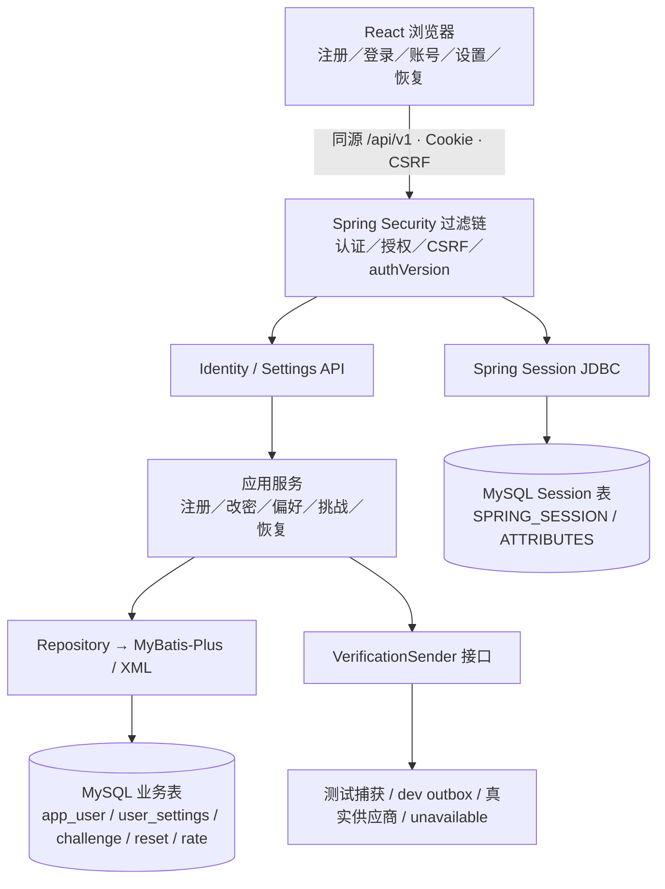

**开发关注点**

1. 当前认证用户从服务端 SecurityContext 获取；客户端传来的 `userId` 不能决定数据归属。
2. 业务 Repository 负责用户／设置／挑战；Session 框架管理自己的表，不能让业务 Mapper 手动维护 Session。
3. Sender 是隔离外部邮件／短信或本地模拟的适配器，不改变认证和数据库的真实性判断。

**对应任务**：M01-01～05；**验收**：A06、A08、A11、A23。

## 图 02：M01 数据表关系（逻辑视图）

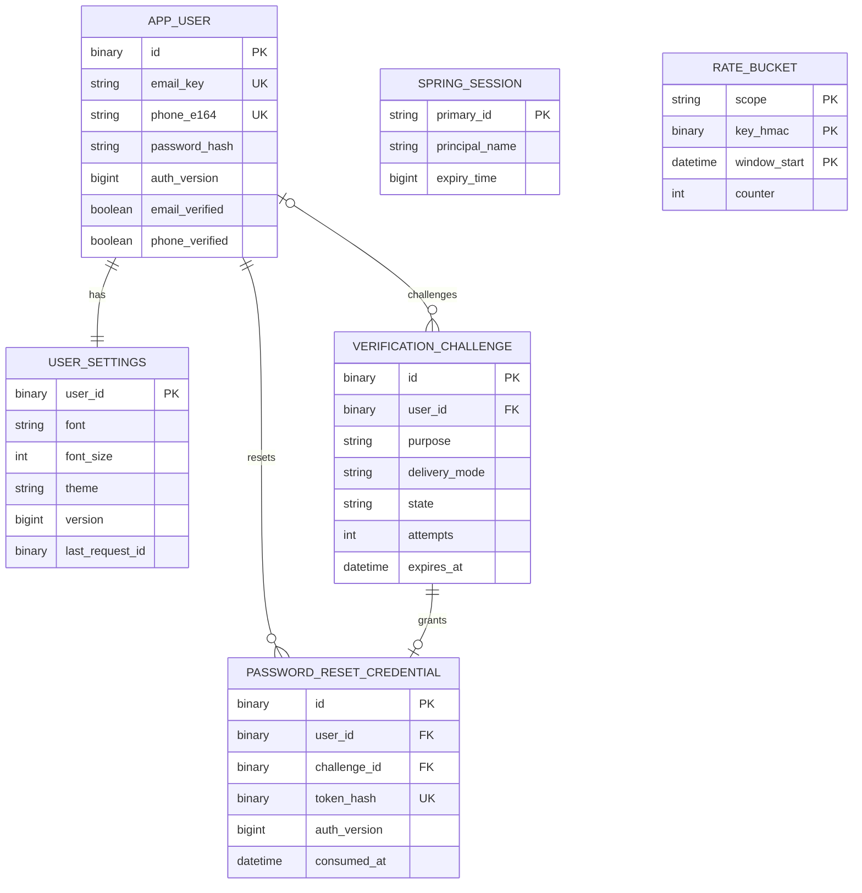

**读图说明**：V2 创建用户和设置；V3 使用 Spring Session 当前 JAR 提供的 MySQL 官方 schema；V4 创建验证挑战、重置凭证和限流桶。图里的 Session 与用户的对应关系由 `principalName` 和框架机制管理，**不存在本文声称的直接业务外键**；`rate_bucket` 按 HMAC 化的主体与时间窗口独立计数。`verification_challenge.user_id` 可以为空，用于未知账号的 DUMMY 挑战。图为简化逻辑视图，不是可执行 DDL；字段和约束以 M01 第 3 章为准。

**对应任务**：M01-01、02、05；**验收**：A05～A06、A08、A18～A24。

## 图 03：用户注册与默认偏好事务

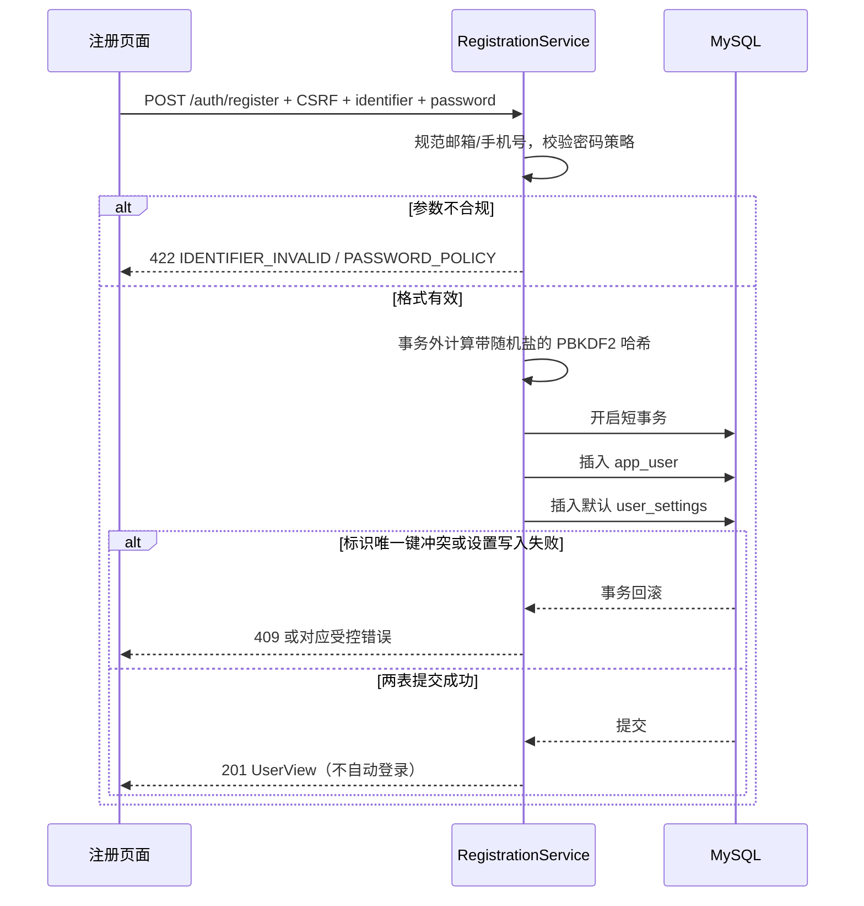

**开发关注点**

- 当前 M01 密码规则：至少 8 个 Unicode code point、包含至少一位 **ASCII 数字**和一个 **ASCII 英文字母**；密码不 trim、不归一化，上限和 PBKDF2 参数见执行文档 4.1。不要回退到旧版“强制大小写字母”的规则。
- `email_key` 与 `phone_e164` 分别唯一；先查重不是并发保护，最终靠数据库唯一约束。
- 用户与默认设置必须同一事务；哈希计算应在事务外，避免长时间占用连接／行锁。
- 注册成功只意味着账号创建，联系方式仍为未验证状态。

**对应任务**：M01-01；**验收**：A01～A07。

## 图 04：登录、CSRF 轮换与跨请求持久认证

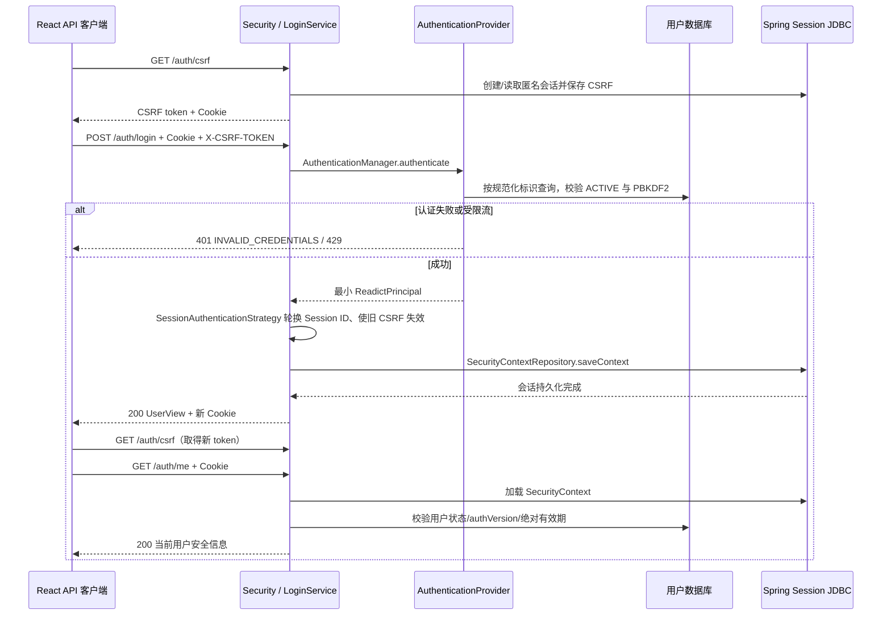

**开发关注点**

- JSON 登录不能只向 `SecurityContextHolder` 写入当前线程；必须明确执行 SessionAuthenticationStrategy，并使用**相同的** SecurityContextRepository 显式 `saveContext`。
- Cookie 携带会话标识；服务器保存认证信息。禁止将用户密码哈希、验证码写入 Session。
- 登录前 token 在登录后失效，前端要重新 GET CSRF；不要发生“登录 200、下一请求 /me 却 401”。
- 无效 CSRF 的 403、无效密码的 401、依赖不可用的 503、限流的 429 要区别处理。

**对应任务**：M01-02；**验收**：A08～A12、A17。

## 图 05：每次受保护 API 的鉴权判定

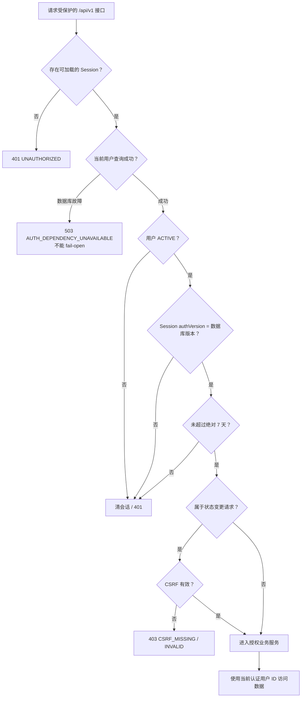

**开发关注点**：Session 空闲 30 分钟由 Session 管理，绝对 7 天由认证时间检查；过期和 authVersion 不匹配须拒绝后续请求。实际 Spring Security 过滤器顺序需要在 M01-02 集成时验证，本图表达**判定关系**，不是框架内部精确 Filter 调用顺序。匿名注册、登录、申请找回等端点有独立白名单，仍需遵守 CSRF 和限流契约。

**对应任务**：M01-02；**验收**：A08～A13、A25。

## 图 06：修改密码、全部旧会话失效与退出区别

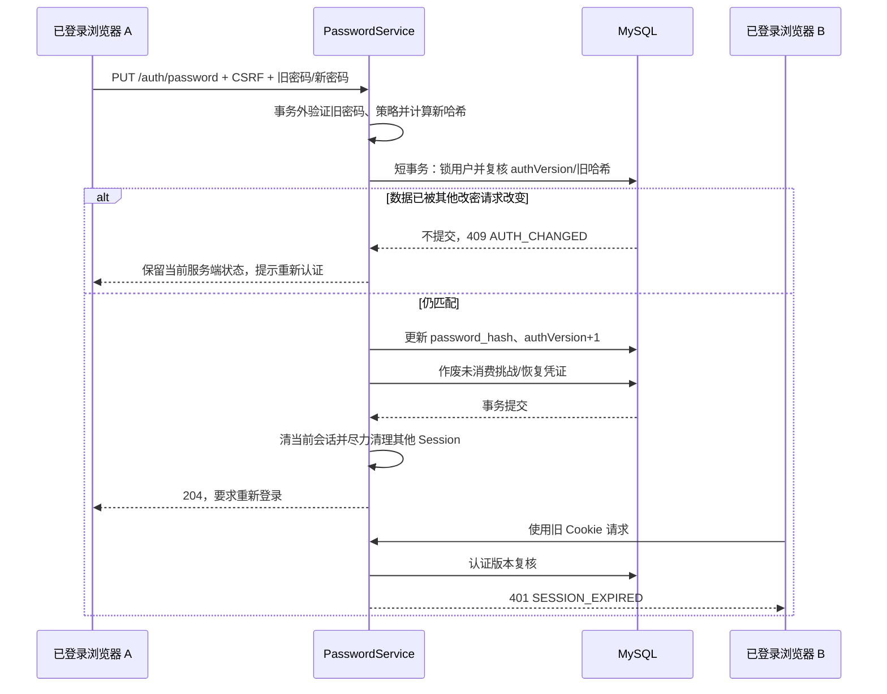

**另一个独立操作：退出登录**。`POST /auth/logout` 由 Spring Security `LogoutFilter` 处理，校验 CSRF，注销**当前** Session、清 Cookie，返回 204；不会因普通退出而修改用户密码或撤销其他设备。改密／重置则通过 `authVersion+1` 拒绝**所有旧会话**。数据库提交后清理 Session 失败，不得回滚已经提交的新密码。

**对应任务**：M01-03；**验收**：A10、A13～A14、A22。

## 图 07：个人偏好保存、幂等和双标签页冲突

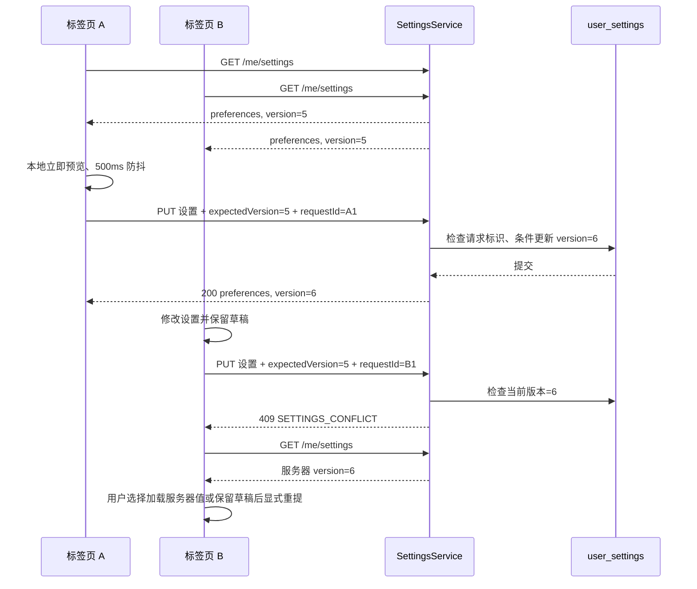

**开发关注点**

- `expectedVersion` 解决**同时编辑**；`requestId` 解决**请求提交成功但响应丢失**后的重复写。相同 requestId／相同内容不重复升版，不同内容返回 409。
- UI 可立即预览，但服务器确认前显示“尚未同步”；迟到响应不得覆盖后来输入的新草稿。
- 服务端通过认证用户确定设置行，不接受外部 userId；BroadcastChannel 只发送“设置已更新”通知，不传用户私有值或 Cookie。

**对应任务**：M01-04；**验收**：A15～A17、A25。

## 图 08：验证码挑战状态机

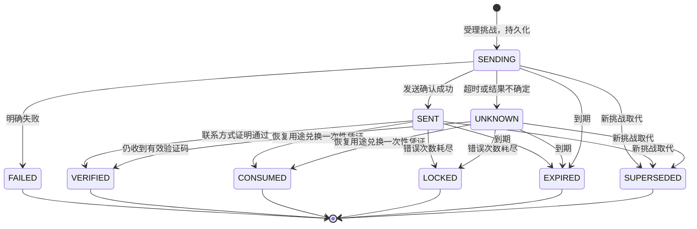

**开发关注点**

- `SENT` 表示投递方确认，不表示用户已经接收或归属已被证明。`UNKNOWN` 表示投递结果不确定，不能自动再次发送。
- 六位码默认有效期 5 分钟、最多 5 次错误、重发冷却 60 秒；真实并发错误尝试必须原子计数。
- 联系方式证明与密码恢复使用**不同用途**；联系方式验证达成 `VERIFIED`，恢复用途兑换一次性凭证达成 `CONSUMED`。`DEV_LOCAL` 可完成模拟分支，但绝不能更新真实 verified=true。
- 上图突出常见路径；失败后的状态清理、次数耗尽与重发竞争的全部条件以执行文档第 8.2 节为准，不能把这张简图当作完整转移表。

**对应任务**：M01-05；**验收**：A18～A19、A23。

## 图 09：申请验证码、异步投递与未知账号

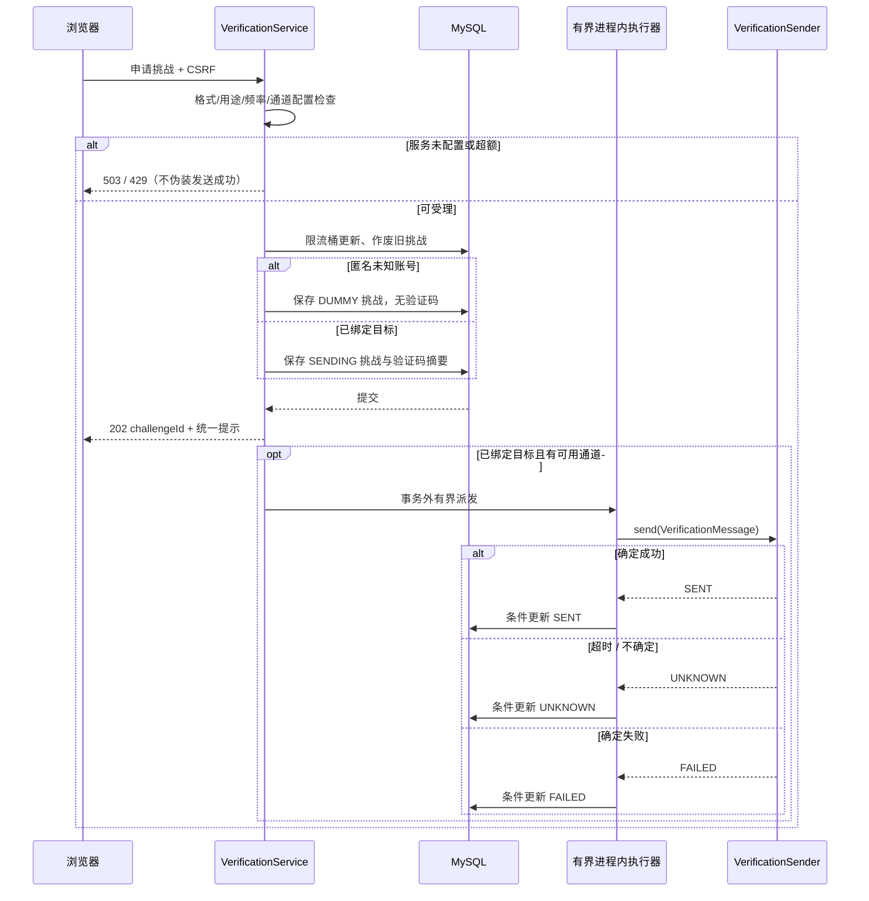

**开发关注点**

1. 匿名密码恢复对存在／不存在的账号返回**同形响应**，不可由 challengeId、提示或发送失败信息泄露账号存在性。
2. 投递在数据库受理事务外，发送结果有条件更新；重发作废的旧挑战不得被迟到回执“复活”。
3. 测试用进程内捕获 Sender；手动本地开发使用明确启用的 `DEV_LOCAL` outbox；生产未配置真实 Sender 时**拒绝真实验证功能**。不得提供公开取码端点或将验证码写入普通日志。

**对应任务**：M01-05；**验收**：A18～A20、A23～A24。

## 图 10：忘记密码、一次性证明和重置事务

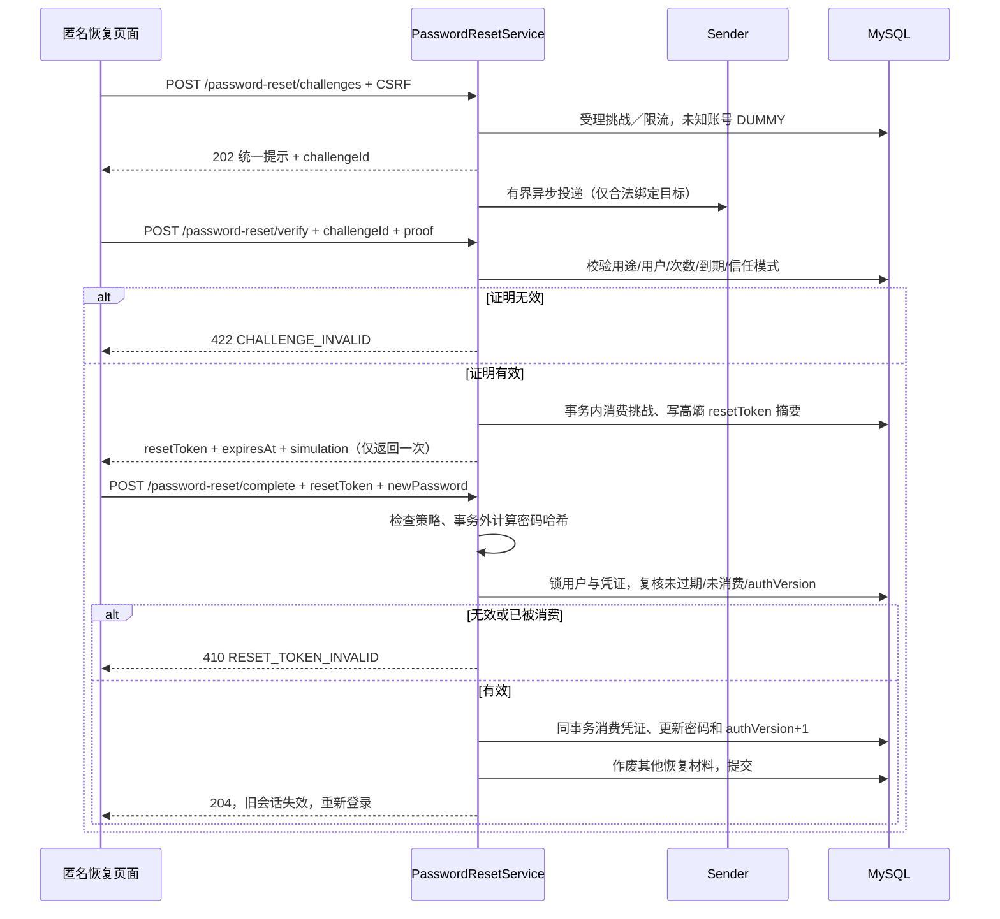

**开发关注点**

- 六位验证码只用于获取更高熵的一次性 `resetToken`，不直接成为改密凭证；token 明文只在验证成功响应中出现一次，数据库只留摘要。
- token 有效期、证明模式和 `authVersion` 都要在最终事务中重新核对；两个并发重置仅允许一个成功。
- 本地 DEV_LOCAL 凭证只在显式开发／测试模式可用；它不能证明真实邮箱／手机号的归属，更不能在公开环境使用。
- 真实邮件／短信供应商、成本和接收验证尚未完成，不能将本图视为外部服务已打通。

**对应任务**：M01-05；**验收**：A20～A24、A28。

## 图 11：M01 分阶段实施与验收状态

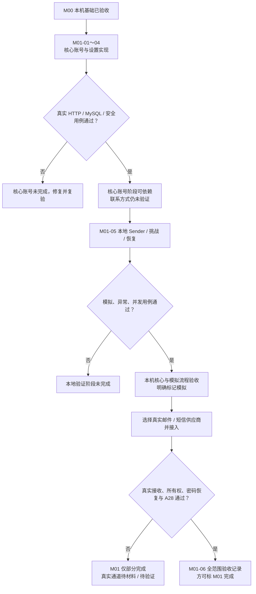

**开发关注点**：核心账号验收通过后，可供后续书籍等模块依赖；真实联系方式尚未验证时，**不能**宣称 M01 全范围完成。每阶段保留实际 Git 提交、环境、脱敏证据和 A01～A28 用例结果；本文仅是设计图集，不生成任何虚假的通过记录。

## 实施索引：看哪个图、检查什么

| 开发任务 | 建议先看 | 不能忽略的契约 | 对应验证 |
|---|---|---|---|
| M01-01 注册 | 图 02、03 | 独立唯一键、PBKDF2、用户＋设置同事务 | A01～A07 |
| M01-02 登录 | 图 01、04、05 | saveContext、Session 轮换、CSRF、authVersion、限流 | A08～A12 |
| M01-03 改密／退出 | 图 05、06 | 密码版本失效与当前 Session 注销是不同语义 | A10、A13～A14、A22 |
| M01-04 设置 | 图 02、07 | 用户隔离、expectedVersion、requestId、草稿与已同步状态 | A15～A17、A25 |
| M01-05 证明与恢复 | 图 02、08～10 | 挑战状态、模拟／真实隔离、一次性凭证、未知账号等形 | A18～A24、A28 |
| M01-06 验收 | 图 11 + 全图集 | 实际结果分阶段归档，不以文档替代执行 | A01～A28 |

## 相关原始资料

- [M01 用户认证与个人设置执行文档](M01-用户认证与个人设置执行文档.md)：正式接口、数据库迁移字段、异常规则、操作步骤和 28 组验收用例的权威依据。
- [ADR-0003：M01 会话认证与分阶段验证](../decisions/ADR-0003-M01会话认证与分阶段验证.md)：已采纳的 Session／CSRF／恢复技术决策。
- [Readict V1.1 模块化开发计划](Readict-V1.1-模块化开发计划.md)：模块依赖、阶段与交付标准。
- [M00 实施与验收记录](../../../validation/implementation/m00/README.md)：已实现的基础工程证据，**不替代 M01 验收**。

**维护规则**：后续如果 M01 接口、状态机或认证配置发生实际变更，先更新权威执行文档和相关 ADR，再同步本图集；不能只修改图而让图与代码契约分叉。
