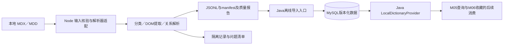
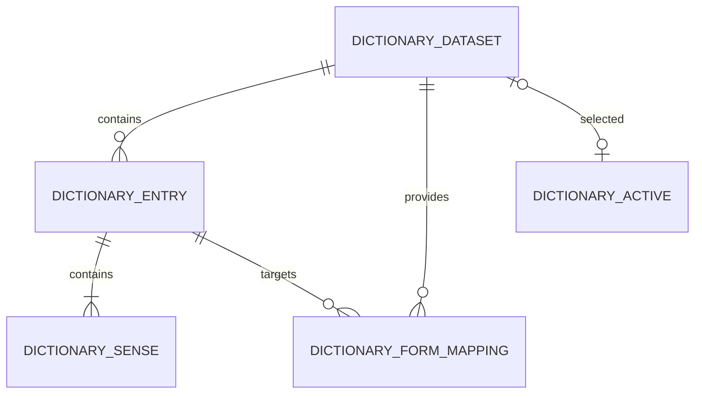
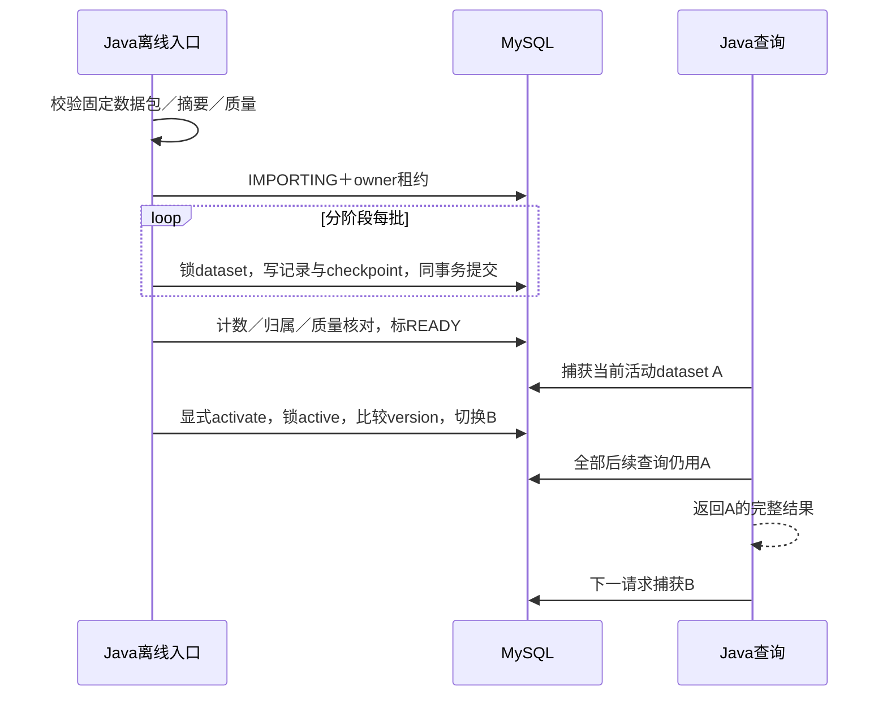

# M02 COL 词典数据底座技术设计与执行文档

版本：0.2；日期：2026-11-21。状态：**部分实施：M02-01 输入与兼容性通过，M02-02 全量提取质量未通过；后续阶段未实施**。实际结果见 [M02 实施与质量阻断记录](../../../validation/implementation/m02/README.md)。

需求基线：[PRD V1.1](../../requirements/prd/PRD-v1.1.md)。总体设计：[系统技术设计](../architecture/Readict-V1.1-系统技术设计.md)。任务来源：[模块化开发计划](Readict-V1.1-模块化开发计划.md)。既定决定：[ADR-0001](../decisions/ADR-0001-本机环境与本地词典及翻译技术选型.md)、[ADR-0002](../decisions/ADR-0002-业务持久层采用MyBatis-Plus与XML.md)。前置实现：[M01 验收记录](../../../validation/implementation/m01/README.md)。

阅读顺序：现状与范围 → 流水线和数据契约 → 词形与查询 → 数据库与导入 → 六项任务 → 验收与排障。本文保留完整目标契约；当前只有 inspect 和诊断 diagnose 已实现，正式 convert／validate、词形关系、V5、Java 导入及 Provider 尚未交付。下文未来命令不能据此假定可执行，真实通过范围以实施记录为准。

## 1. 目标、范围和已有证据

M02 将 COL 文件变为可追溯、可重复生成、可版本切换的英汉文字词典，使正式 Java 后端能够返回词头、中文释义、Unicode 音标、词性和有证据的词形关系。查询时不再解析 MDX，不把 MDX 发给浏览器，不增加常驻 Node 服务。

本模块交付离线转换工具、版本化结构产物、Java 导入入口、五类数据表、DictionaryProvider 和回归／集成测试。M05 才将其接入 EPUB 原文定位、查询会话和浮动卡片，M06 才创建收藏；本模块不提前增加 `/dictionary/lookups` HTTP 实现、词典管理页面、公开导入接口或线上搜索服务。COL 中出现短语不代表本版支持短语查询。

### 1.1 证据分类

| 标记 | 含义 | 本文应用 |
|---|---|---|
| 已有事实 | 代码、归档或本次只读目录核对直接支持 | M00／M01 工程能力、已有迁移、历史 COL 抽查 |
| 工程设计 | 本次确定供正式实现使用的契约与规则 | 转换、导入、身份、查询和一致性 |
| 待验证 | 缺少真实执行或质量证据 | 6.0.6 兼容性、全量提取、实际预算、数据权利 |

**已有事实**：应用提交 `876b5d786ede4dc83864a508c79141c4cd218022` 已实现 M01 核心与本地模拟，M00／M01 记录见归档。源码使用 Java 21、Boot 4.1.2、MP Boot 4 Starter 3.5.18；存在 V1～V4，没有 lexical 模块或 tools/dictionary-import 工程。未来编号从 V5 接续；执行前如已有新迁移，先协调编号，不能覆盖已执行版本。

**已有事实**：系统设计第 9.4 节记载 2026-11-19 的 COL 抽查：121872 个 MDX 索引项、251 条分散记录可读取，包含中文和 Unicode 音标；running 有独立义项，children 的词形说明有缺字。临时解析器为 js-mdict 7.0.0；MDD 仅发现 result-min.css、yd_col.js。该历史结论不证明 6.0.6 兼容、全量语义正确或数据授权完成。

2026-11-21 只读目录核对：设计仓库 `dict/col/col.mdx` 24594337 字节，`col.mdd` 1853 字节，另有 col.png 和 result-min.css。文件大小不是校验摘要，本次不重新解析。词典源文件是本地输入，不作为本任务提交内容；路径通过执行参数提供。

### 1.2 技术与安全边界

- Node 24 离线工具负责格式复杂度；Java 负责受保护的数据库导入和正式查询。Node 不接触数据库凭据。
- 优先验证 js-mdict 6.0.6，锁定精确依赖和 lockfile。该版本仓库 [LICENSE](https://github.com/terasum/js-mdict/blob/v6.0.6/LICENSE) 为 MIT；**解析工具许可不等于 COL 数据许可**。能读取也不等于可以公开分发或永久保存全文／快照。
- 使用 inert DOM 解析器（选择 [parse5](https://github.com/inikulin/parse5)，未来锁定经 Node 24 验证的精确版本）遍历节点，不启动浏览器、不加载远程资源、不执行脚本。该项目提供HTML解析／序列化能力，COL专用提取规则仍由本工程实现。现有 CSS 仅帮助识别标记，不作为必须执行的规则。
- 数据库沿用本机 MySQL80／8.0.44，同实例 readict_dev／readict_test、独立 app／migrate 账号。无 Redis、MQ、Docker 或第二个数据库实例前置。
- 音频继续待材料，audioId=null，未知口音标 unknown；不把 CSS／JS 当录音，不自动用设备朗读替代词典音频。

## 2. 总体流程、组件和目录



### 2.1 目标目录

下列路径相对正式应用 readict-app，均为未来新增目标，不在本次创建：

```text
tools/dictionary-import/
  package.json、package-lock.json、README.md
  src/cli.mjs、parser-adapter.mjs、extract.mjs、normalize.mjs
  src/resolve-forms.mjs、emit.mjs、validate.mjs
  test/                         自建／经许可的最小HTML夹具和回归测试
backend/src/main/java/com/readict/lexical/
  domain/                       DictionaryProvider、LookupRequest／Result、POS与来源类型
  application/                  LocalDictionaryProvider、DatasetService
  infrastructure/persistence/
    entity/、mapper/             五类表的Entity与Mapper
    DictionaryRepository.java
backend/src/main/java/com/readict/dictionarytool/
  DictionaryImportMain.java      独立离线启动类，不扫描整个com.readict
  DictionaryImportConfiguration.java
  DatasetImporter.java、BundleValidator.java
backend/src/main/resources/
  db/migration/V5__local_dictionary.sql
  mapper/lexical/                自定义XML
backend/src/test/java/com/readict/
  lexical/                      普通单测
  DictionaryIT.java             真实MySQL集成测试
```

Node 工具采用 ESM 和 `node:test`，不为一个离线工具新增前端构建链。输出放应用忽略的 `.artifacts/dictionary/`；原文件、转换全文和隔离 HTML 不入 Git。长期可重复使用的转换／导入源码和测试属于正式工程，单次检查脚本不提交。应用不建 docs/，运行入口记入应用 README，详细记录归设计仓库。

现有 MapperScan 是 `com.readict.*.infrastructure.persistence.mapper`，lexical 遵守该层级。XML 路径继续 `classpath*:/mapper/**/*.xml`；业务 UUID 和 UTC 使用现有 TypeHandler，MyBatis 二级缓存关闭，Flyway 独占表结构管理。

### 2.2 阶段及不变量

| 阶段 | 输入 → 输出 | 必须成立的条件 |
|---|---|---|
| 输入核验 | 文件路径 → 源清单、摘要、资源列表 | 文件未被修改，解析器版本真实可追踪 |
| 枚举与分类 | 索引记录 → ENTRY／ALIAS／SKIP／FAIL | 每个源记录都有且只有一个最终处置 |
| 提取 | HTML → 区域、义项、IPA、POS | 无脚本执行，无额外例句，无静默截断 |
| 关联 | 原始词形提示 → 有证据的一对多关系 | 不把独立 running 或 saw 强行改成 run／see |
| 输出 | 结构记录 → 规范化文件和 manifest | 字节确定、身份稳定、计数对账 |
| 导入 | 校验通过的包 → IMPORTING／READY | 部分导入不能成为活动版本 |
| 激活与查询 | READY → 活动指针 → 查询结果 | 一次查询固定一个数据集，旧快照不被改写 |

## 3. 词条提取和质量策略

### 3.1 源记录身份与分类

ParserAdapter 对外暴露 `enumerate(): AsyncIterable<SourceRecord>`，SourceRecord 包含 `sourceOrdinal`（从0开始）、`indexKey`、`recordOffset`（如库提供）、原始解码文本和字节摘要。sourceOrdinal 按源索引实际顺序枚举，不用 JS 对象键去重；相同 key 的不同位置也必须保留。

sourceRecordHash固定为解析器返回的原始解码文本（尚未DOM清洗／空白归一化）按UTF-8编码后的SHA256，不冒充MDX压缩块的原始字节摘要。整个MDX／MDD的原始字节摘要另存manifest；解析器若无法保留原始记录字节，也不得混用两种摘要语义。

解析库若只支持按 key 查找，必须证明能取得重复 key 的不同记录；若做不到，M02-01 停止，不以“找到一个 book”替代完整枚举。读取一个源记录后分类，保留 indexKey 与 headword 的差异，不能直接把 indexKey 当词头。

- ENTRY：至少一个可支持的单词区域成功提取；一条记录可以包含多个独立区域。
- ALIAS：只有明确跳转指令／有证据的词形关系，不自行创造中文释义。
- SKIP：明确定义的资源记录、空分隔记录或本版排除的多词短语，记录原因。含空白的短语标 OUT_OF_SCOPE_PHRASE；连字符／撇号词不因此跳过。
- FAIL：解码、结构、词义或关联无法可靠处理。保留错误码和位置，输出到隔离清单；不能改成“跳过”降低失败数。

同记录部分区域失败，最终源处置仍为 FAIL，其候选区域只进入诊断，不进入可查询 entries。避免一条源记录同时算 success 和 failure。修规则后整条重跑，禁止人工在 JSONL 里补写词义而不提升规则版本。

### 3.2 DOM 提取顺序

**工程设计**：按下列顺序实现 COL 专用规则；选择器来自已有分析方向，需要固定夹具和真实代表词确认，不声称覆盖全部变体。

1. 惰性解析 HTML，删除 script、style、iframe、object、事件属性、远程资源引用及 `.exampleLists` 整个子树。不执行 yd_col.js，也不调用它修复原文。
2. 识别每个词条区域的 `.title`，读取实际 headword；`.phonetic` 提取原样 Unicode IPA，保留区域顺序。多条音标可并存；未明确英美标签时 accent=unknown。
3. 以 `.collinsOrder`、`.collinsMajorTrans` 及区域边界划分义项，保存原始标签与源顺序。若选择器只在部分版式存在，应进入明确的版式分支，不自动把整段 textContent 当中文释义。
4. 清除例句节点后提取中文释义文本及所属用法标签。中英同段时按明确子节点／分隔结构提取，保留中文释义中必要英文词形、括注和数字；不得按第一个汉字裁切整段。
5. HTML entity 解码一次，显示文本允许将排版空白统一为单个普通空格；原始 HTML 摘要／位置保留。该归一化只作用于词典字段，绝不用于 EPUB 原文的 UTF-16 定位。
6. 完成字段、长度、中文存在性和区域结构校验后才生成 entry／sense。含汉字只是最低检查，不证明整段中文准确。

无法可靠区分中文释义和英例句时发出 MEANING_BOUNDARY_UNKNOWN，原义项位置保留并隔离；不能“保留全部总比丢失好”而把例句带进产品。headword 缺失为 HEADWORD_MISSING；源文本可见缺字为 SOURCE_TEXT_DEFECT，不借助 LLM 或在线翻译补齐。

### 3.3 词性与顺序

统一 POS：noun、verb、adjective、adverb、pronoun、preposition、conjunction、determiner、interjection、unknown。原始标签另存 rawPos。名词复数、过去式等属于词形关系，不等同新增 POS；不能仅见 running 就标 verb。

每个 entry 的 providerOrder 从0连续编号，按源义项顺序生成；同一源展示序号可以重复或缺号，不用它当数据库唯一身份。保留 `sourceLabel` 作诊断。区域按 sectionOrder 从0编号。禁止按中文、字母或“看起来常用”重排源义项。

查询时可将与 POS 提示匹配的义项稳定前移；匹配组内部、其余组内部都沿用 providerOrder。提示 unknown 不改变顺序。默认主要释义之外再展示两个，其余折叠属于 M05 UI 消费规则，底座不能只存三条。

### 3.4 缺陷、隔离和质量门槛

每条问题保存 sourceOrdinal、indexKey、region、field、issueCode、severity、规则版本、原始记录摘要和人工处置；隔离全文仅在本地受控目录保存，不写普通日志。INFO 为正常跳过，WARN 为可解释但不影响文字正确的缺口，ERROR 为不应进入查询的内容／关系错误。

发布前 ERROR 必须归零或逐条进入有负责人、原因和影响范围的已批准排除清单，其摘要写入质量报告。排除不抹掉 sourceFailed 计数；“251条可读”不能作为 ERROR 自动豁免。固定50词不得有未处理的中文／IPA／POS／词形严重错误；音频为空不算文字错误。过高排除率不能仅靠签字通过，须说明覆盖缺口并停止声称全量词典完成。

## 4. 词形、规范化与查询身份

### 4.1 四种身份分离

| 身份 | 示例／规则 | 用途 |
|---|---|---|
| 原文词形 originalSurface | `Runs`，保持原样 | UI和后续原文快照；M02不改写原文 |
| 查询键 surfaceKey | 复用系统设计的版本化规范化规则 | 精确索引／词形查找，不做词干截断 |
| 词条 entryKey／entryId | 源位置＋区域身份，不能只用 lemma | 保留同形、多区域和来源 |
| lemmaKey | 已确认的单词原型规范化键 | 供收藏主体归并；不以条目ID替代 |

规范化版本 `col-normalize-v1` 复用系统设计第9.1节：校验有效Unicode，NFKC、Locale.ROOT小写、弯撇号转直撇号、去除两端非词字符；不删词内连字符／撇号、不删除变音符号、不任意截尾、不做模糊搜索。两端保留Unicode字母／数字／组合标记，剥离引号等外围标点后再校验一个词形；词内撇号保留，纯数字拒绝。Node端实现必须通过与Java相同的黄金向量，不以机器locale排序或大小写转换替代Locale.ROOT语义。输入originalSurface、indexKey、headword仍原样保留，规范化只生成比较键，不修改显示与原文偏移。首版查询内部空白返回UNSUPPORTED_QUERY，不改成短语接口。

词形证据等级由来源种类表达，不填虚构数值置信度：EXPLICIT_FORM（词典明确屈折关系）、EXPLICIT_REDIRECT（可解析跳转）、CURATED_CORRECTION（经审阅规则文件，附原因）、UNRESOLVED。规则文件是可版本追踪的修正说明，不能复制整本词典。UNRESOLVED 不进入肯定映射。

### 4.2 代表词处理

| 输入 | 处理要求 |
|---|---|
| run | 精确词头可能有多个区域，保留各区域及原顺序 |
| runs | 有明确复数／第三人称关系才映射run；不能仅删s猜测 |
| ran | 依据词典明确关系映射run；缺少证据则返回待确认，不假造 |
| running | 保留独立名词／形容词等区域；明确动词屈折关系可同时指向run，按POS及关系证据选择或保留歧义 |
| child／children | 源说明缺字不能据残片自动造child；可用其他明确源证据或经审阅修正规则，原缺陷仍记录 |
| saw | 独立名词／动词和see的过去式候选并存，不能总是映射see |
| 无词条且无关系的词形 | NOT_FOUND；不生成假释义，不作为合法首次收藏词条 |

### 4.3 选择算法

一次查询先固定 datasetId，再同时查精确词头和显式 form_mapping。候选按相同 entryId 去重、关系证据聚合；不得先命中某个 exact 就丢掉其他已确认屈折候选。

1. 只有一个可用候选：返回 FOUND，含 lemmaMethod、映射证据和原始词形。
2. 多个候选保留原有关系证据，不因POS提示唯一匹配便认定某个lemma正确。POS只用于各区域义项组的稳定排序，不排除其他lemma，也不改变收藏身份。
3. 多个区域的 lemmaKey 相同：可作为同 lemma 的多区域结果展示，regionOrder稳定；输出各区域 entryId，不伪造单一物理条目。
4. 多个不同 lemma 且不能唯一确定：返回 AMBIGUOUS、候选和 `resolvedLemmaKey=null`。可展示精确词条预览，但不能自动按猜测原型建立收藏。M05 选择／回退必须遵循系统设计，M06 没有明确义项身份不得写首次释义快照。

禁止把“候选排第一”描述成完成词义消歧。跳转最长8跳，访问路径做循环检测，目标有多条区域则保留多候选；循环、悬空和超限作为关系错误，不能进入递归死循环。

## 5. 版本化产物和身份算法

### 5.1 输出包

```text
bundle/
  manifest.json
  entries.jsonl
  senses.jsonl
  forms.jsonl
  dispositions.jsonl             每个源索引的最终处置
  issues.jsonl                   诊断；不携带可执行HTML
  quality-report.json
```

原始隔离 HTML 在 bundle 外的忽略目录，不能成为导入必须执行的内容。manifest 内文件名必须是上述白名单相对名，不接受绝对路径、`..`、URL、符号链接或重解析点越界；导入程序以真实路径校验输入根目录，并限制文件大小／行长。

统一 `UTF-8 无BOM、LF、每行一个对象、最后一行LF`。对象固定 schema 字段顺序，null 显式输出，数字使用整数，禁止 NaN；除规则规定的空白外不随机改写字符串。entries 按 sourceOrdinal、sectionOrder；senses 按对应 entry 顺序、providerOrder；forms 按 surfaceKey 的 UTF-8字节序、entryKey、relation；不使用机器 locale 排序。

manifest和quality-report的JSON文件也各写成一个紧凑对象加尾LF，文中多行缩进仅供阅读。JSONL按各记录schema固定字段顺序；evidence对象／数组先按来源序号、区域、ruleId固定排序，不接受运行时Map插入顺序决定摘要。字符串转义固定为标准JSON必要转义，不额外转义非ASCII字符。

### 5.2 manifest 字段

| 字段 | 契约 |
|---|---|
| schemaVersion | `readict-col-bundle-1`，不兼容格式变更必须升级 |
| diagnosticOnly | 必填布尔值；采样true、完整包false；Java正式导入拒绝true |
| source | mdxSha256、mddSha256、sourceHash；小写64位hex；MDD未提供必须显式null |
| datasetVersion | 人工标记的数据发布版本，如col-local-r1；不等于记录数或当前日期 |
| converterVersion／parserVersion／normalizationVersion／rulesVersion | 精确版本，不能写latest；变更规则必须提升版本 |
| identityHash／datasetId | 下述规范化身份算法，Java重新计算核对 |
| counts | sourceTotal／sourceSucceeded／sourceSkipped／sourceFailed；entry／sense／form总数 |
| files | 各文件name、sizeBytes、lineCount、sha256；不含manifest自身 |
| contentHash | 按文件白名单顺序，对各name／sizeBytes／sha256的规范化元组求SHA256 |
| quality | reportSha256、exclusionApprovalHash（无排除时null）、releaseEligible |
| rights | status=UNVERIFIED或CONFIRMED、policyVersion、attribution、snapshotAllowed、distributionAllowed |

sourceHash 为规范化数组 `["readict-col-source-1",mdxSha256,mddSha256]` 的SHA256。identityHash 为规范化数组 `[schemaVersion,sourceHash,datasetVersion,converterVersion,parserVersion,normalizationVersion,rulesVersion]` 的SHA256。固定紧凑JSON、不转义非ASCII、无尾换行；Node和Java各有黄金向量测试。不把生成时间放入确定性内容或身份；执行时间、耗时和机器信息放运行记录。

datasetId 由 identityHash 前16字节设置 UUID version=8、RFC variant 得到；entryId 由SHA256规范化数组 `["entry-v1",datasetId,sourceOrdinal,sectionOrder,indexKey]` 同法生成；senseId 由 `["sense-v1",entryId,providerOrder]` 生成。entryKey 固定 `s{sourceOrdinal}:r{sectionOrder}`，senseKey固定 `p{providerOrder}`。这里采用自定义确定性UUID，不误用 Java `UUID.nameUUIDFromBytes` 充当SHA256算法；完整hash和源键核对冲突，截断碰撞视为硬失败。

字节算法：取摘要前16字节，`bytes[6]=(bytes[6]&0x0f)|0x80`，`bytes[8]=(bytes[8]&0x3f)|0x80`，按网络字节序输出标准UUID字符串。version／variant布局依据[RFC 9562第5.8节](https://www.rfc-editor.org/rfc/rfc9562.html#section-5.8)；具体SHA256身份元组是本工程设计，并非RFC提供了本词典算法。

同 sourceHash／datasetVersion／converterVersion 的导入如果 parser／rules／normalization 不同，拒绝 DATASET_IDENTITY_CONFLICT，要求提升 datasetVersion 或 converterVersion；不得悄悄覆盖。hash相同不等于授权成立。

### 5.3 记录和示例

下例是**自建合成记录**，只解释字段，不是 COL 实际提取结果，也不是可直接导入的数据包；示例ID和摘要须由未来工具按算法生成。

```json
{
  "entryId":"00000000-0000-8000-8000-000000000001",
  "entryKey":"s0:r0",
  "sourceOrdinal":0,
  "indexKey":"sampleword",
  "sectionOrder":0,
  "headword":"sampleword",
  "lemmaKey":"sampleword",
  "lemmaMethod":"EXACT_HEADWORD",
  "phonetics":[{"accent":"unknown","ipa":"/ˈsɑːmpəl/","audioId":null}],
  "sourceRecordHash":"0000000000000000000000000000000000000000000000000000000000000000"
}
```

senses.jsonl 每条为 `{senseId,entryId,senseKey,pos,rawPos,zh,providerOrder,sourceLabel}`；forms.jsonl 每条为 `{surfaceKey,entryId,relation,evidence,priority}`，evidence包含 sourceOrdinal、region、sourceLabel、ruleId，不复制整段例句。每条entry须至少一个合法sense；别名只生成映射，不伪造无义项实体。priority为确定性关系排序值，不是概率。

对应的单行记录示例依次属于senses、forms和dispositions三个文件；仍为合成占位ID，不能据此宣称实际提取通过：

```jsonl
{"senseId":"00000000-0000-8000-8000-000000000002","entryId":"00000000-0000-8000-8000-000000000001","senseKey":"p0","pos":"noun","rawPos":"n.","zh":"用于测试的示意释义","providerOrder":0,"sourceLabel":"1"}
```

```jsonl
{"surfaceKey":"samplewords","entryId":"00000000-0000-8000-8000-000000000001","relation":"INFLECTION","evidence":[{"sourceOrdinal":0,"region":0,"sourceLabel":"synthetic plural label","ruleId":"synthetic-explicit-form"}],"priority":10}
```

```jsonl
{"sourceOrdinal":0,"indexKey":"sampleword","sourceRecordHash":"0000000000000000000000000000000000000000000000000000000000000000","outcome":"ENTRY","entryCount":1,"senseCount":1,"formCount":1,"issueCodes":[]}
```

evidence统一为数组，可聚合多个来源；issue记录字段固定为`sourceOrdinal,indexKey,region,field,issueCode,severity,rulesVersion,sourceRecordHash,disposition`。priority初值EXPLICIT_FORM／INFLECTION=10、EXPLICIT_REDIRECT／REDIRECT=20、CURATED_CORRECTION=30；这只规定可重现展示顺序，不代表较小值必然语义正确或可压掉其他候选。

dispositions.jsonl 每条为 `{sourceOrdinal,indexKey,sourceRecordHash,outcome,entryCount,senseCount,formCount,issueCodes}`。ALIAS 解析成功计入 sourceSucceeded，但可能 entryCount=0。最终对账：

```text
sourceTotal = sourceSucceeded + sourceSkipped + sourceFailed
sourceSucceeded = ENTRY成功数 + ALIAS成功数
entryCount = 已成功源记录的entryCount之和
senseCount = 已成功源记录的senseCount之和
formCount = 去重后全局forms行数
```

源处置里的formCount记录该源产生的去重前关系数，不能用其总和冒充全局唯一映射数；质量报告另给 formGenerated／formDeduplicated，满足 formGenerated-formDeduplicated=formCount。每个sourceOrdinal恰有一条处置，范围0到sourceTotal-1，无空洞、重复或静默遗漏。

质量报告示例为合成小样本，不是历史 COL 统计：

```json
{
  "schemaVersion":"readict-col-quality-1",
  "counts":{"sourceTotal":4,"sourceSucceeded":2,"sourceSkipped":1,"sourceFailed":1,"entryCount":2,"senseCount":3,"formGenerated":2,"formDeduplicated":1,"formCount":1},
  "skipReasons":{"OUT_OF_SCOPE_PHRASE":1},
  "errors":{"SOURCE_TEXT_DEFECT":1},
  "representativeReview":{"required":50,"reviewed":0,"criticalUnresolved":1},
  "approvedExclusions":[],
  "releaseEligible":false
}
```

完整 manifest 示例（文件清单展示全契约，数值为合成占位，不可用于验收；校验器必须重新计算而不能信任声明）：

```json
{
  "schemaVersion":"readict-col-bundle-1",
  "diagnosticOnly":false,
  "source":{"mdxSha256":"0000000000000000000000000000000000000000000000000000000000000000","mddSha256":null,"sourceHash":"0000000000000000000000000000000000000000000000000000000000000000"},
  "datasetVersion":"synthetic-example",
  "converterVersion":"0.1.0",
  "parserVersion":"js-mdict@6.0.6",
  "normalizationVersion":"col-normalize-v1",
  "rulesVersion":"col-extract-r1",
  "identityHash":"0000000000000000000000000000000000000000000000000000000000000000",
  "datasetId":"00000000-0000-8000-8000-000000000001",
  "counts":{"sourceTotal":0,"sourceSucceeded":0,"sourceSkipped":0,"sourceFailed":0,"entryCount":0,"senseCount":0,"formCount":0},
  "files":[
    {"name":"entries.jsonl","sizeBytes":0,"lineCount":0,"sha256":"0000000000000000000000000000000000000000000000000000000000000000"},
    {"name":"senses.jsonl","sizeBytes":0,"lineCount":0,"sha256":"0000000000000000000000000000000000000000000000000000000000000000"},
    {"name":"forms.jsonl","sizeBytes":0,"lineCount":0,"sha256":"0000000000000000000000000000000000000000000000000000000000000000"},
    {"name":"dispositions.jsonl","sizeBytes":0,"lineCount":0,"sha256":"0000000000000000000000000000000000000000000000000000000000000000"},
    {"name":"issues.jsonl","sizeBytes":0,"lineCount":0,"sha256":"0000000000000000000000000000000000000000000000000000000000000000"},
    {"name":"quality-report.json","sizeBytes":0,"lineCount":1,"sha256":"0000000000000000000000000000000000000000000000000000000000000000"}
  ],
  "contentHash":"0000000000000000000000000000000000000000000000000000000000000000",
  "quality":{"reportSha256":"0000000000000000000000000000000000000000000000000000000000000000","exclusionApprovalHash":null,"releaseEligible":false},
  "rights":{"status":"UNVERIFIED","policyVersion":"unverified","attribution":"本地COL 来源与使用权利待核实","snapshotAllowed":false,"distributionAllowed":false}
}
```

开发人员应生成可通过校验的自建包作为自动测试夹具，不直接改上述零摘要示例当“真实数据”。未经确认的数据可在有权使用的本机受限验证范围登记，但不能通过设置 snapshotAllowed=true 代替权利核验；公开分发和正式快照能力由权利门槛独立阻断。

## 6. V5 数据库设计

下列为未来 `V5__local_dictionary.sql` 字段级示例，不在本次执行。所有业务 UUID 为 BINARY(16)、应用输入；UTC DATETIME(3)，摘要为BINARY(32)。文本语义与长度用应用和数据库双重验证，超限记录隔离，禁止自动substring。meaning_zh最大10000个Unicode code point，其他长度见DDL，限制按字符不是UTF-16偏移；原文定位不属于此表。

```sql
CREATE TABLE dictionary_dataset (
  id BINARY(16) NOT NULL,
  identity_hash BINARY(32) NOT NULL,
  source_hash BINARY(32) NOT NULL,
  dataset_version VARCHAR(64) CHARACTER SET ascii COLLATE ascii_bin NOT NULL,
  converter_version VARCHAR(64) CHARACTER SET ascii COLLATE ascii_bin NOT NULL,
  parser_version VARCHAR(64) CHARACTER SET ascii NOT NULL,
  normalization_version VARCHAR(64) CHARACTER SET ascii NOT NULL,
  rules_version VARCHAR(64) CHARACTER SET ascii NOT NULL,
  status VARCHAR(16) CHARACTER SET ascii NOT NULL,
  counts_json JSON NOT NULL,
  content_hash BINARY(32) NOT NULL,
  manifest_json JSON NOT NULL,
  rights_status VARCHAR(16) CHARACTER SET ascii NOT NULL,
  snapshot_allowed BOOLEAN NOT NULL DEFAULT FALSE,
  distribution_allowed BOOLEAN NOT NULL DEFAULT FALSE,
  import_owner BINARY(16) NULL,
  lease_until DATETIME(3) NULL,
  import_phase VARCHAR(16) CHARACTER SET ascii NOT NULL DEFAULT 'ENTRIES',
  checkpoint_line BIGINT NOT NULL DEFAULT 0,
  error_code VARCHAR(64) CHARACTER SET ascii NULL,
  created_at DATETIME(3) NOT NULL,
  ready_at DATETIME(3) NULL,
  PRIMARY KEY (id),
  UNIQUE KEY uk_dataset_identity (identity_hash),
  UNIQUE KEY uk_dataset_release (source_hash,dataset_version,converter_version),
  KEY ix_dataset_status (status,created_at),
  CONSTRAINT ck_dataset_status CHECK (status IN ('IMPORTING','READY','FAILED')),
  CONSTRAINT ck_dataset_phase CHECK (import_phase IN ('ENTRIES','SENSES','FORMS','VERIFY','DONE')),
  CONSTRAINT ck_dataset_checkpoint CHECK (checkpoint_line >= 0),
  CONSTRAINT ck_dataset_rights CHECK (rights_status IN ('UNVERIFIED','CONFIRMED')),
  CONSTRAINT ck_dataset_ready CHECK (status <> 'READY' OR (ready_at IS NOT NULL AND import_phase = 'DONE'))
) ENGINE=InnoDB DEFAULT CHARSET=utf8mb4 COLLATE=utf8mb4_0900_bin;

CREATE TABLE dictionary_active (
  slot VARCHAR(16) CHARACTER SET ascii COLLATE ascii_bin NOT NULL,
  dataset_id BINARY(16) NULL,
  version BIGINT NOT NULL DEFAULT 0,
  updated_at DATETIME(3) NOT NULL,
  PRIMARY KEY (slot),
  CONSTRAINT fk_active_dataset FOREIGN KEY (dataset_id) REFERENCES dictionary_dataset(id),
  CONSTRAINT ck_active_slot CHECK (slot = 'col'),
  CONSTRAINT ck_active_version CHECK (version >= 0)
) ENGINE=InnoDB;
INSERT INTO dictionary_active(slot,dataset_id,version,updated_at)
VALUES ('col',NULL,0,UTC_TIMESTAMP(3));

CREATE TABLE dictionary_entry (
  id BINARY(16) NOT NULL,
  dataset_id BINARY(16) NOT NULL,
  entry_key VARCHAR(128) NOT NULL,
  source_ordinal BIGINT NOT NULL,
  source_index_key VARCHAR(512) NOT NULL,
  section_order INT NOT NULL,
  provider VARCHAR(64) NOT NULL,
  provider_version VARCHAR(64) NOT NULL,
  source_lang VARCHAR(16) NOT NULL DEFAULT 'en',
  target_lang VARCHAR(16) NOT NULL DEFAULT 'zh-CN',
  lemma_key VARCHAR(128) NOT NULL,
  headword VARCHAR(128) NOT NULL,
  lemma_method VARCHAR(32) NOT NULL,
  phonetics_json JSON NOT NULL,
  source_record_hash BINARY(32) NOT NULL,
  attribution TEXT NOT NULL,
  license_policy_version VARCHAR(64) NOT NULL,
  created_at DATETIME(3) NOT NULL,
  PRIMARY KEY (id),
  UNIQUE KEY uk_entry_source (dataset_id,entry_key,section_order),
  UNIQUE KEY uk_entry_dataset (id,dataset_id),
  KEY ix_entry_lemma (dataset_id,lemma_key),
  CONSTRAINT fk_entry_dataset FOREIGN KEY (dataset_id) REFERENCES dictionary_dataset(id),
  CONSTRAINT ck_entry_order CHECK (source_ordinal >= 0 AND section_order >= 0)
) ENGINE=InnoDB DEFAULT CHARSET=utf8mb4 COLLATE=utf8mb4_0900_bin;

CREATE TABLE dictionary_sense (
  id BINARY(16) NOT NULL,
  entry_id BINARY(16) NOT NULL,
  provider_sense_key VARCHAR(128) NOT NULL,
  pos VARCHAR(24) CHARACTER SET ascii NOT NULL,
  raw_pos VARCHAR(128) NULL,
  meaning_zh TEXT NOT NULL,
  provider_order INT NOT NULL,
  source_label VARCHAR(128) NULL,
  PRIMARY KEY (id),
  UNIQUE KEY uk_sense_order (entry_id,provider_order),
  CONSTRAINT fk_sense_entry FOREIGN KEY (entry_id) REFERENCES dictionary_entry(id) ON DELETE CASCADE,
  CONSTRAINT ck_sense_order CHECK (provider_order >= 0),
  CONSTRAINT ck_sense_pos CHECK (pos IN ('noun','verb','adjective','adverb','pronoun','preposition',
    'conjunction','determiner','interjection','unknown'))
) ENGINE=InnoDB DEFAULT CHARSET=utf8mb4 COLLATE=utf8mb4_0900_bin;

CREATE TABLE dictionary_form_mapping (
  dataset_id BINARY(16) NOT NULL,
  surface_key VARCHAR(128) NOT NULL,
  entry_id BINARY(16) NOT NULL,
  relation VARCHAR(32) CHARACTER SET ascii NOT NULL,
  evidence JSON NOT NULL,
  priority SMALLINT NOT NULL,
  PRIMARY KEY (dataset_id,surface_key,entry_id,relation),
  KEY ix_form_entry (entry_id,dataset_id),
  CONSTRAINT fk_form_dataset FOREIGN KEY (dataset_id) REFERENCES dictionary_dataset(id),
  CONSTRAINT fk_form_same_dataset FOREIGN KEY (entry_id,dataset_id)
    REFERENCES dictionary_entry(id,dataset_id),
  CONSTRAINT ck_form_relation CHECK (relation IN ('INFLECTION','REDIRECT','CURATED_CORRECTION')),
  CONSTRAINT ck_form_priority CHECK (priority >= 0)
) ENGINE=InnoDB DEFAULT CHARSET=utf8mb4 COLLATE=utf8mb4_0900_bin;
```

form_mapping 的 entry 必须属于同一 dataset；上述entry的`(id,dataset_id)`唯一键与复合FK是V5必备约束，Repository／导入校验也复核归属。不能改为两个独立FK后声称同数据集归属已被数据库保证。

五表不关联 app_user：字典内容是系统级参考数据，用户权限和原文由后续查询会话／收藏管理。共享的仅是词典内容缓存，不缓存任何用户原句、lookupId或收藏状态。active只能指向READY由锁定事务校验；FK不能表达该状态条件。



不使用全局逻辑删除；READY 数据内容不可原地更新。snapshotAllowed和权利政策不得由普通客户端修改。数据集许可变化若需撤销能力，应单独执行受控政策变更、清缓存和快照处置，不能覆盖词义冒充同版本。

## 7. Java 导入、断点与活动版本

### 7.1 独立入口与数据库保护

现有 ReadictApplication 扫描整个 com.readict，包含 HttpSecurity、Session、身份秘密及后台清理。**不得只给现有主类加 WebApplicationType.NONE 就假设可运行导入**。

未来 DictionaryImportMain 使用独立配置源，显式导入 DataSource／Hikari、Flyway、MP／Mapper／事务及 lexical 导入组件；不标注扫描整个com.readict的@SpringBootApplication，不加载MVC、Security、Session或用户后台任务。复用现有 DatabaseEnvironmentGuard 初始化器和 UTC 设置；只允许一个dev或test profile，不新增import profile绕过保护。复用数据源／迁移配置时显式读取所需属性，不能为了离线入口复制另一套弱化账号规则。

构建保留原可执行Web JAR，另增加 classifier=`dictionary-tool` 的可执行JAR并指定离线主类。构建和启动验证属于M02；示例命令以未来产生的 `backend/target/readict-backend-0.0.1-SNAPSHOT-dictionary-tool.jar` 为目标。离线入口不监听HTTP、不要求认证HMAC密钥，仍必须有对应数据库app／migrate账号和Flyway保护。

命令契约：`validate --bundle <目录>` 仅校验文件不启动数据库；`import --bundle <目录> [--resume]` 校验后导入但不激活；`activate --dataset <UUID> --expected-active-version <整数>` 独立确认；`inspect --dataset <UUID>` 输出计数／状态不输出正文全文。参数先校验后启动Spring，不能让validate无意执行Flyway。

### 7.2 校验和批量写入

1. 预检固定文件集、摘要、总大小、JSON schema、版本、计数和质量门槛；拒绝未知schema、重复JSON键、非法UTF-8、超长字段、NaN、空合法entry的包。复制至本地受控、不可被转换器继续覆盖的暂存目录后核对，读取期间再核摘要防输入被替换。
2. 使用dataset identity查重：READY同identity且contentHash一致返回已导入；identity相同content不同为不可变冲突；同发布唯一键元数据不同返回DATASET_IDENTITY_CONFLICT。
3. 创建IMPORTING，初始phase=ENTRIES、checkpoint=0。按entries→senses→forms分阶段写入，每批最多500行或2MiB参数数据（先到者为准）；不把完整JSONL读进Java堆。
4. 每批短事务先锁dataset，核对import_owner／lease，再写数据和更新checkpoint；写入与断点同事务提交。受影响行／ID／关系校验失败整批回滚，不用INSERT IGNORE吞错。
5. 每阶段结束把phase推进、checkpoint归0；VERIFY阶段核对DB计数、唯一性、每entry至少一义项、词形归属／词头和质量报告；通过后在同事务置READY、phase=DONE、ready_at、清lease。尚未激活。

manifest及文件内容冻结后可多次扫描，进度用逻辑行号，不能用跨平台字符偏移冒充字节断点。checkpoint_line为**已提交行数**；重试从下一行读取。当前批次提交后进程未收到结果，重启先读数据库断点，不能按客户端旧断点重复插入。

### 7.3 租约、失败和恢复

每次导入运行生成owner UUID，租约默认120秒，每批续约；长校验每30秒心跳。其他运行见未过期租约拒绝IMPORT_IN_PROGRESS。租约过期且显式--resume时，锁dataset后更换owner；旧进程下一事务发现owner不匹配必须停止，不能继续写。租约持有检查、数据写入和续约同事务，防接管后旧进程提交。

可重试数据库故障保留IMPORTING和已提交断点，进程退出等待显式恢复；确认不可恢复的格式／数据错误标FAILED，记录脱敏errorCode。FAILED恢复只允许原identity与contentHash完全一致且错误已被判定为环境问题；修改产物必须新版本。若只剩孤立IMPORTING，inspect说明状态，不能自动设置READY。

清理部分导入按该datasetId删除forms→senses→entries→dataset，必须确认非活动、无租约且没有历史消费者引用。首版无自动删除READY的公开或定时功能；由受控维护操作执行，后续M06增加引用前必须扩展检查。禁止为了恢复导入TRUNCATE字典表或删库重建。

### 7.4 激活、回退与读取

activation短事务锁 active slot，再锁目标dataset，确认READY和发布门槛，比较expected-active-version；同目标已活动返回当前状态，不额外升版；新目标更新dataset_id和version+1。并发切换只有符合预期版本者成功，其余ACTIVE_VERSION_CONFLICT，不能“最后提交覆盖”。READY导入完成不自动抢占活动版本。

回退通过相同activate操作指向仍保留的旧READY数据集，仍有版本条件。无活动指针时查询返回DICTIONARY_NOT_CONFIGURED；活动存在但数据状态异常为DATASET_NOT_READY，不能降级Mock或别的供应商。



每次查询读取活动指针并持有不可变DatasetRef，后续entry／sense／form都显式带该dataset。首版不缓存活动指针，避免跨进程CLI切换后Web长期使用旧指针；内容缓存按datasetId隔离，不依赖本地事件完成正确性。旧READY至少保留至M05 lookup有效期结束及M06历史引用策略确认，M02默认保留而不自动淘汰。收藏首次快照不得随词典切换更新。

## 8. Java 查询契约与持久层

### 8.1 Provider 输入输出

服务端内部接口，不是新HTTP API：

```java
public interface DictionaryProvider {
    DictionaryLookupResult lookup(DictionaryLookupRequest request);
}
// Request: originalSurface, posHint（可空）
// Result: outcome, datasetRef, originalSurface, normalizedKey,
//         resolvedLemmaKey（可空）, regions, candidates, warnings
// outcome: FOUND / AMBIGUOUS / NOT_FOUND / UNSUPPORTED_QUERY
```

DatasetRef含datasetId、datasetVersion、normalizationVersion、provider及policyVersion。输入最长128 code point／512 UTF-8字节，拒绝空、控制字符及内部空白。POS提示只接受统一枚举，不从客户端直接信任lemma或数据集ID。独立验证／历史义项读取使用内部明确的DatasetRef方法，不复用“当前活动查询”去解析旧senseId。

regions中每个区域复用系统设计的NormalizedDictionaryEntry字段：entryId、datasetId／Version、provider／Version、lemma／Key／Method、originalSurface、detectedPos／posMethod、phonetics、senses、attribution、cachePolicy、snapshotAllowed；增加regionOrder与rawPos诊断字段。ipa缺失可空，音频一律null；senses包含senseId、pos、zh、providerOrder。多区域不把entryId变成假ID，候选摘要不包含用户信息。

Provider固定`local-col`，providerVersion取datasetVersion；attribution、licensePolicyVersion和snapshotAllowed取该数据集经核对的rights政策，不从客户端传入。entryKey与senseKey用于来源定位，API使用确定性UUID的entryId／senseId；查询日志不把这两套键混淆。M02内部只保留词典身份，M05再签发绑定用户／原文的短时lookupId，不能把entryId充当用户查询授权凭证。

POS来自调用方的提示，posMethod如NONE或CALLER_HINT，不声称M02已运行全文NLP。FOUND才有resolvedLemmaKey；AMBIGUOUS的正式归并身份为空。NOT_FOUND是业务结果而非连接错误。数据库／配置失败用明确错误，不返回空词条掩盖。

### 8.2 Mapper／XML 与缓存

Repository先按dataset查精确lemma，再查surface映射，并按候选entry集合批量读取义项，避免每义项单独查询。复杂JOIN、归属、锁和版本更新使用XML，参数绑定；不接收任意排序SQL，不拼 `${surface}`。BaseMapper只承担简单单表操作，UUID类型处理沿用M00／M01。

XML关键读取示意（位于lexical Mapper，省略结果映射文件头，未来实现必须配置完整UUID／UTC映射）：

```xml
<mapper namespace="com.readict.lexical.infrastructure.persistence.mapper.DictionaryEntryMapper">
  <select id="findExact" resultType="com.readict.lexical.infrastructure.persistence.entity.DictionaryEntryEntity">
    SELECT id, dataset_id, entry_key, section_order, headword, lemma_key
    FROM dictionary_entry
    WHERE dataset_id = #{datasetId,jdbcType=BINARY,typeHandler=com.readict.shared.persistence.typehandler.UuidBinaryTypeHandler}
      AND lemma_key = #{surfaceKey}
    ORDER BY source_ordinal, section_order, id
  </select>
</mapper>
```

示意resultType不是完整映射交付：正式XML要使用显式resultMap处理UUID，不能以Byte[]到UUID自动转换为前提。词形查询必须同时匹配dataset_id，不能只按surfaceKey跨版本JOIN。

首版缓存为JVM内有界LRU（同步的access-order LinkedHashMap封装，读取返回不可变对象），无需另增服务。缓存键 `(datasetId,normalizationVersion,surfaceKey,posHint)`，成功TTL10分钟、未命中TTL30秒，最多2000键、估算内容预算16MiB先到者淘汰；单结果超过256KiB不缓存。数据错误／超时不负缓存。首版不做跨请求在途合并，每次未命中独立查询；后续有重复负载证据再评估合并，避免引入取消共享请求的生命周期问题。XML查询超时初值2秒，数据库错误保留明确失败。

预算是工程初值，不是测量事实。记录估算算法和实际堆占用，超预算修正；缓存只存词典公用内容，不含当前用户、原句、收藏状态、lookupId和token。查询capture的DatasetRef与缓存条目完全一致，切换后旧键自然隔离。

### 8.3 错误与生命周期

| 错误／结果 | 处理与重试 |
|---|---|
| DICTIONARY_NOT_CONFIGURED | 未配置／无活动集，明确不可用，不用Mock顶替 |
| DATASET_NOT_READY | 活动数据不满足READY／完整性，记录诊断，停止该次查询 |
| CONVERSION_FAILED | 源转换错误，进入问题清单；修改规则后新版本重跑 |
| BUNDLE_INVALID／HASH_MISMATCH | 写库前拒绝，或停止当前导入，禁止忽略 |
| DATASET_IDENTITY_CONFLICT | 同身份异内容／规则，需提升版本，不覆盖 |
| IMPORT_IN_PROGRESS／IMPORT_LEASE_LOST | 拒绝并发或停止旧运行；显式恢复 |
| ACTIVE_VERSION_CONFLICT | 读取当前指针，人工确认后用新版本再操作 |
| DICTIONARY_UNAVAILABLE | 数据库失败；可重试但不映射成NOT_FOUND |
| FOUND／AMBIGUOUS／NOT_FOUND | 业务结果，由M05展示；无虚构释义或身份 |

后续M05将依赖错误映射到统一Problem Details；M02 CLI使用退出码：0成功，2输入／schema错误，3转换质量不通过，4数据库／租约／冲突失败，5内部异常。日志只记runId、datasetId、计数、阶段、错误码和耗时，不打印全文词典、数据库凭据或用户原文。

## 9. M02-01 工具和输入核验

**前置**：读完本设计、理解M00／M01库保护；目标为tools工程、ParserAdapter及输入清单，不建数据库对象。

实施步骤：创建ESM package，脚本定义 `inspect`、`convert`、`validate`、`test`；js-mdict精确6.0.6、DOM解析器精确锁版；检查传递依赖和许可，不为了“最新”漂移版本。adapter隔离枚举、记录解码和MDD资源列表；先用自建／经许可夹具验证，再读取用户配置路径。记录源文件前后摘要，源在处理期间变化则中止。

未来PowerShell，先将示例路径替换实际授权输入；工作目录为应用tools工程：

```powershell
Set-Location D:\Java-learning\Readict\readict-app\tools\dictionary-import
npm ci
npm test
npm run inspect -- --mdx 'D:\Java-learning\Readict\readict-design\dict\col\col.mdx' --mdd 'D:\Java-learning\Readict\readict-design\dict\col\col.mdd'
```

预期：输出实际parser版本、源SHA256、索引数和资源数／名称，不倾倒完整词典。未来首次创建工程的安装过程生成lockfile，此后用npm ci；上列命令本次不运行。若API与旧7.0.0用法不符，核对6.0.6实际导出和枚举能力，不伪造方法名。兼容性失败时停在此任务，报告失败输入／异常／候选修复；未经新决定不自动换线上Node服务或将7.0.0当成6.0.6。

完成条件：精确依赖可重装，代表记录和重复key／Unicode／MDD枚举可读，失败边界清晰，工具许可及数据权利状态分别记录。软件LICENSE通过不自动将rights设CONFIRMED。

## 10. M02-02 结构提取

**前置**：M02-01兼容性通过；目标extract／normalize模块、最小DOM夹具和质量错误分类。

先按第3节拆分纯函数，输入一个SourceRecord，输出候选区域、义项和问题；禁止在提取函数内查询数据库／调用翻译。建立普通、混排、多区域、重复标题、unknown POS、缺IPA、恶意script、嵌套例句、HTML entity和缺字夹具。测试断言中文内容与顺序而非只断言“返回了数组”。真实代表词人工核对源HTML与输出，不执行源交互。

未来在tools/dictionary-import执行 `npm test`；转换小型明确输入范围的诊断参数约定 `npm run convert -- --mdx <路径> --out <本地诊断目录> --sample-ordinals <逗号分隔序号>`。sample产物必须manifest标记 `diagnosticOnly=true`，正式校验／Java导入明确拒绝该字段为true；不能拿采样包覆盖全量数据集。参数中的尖括号为占位，必须替换，不可直接执行。

预期：例句不进入senses，IPA保留，无法可靠提取的记录明确FAIL。若中文只剩半句，检查DOM边界而非继续追加正则；如果全体POS为unknown，核对源标签分支，不谎称“词性处理通过”。完成条件：关键夹具输出与人工期望一致，异常可定位到源记录／区域，未静默补字／删义项。

## 11. M02-03 词形和独立词条

**前置**：结构提取稳定；目标resolve-forms模块、版本化规则说明和词形回归集。

建立按headword／indexKey的多值索引，解析明确跳转和屈折说明，输出带证据的一对多关系。Node可以保留紧凑索引，但不能把所有HTML常驻内存。按第4节处理running／saw，区分same-lemma多区域和different-lemma歧义；children缺字保留问题，人工修正规则附来源依据和审核说明，不修改原文件。

未来tools工程 `npm test` 检查：run／runs／ran、running独立区域、saw多候选、child／children、跳转环、悬空目标和8跳上限。一个关系有多个来源时聚合evidence，保留可重现排序；去重不丢证据。

预期：能解释每次lemma选择依据，unknown不被当已解决。若只有通过删s／ing才查到，说明缺证据，不是完整通过；若running所有POS都变run，检查是否将形态提示无条件覆盖独立词条。完成条件：固定词形集人工审阅，歧义可保留，查询和收藏身份边界明确，无假置信度。

## 12. M02-04 产物和可复现性

**前置**：提取／关系规则已版本化；目标emit／validate、manifest／质量报告、自建schema夹具。

实现固定序列化、字节摘要、稳定排序及第5节身份算法；先写临时输出目录，所有文件完成后写manifest，最后原子更名为最终bundle目录。失败／SIGINT保留partial标记，validate拒绝缺manifest或partial目录；不得让半写文件冒充发布产物。转换本身首版允许从头重跑，不承诺复杂跨解析器断点；正式数据库导入有批次断点，两者分开。

未来在tools工程，路径参数由本机选择：

```powershell
$readictDictionaryOut = 'D:\Java-learning\Readict\readict-app\.artifacts\dictionary\col-r1'
npm run convert -- --mdx 'D:\Java-learning\Readict\readict-design\dict\col\col.mdx' --mdd 'D:\Java-learning\Readict\readict-design\dict\col\col.mdd' --out $readictDictionaryOut --dataset-version col-local-r1
npm run validate -- --bundle $readictDictionaryOut
```

全量转换前先估算预算；输出目录必须未存在，重复运行用另一个目录，不能覆盖已供导入使用的包。两次全量转换比较manifest确定性字段和所有文件摘要；运行时间写bundle外报告。出现摘要不同，定位排序、随机ID、locale、生成时间或规则版本，不以“内容看着一样”验收。

起始预算：单条原始解码记录最大2MiB、JSONL单行最大512KiB、Node进程RSS目标≤1GiB、完整bundle≤1GiB，超限明确失败并留计数。预算需真实测量修订，不无上限放宽；源格式解析库若必需全量驻留，应单独量化并决定是否可接受，而非声称已实现流式MDX。

完成条件：全量处置对账、产物引用完整、相同输入可复现、采样包不能正式导入、质量门槛未被绕过；输出和源全文仍在忽略目录。

## 13. M02-05 数据迁移、导入和查询

**前置**：完整数据包可校验；目标V5、五表Entity／Mapper／XML、Importer和Provider。本机正式集成先使用readict_test，不能用readict_dev做清理验收。

实施顺序：V5审阅→普通BundleValidator测试→独立CLI启动隔离→真实空增量迁移／重复启动→500行批次与租约恢复→READY校验→显式切换→查询与缓存→失败与竞争测试。保留V1～V4原字节，不删除旧测试；FoundationIT的预期表集合增补五表，M00／M01保护断言仍有效。

Entity指定IdType.INPUT、autoResultMap与UUID／UTC处理器；form复合主键不强塞BaseMapper默认id，通过专用XML操作。对metadata、批次内容和checkpoint有业务含义的SQL必须显式书写，不依赖MP全局逻辑删除／乐观锁插件。

未来backend/，先普通测试 `mvn test`；再在已按应用README安全加载test账号的专用终端：

```powershell
Set-Location D:\Java-learning\Readict\readict-app\backend
if ($env:DB_APP_USER -ne 'readict_test_app' -or $env:DB_MIGRATION_USER -ne 'readict_test_migrate') {
  throw '拒绝运行：请先配置专用测试账号'
}
mvn -Pmysql-it verify
mvn package -DskipTests
```

预期：V5增量迁移和校验通过，Web与dictionary-tool两个JAR同时存在。未来以显式环境启动CLI，先validate（无数据库），再import和inspect，确认后activate；参数形式见第7节。激活版本先inspect读取，禁止文档写死当前version=0后被长期照抄。

未来backend/命令示例（须先完成工具，且test环境已加载；bundle必须为真实完整校验包）：

```powershell
$readictDictionaryJar = './target/readict-backend-0.0.1-SNAPSHOT-dictionary-tool.jar'
$readictDictionaryBundle = '../.artifacts/dictionary/col-r1'
java -jar $readictDictionaryJar validate --bundle $readictDictionaryBundle
java -jar $readictDictionaryJar import --bundle $readictDictionaryBundle --spring.profiles.active=test
$readictDatasetId = (Get-Content (Join-Path $readictDictionaryBundle 'manifest.json') -Raw | ConvertFrom-Json).datasetId
java -jar $readictDictionaryJar inspect --dataset $readictDatasetId --spring.profiles.active=test
```

先逐条确认退出码0，再进行下一条，不将失败的validate当作继续导入的许可。inspect应返回dataset状态／计数及当前active版本；激活命令为 `java -jar <工具JAR> activate --dataset <实际UUID> --expected-active-version <刚读取的版本> --spring.profiles.active=test`，人工核对后替换占位值执行。CLI显式允许并转交spring.profiles.active参数，其余业务参数严格白名单；数据库命令启动仍会按配置校验／执行增量Flyway，不能把inspect描述为完全不触发初始化的离线文件检查。只有validate保证不启动Spring／数据库。

排障：Bean加载HttpSecurity说明离线入口扫描过宽；普通测试要求真实密码说明测试上下文错误；UUID转字节异常检查resultMap而非改DDL为字符串；续跑重复键检查checkpoint是否与批次同事务；切换后混数据检查缓存key和JOIN的dataset条件。完成条件：Java可查真实COL文字数据、导入幂等／中断／失败恢复、版本竞争和缓存隔离全部有实际结果；不是仅“建了五张表”。

## 14. M02-06 验收、交付与未决事项

### 14.1 普通测试和代表词

普通Node／Java单测不连接数据库，使用自建最小合法数据包验证schema、hash、UUID黄金向量、DOM规则、映射和状态分支。Java构建继续用原Maven测试体系；Node工具不要求启动前端。

至少50个人工词表，以下50词是待执行清单，不声称实际COL全命中：book、books、read、reads、reading、run、runs、ran、running、child、children、saw、see、seen、went、go、better、good、best、feet、foot、mice、mouse、thought、think、left、leave、lie、lay、lying、set、light、well、fast、hard、record、present、lead、wind、bank、spring、close、open、beautiful、quickly、the、an、can't、mother-in-law、colour。缺词也要作为预期／问题登记，不换成更容易命中的词掩盖失败。

逐词记录indexKey／headword／region、中文和顺序、IPA、POS、关系、查询结果、异常与审核人。多区域／缺字词对照原始来源，不能只对比旧工具输出。至少再加无结果词、非法输入和恶意HTML自建夹具，人工词表不能替代全量计数。

### 14.2 真实MySQL验收矩阵

| 编号 | 场景 | 通过条件 |
|---|---|---|
| D01 | 解析器6.0.6实际读源、重复key枚举 | 版本真实、索引无静默覆盖，不能借用7.0.0结论 |
| D02 | 中文／IPA／POS／区域／例句剔除 | 50词逐项核对，异常有位置与处置 |
| D03 | running／saw等一对多 | 独立义项保留，不强制错误归并 |
| D04 | child／children缺字、跳转环／悬空 | 问题显式，不能凭残缺说明补词 |
| D05 | 两次转换／Node和Java黄金向量 | 摘要、ID、顺序一致，无时间／随机性污染 |
| D06 | source处置与entry／sense／form计数 | 一源一处置、无空洞，对账等式全部成立 |
| D07 | BOM／坏UTF-8／未知schema／超长／路径越界 | 写库前拒绝，未知字段策略一致且有错误 |
| D08 | 源／文件摘要被改、同身份异内容 | 拒绝，不覆盖原数据集 |
| D09 | V5首次／二次启动、UUID／UTC和约束 | 原V1～V4不变，重复迁移0次，类型读写一致 |
| D10 | 重复导入同包、同发布不同规则 | 同包幂等，异身份冲突可解释 |
| D11 | 批次中异常、提交后丢响应 | 数据与断点一致，续跑不重不漏 |
| D12 | 租约过期接管／旧进程迟到 | 新owner唯一生效，旧进程不能提交 |
| D13 | 失败集／空义项／跨dataset映射 | 不能READY或激活，FK与校验实际有效 |
| D14 | 激活竞争／相同目标／回退 | 版本条件生效，当前查询固定旧Ref |
| D15 | 缓存命中／未命中／过期／容量／切换 | 版本隔离，错误不负缓存，无用户信息 |
| D16 | 无活动集／数据库不可用 | 明确不可用，不以NOT_FOUND或Mock冒充 |
| D17 | 分批清理未活动失败集 | 精确dataset范围，不碰用户／Session／其他测试记录 |
| D18 | M00／M01全套回归和秘密检查 | 原能力不回归，输入全文／凭据／本地包未入提交 |

真实IT仅用readict_test，连接／Flyway前复用保护，连接后与清理前核对实际库／账号。测试生成自己的dataset UUID、恢复测试前active指针；激活类测试串行运行并锁定slot，结束仅在指针仍指向本次测试对象时恢复，发现外部修改就停止清理并报告，不能覆盖别人最新操作。不得TRUNCATE或重建数据库，不停止共享MySQL制造故障。

### 14.3 预算、未决问题与采用门槛

| 项目 | 补充验证输入与方法 | 通过标准／影响 |
|---|---|---|
| 解析器兼容性 | 实际MDX／MDD、重复key、Unicode、损坏夹具 | 枚举完整且错误显式；失败阻断转换实现，不静默换服务架构 |
| 全量提取质量 | 全源转换、处置对账、固定50词与异常分层抽查 | 关键错误处理完成、排除可追溯；失败阻断该数据集READY |
| 混排和缺字规则 | source HTML与人工期望、最小回归夹具 | 不截断／不编造／不引入额外例句；不可靠关系隔离 |
| 资源与性能 | 实际全包，记录RSS／堆、耗时、批次事务、冷暖查询 | 预算可控；查询初始目标暖P95≤100ms、冷P95≤300ms，需记录硬件／样本，不是已有成绩 |
| 数据权利 | 来源、授权说明、持久化／展示／缓存／快照／分发范围 | 软件MIT不替代数据许可；未核实阻断相应正式公开／快照能力 |
| 音频 | 等待用户后续文件 | 再分析编码／映射／口音；本轮不分析现有audio目录，不阻塞文字底座 |

性能测试先限定单用户顺序和5并发，固定50词各20轮，排除首次启动但单独记录冷查询，不隐藏错误／未命中。结果不达标先检查索引、批量读、缓存和输出大小，不先引入Redis。全量转换耗时只记录实测，不预设未经测量的交付时长。

### 14.4 未来交付与本次文档边界

实际执行后在设计仓库 `validation/implementation/m02/` 建入口和报告，记录应用提交、环境、依赖、源摘要、人工词表、计数、性能、幂等／切换／失败证据和未决项。原始词典／bundle／隔离HTML留本地忽略目录；验收记录选取合法、必要、脱敏的最小内容，不把全文入库发布。

M02完成需满足文字质量、转换可复现、计数、导入一致性和查询退出条件；音频保持待材料，数据权利独立登记。它不表示M05查词卡片、M06收藏或整个词典产品已完成。

本次只交付本文和配套技术说明，执行资料／链接／示例／状态一致性检查后中文本地提交，不修改应用源码、不执行转换或迁移、不生成M02通过记录、不自动推送。
