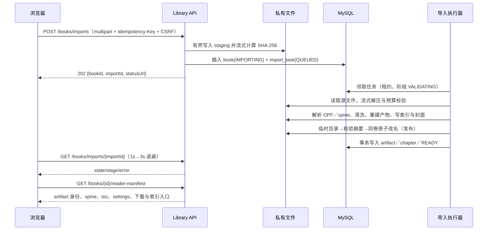
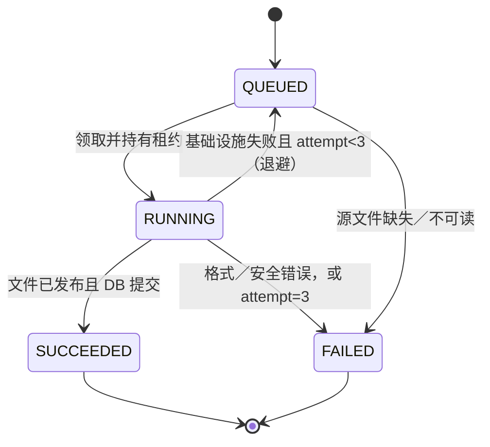

# M03 文件、EPUB 导入与书架技术设计与执行文档

版本：0.3；日期：2026-11-23。状态：**本机核心实现完成（后端＋前端代码，`readict_test` 已迁移，接口与恢复矩阵验收通过，浏览器自动检查完成），人工视觉确认、真实 EPUB 与 V03 全量矩阵未完成；M03 未整体验收通过**。实际结果见 [M03 实施记录](../../../validation/implementation/m03/2026-11-23-local/README.md)。

需求基线：[PRD V1.1](../../requirements/prd/PRD-v1.1.md)。总体设计：[系统技术设计](../architecture/Readict-V1.1-系统技术设计.md)。任务来源：[模块化开发计划](Readict-V1.1-模块化开发计划.md)。既定决定：[ADR-0001](../decisions/ADR-0001-本机环境与本地词典及翻译技术选型.md)、[ADR-0002](../decisions/ADR-0002-业务持久层采用MyBatis-Plus与XML.md)、[ADR-0008](../decisions/ADR-0008-EPUB安全流水线与确定性产物.md)（已采纳）。前置实现：[M00 记录](../../../validation/implementation/m00/README.md)、[M01 记录](../../../validation/implementation/m01/README.md)、[M02 记录](../../../validation/implementation/m02/README.md)、[A02 记录](../../../validation/implementation/a02/README.md)。

阅读顺序：实际起点 → 范围与证据 → 流程与目录 → 存储与任务 → 安全流水线与产物 → V7 与 API → 后端／前端指导 → 六项任务 → 验收与命令 → 未决事项。

## 0. 基线、证据分类与本次边界

### 0.1 证据分类

| 标记 | 含义 | 本文应用 |
|---|---|---|
| 已有事实 | 仓库代码、迁移或归档记录直接支持 | M00～M02／A02 工程能力、V1～V6、认证链、既有 UI |
| 工程设计 | 本文确定、供正式实现使用的契约与规则 | 存储、任务、清洗、确定性、V7、API、前端 |
| 待验证 | 缺真实执行或测量证据 | Java 解析器兼容、预算实测、确定性跨 JDK、数据体积、恶意样本覆盖 |

### 0.2 2026-11-23 实际只读核对

以下为写作时的仓库事实，实施前须复核，若已变化先记录差异再动工。

- 应用仓库 HEAD `25e3310`（A02 本机音频 MVP 底座）；设计仓库 HEAD `d382f9d`。应用已有 Java 21／Boot 4.1.2／MP Boot 4 Starter 3.5.18＋XML、HikariCP、Flyway V1～V6、Session JDBC、统一 Problem Details 与 requestId。
- 已有包：`com.readict.{identity,lexical,operations,settings,shared}`。**没有 `library` 包**，前端**没有 `features/library`**。MapperScan 为 `com.readict.*.infrastructure.persistence.mapper`，XML 位于 `resources/mapper/<module>`，`map-underscore-to-camel-case=true`，二级缓存关闭、`local-cache-scope=STATEMENT`。
- 迁移已执行 V1～V6，**V7 空闲**；`spring.flyway.clean-disabled=true`、`baseline-on-migrate=false`。V1～V6 不得修改或删除。
- [SecurityConfiguration](../../../../readict-app/backend/src/main/java/com/readict/shared/config/SecurityConfiguration.java) 为显式白名单＋`anyRequest().denyAll()`：`GET/HEAD /api/v1/dictionary/audio/*` 已登记认证，**`/api/v1/books/**` 当前全部被拒绝**。状态变更需 CSRF（`X-CSRF-TOKEN`）。
- [application.yml](../../../../readict-app/backend/src/main/resources/application.yml) **未配置** `spring.servlet.multipart.*`，即 Boot 默认单文件 1 MB、单请求 10 MB；与 25 MiB 预算冲突。`readict.*` 已存在 `auth`、`verification`、`audio` 配置段。
- [ApiExceptionHandler](../../../../readict-app/backend/src/main/java/com/readict/shared/web/ApiExceptionHandler.java) 只映射 `DomainProblem`、`SystemNotReadyException`／`DataAccessException`／`TransactionException`、参数类异常与兜底 `Exception`；**没有 413／415 映射**，超限会落到 500。`DomainProblem` 目前位于 `com.readict.identity.domain`。
- 私有存储先例为 [AudioStorage](../../../../readict-app/backend/src/main/java/com/readict/lexical/audio/AudioStorage.java)：配置根、目录名必须 `readict_<profile>`、拒绝符号链接、realpath 归因、原子发布。
- [FoundationIT](../../../../readict-app/backend/src/test/java/com/readict/FoundationIT.java) 用 `containsExactlyInAnyOrder` 断言当前 18 张表；新增表必须同步更新该断言，否则测试失败属预期。
- 前端 [http.ts](../../../../readict-app/frontend/src/lib/http.ts) 的 `request()` 只允许 `GET|POST|PUT` 与 JSON body，统一处理 CSRF、Problem Details、401 事件；**不支持 multipart、DELETE、自定义头与上传进度**。路由在 [App.tsx](../../../../readict-app/frontend/src/App.tsx) 内以 BrowserRouter 集中声明。

### 0.3 本次文档边界

只写设计与执行指导：不创建源码、不建库、不执行迁移、不导入真实 EPUB、不产生验收结论。不修改 PRD、系统设计历史章节、M00～M02 完成条件、历史证据；新增链接仅作入口补充。
### 0.4 2026-11-23 实施补记（0.2）

后端与前端核心已按本文落地，提交 `d08976b`；`readict_test` 已执行 V7，`readict_dev` 未迁移。实现中确认并回写以下差异，其余契约未变：

1. `spineHref` 统一为**包内完整路径**（如 `OEBPS/Text/ch1.xhtml`），章节表、`index.json`、`manifest` 与接口一致；不是相对 OPF 的 href。
2. `<link rel="stylesheet">` 保留，但仅当目标为包内 CSS；其余 `link`／`meta` 仍剔除。
3. 共享错误类型为新增的 `com.readict.shared.web.ApiProblem`，未迁移 `identity.DomainProblem`，避免影响 M01 既有行为。
4. CSS 解析使用 `com.helger:ph-css:7.0.5`（Apache-2.0，镜像可用版本），不是 8.4.0。
5. 新增错误码 `EPUB_INVALID_XHTML`、`COVER_NOT_FOUND`、`LEASE_LOST`、`BOOK_STATE_CONFLICT`；`text-index` 块字段为 `utf16Length`。
6. 确定性只在本机同 JDK 内验证；跨 JDK 未测，仍需按 V04 处理。

未完成项：A03／A05／A07／A11／A12 已补单测或集成（见实施记录）；人工视觉确认、真实 EPUB、V03 全量恶意矩阵与跨 JDK 确定性、`readict_dev` 迁移和 M08 清理执行后置。矩阵状态见实施记录，不因本文更新而升格。

## 1. 目标、范围与明确不做

### 1.1 交付范围

1. 私有文件底座：`StoragePort`／`BookStorage`、根目录保护、staging、原子发布、按 key 读取与删除登记。
2. 有界上传：`.epub` 校验、流式接收、SHA-256、25 MiB 上限、超限中断、幂等键。
3. 导入流水线：ZIP 结构校验、预算、XML／CSS／资源清洗、封面提取、确定性产物、块与句索引。
4. 导入任务：状态机、阶段、租约、续约、接管、重试分类、崩溃恢复、并发上限。
5. 数据：V7 四表（`book`、`book_artifact`、`book_chapter`、`import_task`）及 Entity／Mapper／XML。
6. API：`/books`、`/books/imports`、`/books/imports/{importId}`、`/books/{id}`、`DELETE /books/{id}`、cover、`reader-manifest`、产物下载、`text-index`。
7. 前端：`/books` 书架页、导入对话框与进度、搜索、删除确认、封面占位、错误文案。
8. 验证：普通单测与 `readict_test` 集成测试矩阵，覆盖合法／恶意／损坏／超限／断流／崩溃／重复导入。

### 1.2 明确不做

- 阅读器、分页、目录面板、位置恢复、进度表与进度接口（M04；本文只在 manifest 中提供其输入）。
- 单词定位、查词、词典卡片、句子持久化（M05）；收藏主体与快照（M06）；翻译（M07）。
- `file_cleanup_task`、孤儿回收巡检、故障注入与告警（M08）；本模块只登记待清理状态。
- 备份恢复、兼容／性能验收、运行交付（M09）。
- 音频导入与播放（A02 已完成本机 MVP 底座，完整复验与会话播放后置）；DRM、PDF、固定版式、脚本化 EPUB；多用户共享文件去重；对象存储；生产部署。

## 2. 已有证据与复用边界

| 编号 | 证据 | 可复用 | 不可复用／须重建 |
|---|---|---|---|
| E1 | [原型书架 Bookshelf.tsx](../../../prototypes/reader-ui/src/components/Bookshelf.tsx)、`bookshelf.css` | 卡片层级、搜索、导入与删除交互、空态与错误态视觉 | 其“按文件名含 fail／drm 判失败”“50 MB 上限”“导入即复用内置样书”均为 Mock，必须替换为真实请求与 25 MiB 文案 |
| E2 | [reader-core importBook.ts](../../../validation/technical/reader-core/src/importBook.ts)、[REPORT §七](../../../validation/technical/reader-core/REPORT.md) | 攻击样本类型、预算维度、拒绝项清单、CSP 基线 | JSZip／DOMPurify／`XMLSerializer` 全部为浏览器实现；解压非流式、依赖未治理，**不可作 Java 流水线证明** |
| E3 | [AudioStorage](../../../../readict-app/backend/src/main/java/com/readict/lexical/audio/AudioStorage.java)、[AudioPlaybackService](../../../../readict-app/backend/src/main/java/com/readict/lexical/audio/AudioPlaybackService.java) | 私有根保护、profile 目录名、realpath 归因、临时文件＋原子改名 | 只处理固定格式单文件与哈希键，无目录树、无导入任务、无用户归属 |
| E4 | M00 事务／TypeHandler／Flyway 基线 | UUID BINARY(16)＋INPUT、UTC DATETIME(3)、显式 XML、`mysql-it` 剖面 | 无业务表并发与文件事务组合的先例 |
| E5 | M01 认证、CSRF、Session、`Problems` | 认证主体取 userId、CSRF 头、Problem Details 扩展、401／403 语义 | 无文件与任务权限模型 |
| E6 | M02／A02 任务与租约实现 | 分批 checkpoint、owner 租约、显式版本切换、离线 CLI 隔离启动 | 其租约属于数据集导入，不覆盖“文件先发布、DB 后提交”的两阶段顺序 |
| E7 | [系统设计 §7.1／§13.3／§14.2／§16.1](../architecture/Readict-V1.1-系统技术设计.md) | 字段、状态、端点、预算与失败矩阵 | 均为工程设计，无实现证据 |

## 3. 总体流程与组件



| 组件 | 职责 | 事务／外部调用 |
|---|---|---|
| `LibraryController` | 传输校验、认证主体、状态码与 Problem Details | 无事务 |
| `BookQueryService` | 书架投影、书籍详情、封面与 manifest 组装 | 只读事务；读取 settings 走应用服务 |
| `ImportService` | 上传落盘、幂等判定、书籍与任务写入、同源复用 | 短事务；文件写入在事务外 |
| `ImportWorker` | 领取／续约／阶段推进／失败分类／发布后提交 | 领取与提交短事务；解析在事务外 |
| `EpubInspector` | ZIP 结构、预算、OPF／spine／toc、封面候选 | 纯内存，不访问网络 |
| `EpubSanitizer` | XHTML／SVG／CSS 白名单与资源闭合 | 纯内存 |
| `ArtifactWriter` | 确定性序列化、索引生成、临时目录与原子发布 | 文件系统；不接受用户路径 |
| `BookStorage` | 私有根、key 解析、读写、原子发布、删除登记 | 文件系统 |
| `BookRepository`／`*Mapper` | 书籍、产物、章节、任务持久化与条件更新 | 显式 XML 负责条件更新与游标 |

## 4. 目标目录与工程约定

以下相对正式应用 `readict-app`，均为**待新增**目标（本次不创建）：

```text
backend/src/main/java/com/readict/library/
  api/            LibraryController、BookView、ManifestView、ProblemMapping
  application/    ImportService、ImportWorker、BookQueryService、ImportRecoveryJob、book 投影
  domain/         BookStatus、ImportState、ImportStage、ImportFailure、EpubLimits
  infrastructure/
    storage/      StoragePort、BookStorage、StorageKey
    epub/         EpubInspector、EpubSanitizer、CssSanitizer、XhtmlSerializer、TextIndexer
    persistence/  entity/、mapper/、BookRepository、ImportTaskRepository
backend/src/main/resources/
  db/migration/V7__library_books.sql
  mapper/library/BookMapper.xml、BookArtifactMapper.xml、BookChapterMapper.xml、ImportTaskMapper.xml
backend/src/test/java/com/readict/library/
  epub/           EpubFixtures、EpubInspectorTest、EpubSanitizerTest、DeterminismTest、TextIndexerTest
  storage/        BookStorageTest
  LibraryIT.java  真实 readict_test 集成
frontend/src/features/library/
  api.ts、model.ts、BookshelfPage.tsx、BookCard.tsx、ImportDialog.tsx、useBookshelf.ts
  api.test.ts、model.test.ts
```

约定：

- 一个 Maven 应用内按业务包分层；Controller 只做传输校验，事务在应用服务公共代理方法；Controller 不直接调用 Mapper。
- 自定义 XML 只用于条件更新、游标分页、JOIN 与状态竞争；简单单表可用 BaseMapper，但 `selectById` 不是所有权证明。
- 所有 UUID 由应用生成＋`IdType.INPUT`＋`UuidBinaryTypeHandler`；时间一律 `UtcInstantTypeHandler`／`DATETIME(3)` UTC；哈希 `BINARY(32)` 存字节，API 输出小写十六进制。
- 不使用全局逻辑删除、乐观锁插件、分页插件；`version`／状态由显式 SQL 维护。
- 应用不建 `docs/`；详细记录归设计仓库。单次验收脚本不提交；IT 使用测试临时目录。
- 新增配置统一前缀 `readict.library.*`，由 `@Value` 或 `@ConfigurationProperties` 读取，不在代码写死路径。

## 5. 私有存储与 StoragePort

### 5.1 根目录与环境保护

| 配置 | 值 | 校验 |
|---|---|---|
| `readict.library.storage-root` | `${READICT_BOOK_STORAGE_ROOT:}` | 空白即视为未配置：导入与读取返回 503 `STORAGE_NOT_CONFIGURED`，**启动不失败**（不影响 M00～M02 已可用路径） |
| profile | 单一 `dev`／`test` | 目录末级名必须为 `readict_<profile>`；多 profile 或名称不符即 `STORAGE_ENVIRONMENT_INVALID` |
| 真实路径 | `toAbsolutePath().normalize()` 后 `toRealPath()` | 拒绝符号链接／junction；每次操作重新解析父目录并复核 `startsWith(root)` |

初始目录布局（`key` 一律由服务端生成，不含用户输入）：

```text
{root}/staging/{importId}/upload.part          接收中，失败即删
{root}/staging/{importId}/source.epub          校验完成、尚未归属书籍
{root}/users/{userId}/books/{bookId}/source.epub
{root}/users/{userId}/artifacts/{artifactId}/reader.epub
{root}/users/{userId}/artifacts/{artifactId}/index.json
{root}/users/{userId}/artifacts/{artifactId}/manifest.json
{root}/users/{userId}/artifacts/{artifactId}/cover.jpg|png
```

设计第 13.6 节的示例未带 `users/{userId}` 前缀；本文增加该前缀以便按用户归属删除与体积统计，属于实现细化，不改变“key 不可由用户指定”的约束。原始文件名只入 `book.original_filename` 展示，永不参与路径。

### 5.2 方法契约

| 方法 | 语义 | 失败 |
|---|---|---|
| `writeStaging(importId, InputStream, limitBytes)` | 有界写入并同步计算 SHA-256，返回字节数与摘要 | 超限 `UPLOAD_TOO_LARGE`；中断删除半成品 |
| `adoptSource(importId, userId, bookId)` | staging → 正式源文件，原子改名 | 目标已存在且摘要不同 → `STORAGE_CONFLICT` |
| `publishDirectory(stagingDir, artifactId, userId)` | 产物目录整体原子改名 | 跨卷或目标存在 → 失败并保留 staging |
| `openRead(key)` | 返回流与长度，供下载／校验 | 不存在 → `STORAGE_MISSING` |
| `existsAndDigest(key)` | 存在性＋摘要 | 摘要不符 → `STORAGE_CONFLICT` |
| `deleteOwned(keys)` | 仅删除本用户 key 前缀下文件 | 越界 key 直接拒绝 |

读取使用流式或 `RandomAccessFile`，不把整本书读入堆。任何写入先写同目录临时文件再原子改名；发布后不再修改。

### 5.3 容量与清理边界

- 首版不跨用户去重、不共享产物；同一源文件重复导入复用同一 `book` 行，不产生第二份源文件。
- 文件删除不做“立即物理删除＋DB 同事务”的假设：删除书籍只置 `DELETING` 并登记待清理，物理回收由 M08 任务执行。M03 的测试可显式清理自己生成的目录。
- 磁盘余量：写入前检查可用空间不小于单文件上限的 2 倍，不足返回 503 `STORAGE_UNAVAILABLE`，不写半文件。

## 6. 上传、任务与租约

### 6.1 上传预算与 multipart 配置

| 项 | 值 | 说明 |
|---|---|---|
| 单文件业务上限 | 25 MiB | 设计第 7.1 节；原型 50 MB 文案必须更正 |
| `spring.servlet.multipart.max-file-size` | `26MB` | Servlet 兜底，略高于业务上限，使正常超限由业务返回 `UPLOAD_TOO_LARGE` |
| `spring.servlet.multipart.max-request-size` | `28MB` | 预留 multipart 边界与表单开销 |
| `file-size-threshold` | `0` | 直接落盘，避免大对象驻留堆 |
| 扩展名 | 必须 `.epub`（大小写不敏感） | 仅作快速拒绝，不是格式证明 |
| 魔数 | 前 4 字节 `PK\x03\x04` | 不匹配即 `EPUB_FILE_TYPE_REQUIRED` |

上传阶段只做同步快速检查（大小、扩展名、ZIP 魔数、CSRF、幂等键）。**格式、结构、安全判断一律异步**，失败体现在任务状态，不在上传响应中假装已解析。

### 6.2 接收与幂等

1. 校验 `Idempotency-Key` 为 UUID；缺失 400 `IDEMPOTENCY_KEY_REQUIRED`，非法 400 `INVALID_IDEMPOTENCY_KEY`。
2. 流式写入 `staging/{importId}/upload.part`，逐块计数，超 25 MiB 立即中断并删除半成品。
3. 完成后计算 `request_hash = SHA-256(sourceHash ‖ originalFilename ‖ size)`。
4. 事务：按 `(user_id, request_id)` 查已有任务 → 同 hash 返回原结果；不同 hash → 409 `IDEMPOTENCY_KEY_REUSED`。
5. 再按 `(user_id, source_hash)` 决定同源分支（6.7），最后插入 `book(IMPORTING)`＋`import_task(QUEUED)` 并提交。
6. 提交成功后把 staging 文件 `adoptSource` 到正式位置；若此步失败，任务标 `FAILED/STORAGE_WRITE_FAILED`，不留下 READY。

### 6.3 任务状态机



阶段固定为 `VALIDATING → PARSING → SANITIZING → PUBLISHING`；`SUCCEEDED` 终态停在 `PUBLISHING`。书籍状态 `IMPORTING → READY｜FAILED`，`READY → DELETING`；`BROKEN` 由 M08 巡检写入，M03 只读取并拒绝提供 manifest。任何阶段异常都不得让 `book.status=READY`。

### 6.4 租约领取、续约与接管

```sql
-- 短事务内选择候选
SELECT id FROM import_task
 WHERE state='QUEUED' AND (next_attempt_at IS NULL OR next_attempt_at<=UTC_TIMESTAMP(3))
 ORDER BY created_at LIMIT 1 FOR UPDATE SKIP LOCKED;

-- 领取
UPDATE import_task
   SET state='RUNNING', stage='VALIDATING', attempt=attempt+1,
       lease_token=?, lease_until=?, updated_at=UTC_TIMESTAMP(3)
 WHERE id=? AND state='QUEUED';

-- 续约（每 20 秒，租约 90 秒）
UPDATE import_task SET lease_until=?, updated_at=UTC_TIMESTAMP(3)
 WHERE id=? AND lease_token=? AND state='RUNNING' AND lease_until>UTC_TIMESTAMP(3);

-- 接管（旧进程超时后）
UPDATE import_task SET lease_token=?, lease_until=?, updated_at=UTC_TIMESTAMP(3)
 WHERE id=? AND (state='QUEUED' OR (state='RUNNING' AND lease_until<UTC_TIMESTAMP(3)));
```

发布与提交必须以 `WHERE id=? AND lease_token=? AND lease_until>UTC_TIMESTAMP(3)` 为条件；条件不成立即放弃，不写任何可见状态。旧进程迟到不得覆盖新 owner 的结果。

### 6.5 重试与失败分类

| 类别 | 示例 | 处置 |
|---|---|---|
| 基础设施 | 磁盘 IO、数据库瞬时失败、租约续约失败 | `attempt<3` 回到 `QUEUED` 并退避（10s／30s／90s）；第 3 次失败置 `FAILED/INTERNAL_ERROR` |
| 超时 | 单次处理超过 60 秒总预算 | 置 `FAILED/IMPORT_TIMEOUT`；不自动重试 |
| 输入／安全 | ZIP 结构、路径、DTD、加密、固定版式、清洗失败、确定性不一致 | 立即 `FAILED` 并带具体错误码，**不重试** |
| 源文件缺失 | 正式源文件被外部删除 | `FAILED/SOURCE_MISSING`，不重建 |

格式／安全错误不重试是硬规则：重试不能修复恶意输入，只会放大资源消耗。重新入队时必须把 `error_code`／`safe_error_message` 清空，否则 `ck_task_error` 约束会拒绝；失败终态才写错误码。

### 6.6 执行器与并发上限

- 单实例导入并发 1、待处理队列上限 10、每用户同时有效任务上限 2（设计第 6.3 节），超限 429 `IMPORT_LIMIT_REACHED` 并给 `Retry-After: 30`。
- 有界 `ThreadPoolTaskExecutor`（core=max=1，queue=10，`RejectedExecutionHandler` 不抛弃任务，由数据库状态兜底），进程内**不保存待处理任务列表**。
- 恢复扫描：启动后 10 秒执行一次，之后每 5 秒扫描 `QUEUED` 与超时 `RUNNING`；租约过期任务由 `attempt` 与退避规则决定是否重领。
- 关闭：先停止接收，等待当前任务到阶段边界；不承诺跨重启保留内存状态，靠数据库状态恢复。

### 6.7 同 sourceHash 重复导入

| 现有书籍状态 | 行为 |
|---|---|
| `READY` | 删除本次 staging；200 `{bookId, reused:true}`，不创建新任务 |
| `IMPORTING` | 删除本次 staging；202，返回当前任务 `{bookId, importId, reused:true}` |
| `FAILED`／`BROKEN` | 复用书籍行（更新 `source_size`、`original_filename`，状态回 `IMPORTING`），替换源文件，创建新 `import_task`；202 |
| `DELETING` | 删除 staging；409 `BOOK_DELETING`，不重新激活 |

`origin_key`：首次导入时生成并持久化；同源复用沿用原值。**删除书籍后重新导入时从保留的收藏来源恢复 `originKey`** 依赖 M06 收藏数据，M03 不实现该恢复，重新导入将生成新 `origin_key`；该差异在第 15 章明确交接给 M06／M08，不得在本模块声称已完成。

### 6.8 删除语义

`DELETE /books/{id}` 事务内：校验归属 → 状态置 `DELETING`（已为 `DELETING` 直接返回 202）→ 置 `import_task.cleanup_pending=TRUE` → 提交。成功后书架立即不显示该书，manifest／下载／导入复用全部拒绝。物理文件与行的最终回收由 M08 执行；M03 只在测试中清理自己生成的数据。

## 7. EPUB 解析与安全处理

### 7.1 结构校验顺序

1. ZIP 中央目录快速预检：条目数、声明大小、重复规范化路径、首条必须为 `mimetype` 且 STORED。
2. `mimetype` 内容必须恰为 `application/epub+zip`（20 字节，无换行）。
3. `META-INF/container.xml` → 取唯一或首个 `rootfile` 的 `full-path`；多 rootfile 时按 OPF 的 package 唯一性判定，歧义即失败。
4. OPF：`package/@version`（2.0／3.0 系列）、`metadata`（dc:title、dc:creator、dc:language、dc:identifier）、`manifest`（id／href／media-type）、`spine`（itemref／linear）。
5. 目录：EPUB3 `properties="nav"` 的 XHTML nav 或 EPUB2 NCX；都没有时用 spine 顺序与章节标题兜底，并在 `manifest.json` 标记 `tocSource=SPINE`。
6. 每个 manifest href 解析后必须仍在包根之下；spine 引用的项必须存在于 manifest 且为 XHTML。
7. 固定版式（`rendition:layout` 为 `pre-paginated`）、`META-INF/encryption.xml`（含字体混淆）、DRM 标记一律拒绝并给出准确原因，不泛称“DRM”。

### 7.2 预算表（初始工程预算，须实测修订）

| 项 | 上限 | 检查时点 | 超限结果 |
|---|---|---|---|
| 源文件 | 25 MiB | 上传接收 | 413 `UPLOAD_TOO_LARGE` |
| ZIP 条目 | 2500 | 中央目录＋读取流 | `EPUB_ENTRY_LIMIT` |
| 单条目解压 | 16 MiB | 逐条读取计数 | `EPUB_ENTRY_TOO_LARGE` |
| 累计解压 | 80 MiB | 逐条累加 | `EPUB_TOTAL_TOO_LARGE` |
| 路径 UTF-8 | 512 字节 | 每次解析 URI 后 | `EPUB_PATH_TOO_LONG` |
| 嵌套目录深度 | 16 | 同上 | `EPUB_TOO_DEEP` |
| spine 项数 | 1000 | OPF | `EPUB_SPINE_TOO_LARGE` |
| 单章清洗后输出 | 8 MiB | 逐章序列化 | `EPUB_CHAPTER_TOO_LARGE` |
| 产物 reader.epub | 96 MiB | 发布前统计 | `EPUB_ARTIFACT_TOO_LARGE` |
| 索引 index.json | 8 MiB | 发布前统计 | `EPUB_INDEX_TOO_LARGE` |
| 封面 | 4 MiB、≤4096×4096 | 提取后 | 丢弃封面并 WARNING，不失败 |
| 单块文本 | 64 KiB UTF-16 | 索引生成 | 按句边界切块，超限标 `FRAGMENT` |
| 导入总时长 | 60 秒 | worker 计时 | `IMPORT_TIMEOUT` |

中央目录的声明大小只作辅助，**真实字节以读取流累计为准**；达到上限立即中断并关闭流。

### 7.3 拒绝与剔除清单

- 路径：绝对路径、盘符、反斜杠混淆、`..` 越界、重复规范化路径、符号链接条目、非常规文件、嵌套归档（`.zip`／`.epub` 条目）。
- XML：DTD、外部实体、外部 schema、网络访问、超长实体；解析参数固定（`disallow-doctype-decl=true`、`external-general-entities=false`、`external-parameter-entities=false`、`load-external-dtd=false`、`ACCESS_EXTERNAL_DTD=""`、`ACCESS_EXTERNAL_SCHEMA=""`、`FEATURE_SECURE_PROCESSING=true`）。
- 内容：`script`、`iframe`、`object`、`embed`、`applet`、`form`／`input`／`button`／`select`／`textarea`、`base`、`meta`（除本文注入的 CSP）、`noscript`、`template`、`canvas`、`audio`、`video`、MathML、`foreignObject`、SMIL 动画（`animate`／`set`／`animateTransform`）、事件属性（`on*`）、`style` 属性中的 `url()`／`expression`、`data:` URI。`link` 仅保留 `rel=stylesheet` 且目标为包内 CSS 的引用，其余删除。
- 外部 URI：`http:`／`https:`／协议相对 `//`／`javascript:`／`mailto:`／`tel:` 全部删除；内部链接只保留指向已保留 spine 项或 `#fragment` 的形式。
- 隐藏内容：`hidden` 属性、内联 `display:none`／`visibility:hidden` 的元素连同文本删除并计数，避免“看不见的正文”进入索引。

### 7.4 XHTML／SVG 白名单

| 类别 | 保留 |
|---|---|
| 文档 | `html`、`head`、`title`、`body`（head 内仅保留 title 与注入的 CSP meta） |
| 结构 | `div`、`section`、`article`、`aside`、`header`、`footer`、`nav`、`p`、`blockquote`、`pre`、`hr`、`br` |
| 标题与列表 | `h1`～`h6`、`ul`、`ol`、`li`、`dl`、`dt`、`dd` |
| 行内 | `span`、`em`、`strong`、`b`、`i`、`u`、`s`、`small`、`sub`、`sup`、`q`、`cite`、`code`、`kbd`、`samp`、`var`、`ruby`、`rt`、`rp`、`a` |
| 表格 | `table`、`caption`、`colgroup`、`col`、`thead`、`tbody`、`tfoot`、`tr`、`th`、`td` |
| 图片 | `img`、`figure`、`figcaption`（`src` 必须指向已保留资源） |
| SVG（内联） | `svg`、`g`、`path`、`rect`、`circle`、`ellipse`、`line`、`polyline`、`polygon`、`text`、`tspan`、`defs`、`symbol`、`use`（`href` 仅 `#id`） |
| 属性 | `id`、`class`、`lang`、`dir`、`title`、`alt`、`src`、`href`、`colspan`、`rowspan`、`width`、`height`、`xml:lang`、`xmlns`、`xmlns:epub`、`epub:type`、`role`、`aria-*`、`viewBox`、`d`、`fill`、`stroke`、`stroke-width`、`x`、`y`、`cx`、`cy`、`r`、`rx`、`ry`、`x1`、`y1`、`x2`、`y2`、`points` |

其余元素与属性一律删除；删除时记录计数进入质量日志，不静默改变正文语义。SVG 只作为图形保留，不承载可交互内容。

### 7.5 CSS 规则

经 ph-css 解析为语法树后重写，不使用正则：

- 删除 `@import`、`@charset`、`@font-face`、`@keyframes`、`@supports`、`@page` 与未知 at-rule。
- `@media` 只保留 screen 相关且内部规则全部通过白名单的分支。
- 属性白名单：`color`、`background-color`、`font-family`（仅 Georgia／Palatino Linotype／Arial／serif／sans-serif／monospace）、`font-size`、`font-style`、`font-weight`、`font-variant`、`line-height`、`letter-spacing`、`word-spacing`、`text-align`、`text-indent`、`text-decoration`、`text-transform`、`white-space`、`vertical-align`、`list-style-type`、`list-style-position`、`margin*`、`padding*`、`border*`、`border-radius`、`width`、`max-width`、`height`、`max-height`、`display`（仅 `block`／`inline`／`inline-block`／`none`／`list-item`／`table` 系列）、`float`（仅 `left`／`right`／`none`）、`clear`、`page-break-*`、`break-*`。
- 值中含 `url(`、`expression`、`var(`、`calc(` 的颜色／尺寸以外用途一律丢弃；`position`、`top/left/right/bottom`、`z-index`、`transform`、`transition`、`animation` 全删。
- 输出由自建序列化器生成，选择器文本原样保留（仅压缩空白），声明按白名单顺序输出。

### 7.6 资源闭合

- 保留集合 = spine XHTML ∪ 其清洗后实际引用的图片／CSS ∪ 封面 ∪ 目录文档；其余资源（脚本、字体、音视频、未引用图片）剔除。
- 剔除后重新扫描 XHTML 与 CSS 中的引用，出现指向已剔除资源的引用必须同步删除，发布前断言“产物内不存在悬空内部引用”。
- 资源 MIME 以 OPF 声明与实际魔数双向校验；`image/svg+xml` 仅允许包内独立 SVG 且经同一 SVG 白名单，否则剔除。

### 7.7 CSP 注入

每个保留的 XHTML 文档在 `head` 首位注入：

```text
default-src 'none'; img-src blob: data:; style-src 'unsafe-inline' blob:;
font-src blob: data:; script-src 'none'; connect-src 'none'; frame-src 'none';
object-src 'none'; form-action 'none'; base-uri 'none'
```

CSP 只作纵深防护，不替代清洗；`img-src blob:` 是阅读引擎替换资源所必需，`data:` 仅对已验证的图片类型保留。

### 7.8 封面

候选顺序：EPUB3 manifest `properties` 含 `cover-image` → EPUB2 `<meta name="cover" content="id">` → 首个 `figure`／`img`。校验 JPEG（`FF D8 FF`）或 PNG（`89 50 4E 47`）魔数、字节上限、像素上限；通过则原字节保存并记录 `cover_mime` 与 `cover_hash`。不重编码、不接受 SVG、不使用外部图片。无合格封面时 `cover_storage_key` 为空，接口 404，由 UI 显示本地占位。

### 7.9 错误码分类

- 同步（HTTP）：`UPLOAD_TOO_LARGE`、`REQUEST_TOO_LARGE`、`UNSUPPORTED_MEDIA_TYPE`、`EPUB_FILE_TYPE_REQUIRED`、`IDEMPOTENCY_KEY_REQUIRED`、`INVALID_IDEMPOTENCY_KEY`、`IDEMPOTENCY_KEY_REUSED`、`BOOK_DELETING`、`IMPORT_LIMIT_REACHED`、`STORAGE_NOT_CONFIGURED`、`STORAGE_UNAVAILABLE`。
- 异步（`import_task.error_code`，用户可见文案由前端映射）：`EPUB_INVALID_ZIP`、`EPUB_INVALID_MIMETYPE`、`EPUB_INVALID_CONTAINER`、`EPUB_INVALID_OPF`、`EPUB_INVALID_SPINE`、`EPUB_INVALID_XHTML`、`EPUB_ENTRY_LIMIT`、`EPUB_ENTRY_TOO_LARGE`、`EPUB_TOTAL_TOO_LARGE`、`EPUB_PATH_TOO_LONG`、`EPUB_TOO_DEEP`、`EPUB_PATH_TRAVERSAL`、`EPUB_SPINE_TOO_LARGE`、`EPUB_DTD_FORBIDDEN`、`EPUB_FIXED_LAYOUT`、`EPUB_ENCRYPTED`、`EPUB_NO_CONTENT`、`EPUB_CHAPTER_TOO_LARGE`、`EPUB_ARTIFACT_TOO_LARGE`、`EPUB_INDEX_TOO_LARGE`、`EPUB_ARTIFACT_UNDETERMINISTIC`、`SOURCE_MISSING`、`STORAGE_WRITE_FAILED`、`IMPORT_TIMEOUT`、`LEASE_LOST`、`BOOK_STATE_CONFLICT`、`INTERNAL_ERROR`。封面缺失不是错误（`COVER_NOT_FOUND` 只用于读取已删除／缺失封面）。

`error_code` 之外的用户文案必须安全、可操作、不含路径与堆栈；技术细节只进脱敏日志。

## 8. 确定性产物与文本索引

### 8.1 流水线版本

`pipelineVersion = epub-safe-v1`，绑定：ZIP 重建规则、XML 序列化规则、元素／属性／CSS 白名单版本、资源闭合规则、索引 schema 与分句规则。任一变化必须升版本号；旧产物保持不可变，CFI 不跨版本复用。

### 8.2 ZIP 重建规则

- `mimetype` 为首条，STORED，无 extra field。
- 其余条目按规范化路径的 UTF-8 字节序排序。
- 所有条目时间戳固定为 `1980-01-01T00:00:00Z`（DOS 最小可表示值），外部属性固定。
- 压缩：除 `mimetype` 外统一 DEFLATE，级别固定为 6。
- 不写注释、不写 ZIP64（超出上限即失败，不降级）。

### 8.3 序列化规则

自建序列化器输出：固定 `<?xml version="1.0" encoding="UTF-8"?>`、无缩进与多余空白、属性按固定顺序（命名空间声明 → 固定属性表序 → 其余按字典序）、文本仅转义 `& < >`、属性值转义 `& < > "`、空元素写成 `<x/>`、不输出注释与处理指令。XHTML 根元素保留 `xmlns` 与 `xmlns:epub`。

### 8.4 可复现门槛

同一源文件、同一 `pipelineVersion` 的两次完整处理必须产生相同 `artifactHash`、相同 `index.json` 摘要与相同封面摘要。任一不一致 → 该次任务 `FAILED/EPUB_ARTIFACT_UNDETERMINISTIC`，不得 READY。首次实现即用两次连续运行验证；跨 JDK 大版本的差异未知，需在记录的运行环境内声明，不得以“内容相同”替代字节一致。

### 8.5 产物布局

| 文件 | 内容 | 上限 |
|---|---|---|
| `reader.epub` | 清洗后的可分页 EPUB（含 CSP meta） | 96 MiB |
| `index.json` | 全书块文本与句范围、摘要 | 8 MiB |
| `manifest.json` | spine、toc 树、tocSource、源摘要、流水线版本、计数 | 2 MiB |
| `cover.jpg`／`cover.png` | 原字节封面 | 4 MiB |

### 8.6 块与标识

- 块 = 首个含文本的块级元素；其内部若再出现块级元素，则内层自成一块，不重复收集文本。
- `blockId` 在**单章内**从 `b-1` 递增，按文档顺序；跨章唯一性由 `spineHref` 保证。`spineHref` 为包内完整路径（如 `OEBPS/Text/ch1.xhtml`），章节表、索引、manifest 与接口使用同一值。
- 块文本 = 该块内全部文本节点按顺序连接，`br` 记为 `\n`；不 trim、不压缩空白、不做 Unicode 归一化。
- `textHash = SHA-256(块文本 UTF-8 字节)`；`utf16Length = Java String.length()`（UTF-16 码元计数），与浏览器 JS `length` 一致。

### 8.7 句范围

- 使用 Java `BreakIterator.getSentenceInstance(Locale.US)`，叠加版本化称谓修正 `segment-rules-v1`（`Mr.`、`Mrs.`、`Ms.`、`Dr.`、`Prof.`、`St.`、`Jr.`、`Sr.`、`vs.`、`etc.`、`e.g.`、`i.e.`、`No.`）。
- 范围是块内 UTF-16 半开区间 `[start,end)`；不跨块，因此跨块长句在首版标 `kind=FRAGMENT`，块末无终止符的末段同样标 `FRAGMENT`。
- 与浏览器 `Intl.Segmenter` 的差异属预期：浏览器结果只作即时预览，持久来源以本索引为准（设计第 14.7 节）。V09 语料验证在 M05 之前完成，M03 只承诺结构与夹具内的稳定性。

### 8.8 索引 schema

```json
{
  "schemaVersion": "readict-text-index-1",
  "pipelineVersion": "epub-safe-v1",
  "segmentRules": "segment-rules-v1",
  "artifactHash": "<64 位小写 SHA-256>",
  "chapters": [
    {
      "spineHref": "Text/ch1.xhtml",
      "spineIndex": 0,
      "totalUtf16": 4210,
      "blocks": [
        {
          "blockId": "b-1",
          "text": "Call me Ishmael.",
          "utf16Length": 17,
          "textHash": "<64 位小写 SHA-256>",
          "sentences": [{"start": 0, "end": 17, "kind": "SENTENCE"}]
        }
      ]
    }
  ]
}
```

`text-index` 接口按章返回 `{blocks:[{blockId,utf16Length,textHash,sentences}]}`，**不返回 `text`**，全文只留在受鉴权的私有产物中。

### 8.9 一致性门槛

发布前必须通过三项断言，否则不得 READY：

1. 索引块数与产物 XHTML 实际文本块数一致，逐块 `utf16Length` 与 `textHash` 可由产物重新计算得到。
2. 产物内不存在 `script` 元素、事件属性、外部 URI、悬空内部引用。
3. 每个 spine 项都在章节表与索引中存在，顺序一致。

浏览器侧“DOM 块文本与索引逐字相等”的运行时校验由 M05 在加载章节时完成；M03 只保证索引与服务端产物自洽。

## 9. V7 数据库设计

### 9.1 迁移

`V7__library_books.sql` 接续 V1～V6，只建 4 张表。**不建** `reading_progress`（M04）、`file_cleanup_task`（M08）、收藏／翻译表。已执行迁移不改不删，禁 `clean`，禁重建数据库。

### 9.2 DDL

```sql
CREATE TABLE book (
  id BINARY(16) NOT NULL,
  user_id BINARY(16) NOT NULL,
  origin_key BINARY(16) NOT NULL,
  source_hash BINARY(32) NOT NULL,
  source_size BIGINT NOT NULL,
  title VARCHAR(512) NOT NULL,
  author VARCHAR(512) NULL,
  original_filename VARCHAR(255) NOT NULL,
  status VARCHAR(16) CHARACTER SET ascii NOT NULL,
  active_artifact_id BINARY(16) NULL,
  last_read_at DATETIME(3) NOT NULL,
  created_at DATETIME(3) NOT NULL,
  updated_at DATETIME(3) NOT NULL,
  PRIMARY KEY (id),
  UNIQUE KEY uk_book_source (user_id, source_hash),
  KEY ix_book_shelf (user_id, status, last_read_at, id),
  KEY ix_book_origin (user_id, origin_key),
  CONSTRAINT fk_book_user FOREIGN KEY (user_id) REFERENCES app_user(id),
  CONSTRAINT ck_book_status CHECK (status IN ('IMPORTING','READY','FAILED','BROKEN','DELETING')),
  CONSTRAINT ck_book_size CHECK (source_size > 0 AND source_size <= 26214400),
  CONSTRAINT ck_book_read CHECK (last_read_at >= created_at)
) ENGINE=InnoDB DEFAULT CHARSET=utf8mb4;

CREATE TABLE book_artifact (
  id BINARY(16) NOT NULL,
  book_id BINARY(16) NOT NULL,
  artifact_hash BINARY(32) NOT NULL,
  pipeline_version VARCHAR(64) CHARACTER SET ascii NOT NULL,
  epub_storage_key VARCHAR(512) CHARACTER SET utf8mb4 COLLATE utf8mb4_bin NOT NULL,
  index_storage_key VARCHAR(512) CHARACTER SET utf8mb4 COLLATE utf8mb4_bin NOT NULL,
  manifest_storage_key VARCHAR(512) CHARACTER SET utf8mb4 COLLATE utf8mb4_bin NOT NULL,
  cover_storage_key VARCHAR(512) CHARACTER SET utf8mb4 COLLATE utf8mb4_bin NULL,
  cover_mime VARCHAR(32) CHARACTER SET ascii NULL,
  cover_hash BINARY(32) NULL,
  total_utf16 BIGINT NOT NULL,
  status VARCHAR(16) CHARACTER SET ascii NOT NULL,
  created_at DATETIME(3) NOT NULL,
  PRIMARY KEY (id),
  UNIQUE KEY uk_artifact_identity (book_id, pipeline_version, artifact_hash),
  KEY ix_artifact_book (book_id, created_at),
  CONSTRAINT fk_artifact_book FOREIGN KEY (book_id) REFERENCES book(id),
  CONSTRAINT ck_artifact_status CHECK (status IN ('READY','REVOKED')),
  CONSTRAINT ck_artifact_total CHECK (total_utf16 >= 0),
  CONSTRAINT ck_artifact_cover CHECK ((cover_storage_key IS NULL) = (cover_mime IS NULL)
    AND (cover_storage_key IS NULL) = (cover_hash IS NULL)),
  CONSTRAINT ck_artifact_mime CHECK (cover_mime IS NULL OR cover_mime IN ('image/jpeg','image/png'))
) ENGINE=InnoDB DEFAULT CHARSET=utf8mb4;

CREATE TABLE book_chapter (
  id BINARY(16) NOT NULL,
  artifact_id BINARY(16) NOT NULL,
  spine_index INT NOT NULL,
  spine_href VARCHAR(512) CHARACTER SET utf8mb4 COLLATE utf8mb4_bin NOT NULL,
  href_hash BINARY(32) NOT NULL,
  title VARCHAR(512) NOT NULL,
  text_length BIGINT NOT NULL,
  cumulative_text_length BIGINT NOT NULL,
  created_at DATETIME(3) NOT NULL,
  PRIMARY KEY (id),
  UNIQUE KEY uk_chapter_spine (artifact_id, spine_index),
  UNIQUE KEY uk_chapter_href (artifact_id, href_hash),
  CONSTRAINT fk_chapter_artifact FOREIGN KEY (artifact_id) REFERENCES book_artifact(id),
  CONSTRAINT ck_chapter_index CHECK (spine_index >= 0),
  CONSTRAINT ck_chapter_length CHECK (text_length >= 0 AND cumulative_text_length >= text_length)
) ENGINE=InnoDB DEFAULT CHARSET=utf8mb4;

CREATE TABLE import_task (
  id BINARY(16) NOT NULL,
  user_id BINARY(16) NOT NULL,
  book_id BINARY(16) NULL,
  state VARCHAR(16) CHARACTER SET ascii NOT NULL,
  stage VARCHAR(16) CHARACTER SET ascii NOT NULL,
  attempt INT NOT NULL DEFAULT 0,
  next_attempt_at DATETIME(3) NULL,
  lease_token BINARY(16) NULL,
  lease_until DATETIME(3) NULL,
  request_id BINARY(16) NOT NULL,
  request_hash BINARY(32) NOT NULL,
  error_code VARCHAR(64) CHARACTER SET ascii NULL,
  safe_error_message VARCHAR(255) NULL,
  cleanup_pending BOOLEAN NOT NULL DEFAULT FALSE,
  created_at DATETIME(3) NOT NULL,
  updated_at DATETIME(3) NOT NULL,
  PRIMARY KEY (id),
  UNIQUE KEY uk_task_request (user_id, request_id),
  KEY ix_task_claim (state, next_attempt_at, created_at),
  KEY ix_task_book (book_id),
  KEY ix_task_lease (state, lease_until),
  CONSTRAINT fk_task_user FOREIGN KEY (user_id) REFERENCES app_user(id),
  CONSTRAINT fk_task_book FOREIGN KEY (book_id) REFERENCES book(id) ON DELETE SET NULL,
  CONSTRAINT ck_task_state CHECK (state IN ('QUEUED','RUNNING','SUCCEEDED','FAILED')),
  CONSTRAINT ck_task_stage CHECK (stage IN ('VALIDATING','PARSING','SANITIZING','PUBLISHING')),
  CONSTRAINT ck_task_attempt CHECK (attempt >= 0 AND attempt <= 3),
  CONSTRAINT ck_task_lease CHECK ((lease_token IS NULL) = (lease_until IS NULL)),
  CONSTRAINT ck_task_error CHECK ((state = 'FAILED') = (error_code IS NOT NULL))
) ENGINE=InnoDB DEFAULT CHARSET=utf8mb4;

ALTER TABLE book
  ADD CONSTRAINT fk_book_active_artifact FOREIGN KEY (active_artifact_id) REFERENCES book_artifact(id);
```

### 9.3 设计与实现说明

| 项 | 说明 |
|---|---|
| 循环外键 | `book.active_artifact_id → book_artifact.id` 与 `book_artifact.book_id → book.id` 互指，故先建两表再 `ALTER` 补外键；删除顺序必须先清 `active_artifact_id` |
| `last_read_at` | 非空，导入完成时置为服务端当前时间；书架按 `(last_read_at DESC, id DESC)` 稳定排序，避免 NULL 排序歧义 |
| `origin_key` | 首次导入生成；同源复用沿用；跨删除恢复依赖 M06（见 6.7） |
| `request_id／request_hash` | 幂等回执落在任务表，不新建 `mutation_receipt`（该表归 M06） |
| `next_attempt_at` | 设计第 13.3 节字段表未列出；为退避重试必需，本文显式增加并记录 |
| `cleanup_pending` | 设计将清理任务归 M08；M03 只登记“存在待清理文件”，不执行回收，避免两模块重复建表 |
| `manifest_storage_key` | 设计第 13.3 节要求目录树存 manifest JSON 文件；增加该列以定位文件，不改变文件存储事实 |
| 表集合断言 | `FoundationIT` 的 18 表断言必须增加这 4 张表；这只是同步既有测试，不改其保护语义 |

### 9.4 迁移验证

首次在 `readict_test` 空库执行 → 二次启动验证 0 次迁移 → 增量执行验证 V1～V6 不变 → 断言表集合与约束。开发库只在测试库验收通过后由用户批准执行；不得对 `readict_dev` 做清理型测试。

## 10. API 完整契约

### 10.1 通用规则

- 路径前缀 `/api/v1`；JSON camelCase，`application/json`；错误 `application/problem+json`（复用 `Problems`，含 `code`／`requestId`／`retryable`）。
- 全部端点需 Session 认证；跨用户资源统一 404，不泄露存在性。状态变更需 `X-CSRF-TOKEN`；上传与删除另需 `Idempotency-Key: UUID`。
- 私有资源响应统一 `Cache-Control: private, no-store`、`X-Content-Type-Options: nosniff`。
- 400 参数格式／缺失；401 未认证；403 CSRF；404 不存在或非本人；409 状态冲突；413 超限；415 媒体类型；422 业务内容无效；429 限流；503 依赖不可用。

### 10.2 端点总表

| 方法／路径 | 请求 | 成功／主要失败 |
|---|---|---|
| GET `/books` | `q?`、`cursor?`、`limit?`（默认 20，最大 50） | 200 `{items,nextCursor}`；仅本人；`q` 非法 400 |
| POST `/books/imports` | multipart `file`；`Idempotency-Key` | 202 `{bookId,importId,reused:false}`；READY 同源 200 `reused:true`；409 `IDEMPOTENCY_KEY_REUSED`／`BOOK_DELETING`；413；415；429 |
| GET `/books/imports/{importId}` | 无 | 200 `{importId,bookId,state,stage,attempt,error?,createdAt,updatedAt}`；404 |
| GET `/books/{id}` | 无 | 200 书籍详情；404 |
| DELETE `/books/{id}` | `Idempotency-Key` | 202 `{bookId,state:"DELETING"}`；重复 202；已不存在 404；409 非法状态 |
| GET `/books/{id}/cover` | 无 | 200 图片流＋ETag；无封面 404；非 READY 409 |
| GET `/books/{id}/reader-manifest` | 无 | 200 第 10.4 节；非 READY 409 `BOOK_NOT_READY`；`BROKEN` 409 |
| GET `/books/{id}/artifacts/{artifactId}/epub` | 无 | 200 `application/epub+zip`＋`Content-Length`＋ETag；产物不属于该书 404 |
| GET `/books/{id}/artifacts/{artifactId}/text-index` | `spineHref` 必填 | 200 `{spineHref,spineIndex,totalUtf16,blocks}`；章节不属于产物 404 |

### 10.3 书架与书籍

```json
{
  "items": [
    {
      "id": "b0000000-0000-4000-8000-000000000001",
      "title": "Moby-Dick",
      "author": "Herman Melville",
      "coverUrl": "/api/v1/books/b0000000-0000-4000-8000-000000000001/cover",
      "status": "READY",
      "progressRatio": null,
      "lastReadAt": "2026-11-23T02:00:00.000Z",
      "createdAt": "2026-11-23T01:58:00.000Z"
    }
  ],
  "nextCursor": null
}
```

- `status` 只返回 `IMPORTING`／`READY`／`FAILED`／`BROKEN`；`DELETING` 从不出现。
- `progressRatio` 在 M04 前固定为 `null`；`lastReadAt` 取 `book.last_read_at`。M04 接入后由进度表计算，字段名不变。
- `coverUrl` 无封面时为 `null`，前端用本地占位，不请求 404 资源。
- 搜索：`q` 去首尾空白、长度 ≤100；对 `title`／`author` 做参数化 `LIKE`，转义 `%`、`_`、`\`；排序仍按 `last_read_at DESC, id DESC`。
- 游标：`base64url(lastReadAt 纪元毫秒 + "|" + id)`，服务端解析失败返回 400；不使用 offset 分页。

### 10.4 阅读清单

```json
{
  "bookId": "b0000000-0000-4000-8000-000000000001",
  "artifactId": "a0000000-0000-4000-8000-000000000001",
  "artifactHash": "<64 位小写 SHA-256>",
  "pipelineVersion": "epub-safe-v1",
  "epubUrl": "/api/v1/books/{bookId}/artifacts/{artifactId}/epub",
  "textIndexUrl": "/api/v1/books/{bookId}/artifacts/{artifactId}/text-index",
  "spine": [{"chapterId": "c0000000-0000-4000-8000-000000000001", "href": "OEBPS/Text/ch1.xhtml", "index": 0, "title": "Chapter 1", "textLength": 4210}],
  "toc": [{"id": "toc-1", "label": "Chapter 1", "href": "OEBPS/Text/ch1.xhtml", "children": []}],
  "settings": {"font": "Georgia", "fontSize": 20, "lineHeight": 1.8, "width": 660, "theme": "warm", "pronunciation": "en-GB"},
  "settingsVersion": 1
}
```

`settings` 通过 `SettingsService` 应用服务读取，不直接查设置表；`toc` 来自产物 `manifest.json`，`tocSource` 为 `NCX`／`NAV`／`SPINE` 时都在响应中体现为同一结构。

### 10.5 导入响应与轮询

```json
{
  "importId": "i0000000-0000-4000-8000-000000000001",
  "bookId": "b0000000-0000-4000-8000-000000000001",
  "state": "RUNNING",
  "stage": "SANITIZING",
  "attempt": 1,
  "error": null,
  "createdAt": "2026-11-23T01:58:00.000Z",
  "updatedAt": "2026-11-23T01:58:12.000Z"
}
```

`error` 存在时为 `{code, message, retryable}`；`message` 为用户可读中文，不含路径、堆栈、内部 key。轮询建议 1 秒，超过 30 秒退避到 3 秒，终态即停止；`FAILED` 不自动重试，重新选择文件是新操作。

### 10.6 产物下载与索引

- 下载：`Content-Type: application/epub+zip`、`Content-Length`、`ETag: "<artifactHash>"`、`Content-Disposition: attachment; filename="book.epub"`。**首版不支持 Range**（阅读引擎整本读取）；不需要 Range 时以 `If-None-Match` 命中返回 304。
- 索引：`spineHref` 必须与章节表精确匹配（含大小写），否则 404 `CHAPTER_NOT_FOUND`；响应不含块文本。
- 所有产物读取前校验 `artifact.book_id` 属于当前用户书籍；`artifact.status=REVOKED` 返回 410 `ARTIFACT_REVOKED`。

### 10.7 与现有安全链的对接

`SecurityConfiguration` 需新增（其余仍 `denyAll()`）：

```text
GET    /api/v1/books
POST   /api/v1/books/imports
GET    /api/v1/books/imports/*
GET    /api/v1/books/*
DELETE /api/v1/books/*
GET    /api/v1/books/*/cover
GET    /api/v1/books/*/reader-manifest
GET    /api/v1/books/*/artifacts/*/epub
GET    /api/v1/books/*/artifacts/*/text-index
```

以上均为 `authenticated()`；CSRF 沿用全局配置，不新增豁免。**不得**为 multipart 单独关闭 CSRF。matcher 顺序必须让 `/api/v1/books/imports/*` 先于 `/api/v1/books/*`，否则导入轮询会被通用书籍规则吞掉。

## 11. 后端实现指导

### 11.1 实现顺序

1. `domain` 枚举与 `EpubLimits`（数值集中一处，便于测试注入小预算）。
2. `BookStorage`＋key 解析＋单测（路径、符号链接、原子发布、超限）。
3. `EpubFixtures` 与 `EpubInspector`（结构、预算），先纯单测。
4. `EpubSanitizer`／`CssSanitizer`／`XhtmlSerializer`＋白名单单测＋确定性测试。
5. `TextIndexer`＋索引 schema 与摘要测试。
6. V7 迁移＋Entity／Mapper／XML；`FoundationIT` 表集合同步。
7. `ImportService`（上传、幂等、同源分支）与 `ImportWorker`（租约、阶段、发布）。
8. `LibraryController` 与查询服务；安全链与异常映射。
9. `LibraryIT` 全矩阵；再开发前端。

### 11.2 事务与锁顺序

- 上传：文件写入（无事务）→ 短事务写 `book`＋`import_task` → 提交 → 文件改名。事务内不做 IO 等待。
- 发布：解析、清洗、写临时目录（无事务）→ 校验摘要 → 原子改名（无事务）→ **短事务**写 `artifact`／`chapter`／更新 `book.status=READY`／`active_artifact_id`／`last_read_at`／任务 `SUCCEEDED`。DB 失败留下不可见孤儿目录，由 M08 回收；绝不让 READY 指向未完成文件。
- 删除：短事务锁 `book` 行（`SELECT ... FOR UPDATE`）→ 校验 → 置 `DELETING` → 置任务 `cleanup_pending` → 提交。
- 锁顺序固定：`book` → `book_artifact` → `book_chapter` → `import_task`；任何路径不得反向加锁。隔离级别沿用 READ COMMITTED，唯一约束承担去重，条件更新承担状态竞争。

### 11.3 条件更新 SQL 要点

```sql
-- 领取（见 6.4）
-- 发布成功（必须同时满足租约与书籍状态）
UPDATE book SET status='READY', active_artifact_id=?, last_read_at=UTC_TIMESTAMP(3), updated_at=UTC_TIMESTAMP(3)
 WHERE id=? AND status='IMPORTING';
-- 失败收口
UPDATE book SET status='FAILED', updated_at=UTC_TIMESTAMP(3) WHERE id=? AND status='IMPORTING';
```

更新行数为 0 必须视为状态竞争并放弃，不得重试覆盖；日志记录 `bookId`、`importId`、期望状态与实际读取状态。

### 11.4 异常与响应映射

在 `ApiExceptionHandler` 增加：

| 异常 | 响应 |
|---|---|
| `MaxUploadSizeExceededException` | 413 `UPLOAD_TOO_LARGE` |
| `MultipartException`／`MaxUploadSizeExceededException` 的请求体变体 | 413 `REQUEST_TOO_LARGE`／400 `INVALID_REQUEST` |
| `HttpMediaTypeNotSupportedException` | 415 `UNSUPPORTED_MEDIA_TYPE` |
| 业务 `DomainProblem` 等价值异常 | 按错误码表 |

`DomainProblem` 现位于 `identity.domain`；本模块需要独立的共享错误类型。实际实现新增 `com.readict.shared.web.ApiProblem` 并由 `ApiExceptionHandler` 统一映射，`identity` 侧保持不变，**没有**让 `library` 反向依赖 `identity` 内部类。若后续要合并两套错误类型，须单独提交并在 M00／M01 回归中确认无行为变化。

### 11.5 日志与脱敏

记录：`requestId`、`bookId`、`importId`、阶段、耗时、错误码、字节计数。禁止记录：源文件字节、正文文本、用户文件名全文（可记录扩展名与长度）、存储绝对路径、Session／CSRF、凭据。清洗统计（删除元素数、剔除资源数、警告码）以计数形式记录，供质量分析，不入用户可见错误。

### 11.6 配置片段

```yaml
spring:
  servlet:
    multipart:
      max-file-size: 26MB
      max-request-size: 28MB
      file-size-threshold: 0
readict:
  library:
    storage-root: ${READICT_BOOK_STORAGE_ROOT:}
    import:
      concurrency: 1
      queue-capacity: 10
      per-user-limit: 2
      lease-seconds: 90
      renew-seconds: 20
      max-attempts: 3
      timeout-seconds: 60
```

配置缺失时行为必须明确：存储根缺失 → 503 且不阻塞已有模块；执行器参数非法 → 启动失败（配置错误不应静默降级）。

## 12. 前端实现指导

### 12.1 路由与页面

- 路由：`/books`（书架）。登录守卫复用 `Protected`；未登录跳 `/login`。
- 组件：`BookshelfPage`（列表、搜索、空态、错误态）、`BookCard`（封面／书名／作者／进度占位／最近阅读／打开／删除）、`ImportDialog`（选择文件、本地校验、上传进度、取消、排队阶段）、`DeleteBookDialog`（明确说明“保留已收藏原文快照”，措辞与 PRD 第 4.1 节一致）。
- 首版书架不进入阅读页（M04 才有 `/reader/:bookId`）；“打开”按钮在 M04 前禁用并提示“阅读器尚未接入”，不伪造跳转。

### 12.2 HTTP 层扩展

`http.ts` 现只支持 `GET|POST|PUT`＋JSON。需扩展而不破坏既有调用：

| 能力 | 方式 |
|---|---|
| `DELETE` | 扩展 method 联合类型；复用 CSRF 与 Problem Details 解析 |
| multipart | 新增 `upload(path, file, {onProgress, signal, headers})`：用 `XMLHttpRequest` 以获得上传进度（fetch 无上传进度），手动带 `X-CSRF-TOKEN` 与 `Idempotency-Key` |
| 自定义头 | `request()` 增加可选 `headers`，仅供 `Idempotency-Key` 等白名单头使用 |
| 取消 | 上传用 `xhr.abort()`；轮询用 `AbortController`；组件卸载必须中止 |

错误处理沿用既有约定：`code` 驱动文案，401 触发 `readict-session-expired`，CSRF 失效自动重取 token 但**不自动重放上传**（需用户重新点击）。

### 12.3 客户端状态机

```text
idle → validating（扩展名/大小） → uploading（进度）
     → queued → running(stage) → ready
                              → failed(code)
     → rejected(本地校验或 413/415)
```

- 同一时刻只允许一个上传；上传中禁用重复选择。
- `Idempotency-Key` 在用户选择文件时生成，重试同一文件复用同一键；更换文件重新生成。
- 轮询：1 秒起始，30 秒后 3 秒，终态停止；页面隐藏时暂停并在可见时立即刷新一次。

### 12.4 错误文案映射（示例）

| code | 用户文案 |
|---|---|
| `UPLOAD_TOO_LARGE` | 文件超过 25 MB 上限，无法导入 |
| `EPUB_FILE_TYPE_REQUIRED` | 请选择 .epub 格式的电子书 |
| `EPUB_INVALID_ZIP`／`EPUB_INVALID_MIMETYPE` | 文件不是有效的 EPUB，请换一个文件 |
| `EPUB_ENCRYPTED` | 该书包含加密内容，暂不支持导入 |
| `EPUB_FIXED_LAYOUT` | 暂不支持固定版式 EPUB |
| `EPUB_PATH_TRAVERSAL`／`EPUB_DTD_FORBIDDEN` | 文件结构不安全，已拒绝导入 |
| `EPUB_ARTIFACT_UNDETERMINISTIC` | 处理结果不稳定，已停止导入，请稍后重试并反馈 |
| `IMPORT_TIMEOUT` | 导入时间超出限制，请重试或换用更小的文件 |
| `IMPORT_LIMIT_REACHED` | 正在导入的书过多，请等待当前任务完成 |
| `STORAGE_NOT_CONFIGURED`／`STORAGE_UNAVAILABLE` | 本地存储暂不可用，请稍后重试 |

未知 `code` 一律使用统一兜底文案，不显示原始技术信息。

### 12.5 视觉与可追溯

- 复用原型的卡片、搜索框、空态与确认框层级，但**以真实请求替换模拟成功**：不得出现“模拟导入”“按文件名判失败”“50 MB”等原型文案。
- 视觉 token 沿用现有 `account.css`（暖白纸面、深灰正文、深绿交互、Georgia 正文），不引入新的组件库；原型引用需在实现提交说明中写明 `prototypes/reader-ui` 的具体提交与文件，便于追溯。
- 封面缺失使用本地占位（CSS 渐变＋书名首字母），不发 404 请求。
- 可访问性：文件输入有可见 label，进度用 `role="status"`＋`aria-live="polite"`，删除确认是模态对话框且焦点被困、Escape 可关闭、确认按钮默认聚焦；390px 下卡片单列、操作不溢出；键盘可完成选择文件、取消、删除全流程。

### 12.6 前端测试点

纯函数测试（`node:test`＋`tsx`，沿用现有 `npm test` 脚本加入新目录）：状态机迁移、错误文案映射、游标解析、`q` 校验、进度百分比与取消不更新状态。组件级行为以本机浏览器检查记录呈现，不把单测通过描述为交互验收。

## 13. 六项任务执行指导

### 13.1 M03-01 存储底座与有界上传

**前置**：读完第 5、6 章；`readict_test` 可用；不建表也能先做存储与单测。

步骤：实现 `StorageKey`（服务端生成、拒绝非法 key）、`BookStorage`（根校验、staging、adopt、publish、openRead、deleteOwned）、`EpubLimits`；实现上传接收与 SHA-256；实现 `Idempotency-Key` 解析与 `(user_id,request_id)` 查询（此时任务表可后置，允许先用内存假实现跑单测，**不得**进正式代码）。

验证：路径注入（`..`、绝对路径、反斜杠、超长 key）、符号链接父目录、超 25 MiB 中断、断流半成品清理、并发发布同一目录、磁盘不足分支。完成条件：任何用户输入都不能决定磁盘路径；超限在写入过程中即中断。

### 13.2 M03-02 流式解压与预算

步骤：中央目录预检 → 读取流累计 → mimetype／container／OPF／spine 校验 → 目录解析 → 拒绝清单。所有预算从 `EpubLimits` 读取，测试用极小值验证真实阻断。

验证：ZIP bomb（高压缩比）、条目数超限、单条超限、累计超限、`../` 与 `..%2f`、重复规范化路径、符号链接条目、嵌套 zip、`mimetype` 非首条或非 STORED、DTD／外部实体、固定版式、`encryption.xml`、多 rootfile 歧义、错误 XHTML。完成条件：每类拒绝都有独立错误码，且不产生任何正式文件。

### 13.3 M03-03 清洗、确定性与索引

步骤：白名单实现 → CSS 重写 → 资源闭合 → CSP 注入 → 封面 → 序列化 → ZIP 重建 → 索引。白名单与序列化规则一经实现即视为版本化契约，修改需升 `epub-safe-v1`。

验证：XHTML 元素／属性矩阵（含 SVG、表格、ruby、注释、CDATA、命名空间前缀）、CSS 矩阵（`@import`、远程 `url()`、`expression`、`@font-face`、`position`）、外部链接与 `data:` URI、隐藏内容、图片魔数与 MIME 不一致、两次运行 `artifactHash` 一致、索引与产物逐块一致、`br` 与实体、非 BMP 字符（UTF-16 与代理对）。完成条件：产物无脚本、无外部引用、无悬空内部引用；两次摘要一致。

### 13.4 M03-04 任务、租约与发布

步骤：V7 迁移 → Entity／Mapper／XML → `ImportService` → `ImportWorker` → 恢复扫描 → 幂等与同源分支 → 删除。

验证：断流、worker 异常、租约过期接管、旧 owner 迟到提交被拒、发布后 DB 失败留孤儿、重启后续跑、同源重复导入四状态、删除期间上传 409、同一幂等键不同内容 409、同一请求重放返回原结果。完成条件：READY 永远对应完整文件；没有任何路径能在文件未发布时置 READY。

### 13.5 M03-05 书架前端

步骤：`features/library` 落地 → http 扩展 → 页面与组件 → 轮询与错误映射 → 视觉与可访问性 → 与原型对照。

验证：空书架、导入中、成功刷新出现、失败重选、超限 413、非 EPUB 415、搜索命中／无结果、删除确认与取消、删除后立即消失、390px 与键盘全流程。完成条件：所有成功提示均来自服务端真实状态；不存在“模拟成功”。

### 13.6 M03-06 模块验收

步骤：准备合成夹具与恶意样本 → `readict_test` 全矩阵 → 本机浏览器检查 → 归档 `validation/implementation/m03/<日期>/README.md`（按[验证报告模板](../../../templates/validation-report.md)）。

验证与证据：见第 14 章。完成条件：矩阵逐项有结果（含失败）、清理只作用于本次生成数据、未通过项显式列出。**只有全部退出条件满足才可标 M03 完成**，且不表示 M04／M05 可用。

## 14. 验收矩阵与命令

### 14.1 测试夹具

在 `backend/src/test` 内以代码生成 EPUB：`EpubFixtures.epub3()`、`.epub2()`、`.withImages()`、`.withCss()`、`.nestedPaths()`、`.hostile()`（脚本／事件／远程图片／iframe／表单／SVG 脚本／`data:` URI）、`.zipBomb(ratio)`、`.oversized(entryBytes,totalBytes)`、`.brokenMimetype()`、`.encrypted()`、`.fixedLayout()`、`.truncated()`。真实书籍（公开 Moby-Dick、用户 EPUB2）只用于本机人工检查，**不入 Git**，且需在记录中标注来源与可否分发。

### 14.2 验收矩阵

| 编号 | 场景 | 通过条件 |
|---|---|---|
| A01 | 合法 EPUB3（含图片、CSS、ruby、表格） | READY，manifest 可读，正文块与索引一致 |
| A02 | 合法 EPUB2（NCX 目录） | 同上，`tocSource=NCX` |
| A03 | 无目录、无封面 | READY，`tocSource=SPINE`，封面 404 且 UI 占位 |
| A04 | 恶意样本：脚本、事件、iframe、远程图片、`javascript:` | 产物无脚本／无外部请求；文档可读 |
| A05 | ZIP bomb／累计超限／条目超限／单条超限 | 真实中断，任务 FAILED，无正式产物 |
| A06 | 路径穿越、绝对路径、反斜杠、重复规范化路径 | 拒绝并给 `EPUB_PATH_TRAVERSAL` |
| A07 | DTD／外部实体声明 | 拒绝，不发起网络 |
| A08 | `encryption.xml`（含字体混淆） | 拒绝，文案不称“DRM” |
| A09 | 固定版式 `pre-paginated` | 拒绝 |
| A10 | 上传断流／超 25 MiB | 无 READY 行，staging 清理，HTTP 413 |
| A11 | worker 崩溃／租约过期 | 新 owner 接管，不重复发布，旧 owner 无权提交 |
| A12 | 发布后 DB 提交前失败 | 无 READY，孤儿目录可被识别，重试可恢复 |
| A13 | 同源重复导入（READY／IMPORTING／FAILED／DELETING） | 分别 200 reused／202 当前任务／202 新任务／409 |
| A14 | 同一幂等键重放与不同内容 | 重放返回原结果；不同内容 409 |
| A15 | 跨用户访问书、封面、manifest、产物、索引、任务 | 全部 404，无存在性泄露 |
| A16 | 无 CSRF 上传／删除 | 403 `CSRF_MISSING`；补 token 后成功 |
| A17 | 非 READY 取 manifest／未发布取产物 | 409 `BOOK_NOT_READY`／404 |
| A18 | 两次完整处理同一源文件 | `artifactHash`、索引摘要、封面摘要一致 |
| A19 | `text-index` 与产物一致性 | 块数、`utf16Length`、`textHash` 全部匹配 |
| A20 | 删除书籍 | 书架立即消失，manifest／下载拒绝，`cleanup_pending=true` |
| A21 | 存储根未配置 | 上传 503 `STORAGE_NOT_CONFIGURED`，其他模块不受影响 |
| A22 | M00／M01／M02／A02 回归 | 原能力不回归；V1～V6 未变；表集合断言更新且通过 |

### 14.3 命令

普通单测（不连数据库）：

```powershell
Set-Location D:\Java-learning\Readict\readict-app\backend
mvn test
```

真实集成（专用测试终端，先按应用 README 加载 test 账号与临时目录）：

```powershell
if ($env:DB_APP_USER -ne 'readict_test_app' -or $env:DB_MIGRATION_USER -ne 'readict_test_migrate') { throw '拒绝运行：请先配置专用测试账号' }
$env:READICT_BOOK_STORAGE_ROOT = (Join-Path (Get-Location) '../.local/test-books/readict_test')
mvn -Pmysql-it verify
```

本地开发手动验证（dev 环境，两个终端）：

```powershell
# 终端 A：加载 dev 配置并设置存储根
$env:READICT_BOOK_STORAGE_ROOT = 'D:\Java-learning\Readict\readict-app\.local\books\readict_dev'
Set-Location backend; mvn spring-boot:run '-Dspring-boot.run.profiles=dev'

# 终端 B：登录并上传（示例路径替换为实际可分发样本）
$session = New-Object Microsoft.PowerShell.Commands.WebRequestSession
$csrf = Invoke-RestMethod -Uri 'http://127.0.0.1:8080/api/v1/auth/csrf' -WebSession $session
$form = @{ file = Get-Item 'D:\path\to\sample.epub' }
$result = Invoke-RestMethod -Uri 'http://127.0.0.1:8080/api/v1/books/imports' -Method Post -WebSession $session -Form $form -Headers @{ $csrf.headerName = $csrf.token; 'Idempotency-Key' = [guid]::NewGuid().ToString() }
Invoke-RestMethod -Uri "http://127.0.0.1:8080/api/v1/books/imports/$($result.importId)" -WebSession $session
```

预期：上传返回 202；轮询经历 `VALIDATING→PARSING→SANITIZING→PUBLISHING→SUCCEEDED`；书架出现该书；下载 `reader.epub` 可被浏览器打开且无脚本；`text-index` 块数与产物一致。失败时先查 `import_task.error_code`，再查 worker 日志中同一 `importId` 的阶段与计数。

### 14.4 排障

| 现象 | 排查 |
|---|---|
| 上传 403 | 缺 CSRF 或 token 过期；先 `GET /auth/csrf` 再重试，不复用旧 token |
| 上传 413 但文件 < 25 MiB | 检查 `max-file-size`／`max-request-size` 是否生效（配置未生效时按 Boot 默认 1 MB） |
| 任务长期 QUEUED | 执行器未启动、队列满、`next_attempt_at` 未到、或恢复扫描异常 |
| 任务 RUNNING 不结束 | 租约是否续约；60 秒预算是否触发；线程是否被阻塞在 IO |
| READY 但下载 404 | 文件未发布或 key 不一致；核对 `epub_storage_key` 与实际目录 |
| 两次产物摘要不同 | 条目顺序、时间戳、属性顺序、locale 排序、序列化空白；定位后修规则并升版本 |
| manifest 409 | 书不是 READY 或为 BROKEN；检查 `book.status` 与 `active_artifact_id` |
| 前端收不到进度 | 是否用了 fetch；上传必须走 XHR 才能拿到 `upload.onprogress` |

## 15. 未决事项、预算与后续交接

| 项 | 方法 | 门槛／失败处置 |
|---|---|---|
| V03 Java 安全处理与预算 | 恶意／畸形／压缩炸弹样本，观察网络、CPU、内存、磁盘 | 任一不可有界则转受限子进程隔离，不得放宽 |
| V04 确定性产物与索引 | 固定语料两次运行、DOM 与索引逐字对比、CFI 往返（M04 接入后） | 不一致升 `pipelineVersion`，不得复用旧 CFI |
| ph-css 版本与许可 | 锁定精确版本、记录许可与传递依赖 | 未记录不得进入正式依赖 |
| 确定性跨 JDK | 同机同 JDK 必须一致；跨版本另测 | 跨版本差异升版本，不声称等价 |
| 数据体积 | 真实 2 MiB／25 MiB 样本的产物与索引大小 | 超 96 MiB／8 MiB 预算需调整或明确拒绝 |
| 封面解码风险 | 原字节保存的图片在浏览器解码 | 残余风险入 M09 安全清单 |
| 分句准确性 | 与 V09 语料验证衔接 | M03 只保证结构自洽，不声称句子完整性 |

**交接点**：M04 需要 `reader-manifest`、产物下载、`text-index` 与 `artifactHash`；M05 需要 `text-index` 与块标识；M06 需要 `book`／`origin_key`／删除后快照保留；M08 需要 `cleanup_pending` 与孤儿目录识别；M09 需要 A01～A22 的证据归档。上述任一变化不得由后续模块私下改表，须回到本文更新契约。

## 16. 交付边界与变更记录

本次只新增本文与 ADR-0008（现已采纳），并在技术索引、模块计划、系统设计 §18.2 与 ADR 索引补充入口；不创建源码、不建库、不执行迁移、不生成通过记录、不改 PRD 与历史证据。实现完成后按协作规则以中文提交说明改动、原因与实际验证结果，并推送现有远程。

| 版本 | 日期 | 变更 |
|---|---|---|
| 0.1 | 2026-11-23 | 建立 M03 实现前契约：存储、任务、安全流水线、确定性产物、V7、API、前后端指导与验收矩阵；ADR-0008 以“提议”登记，待用户确认 |
| 0.3 | 2026-11-23 | ADR-0008 采纳；补 A03／A05／A07／A11／A12 单测与恢复集成；Edge headless 浏览器检查通过；状态更新为“接口与恢复矩阵已验收，人工确认与真实 EPUB 待办” |
| 0.2 | 2026-11-23 | 按实现回写差异：`spineHref` 为包内完整路径、保留包内 stylesheet link、共享错误类型改为 `ApiProblem`、ph-css 7.0.5、新增错误码；补实施状态与[实施记录](../../../validation/implementation/m03/2026-11-23-local/README.md)入口。状态为部分完成，未整体验收 |
