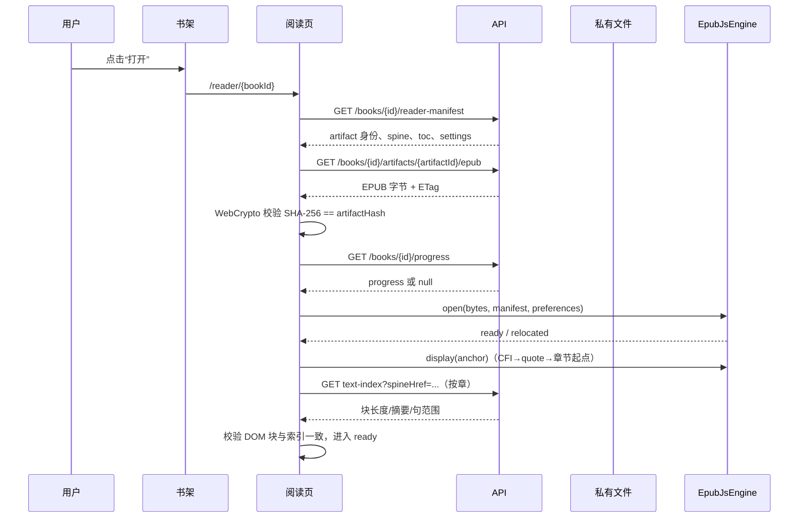
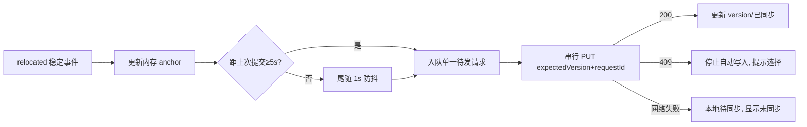

# M04 阅读内核、分页与进度技术设计与执行文档

版本：0.1（草案）；日期：2026-11-23。状态：**未开始；本文为实现前契约与执行指导，不表示已实现或已验收**。实现结果在测试通过后另行归档到 `validation/implementation/m04/`，未通过前不建通过记录。

需求基线：[PRD V1.1](../../requirements/prd/PRD-v1.1.md) 第 4.2～4.4、13.1、14.1 节。总体设计：[系统技术设计](../architecture/Readict-V1.1-系统技术设计.md) 第 7.2～7.4、13.3、14.3～14.4、15.3、17.3 节。任务来源：[模块化开发计划](Readict-V1.1-模块化开发计划.md) M04。前置实现：[M03 执行文档](M03-文件、EPUB导入与书架技术设计与执行文档.md)（0.3）与 [M03 实施记录](../../../validation/implementation/m03/2026-11-23-local/README.md)。

阅读顺序：实际起点 → 范围与证据 → 流程与目录 → 引擎契约 → 加载/分页 → 定位/恢复 → 进度保存 → V8 与 API → 前后端指导 → 六项任务 → 验收与命令 → 风险与交接。

## 0. 基线、证据分类与本次边界

### 0.1 证据分类

| 标记 | 含义 | 本文应用 |
|---|---|---|
| 已有事实 | 仓库代码、迁移或归档记录直接支持 | V1～V7、M03 接口、M01 设置、reader-core 历史实验 |
| 工程设计 | 本文确定、供正式实现使用的契约与规则 | Anchor/Engine、恢复与保存算法、V8、进度 API、页面行为 |
| 待验证 | 缺真实执行或测量证据 | epub.js 正式集成、CFI 稳定性、重排时序、内存与 Blob、多浏览器 |

### 0.2 2026-11-23 实际只读核对

- 应用仓库 HEAD `b7a6fa0`（M03 完成开发库迁移）；设计仓库 HEAD `e836e84`。V1～V7 已执行，`readict_test` 与 `readict_dev` 均为 V7；**V8 空闲**。
- 书籍接口已可用：`GET /books`、`POST /books/imports`、导入轮询、`reader-manifest`、产物下载（ETag/304，**不支持 Range**）、`text-index`、封面、删除。书架 `progressRatio` 目前恒为 `null`。
- `manifest` 实际字段：`bookId、artifactId、artifactHash、pipelineVersion、epubUrl、textIndexUrl、spine[{chapterId,href,index,title,textLength}]、toc[{id,label,href,children}]、settings、settingsVersion`；`textIndexUrl` 形如 `.../text-index?spineHref={spineHref}`，占位符需前端替换并 URL 编码。
- `text-index` 实际返回 `{spineHref, spineIndex, totalUtf16, blocks[{blockId,utf16Length,textHash,sentences[{start,end,kind}]}]}`，**不含正文**；全文只在 `index.json` 私有产物中，服务端可按块读取。
- `spineHref` 为包内完整路径（如 `OEBPS/Text/ch1.xhtml`），与章节表、索引、manifest 一致。
- 前端无 epubjs、无 `/reader` 路由；`HttpOnly` Session + CSRF 由既有 `lib/http.ts` 统一处理；测试脚本按目录 glob 列出（新增 `features/reader` 需同步）。
- 安全链为白名单 + `anyRequest().denyAll()`，尚无 progress matcher；`FoundationIT` 断言 22 张表。
- 依赖：`epubjs@0.3.93` 为 npm 最新稳定版，自带 `types/index.d.ts`，许可 BSD-2-Clause；`@types/epubjs` 不存在，不需要。

### 0.3 本次文档边界

只写设计与执行指导：不写前端/后端代码、不建表、不迁移、不运行浏览器、不生成验收结论；不修改 PRD、M00～M03 的历史完成条件与证据。

## 1. 目标、范围与明确不做

### 1.1 交付范围

1. `ReaderEngine` 适配层与 `EpubJsEngine` 实现：加载、相对定位、单页分页、事件、偏好、销毁。
2. 阅读页：`/reader/:bookId`，顶部返回/书名/目录/设置，正文单页限宽，右栏竖向三入口，底部上一页/下一页，页码在正文内。
3. 位置与恢复：CFI + 产物身份 + quote；CFI 失败时同章唯一 quote 回退；不确定时回章节起点并提示，不覆盖旧进度。
4. 进度持久化：V8 `reading_progress`、`GET/PUT /books/{id}/progress`、版本条件更新、幂等、冲突交互、本地待同步。
5. 书架联动：`progressRatio` 与 `lastReadAt` 真实返回；书架“打开”跳转阅读页。
6. 生命周期与验收：generation、监听器/观察器/Blob 清理；三桌面 + 390px 浏览器矩阵与位置往返。

### 1.2 明确不做

- 单词定位、查词卡片、原句高亮（M05）；收藏主体与快照（M06）；翻译（M07）。
- 全书固定页码、跨版式页号一致、离线阅读、多设备实时同步。
- Firefox/Safari 正式支持（按设计 §15.3 列为后续 V12）；本模块只对 Edge/Chromium 给出证据。
- 服务端解析 CFI：服务端只做长度、形状与来源校验，不声称能证明 CFI 指向某段内容。
- `file_cleanup_task` 与孤儿回收（M08）、阶段验收与恢复演练（M09）。

## 2. 已有证据与复用边界

| 编号 | 证据 | 可复用 | 不可复用／须重建 |
|---|---|---|---|
| E1 | [reader-core REPORT](../../../validation/technical/reader-core/REPORT.md) | epub.js 0.3.93 的分页/CFI/目录可行性、已知陷阱（`currentLocation()` 过渡为空、包 span 破坏 CFI） | Chromium 18 项通过不等于正式验收；WebKit 失败与 Firefox 未跑需继续标注 |
| E2 | [reader-core main.tsx](../../../validation/technical/reader-core/src/main.tsx) | 加载顺序、`relocated` 使用方式、销毁路径的实现思路 | 演示组件与 Mock 网络、DOM 取词耦合，不直接迁入正式前端 |
| E3 | [原型 Reader.tsx](../../../prototypes/reader-ui/src/components/Reader.tsx) | 页面层次、右栏三入口、面板互斥、键盘习惯、视觉 token | CSS 多列分页与字符偏移不是 EPUB 内核；逐词 span 禁用 |
| E4 | [M03 文档](M03-文件、EPUB导入与书架技术设计与执行文档.md) 与实施记录 | manifest/index/产物身份、`spineHref`、CSP、无脚本产物、ETag 下载 | 进度接口、V8 表、书架比例均未实现 |
| E5 | [M01 设置](M01-用户认证与个人设置执行文档.md) 与 `features/settings/model.ts` | 偏好枚举、`PreferenceSaver` 的防抖/冲突/跨标签逻辑 | 阅读页不能另写一套设置状态机 |
| E6 | [系统设计 §7.3](../architecture/Readict-V1.1-系统技术设计.md) | Anchor/Progress 结构与保存/恢复次序 | 设计中的 fallback 第 2～4 步未实现，属本次新增 |

## 3. 总体流程与组件

### 3.1 打开一本书



### 3.2 保存进度



| 组件 | 职责 |
|---|---|
| `ReaderPage` | 路由参数、加载状态机、错误页、面板与键盘编排 |
| `EpubJsEngine` | 包装 epub.js：加载、分页、事件、偏好、锚点、销毁 |
| `anchor`（纯函数） | anchor 构造/校验/比较、quote 回退候选选择 |
| `blocks`（纯函数） | DOM 块映射、`textHash`/长度校验、块内偏移换算 |
| `progress/model` | 防抖、串行队列、版本/冲突状态机、本地待同步编解码 |
| `progress/api` | GET/PUT 解码与错误映射 |
| `ContentsPanel` / `SettingsPanel` | 目录树、偏好设置（复用 `PreferenceSaver`） |
| 后端 `ProgressService` | 鉴权、校验、ratio 计算、版本条件更新、幂等 |
| 后端 `ProgressCalculator` | 纯函数：块偏移 → 全书比例 |
| 后端 `ReadingProgressRepository` | V8 表的读写与条件更新 |

## 4. 目标目录与工程约定

以下相对正式应用 `readict-app`，均为**待新增**（本次不创建）：

```text
backend/src/main/java/com/readict/reading/
  api/            ProgressController、ReadingProgressView、ProgressProblemMapping
  application/    ProgressService、ProgressCalculator、ProgressValidation
  domain/         ReadingAnchor、ProgressConflict、AnchorInvalid
  infrastructure/persistence/
    entity/       ReadingProgressEntity
    mapper/       ReadingProgressMapper
    ReadingProgressRepository.java
backend/src/main/resources/
  db/migration/V8__reading_progress.sql
  mapper/reading/ReadingProgressMapper.xml
backend/src/test/java/com/readict/reading/
  ProgressCalculatorTest、ProgressValidationTest、ReadingProgressIT
frontend/src/features/reader/
  ReaderPage.tsx、ReaderLayout.tsx、reader.css
  engine/         types.ts、EpubJsEngine.ts、anchor.ts、blocks.ts、preferences.ts
  progress/       model.ts、api.ts
  panels/         ContentsPanel.tsx、SettingsPanel.tsx
  engine/*.test.ts、progress/*.test.ts
```

约定：

- 后端按业务包分层，Controller 只做传输校验，事务在应用服务；Mapper/XML 遵守现有 `com.readict.*.infrastructure.persistence.mapper` 与 `classpath*:/mapper/**/*.xml`。
- 前端沿用 `lib/http.ts`（Cookie/CSRF/Problem Details）、`features/settings/model.ts` 的 `PreferenceSaver`；不引入第二套请求或设置逻辑。
- 阅读页不套用 `account-shell` 的成员布局，使用独立全高布局与 `features/reader/reader.css`；视觉 token 沿用暖白/深灰/深绿。
- 依赖：rontend/package.json 精确锁定 epubjs 为 .3.93（不带 ^），使用其自带 	ypes/index.d.ts；许可 BSD-2-Clause 与依赖审计结果记入提交说明；不引入 JSZip／DOMPurify（服务端已清洗），lockfile 一并提交。
- 不新增 docs/；实现记录归设计仓库；单次脚本不提交。

## 5. ReaderEngine 契约（定稿）

```ts
export interface Quote { exact: string; prefix: string; suffix: string }

export interface ReadingAnchor {
  artifactId: string;
  artifactHash: string;
  pipelineVersion: string;
  spineHref: string;          // 包内完整路径，如 OEBPS/Text/ch1.xhtml
  cfi: string;                // epub.js collapsed CFI，长度 ≤ 4096
  blockId?: string;           // 如 b-17
  blockOffset?: number;       // 块内 UTF-16 偏移，≥ 0
  quote?: Quote;              // exact ≤ 256，prefix/suffix ≤ 128
}

export type ReaderPhase =
  | 'idle' | 'loading' | 'verifying' | 'rendering'
  | 'restoring' | 'ready' | 'reflowing' | 'error' | 'disposed';

export type ReaderErrorCode =
  | 'BOOK_NOT_READY' | 'ARTIFACT_REVOKED' | 'ARTIFACT_HASH_MISMATCH'
  | 'ENGINE_INIT_FAILED' | 'ANCHOR_INVALID' | 'TEXT_INDEX_MISMATCH'
  | 'REFLOW_TIMEOUT' | 'IFRAME_UNSAFE' | 'PROGRESS_CONFLICT';

export type ReaderEvent =
  | { type: 'ready'; spineHref: string }
  | { type: 'relocated'; spineHref: string; cfi: string; atStart: boolean; atEnd: boolean;
      blockId?: string; blockOffset?: number; quote?: Quote }
  | { type: 'selection'; spineHref: string; range: Range }   // 预留给 M05，不在此实现取词
  | { type: 'resized' }
  | { type: 'error'; code: ReaderErrorCode; message: string };

export interface ReaderEngine {
  open(source: ArrayBuffer, manifest: ReaderManifest, preferences: ReaderPreferences): Promise<void>;
  display(anchor: ReadingAnchor): Promise<'restored' | 'quote-fallback' | 'chapter-start'>;
  next(): Promise<void>;
  previous(): Promise<void>;
  applyPreferences(preferences: ReaderPreferences): Promise<void>;
  anchor(): ReadingAnchor | null;              // 仅返回最近一次稳定 relocated 产生的锚点
  currentSpine(): { href: string; index: number } | null;
  subscribe(listener: (event: ReaderEvent) => void): () => void;
  destroy(): Promise<void>;
}
```

规则：

1. `open` 内部完成：`ePub(source, { replacements: 'blobUrl' })` → `book.ready` → `navigation` → `renderTo`（`manager:'default', flow:'paginated', spread:'none'`）→ 一次稳定 `relocated` → 应用偏好。失败一律走 `destroy` 后抛结构化错误。
2. `anchor()` 不读 `currentLocation()`；只返回本代 `relocated` 缓存。过渡事件（初始化/重排/恢复期间）不得产生可保存锚点。
3. `display` 的三种返回值必须由调用方区分处理：`restored` 正常；`quote-fallback` 提示“已按文本匹配恢复”；`chapter-start` 提示“位置无法唯一恢复，已回到本章开头”，且**不得**因此写回进度。
4. `destroy` 幂等；只回收本引擎创建的 Blob URL；iframe 移除后不再派发事件。
5. `ReaderManifest`、`ReaderPreferences` 直接复用 manifest 与 `features/settings` 的 `Preferences` 类型映射，不复制字段定义。

## 6. 加载、分页与重排

### 6.1 加载步骤（固定顺序）

1. `phase=loading`：`GET reader-manifest`；非 READY（409）转错误页，提示回书架。
2. `phase=verifying`：`GET epub`（同一 Cookie 会话）；读 `ArrayBuffer`；`crypto.subtle.digest('SHA-256')` 与 `artifactHash` 逐字节比较；不一致 → `ARTIFACT_HASH_MISMATCH`，不渲染。
3. 创建宿主容器与 `EpubJsEngine`；`phase=rendering`；等待首个稳定 `relocated`（见 6.3）。
4. `GET /progress`；`phase=restoring`；按 §7 次序恢复。
5. 按 `spineHref` 取 `text-index`，校验 DOM 块（§7.4）；`phase=ready`。

### 6.2 分页与翻页

- 单页、无跨页双栏（`spread:'none'`）；正文宽度由设置决定，页面容器居中，右栏不占正文宽度。
- `next()/previous()` 串行：内部维护 `pendingDirection: 'next'|'prev'|null`；一次 Promise 未完成时连续输入只保留最后一个方向，完成后执行一次；禁止并发调用 `display`。
- `ready` 之外禁用翻页按钮与键盘翻页；章节边界由 `relocated` 的 `atStart/atEnd` 判断，缺失时比较当前 spine index。
- 跨章：到达末页再前进时允许进入下一 spine；到首章首页/末章末页时按钮禁用。
- 页码：只显示“本章第 N 页 / 共 M 页”，由引擎当次排版计算；不持久化、不作为进度。

### 6.3 稳定判定与重排

- 稳定 = 连续两个动画帧几何不变 **且** 150ms 内无新 `relocated`；最长等待 2s，超时按 `REFLOW_TIMEOUT` 处理（保留已加载正文，提示重新排版）。
- 重排触发：字号/字体/行距/宽度变化、窗口尺寸变化、图片或字体迟到。重排前先取当前锚点，进入 `reflowing`；期间到达的 `relocated` 不写回、不保存；完成后用 §7 恢复。
- 字号/行距/宽度只通过 `rendition.themes` 覆盖，不修改产物文件；图片限制 `max-width:100%; height:auto`，不放大。
- 偏好应用失败（主题注入异常）不阻塞阅读：回退默认值并在控制台记录，界面提示“部分样式未生效”。

### 6.4 键盘、焦点与滚动

- 父页监听 `keydown`：`ArrowRight/ArrowLeft` 翻页，`Escape` 关闭面板，`Tab` 在工具栏与正文间移动；iframe 内同样注册一套，避免同一事件双执行（事件来源判断）。
- 焦点位于输入框、按钮、面板或卡片时，后台左右键不翻页；面板打开时焦点移入面板，关闭后回到触发按钮。
- 禁止用 `scrollIntoView` 制造“翻页”；正文滚动由引擎接管。

## 7. 定位、恢复与降级

### 7.1 锚点来源

- 每个稳定 `relocated` 产生候选锚点：`spineHref` 取自当前 spine item；`cfi` 取自引擎返回的 collapsed CFI；`blockId/blockOffset/quote` 由 §7.2 的 DOM 块映射计算。
- 页号、滚动位置、`rendition.currentLocation()` 都不作为可持久锚点。

### 7.2 块映射与 quote

- 章节加载后，用 `text-index` 的块顺序与 `blockId` 在 iframe DOM 中定位块：约定块元素带 `data-readict-block`（M03 产物在最终 DOM 生成时写入）；若产物缺失该属性，回退按块级元素顺序映射，并在控制台记录一次。
- 块文本按 DOM 文本节点顺序连接（`br` 记为 `\n`），与索引块做 `utf16Length` 与 `textHash` 比较；不一致 → 该章进入只读位置模式：可阅读、不可保存进度，提示 `TEXT_INDEX_MISMATCH`。
- `blockOffset` 为 collapsed 位置在块文本中的 UTF-16 下标；`quote.exact` 取该位置前后各不超过 64 个 UTF-16 单元的片段（上限 256），`prefix/suffix` 各 ≤128。代理对不得被切开。

### 7.3 恢复次序（必须按序，失败即降级）

1. 产物身份校验：`anchor.artifactId == manifest.artifactId`、`artifactHash` 与 `pipelineVersion` 一致；不一致按第 4 步处理。
2. CFI 解析：`rendition.display(cfi)`；等待稳定；校验当前块文本在 `blockOffset` 处与 `quote.exact` 一致（无 quote 时只校验块存在）。一致 → `restored`。
3. CFI 失败或内容不匹配：在同一 `spineHref` 的索引文本中按 `exact + prefix/suffix` 搜索；唯一匹配 → 构造 Range/CFI 并 `display`，返回 `quote-fallback`；多匹配 → 不猜，进入第 4 步并提示“存在多个相同片段”。
4. 回到该 spine 起点：`display(spineHref)`，返回 `chapter-start`，界面提示；**不写回**进度，用户继续翻页后才产生新锚点。
5. 产物/流水线版本变化：不信任旧 CFI，按第 3～4 步以文本验证迁移；不后台改写旧产物，不静默跳到同文其他位置。

### 7.4 文本索引消费

- 按章懒加载并缓存（key = `artifactId + spineHref`），上限 20 章；切书清空。
- 只使用 `blockId/utf16Length/textHash/sentences`；不请求正文文本，不把全书索引读入内存。
- 校验失败只影响保存与回退，不影响阅读本身；错误提示一次，不反复弹窗。

## 8. 进度保存与并发

### 8.1 保存节奏

| 参数 | 值 | 说明 |
|---|---|---|
| 尾随防抖 | 1000ms | 最后一次 relocated 后 1s 提交 |
| 最小提交间隔 | 5000ms | 阅读中频繁翻页时合并 |
| 单标签并发 | 1 | 严格串行，后发请求必须等待前一个完成 |
| 重试 | 不自动重试 | 网络失败保留本地待同步，用户继续阅读；显式重试按钮 |

flush 时机：`pagehide`、切书、离开 `/reader/:bookId`、进入目录/设置面板前不 flush（面板不改变位置），进入收藏页前 flush（M06 接入）。

### 8.2 请求与幂等

- 每个待发请求生成 `requestId`（UUID v4），同一位置重试用同一 `requestId` 与同一 payload；`expectedVersion` 取本标签页已知的最新版本。
- 200 响应更新 `version`、`updatedAt`、`progressRatio`，标记已同步。
- 网络错误/超时：保留 `{anchor, expectedVersion, requestId, dirtyAt}` 到 `localStorage`，键 `readict:progress:v1:{userId}:{bookId}:{artifactId}`；界面显示“尚未同步”。
- 页面重新打开：先取服务器进度；若本地待同步存在且 `artifactId` 相同、`expectedVersion ≥ serverVersion`，用本地锚点恢复并尝试补交；冲突按 8.3 处理。

### 8.3 冲突（409 PROGRESS_CONFLICT）

- 收到 409 立即停止本标签页自动保存，界面提示“另一窗口已更新阅读位置”，给出两个明确选择：
  1. **以服务器为准**：丢弃本地待同步，跳到 `serverProgress.anchor`。
  2. **继续此处**：用响应中的 `currentVersion` 作为新的 `expectedVersion` 显式提交一次；成功后才恢复自动保存。
- 不按客户端时间做 last-write-wins；不在冲突时循环重试。
- 同 `requestId` 同摘要重放由服务端返回原结果，不升版；同号异内容 409 `IDEMPOTENCY_KEY_REUSED`，前端视为不可恢复错误并要求刷新。

### 8.4 跨标签页

- `BroadcastChannel('readict-reader')` 通知“位置已更新”；其他标签页只提示“另一窗口位置已更新”，不自动跳转、不覆盖本地未同步位置。
- 同一标签页内旧响应不得覆盖新位置：每次请求带自增序号，响应序号小于当前已应用序号则丢弃。

## 9. V8 数据库设计

### 9.1 迁移

`V8__reading_progress.sql` 接续 V1～V7，只建一张表。**不建历史表、不建复习表**。已执行迁移不改不删，禁 `clean`。先在 `readict_test` 执行并验收，`readict_dev` 需用户批准后执行。

### 9.2 DDL

```sql
CREATE TABLE reading_progress (
  book_id BINARY(16) NOT NULL,
  user_id BINARY(16) NOT NULL,
  artifact_id BINARY(16) NOT NULL,
  spine_href VARCHAR(512) CHARACTER SET utf8mb4 COLLATE utf8mb4_bin NOT NULL,
  cfi TEXT NOT NULL,
  block_id VARCHAR(128) CHARACTER SET utf8mb4 COLLATE utf8mb4_bin NULL,
  block_offset INT NULL,
  quote_exact VARCHAR(256) NULL,
  quote_prefix VARCHAR(128) NULL,
  quote_suffix VARCHAR(128) NULL,
  progress_ratio DECIMAL(8,7) NOT NULL,
  version BIGINT NOT NULL,
  last_request_id BINARY(16) NOT NULL,
  last_request_hash BINARY(32) NOT NULL,
  updated_at DATETIME(3) NOT NULL,
  PRIMARY KEY (book_id),
  KEY ix_progress_user (user_id, updated_at, book_id),
  CONSTRAINT fk_progress_user FOREIGN KEY (user_id) REFERENCES app_user(id),
  CONSTRAINT fk_progress_book FOREIGN KEY (book_id) REFERENCES book(id),
  CONSTRAINT fk_progress_artifact FOREIGN KEY (artifact_id) REFERENCES book_artifact(id),
  CONSTRAINT ck_progress_ratio CHECK (progress_ratio >= 0 AND progress_ratio <= 1),
  CONSTRAINT ck_progress_offset CHECK (block_offset IS NULL OR block_offset >= 0),
  CONSTRAINT ck_progress_block CHECK ((block_id IS NULL) = (block_offset IS NULL)),
  CONSTRAINT ck_progress_quote CHECK ((quote_exact IS NULL) = (quote_prefix IS NULL)
    AND (quote_exact IS NULL) = (quote_suffix IS NULL)),
  CONSTRAINT ck_progress_cfi CHECK (CHAR_LENGTH(cfi) BETWEEN 1 AND 4096),
  CONSTRAINT ck_progress_version CHECK (version >= 1)
) ENGINE=InnoDB DEFAULT CHARSET=utf8mb4;
```

### 9.3 说明

| 项 | 说明 |
|---|---|
| 一行一书 | `PRIMARY KEY(book_id)`；用户维度由 `user_id` 冗余列与 `book.user_id` 双重校验 |
| `version` | 首次写入为 1；`WHERE book_id=? AND version=?` 条件更新；0 表示“尚无记录”，由 `expectedVersion=0` 表达 |
| 幂等 | `last_request_id/hash` 随版本一次写入；重放返回已存结果 |
| 删除 | 书籍删除事务内删除该行（D15）；文件回收仍归 M08 |
| 表集合 | `FoundationIT` 由 22 张表增加到 23 张（新增 `reading_progress`） |
| 不存 | 页号、滚动像素、客户端时间、正文全文、引擎内部状态 |

## 10. 后端 API 与计算

### 10.1 端点

| 方法／路径 | 请求 | 成功／失败 |
|---|---|---|
| `GET /api/v1/books/{id}/progress` | 无 | 200 `{progress:null}` 或 `{progress:{...}}`；404 非本人／不存在 |
| `PUT /api/v1/books/{id}/progress` | `{expectedVersion,requestId,anchor}` | 200 最新进度；409 `PROGRESS_CONFLICT`／`IDEMPOTENCY_KEY_REUSED`／`BOOK_NOT_READY`；422 `ANCHOR_INVALID`；410 `ARTIFACT_REVOKED` |

两者均需 Session 与 CSRF（PUT），浏览器只监听 `127.0.0.1`，沿用全局安全链。

### 10.2 结构

```json
{
  "bookId": "b0000000-0000-4000-8000-000000000001",
  "anchor": {
    "artifactId": "a0000000-0000-4000-8000-000000000001",
    "artifactHash": "<64 位小写 SHA-256>",
    "pipelineVersion": "epub-safe-v1",
    "spineHref": "OEBPS/Text/ch3.xhtml",
    "cfi": "epubcfi(/6/8!/4/2/1:0)",
    "blockId": "b-17",
    "blockOffset": 35,
    "quote": { "exact": "the children are running", "prefix": "The sun rose and ", "suffix": " toward the house." }
  },
  "progressRatio": 0.1234567,
  "version": 4,
  "updatedAt": "2026-11-23T05:00:00.000Z"
}
```

### 10.3 校验顺序（固定）

1. `requestId` 为 UUID；`expectedVersion ≥ 0`；`anchor` 字段齐全且长度合法（`cfi ≤ 4096`，`quote.exact ≤ 256`，`prefix/suffix ≤ 128`，`blockOffset ≥ 0`）。
2. 书籍属于当前用户；不存在或跨用户 404 `BOOK_NOT_FOUND`；状态非 READY 409 `BOOK_NOT_READY`（`BROKEN/DELETING` 同）。
3. `anchor.artifactId == book.active_artifact_id` 且产物 `status=READY`；产物已 `REVOKED` 410 `ARTIFACT_REVOKED`；`artifactHash/pipelineVersion` 与产物一致，否则 422。
4. `spineHref` 必须是该产物章节表中的精确值；否则 422。
5. 读取该章 `index.json`：`blockId` 必须存在；`blockOffset ∈ [0, utf16Length]`；有 quote 时校验 `blockText.substring(blockOffset, blockOffset+exact.length) == exact`（越界或不等 → 422）。
6. 计算 `progressRatio`（§10.4），不信任客户端比例。
7. 版本条件更新。

### 10.4 比例计算

```text
chapter = 章节表[spineHref]
blocks  = index[spineHref].blocks
preceding = Σ blocks[0..i).utf16Length
offset    = preceding + blockOffset
ratio     = (chapter.cumulativeTextLength - chapter.textLength + offset) / artifact.totalUtf16
```

- clamp 到 `[0,1]`，保留 7 位小数入库。
- `blockId` 为空（图片页等）：按章节边界 `(cumulative - textLength)/total` 计算，界面显示“约 X%”。
- `totalUtf16 == 0` 的异常产物不允许进入 READY（M03 已保证），此处按 409 `BOOK_NOT_READY` 处理。

### 10.5 幂等与冲突

- 读现存行：`last_request_id == requestId` 且 `last_request_hash == SHA-256(规范化请求体)` → 200 返回已存进度，不升版；同号异摘要 → 409 `IDEMPOTENCY_KEY_REUSED`。
- `expectedVersion == 0`：无行时插入 `version=1`；已有行（可能是其他标签页先写）→ 409 `PROGRESS_CONFLICT`。
- `expectedVersion > 0`：`UPDATE ... WHERE book_id=? AND version=?`；影响 0 行时读当前行，若为同号重放返回原结果，否则 409。
- 409 响应在 Problem Details 中附带 `currentVersion` 与 `serverProgress`（可为 null），便于前端给出选择。

### 10.6 书架联动

- `BookMapper.shelf` 改为 `FROM book b LEFT JOIN reading_progress p ON p.book_id=b.id AND p.user_id=b.user_id`，投影 `p.progress_ratio`；`BookEntity` 增加 `@TableField(exist=false) progressRatio`（不参与写入）。
- `BookView.progressRatio` 返回该值（无记录为 `null`）；`lastReadAt` 仍取 `book.last_read_at`。
- 进度保存成功事务内同步 `UPDATE book SET last_read_at=?, updated_at=? WHERE id=? AND user_id=?`。

### 10.7 删除与状态

- `DELETE /books/{id}` 事务内：`markDeleting` 后删除 `reading_progress` 行，再登记 `cleanup_pending`；删除失败整体回滚。
- 阅读中书籍被删除：后续 GET/PUT 返回 404／409，阅读页提示并回书架。

### 10.8 错误码

| code | HTTP | 场景 |
|---|---|---|
| `BOOK_NOT_FOUND` | 404 | 不存在或非本人 |
| `BOOK_NOT_READY` | 409 | 非 READY／BROKEN／DELETING |
| `ARTIFACT_REVOKED` | 410 | 产物已撤销 |
| `ANCHOR_INVALID` | 422 | 产物/章节/块/偏移/quote 不合法 |
| `PROGRESS_CONFLICT` | 409 | 版本冲突，带 `currentVersion`／`serverProgress` |
| `IDEMPOTENCY_KEY_REUSED` | 409 | 同 requestId 不同内容 |
| `INVALID_REQUEST` | 400 | 结构/格式错误 |

## 11. 后端实现指导

1. `ProgressCalculator`：纯函数，输入章节行、索引块列表、`blockId/blockOffset`、`artifact.totalUtf16`，输出 `BigDecimal`（7 位，HALF_UP）；单测覆盖首块/中间块/末块/无块/越界。
2. `ProgressValidation`：集中长度与形状校验；CFI 只校验 `^epubcfi\(.+\)$` 与长度，不解析语义。
3. `ProgressService.save(principal, bookId, request)`：
   - `@Transactional`；锁顺序：`book`（读，必要时 `FOR UPDATE`）→ `reading_progress`；不锁词典/字典表。
   - 校验顺序按 §10.3；读取索引文件走 `BookStorage.resolve`，流式解析单章，不加载全书。
   - 条件更新后重新读取并返回；`last_request_hash` 用与设置相同的规范化摘要做法。
4. `ReadingProgressRepository`：BaseMapper 用于简单查询，条件更新、删除、JOIN 用 XML；不使用 MP 乐观锁插件。
5. `ProgressController`：`@RestController`，UUID 路径变量；返回 `ResponseEntity` + `Cache-Control: no-store`；问题细节复用 `Problems`／`ApiProblem`。
6. `SecurityConfiguration` 增加：`GET /api/v1/books/*/progress`、`PUT /api/v1/books/*/progress` → `authenticated()`；CSRF 沿用全局，不豁免。
7. `ImportService.requestDelete` 增加删除进度调用（M03 代码最小改动），并补一条 IT 断言。
8. 日志：记录 `requestId`、`bookId`、`version`、`ratio`、耗时；**不记录 CFI 全文、quote 文本、正文内容**。

## 12. 前端实现指导

### 12.1 路由与页面

- `App.tsx` 增加 `/reader/:bookId`（`Protected`），标题“阅读”；书架“打开”由禁用改为导航；返回书架时 flush 进度。
- 页面结构：顶部（返回、书名、目录、设置）→ 正文容器（单页、居中、限宽）→ 右栏竖排（目录、收藏、设置；收藏为 M06 前的禁用占位）→ 底部上一页/下一页；页码在正文内。
- 加载中显示骨架与书名；错误按 code 给出可操作文案（重试、回书架）；非 READY 不进入阅读。

### 12.2 引擎接入

- `EpubJsEngine` 构造函数接收宿主元素与 `manifest`；`open` 前校验 `artifactHash`（WebCrypto）；`renderTo` 后立即检查 iframe `sandbox` 属性，若包含 `allow-scripts` → `IFRAME_UNSAFE` 并销毁（fail-closed）。
- `rendition.themes.register/select` 注入字体、字号、行高、颜色；图片 `max-width`；不注入脚本，不修改正文结构。
- 事件适配：把 epub.js 的 `relocated` 转成内部事件，附 `spineHref/cfi/blockId/blockOffset/quote`；在过渡阶段（`restoring/reflowing`）抑制可保存事件。

### 12.3 面板与设置

- 目录树来自 manifest.toc（M03 只给扁平节点，儿童为空；有 children 时递归渲染）；点击跳转 `display(spineHref)`，不按页号。
- 设置面板直接复用 `PreferenceSaver`：以 `manifest.settingsVersion` 为基线，改动防抖 500ms 提交；成功后更新本地基线；冲突提示与设置页一致。
- 面板互斥；打开面板不改变正文宽度、不触发重排。

### 12.4 进度状态机

```text
idle → loading → verifying → rendering → restoring → ready
ready ⇄ reflowing
any → error（可重试/回书架） → disposed
```

- `ready` 才允许翻页与保存；`reflowing` 期间冻结保存与翻页输入。
- 未同步状态在页头显示“尚未同步”，提供“重试保存”；冲突显示选择弹层（§8.3）。

### 12.5 可访问性与响应式

- 键盘：左右翻页、`Escape` 关面板、`Tab` 可达工具栏与面板；焦点在面板/输入时不翻页。
- 对比度：正文与背景满足可读性；深色主题独立语义色；减少动画时禁用过渡。
- 390px：单列、工具栏不遮挡正文、按钮 ≥44px；只承诺基本可用。
- 200% 缩放与窗口变化走同一条重排路径，不单独写分支。

### 12.6 前端测试点

- 纯函数：anchor 校验、quote 候选选择（唯一/多候选/无候选）、块偏移换算、防抖合并、串行队列、冲突状态机、本地待同步编解码。
- 组件：工具栏/面板互斥、错误页分支（可用测试渲染或 Playwright）。
- 浏览器（Edge）：见 §14。

## 13. 六项任务执行指导

### 13.1 M04-01 引擎适配与分页骨架

**前置**：M03 已交付 manifest/下载/索引；`epubjs` 已锁版。

步骤：落地 `engine/types.ts`、`EpubJsEngine` 的 `open/next/previous/destroy/subscribe`；单页渲染与稳定判定；目录树与 spine 分离；`ReaderPage` 骨架。先用本地夹具与测试库书籍验证“能打开、能翻页、能销毁”。

预期：打开 2 MiB 样书首屏可读；连续翻页无重复/丢文；目录跳转进入对应 spine。完成条件：事件与错误类型齐备；`destroy` 后无事件、无 iframe 残留；单测覆盖分页合并与首尾判断。

### 13.2 M04-02 产物校验、偏好与翻页边界

步骤：下载 + SHA-256 校验；`themes` 注入字体/字号/行距/宽度/主题；图片约束；`next/previous` 串行与边界禁用；键盘与焦点基础规则。

预期：篡改字节后拒绝打开；改字号后正文重排且不丢内容；末页继续前进进入下一章，第一章首页禁用上一页。完成条件：`ARTIFACT_HASH_MISMATCH` 生效；三档字号与两种宽度切换后无空白页/跳页。

### 13.3 M04-03 锚点、恢复与降级

步骤：DOM 块映射与 `text-index` 校验；锚点构造；CFI 恢复 + quote 验证；唯一 quote 回退；多候选/无匹配回章节起点；版本不一致处理。

预期：刷新后回到同一段；改版式后仍定位到同一词附近；手工构造失效 CFI 时走 quote 或章节起点并提示，且旧进度不被覆盖。完成条件：三种返回值分别可触发；降级路径不写回进度；跨章恢复正确。

### 13.4 M04-04 重排、迟到资源与焦点

步骤：重排前捕获锚点；屏蔽过渡写回；字体/图片迟到调度；窗口/缩放变化；首尾状态；焦点不触发后台翻页。

预期：改字号、改窗口、图片迟到均不把首页写回；连续快速改设置不产生错误位置；面板打开时左右键不翻页。完成条件：重排 stabilization 预算生效；2s 超时有明确提示。

### 13.5 M04-05 进度保存、冲突与本地待同步

步骤：V8 迁移、进度 API、后端校验/ratio/幂等；前端防抖/串行/版本/flush；409 交互；本地待同步与重试；跨标签提示；书架 JOIN。

预期：翻 3 页只产生有限请求；两窗口不同位置时后写方收到 409 并停止自动覆盖；断网后显示未同步，恢复网络可补交；书架卡片显示真实进度与最近阅读时间。完成条件：`ReadingProgressIT` 全绿；删除书后进度行消失且接口拒绝。

### 13.6 M04-06 生命周期、兼容与验收

步骤：generation 贯穿加载/恢复/事件；AbortController、ResizeObserver、字体监听、定时器清理；Blob 回收；三桌面 + 390px 浏览器矩阵；位置往返与分页覆盖检查。

预期：连续开关书 20 次无持续增长（记录 heap/Blob 观察值）；同一位置在三种桌面与 390px 下均能恢复到相同内容；无旧异步事件覆盖新书。完成条件：浏览器矩阵逐项有记录（含失败）；内存观察只作记录，不宣称“无泄漏”。

## 14. 验收矩阵与命令

### 14.1 矩阵

| 编号 | 场景 | 通过条件 |
|---|---|---|
| R01 | 打开 READY 书 | 正文可读、书名与章节标题正确 |
| R02 | 目录与 spine 分离 | 目录跳转正确，无目录时回退 spine 顺序 |
| R03 | 上一页/下一页与首尾 | 无丢文/重复；首章首页与末章末页按钮禁用 |
| R04 | 键盘与焦点 | 左右键翻页；面板/输入聚焦时不翻页 |
| R05 | 面板不改变正文 | 打开目录/设置前后正文宽度与分页不变 |
| R06 | 390px | 单列可用、工具栏不遮正文、按钮可点 |
| R07 | 刷新恢复 | 回到同一内容位置（允许页号变化） |
| R08 | 改字号/宽度后恢复 | 恢复同一内容，不回到首页 |
| R09 | 跨章节恢复 | 恢复进入正确 spine |
| R10 | CFI 失效、唯一 quote | 按文本回退到唯一位置并提示 |
| R11 | 多候选 quote | 回章节起点并提示，不自动覆盖旧进度 |
| R12 | 产物/流水线变化 | 不信任旧 CFI，按文本验证或提示重处理 |
| R13 | 首次保存 | `expectedVersion=0` 成功，`version=1` |
| R14 | 连续翻页 | 请求数受限、单标签串行、无乱序覆盖 |
| R15 | 两窗口冲突 | 409 停止自动写入，两个选择均可用 |
| R16 | 同 requestId 重放 | 返回原结果，`version` 不变 |
| R17 | 断网/本地待同步 | 显示未同步，恢复后补交成功 |
| R18 | 删除后的书 | 进度行删除；GET/PUT 返回 404/409 |
| R19 | 跨用户/未登录/CSRF | 404/401/403 与既有语义一致 |
| R20 | 块摘要不一致 | 该章只读位置模式，禁止保存并提示 |

同时记录 V05（Edge/Chrome 核心兼容）与 V10（DOM 释放/性能）对应子项，但**不**在本模块宣称两项已通过。

### 14.2 命令

```powershell
# backend/：普通单测（无数据库）
mvn test
# 真实集成：加载 test 单一环境凭据后
$env:READICT_BOOK_STORAGE_ROOT = '<仓库>\.local\tmp\it-books\readict_test'
mvn -Pmysql-it verify
# frontend/：依赖、静态检查、单测、构建
npm ci
npm run lint
npm test
npm run build
```

浏览器验收（Edge headless，复用设计仓库 Playwright；先以 test 配置启动后端与 `npm run dev`）：从书架打开书 → 翻页 → 改字号 → 刷新 → 校验恢复 → 打开目录/设置 → 390px → 返回书架检查进度百分比；截图与结论归档 `validation/implementation/m04/<日期>/`。

### 14.3 排障

| 现象 | 排查 |
|---|---|
| 打开报 `ARTIFACT_HASH_MISMATCH` | 下载响应是否被代理压缩/改写；是否取错产物版本 |
| 一直 `rendering` | 是否等待 `book.ready` 与 `relocated`；容器高度是否为 0 |
| 恢复回到第一页 | 是否在过渡期读位置；CFI 是否来自旧产物 |
| 改字号后位置漂移 | 重排前是否捕获锚点；是否在 `reflowing` 期间写回 |
| 进度不保存 | CSRF/401；`expectedVersion` 是否落后；块摘要是否不一致 |
| 409 后反复弹窗 | 是否仍在自动保存；应停止并等待用户选择 |
| 内存持续增长 | 是否销毁 rendition、解绑监听、回收本引擎 Blob |

## 15. 风险、预算与后续交接

| 风险 | 影响 | 处置 |
|---|---|---|
| epub.js 及其传递依赖审计（V02） | 上线阻断 | 锁定 0.3.93、记录审计结果；本模块只做开发验收，不宣称安全通过 |
| CFI 跨产物不稳定 | 恢复失败 | 以 quote 验证与回退；产物版本变化不信任旧 CFI |
| WebKit/Firefox 未验证 | 兼容范围 | 明确“暂不支持”，不做 UA 伪装测试；V12 另行处理 |
| 重排时序竞态 | 位置漂移 | 稳定判定 + `reflowing` 屏蔽写回；超时给出可恢复状态 |
| 大章节/长索引 | 内存与延迟 | 按章懒加载、缓存上限 20 章、不读全书正文 |
| 内存/Blob 泄漏 | 长时间阅读退化 | generation + 统一销毁；只记录观察值，不宣称无泄漏 |
| 多窗口竞争 | 位置互相覆盖 | 版本条件更新 + 409 明确选择，无自动 LWW |

交接点：M05 复用 `selection` 事件与块映射/索引缓存，不得修改 `spineHref`/块标识语义；M06 在“进入收藏”前调用阅读页 flush，并使用同一 `contextKey` 规则；M08 负责删除后的文件与孤儿回收；M09 负责兼容/性能/恢复演练与支持矩阵声明。

## 16. 交付边界与变更记录

本次只新增本文，并在技术索引与模块计划补充入口；不创建源码、不建库、不执行迁移、不生成验收记录、不改 PRD 与历史证据。

不新增 ADR：epub.js 适配、单页分页、CFI＋quote 恢复与服务端计算比例均已在系统设计第 7 章确定；若实现中发现设计未覆盖的取舍（例如超大章节按需索引），先提议 ADR 并单独确认。实现完成后按协作规则以中文提交说明改动、原因与实际验证结果，并推送现有远程。

| 版本 | 日期 | 变更 |
|---|---|---|
| 0.1 | 2026-11-23 | 建立 M04 实现前契约：引擎接口、分页/重排、锚点与恢复、进度保存并发、V8 与 API、前后端指导、六项任务与 R01～R20 矩阵；状态为未开始 |
