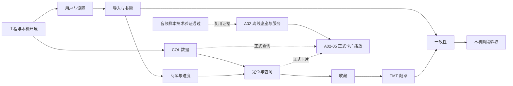

# Readict V1.1 模块化开发计划

版本：0.9；日期：2026-11-22（新增M02 LOCAL_MVP验收记录，保留独立A02任务及历史基线）。
状态：M00-01～M00-05 已完成本机阶段验收，应用实现提交为 ced5f6e；M01 部分完成：核心账号与本地模拟流程验收通过，真实通道待材料；M02本机LOCAL_MVP词典底座完成，测试库及开发库内部查询验收通过，完整质量仍未通过，M03～M09 未开发。本文件保留任务基线，真实结果见 [M00 验收记录](../../../validation/implementation/m00/README.md) 和 [M01 实施验收记录](../../../validation/implementation/m01/README.md)。

当前仓库约定：源码、迁移和正式测试在 readict-app；详细文档、实施记录及截图在 readict-design。应用不建 docs/，单次环境准备和验收脚本不提交，个人便利工具放在忽略的 .local/。以下环境与选型表中的“未验证”等描述保留原始计划编写时的基线，M00 当前结果以验收记录为准。

需求：[PRD V1.1（2026-11-19 修订）](../../requirements/prd/PRD-v1.1.md)。  
设计：[系统技术设计 0.7](../architecture/Readict-V1.1-系统技术设计.md)。  
变更：[CR-0002](../../requirements/changes/CR-0002-密码规则与本地词典及音频阶段安排.md)。  
决定：[ADR-0001](../decisions/ADR-0001-本机环境与本地词典及翻译技术选型.md)、[ADR-0002（持久层）](../decisions/ADR-0002-业务持久层采用MyBatis-Plus与XML.md)和[ADR-0003（M01认证）](../decisions/ADR-0003-M01会话认证与分阶段验证.md)。

## 1. 目标、范围与执行方式

实现“账号 → 导入英文 EPUB → 阅读 → 查词 → 主动翻译 → 收藏原文 → 回看／回原文”的数据库持久化闭环。使用“收藏”，不开发复习表、复习流程、AI 语义消歧、短语查询或 PDF。词典内含短语不意味着新增短语查询功能。

本计划初稿仅编写文档；之后已在独立 readict-app 完成 M00 正式实现。设计仓库的原型、实验、词典及历史证据不直接迁为正式产品。每个完整用户任务完成后统一作中文本地提交，不按内部小步骤提交；涉及两个独立仓库时分别提交，按当前协作约定提交后推送现有远程。

以单人主导的前后端完整模块为默认工作方式。每个模块包含需求核对、数据迁移、后端、前端、错误处理及针对性验证；不以“界面完成”或“接口返回成功”代替模块验收。状态可为未开始／进行中／部分完成／待材料／待验证／完成，只有退出条件满足才标完成。未完成账号恢复可标 M01 部分完成并继续其他模块，但不能宣称完整账号需求已完成；音频材料已提供，样本技术验证通过、人工试听未确认；新增范围由独立A02承接。

默认顺序：**M00 → M01 → M02 → M03 → M04 → M05 → M06 → M07 → M08 → M09**。数据库版本和音频材料不再作为独立环境准备主路径；目标是当前机器的阶段验收，不宣称生产部署能力已验证。

## 2. 实际环境、技术选型与证据状态

### 2.1 当前环境

2026-11-19 只读检查：Windows 11 amd64，JDK 21.0.10、Maven 3.9.14、Node 24.14.0、npm 11.9.0，MySQL 客户端 8.0.44，MySQL80 服务运行；约 16 GiB 内存、20 个逻辑处理器。Docker 命令存在，但 Linux 引擎连接失败。Maven 本地缓存有若干 Boot／驱动版本，不证明正式依赖组合能构建或运行。

**开发、集成测试和阶段验收均使用本机 MySQL80／MySQL 8.0.44。** 同一实例分 `readict_dev`、`readict_test` 及最小权限账号；不另设 MySQL 8.4 实例，不覆盖其他项目数据库。尚未验证应用账号、真实数据库连接、MP／XML、Flyway、Session、事务和并发；本次未创建上述库。测试工具必须检查显式测试配置和数据库名，只允许清理 readict_test，禁止对开发库执行删库／清表。

### 2.2 选型矩阵

“已验证”仅指对应原型／实验／抽查，不是正式工程通过。

| 领域 | 决定 | 证据状态与剩余任务 |
|---|---|---|
| 前端 | React 19.3.1、TypeScript 7.0.2、Vite 8.3.8；React Router | 原型锁文件已有；正式工程还需独立构建／安全检查 |
| UI | Tailwind 4.3.5、现有 shadcn/ui／Base UI、Lucide、Sonner、Floating UI React 0.27.20 | 原型交互有证据；只迁移相关组件，不搬 Mock 存储与正文包词 |
| 阅读 | epub.js 0.3.93 为适配起点，DOM Range、CFI、单页分页 | Chromium 实验通过有限用例；依赖风险、Edge 和新安全产物未通过正式验收 |
| 词法 | compromise 14.20.0 提示 POS，后端规则／数据映射确认 lemma | 小诊断集 9/12，不是生产准确率；失败集必须保留 |
| Java | Java 21、Spring Boot 4.1.2、Maven、Spring MVC／Validation | 目标组合尚未构建；使用稳定补丁，若可达依赖或兼容问题需记录升级决定 |
| 数据与认证 | MyBatis-Plus Boot 4 Starter 3.5.18＋MyBatis XML、HikariCP／Connector/J、Flyway Starter＋MySQL 模块、Spring Security；Session JDBC 在 M01 启用 | Boot BOM 管理对应依赖；不重复引入普通或 Boot 3 MyBatis Starter；真实集成待 M00 验证 |
| 数据库 | 本机 MySQL80／8.0.44、InnoDB、utf8mb4、READ COMMITTED | 服务已运行；独立库和账号待建立，不要求 Docker |
| 文件和任务 | 私有本地目录、StoragePort、MySQL 任务／租约、进程内有界执行器 | 设计已确定，新实现的预算、安全和补偿待验证；无 Redis／队列／对象存储 |
| EPUB 安全处理 | JDK 安全 XML、版本化白名单与确定性序列化；ph-css 解析 CSS | ph-css 只解析，仍需自有安全规则；具体补丁和恶意样本验证在 M03 锁定 |
| 词典 | 本地 COL；Node 离线转换为 JSONL 和 manifest，再导入 MySQL；Java 查询 | MDX／MDD 快速可读；转换质量、版本化和数据权利未验证 |
| MDX 解析工具 | 优先验证 js-mdict 6.0.6（MIT），仅用于离线工具 | 实际6.0.6已通过全源读取及独立对照；历史7.0.0抽查不替代质量验收，完整质量仍未通过，LOCAL_MVP采用范围见ADR-0006，不另建线上Node服务 |
| 翻译 | 腾讯云 TMT 官方 Java SDK，通过 TranslationProvider | 用户已选择；凭据、区域、额度、真实质量和条款尚待验证，不自动开通 |
| 密码 | ≥8 位，至少一个 0–9 和一个 A–Z 或 a–z，允许额外符号；PBKDF2 | 新规则确定；128 code point／512 UTF-8 字节上限与哈希设计保留，参数性能待测 |
| 音频 | 独立发音库；离线MP3＋Java私有文件服务＋浏览器原生Audio；audioId可空 | 已有94条转码和188次浏览器播放证据；人工试听未确认，全量与正式接入由A02独立验收，不用TTS替代 |
| 检查 | Java 单测、本机真实 MySQL 集成、前端单测、Playwright | 无需为本轮安装／启动 Docker；本次不运行完整原型或技术实验 |

Boot 版本要求见[官方系统要求](https://docs.spring.io/spring-boot/system-requirements.html)，JDBC Session 见[官方配置](https://docs.spring.io/spring-session/reference/configuration/jdbc.html)，MySQL 迁移支持见[Flyway 文档](https://documentation.red-gate.com/flyway/reference/database-driver-reference/mysql)，离线工具许可见[6.0.6 LICENSE](https://github.com/terasum/js-mdict/blob/v6.0.6/LICENSE)。这些来源只证明工具说明，不证明项目集成。SDK／库版本最终由对应模块锁文件／POM 记录，不浮动依赖“最新”。

### 2.3 已有证据如何复用

- [UI 原型](../../../prototypes/reader-ui/README.md)：页面层次、浮层、三态收藏、偏好与键盘交互；不是 EPUB 或真实账号实现。Quiet Library 原型变更仍受其自身视觉待反馈状态约束。
- [EPUB 实验报告](../../../validation/technical/reader-core/REPORT.md)：真实分页、CFI、跨 inline 取词和请求竞态；Chromium 最终 18 项通过，WebKit 一项失败，Firefox 未完成，不外推全浏览器。
- COL 2026-11-19 快速抽查：121872 索引，251 条可读有中文、Unicode 音标；children 说明缺字，running 有独立词条；MDD 仅 result-min.css 和 yd_col.js。未做全量语义检查及授权核验。
- 新实现改变了安全处理、存储和网络路径，需要对应模块验证；不重跑旧完整实验来凑证明，也不将新结果覆盖旧 evidence。

## 3. 工程结构、接口和迁移约定

### 3.1 按业务模块组织

readict-app 已有 `frontend/`、`backend/`，后续按需增加 `tools/dictionary-import/`；不创建 docs/，详细文档与证据归设计仓库。前端按 auth／books／reader／dictionary／favorites／settings 组织；后端一个 Maven 应用，按 identity／library／reading／lexical／translation／favorites／operations 组织包，模块内按需分 api／application／domain／infrastructure。不要预建大量空模块或把每个业务包拆成服务。

前端 API 客户端统一处理 Cookie、CSRF、Problem Details 和 requestId；服务端 userId 从认证主体取得，不接收客户端伪造。保留系统设计已有 `/api/v1` 契约、乐观版本、来源校验和幂等语义。

### 3.2 需要落实的契约变化

| 变化 | 正式约束 |
|---|---|
| 业务持久层 | Repository → Mapper／BaseMapper，简单 CRUD 与复杂 XML 分工；显式用户条件、事务／版本／唯一约束不变，UUID input＋BINARY／UTC TypeHandler，不用全局逻辑删除 |
| 本地词典数据 | 增加 datasetId／datasetVersion／entryId／senseId；来源与原始 key 可追溯；词形一对多，不把每个索引键当 lemma |
| 查询及收藏 | Java 只读活动数据集；lookup 引用绑定用户和 source；收藏保存数据集／义项身份和快照，切换不改写历史释义 |
| 数据集导入 | 新版本 staging → 完整校验 → 事务切换活动指针；失败不影响旧版本，幂等可重跑 |
| 认证 | 注册、改密、重置统一新规则；登录验证已有哈希，不按新规则拒绝历史有效凭据 |
| 密码恢复 | 挑战申请／所有权验证／一次恢复凭证／重置；验证服务与 proof 形式待定，未配置不伪造发送成功 |
| 翻译 | 业务 en／zh-CN 映射 TMT 语言代码；不以 MyMemory 自动回退；只发送当前句 |
| 音频 | 字段可空，接口为预留；未就绪时不可用说明，不返回虚构 URL，不标记真实播放完成 |
| 本机数据隔离 | 同一迁移用于 dev／test；测试入口拒绝非 readict_test；未执行环境检查时不得运行破坏性清理 |

### 3.3 数据迁移及提交

Flyway 迁移按模块递增，编号不可复用；已执行迁移不修改，通过新迁移修正。模块只创建需要的表，先 M00 元信息 V1／Flyway history，再按 M01 用户／Session／恢复、M02 词典、M03 书籍／产物／任务、M04 进度、M06 收藏／幂等、M07 翻译／配额、M08 清理辅助状态推进；共享辅助表只由一个模块负责。M01 按 V2 用户／设置、V3 官方 Session schema、V4 挑战／恢复／限流执行；V4 在核心登录限流启用前迁移，本地与真实证明模式严格区分，不能用占位不安全表绕过验证。

每个任务用 `Mxx-yy` 编号，提交写中文修改内容、原因、实际验证、关联任务和基线；一个提交只纳入相关完整行为。每次任务完成后按用户要求主动提交本任务改动，说明内容、原因和实际验证；无改动不建空提交，提交后按当前协作约定推送现有远程。保存源码、脱敏测试与配置示例，不提交凭据、用户 EPUB、原始词典或转换全文、node_modules、构建产物和个人配置；本地数据引用使用配置路径，不写死设计仓库绝对路径。

## 4. 模块任务明细

M00-01～M00-05 已完成本机阶段验收；M01核心与本地模拟已验收，真实通道待接入；M02已交付LOCAL_MVP包／V5／Java查询，通过测试库验收并启用开发库；M03～M09未开始。既有原型／实验结果只用作输入，不计后续正式任务完成。A01材料已提供、样本技术验证通过、人工试听未确认；A02为新增独立任务，未开始。每模块提供后端＋前端＋数据＋异常＋验收，避免再由实施者自行决定范围。

### M00 工程基础与本机环境

状态：已完成本机阶段验收，证据见 [M00 记录](../../../validation/implementation/m00/README.md)。

前置：无。交付：可独立启动的正式前后端、基础配置和数据库迁移机制。详细执行见[M00 独立执行文档](M00-工程基础与本机环境执行文档.md)；文档完成不代表模块实现。

| 任务 | 工作与完成证据 |
|---|---|
| M00-01 | 新建 Java／React 工程、配置示例、忽略规则、运行文档；记录 Java／Node／BOM／锁文件版本，构建可复现 |
| M00-02 | 规划并经授权配置本机 readict_dev／readict_test 和最小权限账号；验证真实连接和读写边界，凭据不写 Git |
| M00-03 | 接入 MP Boot 4 Starter／BaseMapper／XML、HikariCP、Flyway Starter＋MySQL 模块、Spring 事务与 UUID／UTC TypeHandler；元信息 V1、二次启动、真实提交／回滚、版本更新及测试误连保护 |
| M00-04 | 统一 Problem Details、requestId、日志脱敏、健康与就绪、生产配置禁 Mock；前端 API 客户端和会话错误占位 |
| M00-05 | 本机运行约定：Vite 5173 代理 /api 到后端 8080；端口占用明确失败而非自动漂移；测试库清理双重校验，其他项目库不动 |

数据／接口：system_metadata 基础设施表、Flyway history、/api/v1/system/status 与存活／就绪；不创建用户／书籍／收藏业务表，Session JDBC 及会话表在 M01 启用。异常：数据库断连、配置缺失、迁移失败必须显式启动失败，不吞错。退出：构建和启动通过、本机 BaseMapper／XML、UUID／时间映射、真实事务回滚和条件更新成功、测试 profile 误连被拒绝、重复启动不重建数据、无泄密。MySQL 服务存在不算此模块完成。Docker 不参与。

### M01 用户、认证与设置

2026-11-20 根据 [CR-0003](../../requirements/changes/CR-0003-手机号固定中国大陆区号.md) 修订：手机号仅支持中国大陆固定 +86，不提供其他国家／地区选项。接受 11 位本地号码或 +86 完整号码；trim 首尾空白后移除一次可选 +86，以 ASCII 正则 1[3-9][0-9]{9} 校验，统一保存 +86 加本地号码。拒绝其他区号、0086、重复前缀、内部空格／连字符和全角数字。注册、登录、恢复和限流共用此规范；格式有效不代表真实归属已验证。

前置：M00。接口：/auth/*、/me/settings。数据：app_user、user_settings、框架 Session、verification_challenge、password_reset_credential、rate_bucket。详细目录、DDL、DTO、调用流程、命令、排障和退出条件见[M01 独立执行文档](M01-用户认证与个人设置执行文档.md)，决定见[ADR-0003](../decisions/ADR-0003-M01会话认证与分阶段验证.md)。当前 M01 核心与本地模拟已通过本机阶段验收，真实通道待接入；见 [M01 验收记录](../../../validation/implementation/m01/README.md)。

| 任务 | 工作与完成证据 |
|---|---|
| M01-01 | 邮箱／手机号规范化和唯一约束、注册；新密码规则和统一提示，工程上限、盐、PBKDF2 及参数版本保留 |
| M01-02 | Boot Session JDBC、JSON认证／显式 saveContext、Session轮换、CSRF更新、持久限流、当前用户；两用户隔离与统一失败反馈 |
| M01-03 | 改密与 authVersion，全部旧 Session 立即失效；前端清私有缓存并要求重新登录 |
| M01-04 | 账号页面、注册／登录／改密 UI，个人阅读／主题／口音偏好，版本冲突及保存失败反馈 |
| M01-05 | 先完成捕获Sender／受限dev outbox、挑战／验证／一次恢复凭证／重置；区分模拟与真实证明，过期／次数／重发／消费／失效；真实通道单独确定与验收 |
| M01-06 | 在 readict_test 验证标识并发唯一、密码边界、CSRF、认证失效、偏好刷新恢复及恢复挑战失败路径 |

错误：INVALID_CREDENTIALS／PASSWORD_POLICY／IDENTIFIER_UNAVAILABLE／SETTINGS_CONFLICT，验证码错误与过期不泄露账号。现有未验证联系方式不能直接用于重置。验证服务未定可先交付 M01-01～04，再验收本地模拟恢复；状态分“本机核心和模拟流程验收通过”与“M01 全范围完成”。DEV_LOCAL 不置真实 verified=true；真实发送／所有权／恢复未通过，整模块保持部分完成，后续模块可在已验收登录隔离基础上继续。

退出：密码与第 7 章案例一致；注册、改密、重置同规则；所有权证明和真实验证服务通过才完成账号全范围。PBKDF2 已完成本机耗时采样，实际数据与适用边界见 M01 验收记录。

### M02 COL 数据底座与离线工具

前置：M00；正式应用M01核心隔离已可复用，真实通道继续待接入。独立[M02技术设计与执行文档](M02-COL词典数据底座技术设计与执行文档.md)集中定义六项任务的目录、转换规则、数据契约、DDL、导入／查询、命令和排障。V5接续已有V1～V4，五表为dictionary_dataset、dictionary_active、dictionary_entry、dictionary_sense、dictionary_form_mapping；无逐句查询记录全量表。M02-01实际兼容性通过；M02-02～05已交付r4有限覆盖采用、确定性包、V5、独立导入工具及Provider；M02-06完成固定50词、200源抽查、回归及测试库验收。开发库经用户批准按原样补执行V2～V4及V5，已导入并启用；完整质量未通过。见 [M02当前验收](../../../validation/implementation/m02/local-mvp-2026-11-22/README.md)。

| 任务 | 工作与完成证据 |
|---|---|
| M02-01 | 在独立 tools 环境锁 MDX 解析器并验证实际 col.mdx／col.mdd；记录输入摘要、条目数、版本、许可和错误，不能将 7.0.0 抽查等同 6.0.6 通过 |
| M02-02 | 按标题、Unicode 音标、区域／义项、词性、原顺序提取；去掉脚本、样式、例句，不执行 MDD JS；中英混合需专用规则，异常入清单 |
| M02-03 | 保留索引 key／实际 headword／区域、词形关系和证据；处理 runs/run、running 独立义项、ran、children 缺字、saw 同形词，不无条件合并 |
| M02-04 | 生成JSONL／manifest／质量报告，固定字节及Node／Java身份向量；源处置与区域／义项／映射分别对账，采样包不可正式导入；转换中断可从头重跑 |
| M02-05 | Java独立离线入口复用保护与MP/XML；V5／分批checkpoint同事务／owner租约，核对后READY、显式版本条件激活；Provider固定DatasetRef与有界版本缓存 |
| M02-06 | 人工核对至少 50 代表词，建立转换回归样本；检查中文／IPA／POS／顺序、重复导入、无结果和未知词形 |

接口：离线 CLI 和 Java DictionaryProvider，正式查询 API 由 M05 使用；M02只交付内部Provider和离线CLI，不提前增加需EPUB来源的HTTP查询接口或词典上传管理产品页面。错误：DATASET_NOT_READY／CONVERSION_FAILED／DICTIONARY_NOT_CONFIGURED；质量无法确认时保留未提取标记，不能生成假中文。退出：固定词表质量、计数对账、幂等和数据集切换通过；正式分发／快照仍需核实词典数据权利，技术可读性不代替许可；未来验收归档validation/implementation/m02/，本次不建通过记录。音频只记录 A01，不纳入文字退出条件。

### M03 文件、EPUB 导入与书架

前置：M00、M01 已可用认证。接口：/books、/books/imports、cover、reader-manifest、产物下载。数据：book、artifact、chapter、import_task、必要文件清理状态。

| 任务 | 工作与完成证据 |
|---|---|
| M03-01 | StoragePort、私有根目录、源文件有界上传与 SHA-256；25 MiB 初始限制，文件名不作磁盘路径，所有权鉴权下载 |
| M03-02 | ZIP 实际流式解压、条目／单项／总量／路径／时间预算，禁 XML 外部实体、网络、固定版式和 encryption.xml；错误区分具体原因 |
| M03-03 | 安全 XML／CSS 白名单、资源清单、CSP、无脚本产物；确定性序列化和压缩，生成 block／sentence 索引及摘要，不逐词插节点 |
| M03-04 | 导入租约、任务状态／阶段／重试、文件先发布再事务 READY、失败清理；同 sourceHash 重复导入按状态处理 |
| M03-05 | 书架／封面／搜索／导入进度／错误／删除确认；复用已有视觉但真实请求替换模拟成功，原型 UI 版本与源码引用可追溯 |
| M03-06 | 在本机测试库和临时私有目录验证合法 EPUB2/3、恶意／损坏／超限、断流、任务崩溃和重复导入 |

退出：READY 必须对应完整可读文件和索引；安全预算可真实阻断，测试不触发外网或脚本；重跑同版本产物可复现。Java 新流水线必须独立验证，不能引用旧 DOMPurify 通过结案。若 CPU／内存无法有界控制，停在此模块验证隔离处理，不继续假设安全产物成立。

### M04 阅读内核、分页与进度

前置：M03 与 M01 偏好。接口：manifest、text-index、progress；数据：reading_progress，书架 lastReadAt 同事务更新。

| 任务 | 工作与完成证据 |
|---|---|
| M04-01 | ReaderEngine 适配器、ready／relocated／selection／error 事件；单页分页、目录树与 spine 分开，不用旧字符切片 |
| M04-02 | 产物摘要验证、样式主题、字号行距宽度、图片限制、上一页／下一页、章节边界与翻页串行 |
| M04-03 | CFI＋产物／流水线版本＋文本 quote；验证恢复，唯一文本 fallback，不确定回章节起点且不自动覆盖旧位置 |
| M04-04 | 初始化／重排屏蔽过渡位置写回，字体／图片迟到调度、窗口变化、首尾状态、焦点不触发后台翻页 |
| M04-05 | 进度防抖、串行请求、XML 显式 expectedVersion 条件更新、冲突提示、本地待同步；切书／进入收藏 flush，退出失败不声称已同步 |
| M04-06 | 切书 generation、请求／观察器／事件销毁、Blob 回收；三桌面＋390px、分页覆盖和位置往返验证 |

错误：BOOK_NOT_READY／ANCHOR_INVALID／PROGRESS_CONFLICT／ARTIFACT_REVOKED；正文已加载时进度失败可继续阅读并提示未同步。退出：不同版式恢复同内容，无丢文／重复跳读，错误 CFI 不静默跳首个重复句，旧异步事件不覆盖当前书籍。

### M05 单词定位、词典查询与卡片

前置：M02、M04；认证沿用 M01。接口：/dictionary/lookups、source 校验、收藏状态查询契约；收藏正式动作在 M06 接入。

| 任务 | 工作与完成证据 |
|---|---|
| M05-01 | caret 定位、最近块 TreeWalker、跨 inline Range、目标 rect 命中、UTF-16 与代理项，链接／空白不误触发 |
| M05-02 | DOM 文本／服务端索引摘要及 canonical 句子边界；预览不作为持久事实，句内同词按偏移高亮 |
| M05-03 | compromise 实际 term 匹配、后端词形确认、POS 映射和稳定排序；未知原型回退及已有 fallback 冲突处理 |
| M05-04 | 本地查询标准 DTO，数据集／义项身份；卡片主释义＋两条其他释义、更多折叠，中文和音标，不带词典例句 |
| M05-05 | Floating UI 虚拟锚点、iframe 坐标比例、右左上下避让、箭头、75vh 内滚动、目标高亮与非模态焦点 |
| M05-06 | selectionId／generation／abort，快速换词／关闭／翻页竞态；段落入口式键盘查询与合理焦点恢复 |

错误：空结果与网络失败区分；原文保持独立，后端源验证失败禁保存而不伪造句子。退出：左右底部、长词条和展开不越界、不改正文宽度、不插正文包词节点、不串词；音标正确，真实音频明确“待补充”，不作为当前完成条件。

### M06 收藏、快照和回看

前置：M01、M04、M05。接口：/favorites 及 state／sources／detail；数据：favorite_word、context、mutation_receipt，词典数据集快照引用。

| 任务 | 工作与完成证据 |
|---|---|
| M06-01 | 用户＋lemma 主体唯一、主体＋contextKey 唯一；按来源／版本／章节／句位置算 key，不按全文同文或单词 CFI 去重 |
| M06-02 | 验证 source 和字典身份；Mapper／XML 在应用事务中保存主体与语境，保留首次释义，三态和保存中／失败状态，不提前显示成功 |
| M06-03 | 单词／句子投影、搜索、来源筛选含已删除书、稳定时间游标、详情与原文 target 恢复 |
| M06-04 | 整主体取消确认、级联语境删除、幂等回执、响应丢失确认，取消后旧保存重放不复活 |
| M06-05 | 书籍 DELETING 后拒新 source 操作，解绑来源而保留快照、文件清理补偿，删除后原文入口不可用 |
| M06-06 | 本机 readict_test 的 20 并发同词同句、不同句追加、同句多目标、两用户隔离、删除与保存竞争 |

退出：同词一主体、同位置一语境；不同位置同文不误合并；不丢首次快照；删除书籍保留原文与译文；回原文不仅路由变更而且内容匹配。字典数据集切换不得改收藏。翻译字段可先空，在 M07 补齐完整链路。

### M07 腾讯云主动翻译

前置：M01、M05，收藏关联依赖 M06。接口：/translations；数据：translation、用户额度桶、幂等状态，必要辅助表不重复创建。

| 任务 | 工作与完成证据 |
|---|---|
| M07-01 | 官方 TMT Java SDK 适配、配置校验、语言映射、连接／总超时与错误映射；记录锁定 SDK 版本，不手写不必要签名算法 |
| M07-02 | 用户明确点击才发请求；服务端重建当前句，校验长度，不自动送邻句／全文／用户标识，日志不含正文 |
| M07-03 | 用户隔离缓存、single-flight、额度预留、IN_PROGRESS／UNKNOWN 状态；取消不保证上游不计费，无不安全自动重试 |
| M07-04 | 卡片独立翻译状态、失败重试和来源说明；先收藏后翻译／先翻译后收藏，已存译文不后台覆盖 |
| M07-05 | 用户配置真实服务后验证至少 20 代表句、超长／额度／超时／隐私／译文保存条件，分离 Mock 与真实请求证据 |

退出：查词默认零翻译请求；迟到译文不串到新词；翻译失败不阻塞词典和原句收藏；真实 TMT 返回和错误有记录。无凭据时只能标适配／契约完成，不能标真实翻译通过；不自动开通计费或降级为 MyMemory。

### M08 一致性与后台补偿

前置：M03、M06、M07。接口：不新增公共管理产品页面，内部状态与健康指标受控。数据：任务、回执和清理辅助状态。

| 任务 | 工作与完成证据 |
|---|---|
| M08-01 | 收口导入租约、幂等发布、staging／孤儿文件回收、清理退避、过期缓存和额度桶 |
| M08-02 | 锁顺序与事务重试，书籍删除／收藏保存／译文返回／进度的状态竞争，死锁重试不再次外呼 |
| M08-03 | READY 文件摘要／存在性巡检、BROKEN 状态、任务卡住告警，不返回空正文冒充正常 |
| M08-04 | 文件完成后 DB 提交前、DB 提交后响应前、删除中、翻译未知状态故障注入；在本机测试库／临时文件目录执行 |

退出：无虚假成功、无悬空 READY、无复活收藏、无删除导致快照丢失；未知结果明确可确认，不能声称跨数据库／文件事务“恰好一次”。

### M09 本机阶段验收与运行交付

前置：M00～M08 的相关子任务完成；账号恢复未完成必须如实列缺口。数据库只用本机 readict_test，不另设验收版本。

| 任务 | 工作与完成证据 |
|---|---|
| M09-01 | 本机空测试库迁移、升级迁移、Session、并发与隔离、只读／写入失败、测试库清理防误操作 |
| M09-02 | 实际 Chrome／Edge，1440×900、1920×1080、1366×768 和 390px；键盘、焦点、深色对比、减少动画、200% 缩放 |
| M09-03 | 锁文件审计和 EPUB 风险处置，安全样本与两用户负向接口；COL 数据权利、TMT 真实服务、账号恢复的待定项清单 |
| M09-04 | 查词缓存／非缓存延迟分开、翻页／首次打开／内存；50 次切书、500 次翻页的 heap／Blob／监听器观察，不能用 iframe 个数代替 |
| M09-05 | 本机测试库＋私有文件一致性备份恢复演练、运行说明、配置和限制清单、失败回退；不据此宣称未来生产 RPO／RTO 已通过 |

退出：各模块证据可追溯、阶段需求覆盖有结果；未完成恢复、授权或安全项不得被隐藏。音频明确“A02待开发／验收，人工试听未确认”，本轮其他功能可阶段验收，但不能宣称 V1.1 全量需求完成。未来生产数据库、部署机器和系统需另定并做差异验证。

### A01 音频材料分析与样本验证状态

状态：**材料已提供，样本技术验证通过，人工试听未确认**。原“待材料”已不适用。证据见[2026-11-21音频验证](../../../validation/technical/audio/2026-11-21/README.md)：6.0.6读取94条、解码／MP3转换／再解码通过，Chrome和Edge共188次基础播放通过。headless事件不代表人耳听到或发音正确，全量资源、映射质量与数据权利仍待核实。

A01的材料分析不等于正式发音功能完成。后续完整发音链路使用A02独立编号、文档和验收；不向M02文字任务追加音频条件，不用TTS替代，不重新开展相同一轮完整样本实验。

### A02 本地发音库处理与播放接入（独立新增）

状态：**未开始；工程方案已确定**。详见[A02独立执行文档](A02-本地发音库处理与播放接入执行文档.md)和[ADR-0005](../decisions/ADR-0005-独立发音库与离线MP3播放.md)。下表全部为新增工作，不修改M02-01～06原任务、历史状态或验收条件。

| 任务 | 新增范围 | 依赖与独立退出条件 |
|---|---|---|
| A02-01 | 源摘要、实际链接、词头／口音、缺失与重复映射 | 复用6.0.6适配器；全部索引和链接有可追踪分类 |
| A02-02 | 抽取、Speex→MP3、断点、清单、质量对账 | 可先独立开展；候选逐条有结果，公开资源均复核，原文件只读 |
| A02-03 | 独立数据集、资源、映射、活动指针、私有文件与导入 | M02文字V5之后新增迁移，执行前核对编号；幂等、切换／回退和文件一致性通过 |
| A02-04 | Session保护的MP3 GET／HEAD、Range、缓存及错误 | A02-03及既有认证；真实HTTP与权限检查通过 |
| A02-05 | 展示词头关联、实际口音、卡片播放和统一停止 | 等待M02正式查询及M05卡片；切词／关闭／翻页／退出不遗留播放 |
| A02-06 | 全量对账、恢复、权限、浏览器及人工试听 | 底座与完整链路分别登记，证据独立归档validation/implementation/a02/ |

音频包与COL文字包、entry-v2身份分离；MP3初始单声道22050Hz／48kbps，FFmpeg仅离线使用。音频缺失不阻塞文字查询／翻译／收藏。底座验收不代表完整链路；人工试听、全量完整性、映射和权利问题必须显式报告。本次不创建通过记录。

## 5. 依赖、里程碑与风险

| 里程碑 | 可交付行为 | 尚不能宣称的内容 |
|---|---|---|
| K1 M00／M01 基础 | 用户隔离、基本账号、设置与本机持久化 | 恢复未真实验证时不是账号全范围完成 |
| K2 M02／M03 | 真实 COL 可查询，真实安全 EPUB 可导入书架 | 快速抽查不是全量词典质量／授权；原型不等于真实阅读 |
| K3 M04／M05 | EPUB 阅读、位置保存、点击查词 | 有限浏览器不是 Safari／Firefox 全支持，文字通过不代表发音通过 |
| K4 M06／M07 | 收藏与原文快照、主动 TMT 闭环 | Mock 不代表真实 TMT，删除成功提示不代表文件清理已终结 |
| K5 M08／M09 | 本机完整文字流程阶段验收与运行交付 | 不代表生产部署或音频全量需求完成 |

当前不承诺未经测算的固定发布日期。先记录 M00～M02 实际耗时，再按余下任务和材料／服务等待校准；每个任务登记开始／完成／证据／提交。遇到阻断时可推进独立模块，但不得跳过依赖它的安全或数据不变量。

重要风险：Java 安全产物索引与实际 DOM 不一致则停止依赖定位保存的验收；epub.js 风险未关闭不能放行对应产品；COL 提取不准应修规则而非调用生成模型填词典；TMT 未配置不伪装成功；注册／恢复所有权验证需落定；音频 MVP 底座已可用，完整复验与正式卡片后置，人工试听未确认。已有 V01～V15 分别关联本计划模块，详见系统设计第 17 章，不重复建设整套旧实验。

## 6. 完成定义与变更管理

任务完成至少包含：代码与文档、实际接口、必要迁移、正常／失败状态、针对性验证结果和关联提交。仅文档完成不将 M00～M09 状态改为完成。测试结果说明机器、版本、样书／词表、真实／Mock、输入限制和未覆盖项，保留失败；新运行与旧 evidence 分开。

同一个模块有前端、后端、数据任务时应在统一 API 契约下联调；接口变化先改设计再改调用，破坏性数据迁移需说明恢复。PRD／CR 是需求来源，ADR 是技术取舍记录，实验建议不自动升级为已采纳能力。新的范围变更继续编号 CR；本文件维护总体状态；已完成任务新增范围必须另建独立任务编号和执行文档，旧文档只补关联入口或事实状态，不倒改历史完成条件。

本次文档工作不创建正式源码、不改本机服务／库／配置、不运行完整技术实验、不提交词典数据，任务完成后按当前协作约定作中文提交并推送现有远程。当前原型、Quiet Library 与其他工作区变更原样保留。

## 7. 文档验收清单及密码案例

统一提示：**密码不少于 8 位，且至少包含一个数字和一个英文字母。** 以 code point 计长度，不 trim／归一化用户密码；ASCII 数字和字母判定一致，不要求大小写同时出现、允许额外符号，不强制符号。注册／改密／重置相同，登录验证已有哈希。

| 输入 | 预期 | 原因 |
|---|---|---|
| abc12345 | 通过 | 8 位，数字＋小写字母 |
| ABC12345 | 通过 | 8 位，数字＋大写字母 |
| Abc12345 | 通过 | 8 位，数字＋字母 |
| abc1234! | 通过 | 允许额外符号，已有数字和字母 |
| abcdefgh | 不通过 | 缺数字 |
| 12345678 | 不通过 | 缺字母 |
| Abcdefgh | 不通过 | 缺数字；大小写组合不代替数字 |
| abc1234 | 不通过 | 少于 8 位 |

以上仅为未来功能验收要求，本次不创建或执行认证实现。文档检查包括：有效条款不再强制大小写；数据库不要求独立验收实例／升级；账号恢复范围一致；音频保留且明确未验收；相对链接、目录锚点、JSON／字符范围和 CR／ADR 索引一致；原型／实验／词典／readict-app 不变。

## 8. 任务状态登记

| 模块 | 当前状态 | 后续填写的证据／提交 |
|---|---|---|
| M00 | 已完成本机阶段验收 | 应用提交 ced5f6e；[验收记录](../../../validation/implementation/m00/README.md) |
| M01 | 部分完成：核心与本地模拟已验收，真实通道待材料 | [M01 记录](../../../validation/implementation/m01/README.md)；应用提交见记录 |
| M02 | 本机MVP词典底座完成；开发库已启用；完整质量未通过 | [当前验收](../../../validation/implementation/m02/local-mvp-2026-11-22/README.md)；保留r2／r3历史质量记录 |
| M03 | 未开始 | 待正式开发 |
| M04 | 未开始，已有 EPUB 实验 | 待正式适配器验证 |
| M05 | 未开始，已有原型／实验 | 待正式联调 |
| M06 | 未开始 | 待正式事务验证 |
| M07 | 未开始，真实服务待配置 | 待 SDK 和真实调用 |
| M08 | 未开始 | 待故障验证 |
| M09 | 未开始 | 待本机阶段验收 |
| A01 | 材料已提供，样本技术验证通过，人工试听未确认 | [历史样本验证](../../../validation/technical/audio/2026-11-21/README.md)；非正式接入验收 |
| A02 | 本机音频 MVP 底座可用；完整复验后置，正式卡片待 M05 | [独立执行文档](A02-本地发音库处理与播放接入执行文档.md)；[实施入口](../../../validation/implementation/a02/README.md)，按实际结果登记 |

### 2026-11-21 M02 r3复验状态

见[r3报告](../../../validation/implementation/m02/extractor-r3-2026-11-21/README.md)及ADR-0004。子词条component身份、标签、引用分离和entry-v2向量已在Node实现；最终边界保留集27/29完整，全源仍5519条失败。正式包、V5及Java查询未实施；不批准源缺陷排除，不以抽样达标标M02完成。

### 2026-11-22 M02 LOCAL_MVP 验收

用户确认沿用当前COL、不补齐，采用ADR-0006。已完成92907组件／149337义项／73624映射的两次确定性包、独立校验、真实MySQL导入与查询、固定50词（33有结果／17未命中）、200源抽查及性能回归。详细范围和真实测试计数见当前验收报告。开发库原仅V1，经用户批准补执行既有V2～V4后执行V5，已导入并启用同一数据包，重启后内部查询验收通过。A02及M03～M09状态不变。

### 2026-11-22 A02 音频底座实施

M02已完成的文字MVP作为前置，不重验文字内容或改变原结论。A02采用ADR-0007允许部分源录音缺陷隔离，完整扫描、单条质量、计数／摘要／身份和鉴权门槛保持；V6、离线工具、内部目录和鉴权播放正在验收。完整卡片待M05，人工试听及权利未通过，不能以底座测试替代。

### 2026-11-23 A02 按 MVP 收尾

按用户最新指示，优先基本可用，停止第二轮全量、重复整库验证和压测。V6、离线音频工具、AudioCatalog、Session 鉴权媒体接口已交付；可用资源 248283、映射 220844 已导入并启用开发库，76 条源资源隔离。新进程内部目录固定 50 词 47 可用／3 缺失，Chrome／Edge 少量真实播放与退出拒绝访问通过；M02 文字活动数据集保持不变。详见 [MVP 记录](../../../validation/implementation/a02/2026-11-23-local-subset/README.md)。本次只登记 MVP 核心可用，完整复验、正式卡片、人工试听与权利确认后置，不能称完整发音链路完成。
