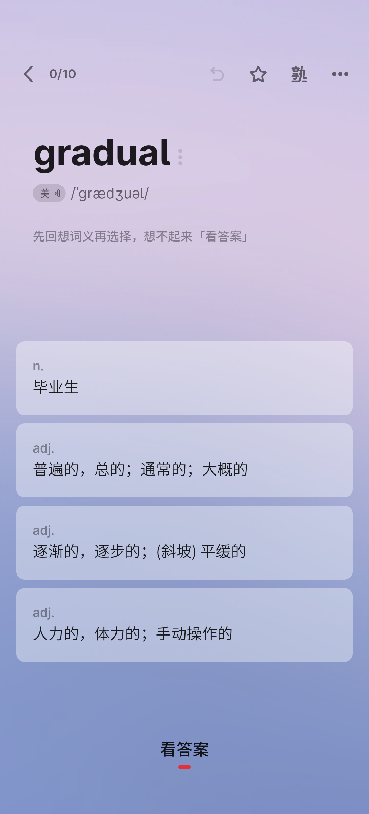

# 不背单词：单词学习与复习功能研究

任务：`RESEARCH-REVIEW-01`；调查日期：2026-11-23（Asia/Shanghai）；报告状态：阶段一调查交付，待人工评审。

## 1. 调查条件与结论边界

本次通过数据线实际控制一加 Ace 5，使用 adb 读取画面、读取可访问控件并提交点击与输入。Android 16，不背单词 **5.9.21（versionCode 360）**，有效画面 1080×2376。连接、画面与输入分别验证通过，不是仅依据设备连接作出的推断。工具只放本机忽略目录，未修改 Readict 业务代码。

使用现有登录账号，当前在学词书为 **四级大纲词汇，4755 词**。会员等级未独立核实，不推定全部辅助功能免费。本账号已有历史学习、复习及答错记录；本次没有清空，因此以下“新学”指 Learn 入口的实际批次，不等于所有样本从零开始。

完成一组 10 词辨识、进入可选整组拼写并验证错误和放弃提示、完成一组 10 词复习、检查词书/词本状态和主动收藏。复习批次进入时已经是 1/10，包含此前已完成的 managerial；本次实际新增完成其余 9 个词。**并未复习清空整个 456 词待办。**

证据记号：O=本次实测；D=官方说明；I=研究推断；Q=待验证。`BB-O-23` 对应截图文件名前缀 23，完整映射见[证据索引](../evidence/index.md)。操作序列补充见[会话记录](../evidence/bubeidanci/session-log.md)。

## 2. 用户任务与完整操作流程

### 2.1 词从哪里进入体系

|入口与步骤|实际展示和结果|证据与边界|
|---|---|---|
|首页 → 我的内容 → 在学词书|四级大纲词汇提供全部、未学习、复习中、复习完成、已标熟；未学习页有 commercial、addict 等条目|O：BB-O-33、39；未重新选择或更换词书|
|首页 → Learn|从现有词书/学习进度启动辨识批次；不需要先把每个词加入生词本|O：BB-O-03～05；词的具体排序和取样规则 Q|
|学习卡片 → 星标|对 instruct 点击星标后，控件从“收藏单词”变成“取消收藏单词”，卡片仍为 0/10|O：BB-O-41；收藏与该组完成进度是不同动作|
|我的内容 → 单词本 → 生词本|原有 2 词，收藏后变 3 词，今天新增 instruct；未学习筛选仍包含 instruct|O：BB-O-34、42、43；没有因收藏直接完成学习|

生词本中已有 overwhelm 和 hello，按加入日期分组。列表点击 hello 会原地展开音标、词性、释义以及词典/收藏图标。底部有沉浸刷词、随身听、听写、随手拼、导出；更多菜单提供批量编辑，编辑态提供“添加至”“删除”。这里只确认入口和列表状态，未把这些独立练习工具全部当作主学习队列测试。（O：BB-O-35～38）

**待验证**：词书以外查词如何加入生词本、外部内容导入、收藏词何时进入首页 Learn/Review、多个词本重复词的去重及词形合并。不能把“收藏成功”推导成“自动加入某日复习计划”。

### 2.2 从首页进入 Learn

1. 首页同时显示 Learn 2855、Review 456；点击 Learn 后弹窗说明有 456 个词待复习，建议先复习，提供“仍然学习／马上复习”。可以选择继续学习，并非强制阻断。（O：BB-O-03）
2. 选择“仍然学习”，进入 `0/10`。gradual 首先显示英文、美国口音标记、音标、四个词性/中文释义选项，以及“看答案”。提示要求先回想再选择。（O：BB-O-04）
3. 点击“看答案”，显示拆分后的单词、词性释义、英文例句、中文句译和助记内容，底部变“下一词”；进度仍是 `0/10`。（O：BB-O-05）
4. consultant 选择正确中文释义后进入详情，出现一格绿色阶段标记，整组仍是 `0/10`。genetic 故意选错，错误项短暂红色、正确项绿色，随后展示正确释义与例句。（O：BB-O-06、11）
5. 其他题面以“认识／不认识”要求自评；有的显示英文例句但隐藏中文释义，有的注明“本词最后一关”，且不提供例句提示。flavor 选“不认识”后揭示释义、句译和词组。（O：BB-O-09、10、13）
6. 选择“认识”后，详情还允许“记错了”；它是纠正刚才判断的入口，不是只读说明。（O：BB-O-12）
7. 词汇交错再现。达到最后一关的 diabetes 答认识后，进度首次变 `1/10`；后续逐词完成直到 `10/10`。（O：BB-O-13、16；中间序列见会话记录）
8. 点击继续，显示“首组单词辨识完成”、+20 酷币，以及“开始拼写／小结”。当前设置为“学习整组拼”，这里依然允许直接进入小结。（O：BB-O-17）
9. 本次进入拼写：显示中文词性释义、输入区、提示和确认控件；将 genetic 故意输入为 abc 并确认，显示输入与正确词的对照，正确答案为 genetic，计数仍 0/10。（O：BB-O-18、19）
10. 退出拼写时提示“放弃后将无法继续拼写本组单词”；选择放弃后进入小结。小结列本组 10 词、各词答错次数、今日已学 10 词，提供“再学一组／休息一下”。继续退出后还有本次学习完成页，展示今日学习、今日复习、总时长。（O：BB-O-20～22）

这里完成的是**辨识闭环和拼写退出分支**，未完成整组拼写，不宣称整组拼写通过。小结中的累计答错次数包含此前记录和本轮操作，不能全部归因于本轮。

### 2.3 中途退出和新学重进

在 instruct 尚未作答、进度 `8/10` 时返回首页：Learn 变为 2847，Review 仍为 456。重新通过 Learn → 仍然学习进入，进度仍是 `8/10`，但当前词变为 pure。说明已完成词的进度保留，本次并非严格恢复到退出前同一张卡。（O：BB-O-14、15）

完成 10 词后，首页 Learn 为 2845。再进入 Learn 是下一组 `0/10`，本次看到 instruct；对它只收藏、不提交作答后退出，未将这组记为完成。（O：BB-O-40、41）

未验证杀进程、离线、换设备后的恢复；也没有证据表明仅“打开／揭示”就满足完成条件。

### 2.4 从首页进入 Review

1. 点击首页 Review。本账号当前批次从 `1/10` 开始，词为 minister；题面仅显示英文、音标和被遮住的释义，底部有“认识／模糊／忘记了”。提示区分“瞬间想起词义”和“思考后想起词义”。（O：BB-O-23）
2. minister 选“忘记了”，展示正确释义、例句和词组，计数仍 `1/10`，底部只有下一词。（O：BB-O-24）
3. filling 选“模糊”，同样揭示释义，但保留“记错了”入口，计数仍 `1/10`。（O：BB-O-25）
4. furthermore、loyal、resign、well-off、premier、spin、chemist 在本次选“认识”后各完成一个词，计数由 1 逐步到 8。不能据此断言任何词只需一次认识；这些词均已有历史进度。（O：操作序列）
5. minister 后续以英文自评和四选一再次出现；filling 也出现四选一。随后两词都出现**只给中文词性释义、遮住英文**的反向回忆题，要求想起单词。（O：BB-O-28；操作序列）
6. 两词通过后达到 `10/10`。在 minister 答案页点击“记错了”，计数即时回退到 `9/10`，绿色完成标记消失；下一词仍是 minister 的反向题。（O：BB-O-26～28）
7. 对该反向题连续两次选择“不认识”，每次揭示答案再点击下一词，均回到同词反向题，计数保持 `9/10`，中间没有别的词。最后选“认识”再继续，恢复 `10/10` 并进入复习小结。（O：BB-O-29、30、31）
8. 小结显示 minister“1 天后复习”、filling“61 天后复习”，其余条目多为“复习完成”；底部显示“已复习 10 词，还剩 447 词”，可继续复习。返回首页也显示 Review 447。（O：BB-O-31、40）

**数量口径**：进入本次批次前待办是 456，已有 1/10 完成，因此本次新增完成 9 词，余量 456−9=447；小结的 10 是整组数量。不要写成“本次新做 10 词导致减少 9”的产品错误。

## 3. 页面、卡片与辅助信息

|阶段/区域|默认展示|揭示/展开后|与记忆的实际关系|
|---|---|---|---|
|新学四选一|英文、口音、音标、四个中文选项|正确词义、句子、句译、助记|选择题检索与看答案是不同反馈分支|
|英文自评题|英文、音标；部分阶段带英文例句|完整释义和中文句译|可以先利用语境判断，也出现最后一关去提示|
|反向题|中文词性释义，英文被遮挡|英文、音标、例句|本次用于重新回忆英文形式；没有要求输入|
|例句卡|答案页英文中目标词加粗、中文译文、音频/更多例句图标|有更多例句入口|来源为产品提供的语境，不是用户导入 EPUB 的原句|
|助记区|当前默认优先显示词组搭配|派生、特殊变形、词根、近义、笔记、词典入口，按词不同|辅助内容按需查看；本轮未逐个验证所有词的完整内容|
|顶部管理|返回、阶段计数、撤回图标、星标、标熟、更多|更多中有设置、沉浸场景、小窍门、纠错/举报|星标实际验证；标熟、撤回和举报未执行|

学习设置实测：混淆项辨析关闭、拆分助记开启、拼写为学习整组拼、自动发音为全部开启；助记顺序列词组搭配、特殊变形、派生词、词根词缀、笔记、近义。（O：BB-O-07、08）

发音控件、口音、自动发音设置及原声句入口已观察；本次通过屏幕进行调查，没有录下声音或人工核验听感，不能声称音质、真人录音、发音正确性及实际扬声器播放已验收。官网对原声例句、词根词缀、拼写测试和动态安排的介绍作为 D 证据，不能替代上述 O 事实或暴露内部算法。（D：[BB-D-01](https://www.bbdc.cn/)，查阅于 2026-11-23）

## 4. 可确认规则与不应推导的结论

|规则|依据|不能扩大的结论|
|---|---|---|
|复习未完成时仍可选择新学|BB-O-03|不能说强制先复习才能学新词|
|答对一次不等于完成一个词|BB-O-06、13、16|阶段数量/升级公式不是由三格图标就可还原|
|揭示答案后允许纠正记忆判断|BB-O-12、26、27|未证明撤销能跨卡、跨会话无限回退|
|模糊/遗忘可能带来同轮再现和不同题型|BB-O-24～31、操作序列|不能把最终 1 天/61 天全部归因于某一次反馈，历史状态不同|
|批次小结展示未来间隔或“复习完成”|BB-O-31|“复习完成”不能直接翻译为永久掌握或永不再出|
|收藏独立于完成进度|BB-O-41～43|未证明所有收藏立即参与首页调度|
|学习进度可保留，拼写放弃有明确限制|BB-O-14、15、20|未验证全场景恢复；拼写限制不能推广到整个学习记录不可恢复|

## 5. 隐含设计问题与待验证规则

- **Q-BB-01：词本与主队列关系。** 当前词书和生词本都展示学习状态，但收藏如何进入每日任务、能否独立作为在学内容，需用专用词本从零验证。
- **Q-BB-02：真正首次学习。** 此账号含历史阶段与错题；需用干净样本记录从首见到最后一关，不据当前混合批次定义唯一固定三步流程。
- **Q-BB-03：题型切换。** 英文自评、选择、中文反向题的触发条件、连续失败是否降级、何时算熟均无法从有限会话确认。
- **Q-BB-04：长期安排。** 1 天和 61 天是本次最终界面结果，需跨日回访；不杜撰固定间隔表或算法名称。
- **Q-BB-05：学习日与自然日。** 电脑与手机日期为 11 月 23 日，App 首页签到仍显示 11/22 Sun.；可能涉及业务日或页面更新，但本轮未确认，不能直接认定凌晨某时切日。
- **Q-BB-06：不同“今日”口径。** 小结显示今日已学 10，随后“我的内容”显示今天 20 词；需区分近日已学、辨识与复习统计，当前不作公式解释。
- **Q-BB-07：重新学习/标熟/删除。** 状态筛选、标熟和批量编辑入口可见，但重置后的调度、删除恢复、跨词本关系未测。
- **Q-BB-08：语境与声音。** 更多例句来源、音频实际播放、同词多语境选择、词组独立调度、会员限制需另行核验。

## 6. 对 Readict 的初步参考价值

以下均为候选研究机制，不是实施建议或需求批准：

1. **将回忆与揭示分开**：隐藏释义、明确反馈后再展示原句/词义，有助于进一步讨论何种提示会泄露答案；需要结合 Readict 用户的真实原句研究。
2. **允许纠正刚才的判断**：“记错了”连同计数回退可观察且容易理解，值得研究其操作成本与误触处理。
3. **让数量具有可解释口径**：首页总待办、批次完成数、单词阶段和结算是不同层级；Readict 后续若加入复习需要先定义其各自含义。
4. **把词组和其他助记放在答案之后**：可研究默认信息密度，但不能照搬考试词书、商业例句或预设词库学习目标。

本报告不据上述现象选择 Readict 算法，不把“标熟”或“复习完成”等竞品术语直接迁入当前收藏模型。
