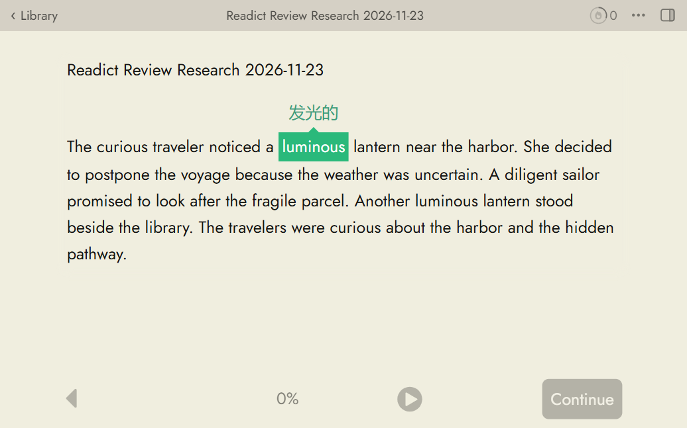
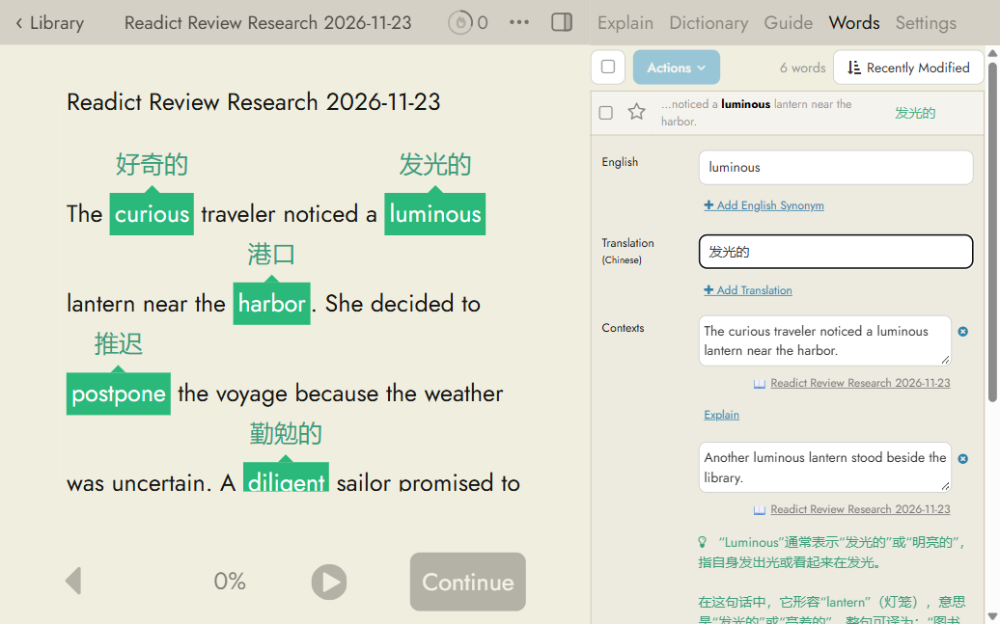
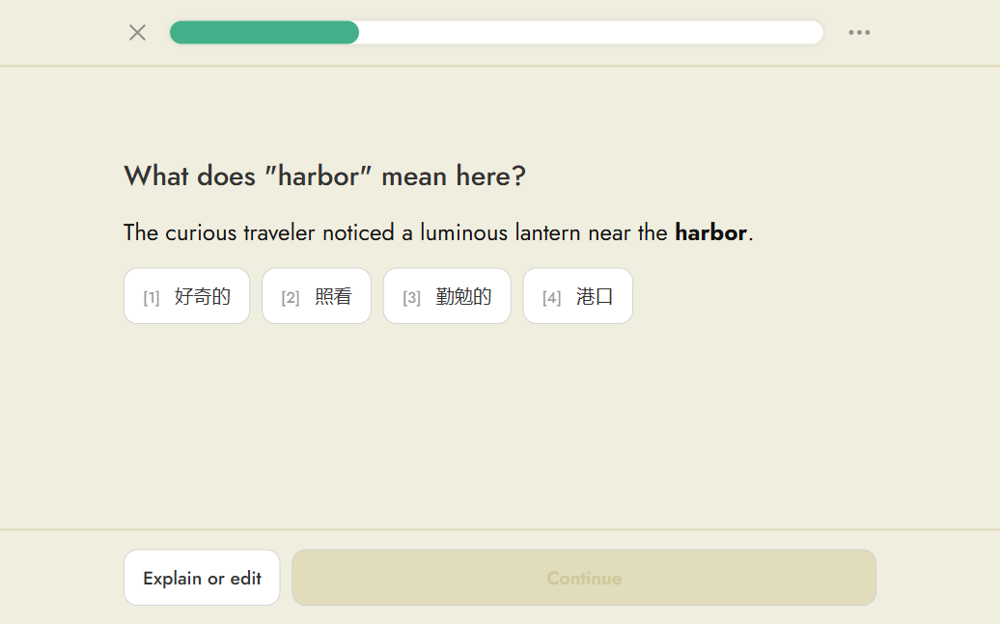
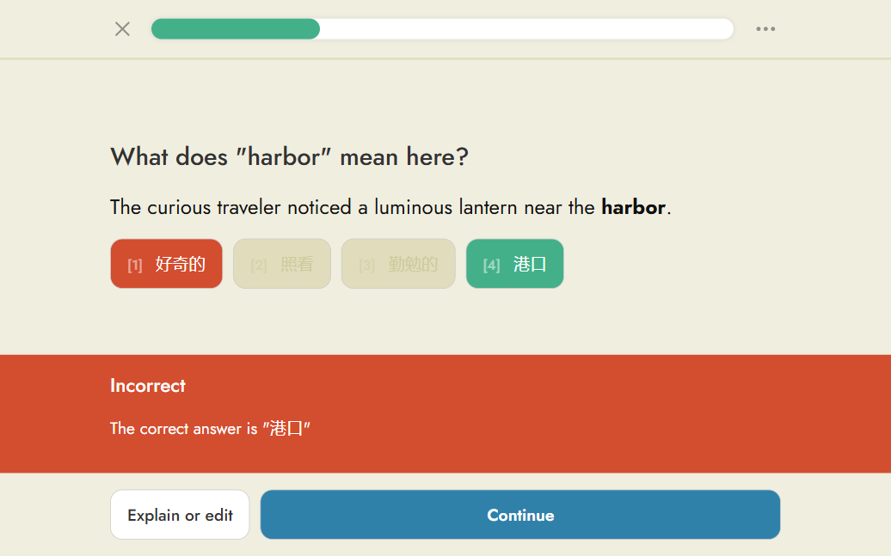
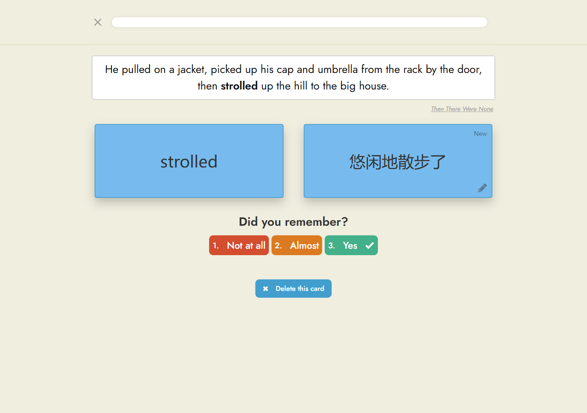
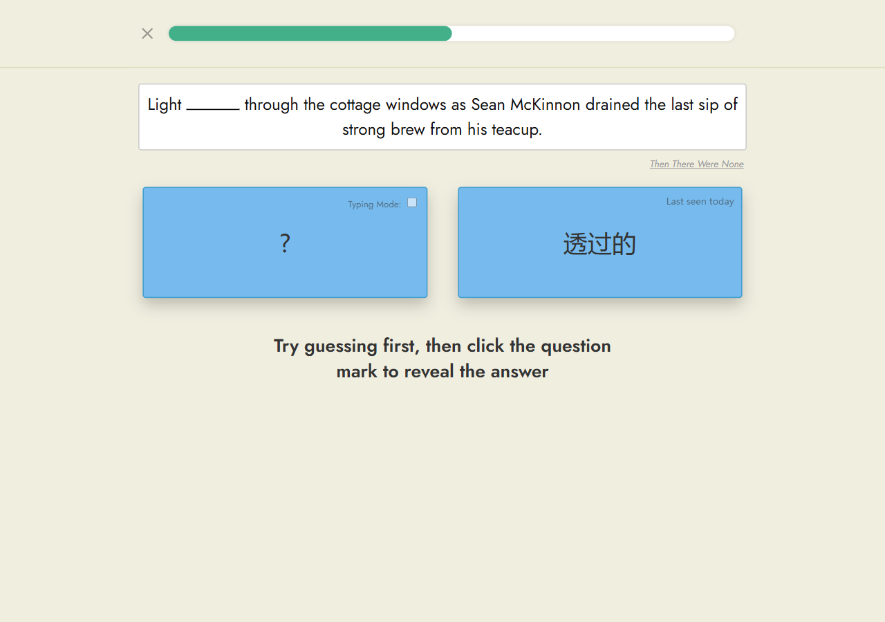
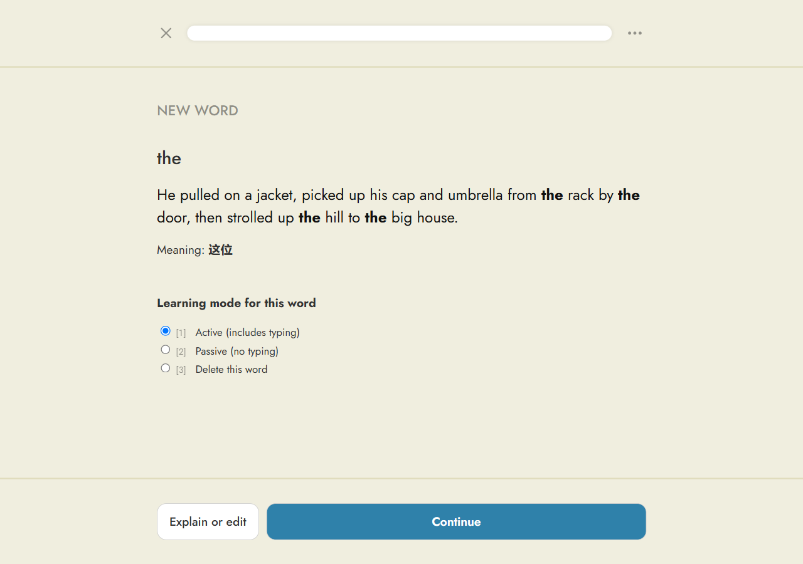
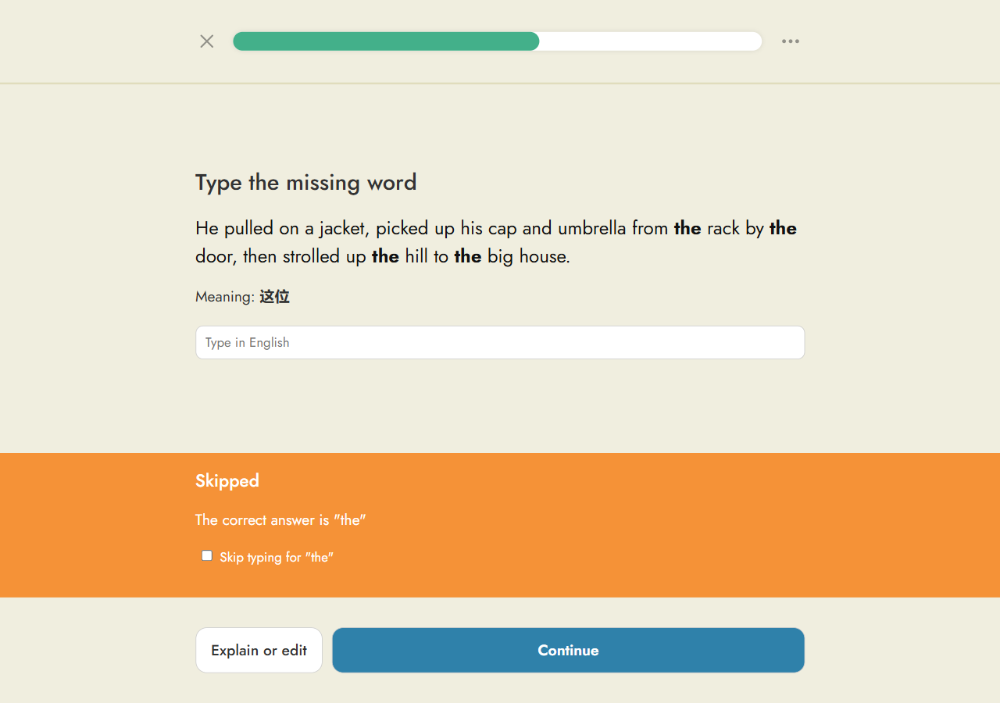
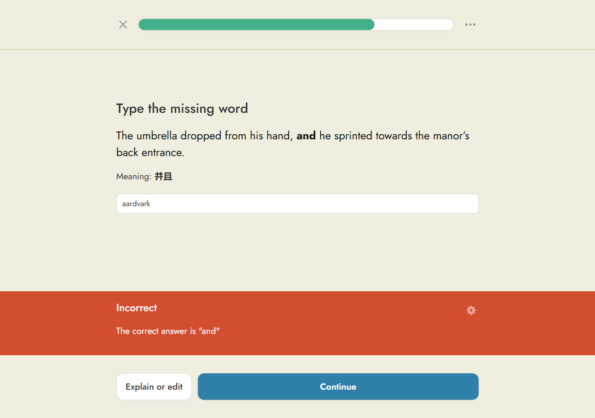
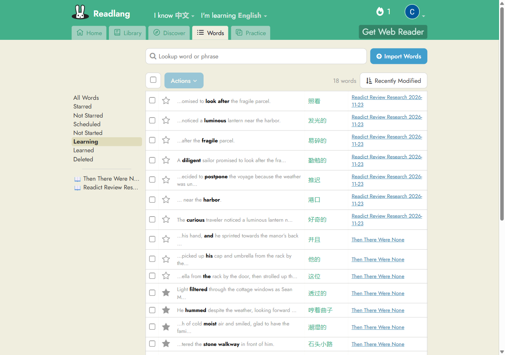

# Readlang：单词学习与复习功能研究

任务：`RESEARCH-REVIEW-01`；调查日期：2026-11-23（Asia/Shanghai）；报告状态：阶段一调查交付，待人工评审。

## 1. 调查条件与覆盖

实际操作工具打开的独立 Chrome 会话，由用户自行登录。未读取或复制原 Chrome 的凭据。学习语言 English、母语中文；当前账号为 **Free Limited**（来源筛选升级弹窗明确标 Current plan）。网页未给出可核实的构建版本，以调查日期和截图标识本次版本。窗口初为约 1036×647，后改为 1280×900，窗口变化产生过文本分页变化。

完成三种模式的正常闭环：**Blitz 7 个新条目、Classic 4 个条目、Mastery 4 个条目**。账号进入前已经有 48 个词、今日已练 3 词；本次自建英语短文，查出 6 个单词和 1 个词组，词表增到 55。三组结束后的今日数量分别是 10、14、18；这是在已有 3 的基础上增加，不是本次从零练了 18 个词。

证据记号 O/D/I/Q 与来源见[证据索引](../evidence/index.md)；`RL-O-13` 对应截图前缀 13。[会话记录](../evidence/readlang/session-log.md)保留具体输入、自评和退出序列；[部分连续观察记录](../evidence/readlang/observed-states.json)只覆盖部分自动记录片段，不冒充全程录屏。

## 2. 单词如何进入学习与复习体系

### 2.1 实测：阅读查询会直接积累词条

1. Library → Upload → Paste Text。输入名为 Readict Review Research 2026-11-23 的自建短文，类别 Other，勾选 AI 生成标记，不公开分享，上传后从 Library 打开。
2. 点击正文 luminous，译文“发光的”出现在词上方；没有再点独立保存按钮。（O：RL-O-04）
3. 同样查询 curious、harbor、postpone、diligent、fragile。再点另一个句子中的 luminous，侧边栏 Words 显示 **6 words**，不是 7；展开 luminous，Contexts 下有两条不同原句和同一文本来源。（O：RL-O-05）
4. 在可见正文中拖选 look after，译为“照看”，作为一个词组条目积累。窗口重排后文本分了页，翻到包含该短语的页面后完成拖选；首次因翻页/重排未成功的尝试不算功能结果。
5. 在末页点击 Continue，Finished 页显示 52 words read、7 translated，并提供“Practice 7 words you translated”。点击后确实进入仅该文样本的练习。（O：RL-O-06、07、10 的 DOM 观察记录）
6. 回 Words，全局总数从 48 变成 55，新增 7 个条目。**阅读点击积累与 Favorite/Starred 是不同动作。**（O：RL-O-03、24、28；全局 55 见会话记录和升级弹窗底层词表观察）

本次仅证明 luminous 的同形重复查询合并且可保留多语境，没有验证 traveler/travelers 等词形归并、不同义项是否拆词、不同翻译语言的身份规则。

### 2.2 其他入口与限制

- 首页有 Start practice 和 Customize practice；顶部 Practice 进入参数页，Words 管理已有条目。（O：RL-O-01、02）
- Words 有 Lookup word or phrase、Import Words；本轮没执行 CSV 导入，不能写成已验证导入规则。
- 单选 luminous 的复选框 → Actions → **Practice Words**，可以立刻进入指定词练习，包括已参与此前练习的词。此标签与历史帮助中的 Practice Flashcards 不同。（O：RL-O-25、26；菜单记录）
- 点击词表中的文本来源筛选，当前账号弹出 **Upgrade to filter by source...**，并说明按特定书籍练习或导出属于 Premium。本轮没有购买。（O：RL-O-23）
- “读完短文后 Practice 7 words”在本次确实可用，而词表来源筛选要求升级。二者入口行为不同，不能把任何一条观察推广为“免费账号所有来源练习都可用/都不可用”。

## 3. 练习如何组织

Practice 页提供三类参数：

|参数|本次实际可见内容|边界|
|---|---|---|
|Mode|Blitz (no typing)、Mastery (with typing)、Classic Flashcards|三种均实际完成；不是同一流程的不同名字|
|Length|4、8、15、25，以及最后一个随当前可用量变化的选项（初见 45，后见 41/37）|不是题目次数；同词可反复测试|
|Source|All，显示 words ready；打开选择窗口可见 All Words 与最近文本|指定来源的可用性受当前版本/账号限制，不能只按旧帮助判断|

设置页的 Flashcard mode 当前为 **Mix of Active and Passive Recall**；另有 Passive Recall Only、Mainly Active Recall。页面明确说明首次先被动回忆、设置影响后续出现，适用于 Classic 与 Mastery；这属于当前 UI 的文字说明，未逐项改设置验证效果。（O：RL-O-29 与会话记录）

首页还显示阅读 500 词或练习 10 张卡保持 streak 的目标。它是连续学习目标，不能等同于“每日清空所有待复习词”的强制任务。（O：RL-O-01）

## 4. 三种模式的实际流程

### 4.1 Blitz：首次接触、选择题、系统判分

1. 从阅读结束页进入该文的 7 条目练习。先出现 NEW WORD：单词、目标加粗的完整原句、Meaning 中文、Explain or edit、Continue；此时先看答案而非立即测验。（O：RL-O-07）
2. 多个新条目介绍与后续题目交错出现；词组有 NEW PHRASE 标签。不是把所有介绍集中结束后才统一开始测试。（O：连续观察记录）
3. 出题方向既有“英文在此处是什么意思”，也有“哪个英文表示给定中文”；原句保留，反向题可用缺词位组织回忆。选择按钮有 [1]～[4] 数字提示。（O：RL-O-08、观察序列）
4. harbor 故意选“好奇的”：所选项红色、正确项绿色，选项锁定，底部 Incorrect 和正确答案；Continue 由禁用变可用，点击后进入下一题。（O：RL-O-09）
5. 正确选择显示 Correct!；同词可重复出现。harbor 错后，中间依次完成 diligent、curious、postpone、fragile 四道作答，并看过 look after 的首次介绍，之后 harbor 再次出现。随后一次正确后又在本轮出现，说明一次答对也不必然结束该词。（O：观察序列；时间约 01:34:07～01:36:31）
6. 本轮最终出现 Session complete，跳回 Practice 参数页；今日已练由 3 变 10。下方词表列 Word、Translation、Next due；多数本轮词为 Today，diligent 为 Tomorrow。（O：RL-O-11 与结算 DOM 记录）

Blitz 本轮没有手动“认识程度”按钮，反馈来自选项作答。不能把选择题猜对视为用户确实能脱离提示回忆。

### 4.2 Classic：先回忆、再揭示、再自行判断

1. 参数页选择 Classic、4 words、All，点击开始。卡片上方是真实来源句子与书名链接；左卡显示英文 strolled，右卡“？”和 New。（O：RL-O-12）
2. 点问号才显示中文译文与编辑图标，再出现 Did you remember?。当前实际只有 **Not at all、Almost、Yes 三个自评按钮**，还有 Delete this card。（O：RL-O-13）
3. 本轮依次提交 strolled→Not at all，filtered→Almost，moist→Yes，brew→Yes；每次反馈直接切换卡片，没有再点 Continue。
4. strolled 在另三词之后再现，标签由 New 变 Last seen today。本轮第二次仍选 Not at all；filtered 随后以**英文填空、中文已知**的反向题出现，左卡“？”上还可见 Typing Mode 复选框。点左问号揭示后，仍是三种自评。（O：RL-O-14、15）
5. filtered→Yes，再次 strolled→Yes 后本轮结束，今日总数变 14，可练总数从 45 变 41。（O：RL-O-16）

对连续遗忘的实际序列是 `strolled 不会 → 另三词 → strolled 不会 → filtered → strolled 会`。两次 Not at all 都没有导致该词永久移除；也没有用系统输入答案来自动判分。

**官方资料差异**：2024-06-05 的 Classic 帮助写四级评价和数字 1～4，本次 UI 为三级。报告保留旧说明作为 D，不使用旧标签覆盖当前 O；尚未核实是否存在设置、语言或灰度差异。（[RL-D-01](https://forum.readlang.com/t/learn-words-with-flashcards/54)）

### 4.3 Mastery：按词学习目标与输入测试

1. 选择 Mastery、4 words、All。首次介绍 the 时，原句、中文含义下方有 Active (includes typing)、Passive (no typing)、Delete this word，默认 Active；Continue 加载稳定后可用。（O：RL-O-17）
2. 本轮 the、and、his 保持 Active，词组 stone walkway 改为 Passive。每词目标不必全部相同。
3. 先经历选择题，再进入 Type the missing word：原句目标被空格遮住、Meaning 中文、英文输入框、Show Hint、Explain or edit。（O：RL-O-18）
4. 对 the **空输入按 Enter**：显示 Skipped、正确答案及“Skip typing for the”复选框，继续按钮可用。本轮未勾该项，而是在后续再现时正常输入。（O：RL-O-19）
5. 对 and 输入 aardvark 按 Enter：显示 Incorrect 和正确答案 and；框禁用，需点 Continue。（O：RL-O-20）
6. 对 his 输入大写 HIS：显示 Correct!。只确认此样本大小写差异被接受，不据此推导所有大小写、拼写容错或词形变化规则。（O：RL-O-21）
7. the 与 and 后续再现，分别输入正确答案后完成。本轮 stone walkway 按 Passive 走选择题，没有出现输入题；结束今日总数变 18，可练 37。（O：RL-O-22、观察序列）

本轮没有用错别字、标点、同义词或错误词序建立完整判分边界；Show Hint 按钮与跳过输入选项确认存在，其更多状态待验证。

## 5. 退出、重新练习、编辑与词表状态

|任务|实际操作与结果|不能据此确认的部分|
|---|---|---|
|指定词立即练习|选中 luminous → Actions → Practice Words，进入该词题面|其他模式、批量上限、所有未到期词的行为未全测|
|未答退出再进|该题不作答点 Close，返回 Practice 参数页；重新从 Words 指定同词后仍问 luminous，干扰选项已变化|不是原批次精确恢复；不能证明完整中断会话已持久化|
|星标|练习菜单 Favorite word，返回 Starred 筛选可看到 luminous 实心星|星标对具体调度权重和每日出现概率 Q|
|编辑|阅读词条展开可编辑英文、译文、多条 Contexts，并有添加同义词、译文、笔记、图片地址入口|本轮未修改词义后再对比判分；保存和回滚规则 Q|
|状态筛选|All Words 55、Learning 18、Not Started 37；Learned 和 Scheduled 本次均为 0；还有 Deleted|Learning 不等于已经长期掌握；Scheduled 的精确定义和时间边界 Q|
|删除/重新学习|Classic 有 Delete this card，新模式菜单有 Delete word，词表 Actions 有 Delete/Export/Practice Words|未执行删除或重置，恢复能力与对历史记录影响 Q|

单词总量、可练量、今日练过量、题次数不相同。本轮数字关系为 48→55 个词、今日 3→10→14→18、可练 45→45→41→37。它们是不同时间点的 UI 结果；尤其 Next due=Today 不等于此刻立即可练，也不能由这些样本反推定时算法。

## 6. 原句、释义、发音与词组如何参与

- **原句**：阅读时保存，词条可有多条；测试会显示真实来源句或挖空句，Classic 有来源书名链接。本轮未比较多条语境在所有模式里的选择概率。
- **语境释义**：阅读的短译文进入练习；首次介绍和 Explain or edit 提供检查机会。the 的既有译文为“这位”，本轮按产品原数据测试，并不表示研究认可该译文准确。学习者可能把不合适的译文练熟，这是进一步研究的问题。
- **解释与扩展信息**：luminous 详情可见中文解释，词条有更多译文/同义词与笔记入口；不把 AI 解释等同于经词典核验的准确词义。
- **词组**：look after 作为一个条目，有独立首次介绍、两个方向的选择题；stone walkway 可单独设 Passive。
- **声音**：本次菜单 Auto-Pronounce 为禁用状态，Sound effects 为勾选。原因未确认，不能声称当前账号实际播放了词语音频。没有进行听感验收。旧官方声音说明不能覆盖此状态。（O：RL-O-27）
- **辅助异常**：控制台有 smartDictionary 的 cacheOnly 查询 404；实际练习和部分解释仍成功。只将其记为辅助查询现象，不断言用户界面全部失败，不读取隐藏调度数据验证算法。

## 7. 业务规则、官方材料与待验证问题

官方历史说明支持三种模式、指定词练习、星标提高优先级及调度受作答影响；具体公式、权重和当前参数未公开确认。官方说 Classic 的调度受 SM2 启发，这不是本次发现 Readlang 采用某个精确实现，更不是 Readict 应采用该算法的建议。（[RL-D-01](https://forum.readlang.com/t/learn-words-with-flashcards/54)、[RL-D-02](https://forum.readlang.com/t/how-do-i-use-the-practice-tab/4481)、[RL-D-03](https://forum.readlang.com/t/how-do-i-add-words-to-practice/454)）

|问题|当前可知|进一步验证|
|---|---|---|
|Q-RL-01 词条身份|同形 luminous 合并、多语境保留|不同词形、不同词义和跨文本对照|
|Q-RL-02 当前自评级数|本轮 Classic 三按钮；旧帮助四级|其他账号、语言、设置或维护者说明|
|Q-RL-03 来源与付费|词表来源筛选升级；读完短文练 7 词成功|Premium 账号与不同入口复测；旧“至少 6 词”仅作官方说明|
|Q-RL-04 调度与状态|Today/Tomorrow、Learning/Not Started 可见|跨日回访、Scheduled/Learned 进入条件；不猜公式|
|Q-RL-05 输入判分|空答 Skipped、错答 Incorrect、HIS 正确|拼写、标点、词形、容错设置与纠正判分|
|Q-RL-06 退出持久化|未答退出后重启该词，题面重新生成|反馈已提交但未 Continue 时、网络失败、刷新和换设备|
|Q-RL-07 发音|Auto-Pronounce 禁用，未验听感|浏览器语音支持、账号/设置和真实播放分别核实|
|Q-RL-08 管理后果|编辑/删除/导出入口可见|删除恢复、历史保留、导入去重和重新学习重置|

## 8. 对 Readict 的候选研究机制

原句转回忆题、一个词多语境、首次检查词义、按词区分识别与主动输出、即时反馈与课后词表管理值得进一步研究。候选价值不等于采用结论。

最需保留的定位差异是：Readlang 的阅读查询会积累词条，Readict 当前只有主动收藏才保存；Readlang 的主动/被动目标也不能直接要求 Readict 读者增加拼写负担。下一阶段应先分析这些机制与真实阅读习惯的适配，再决定产品范围。
